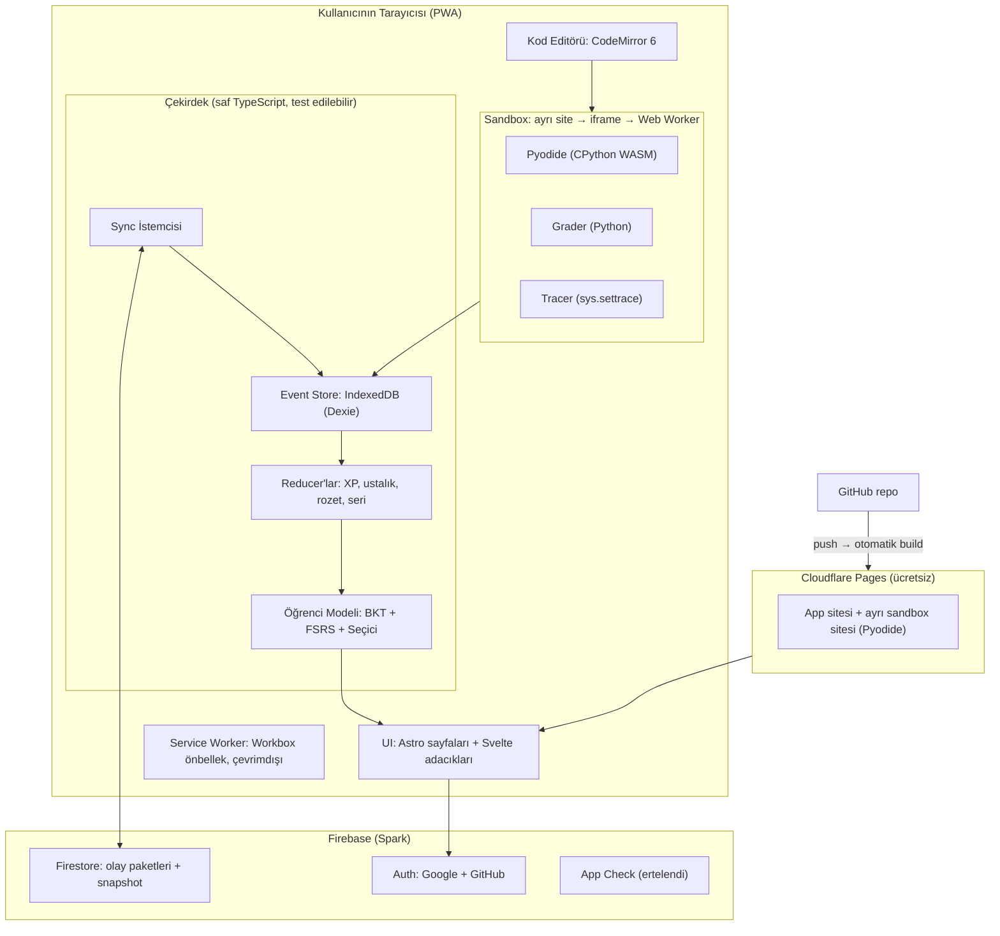
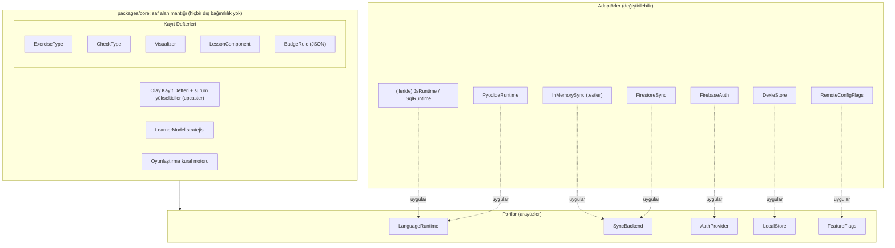
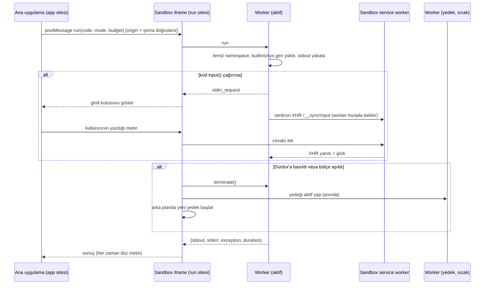
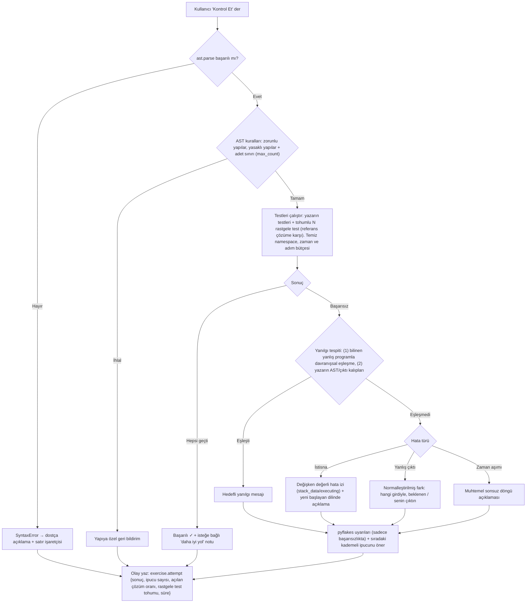
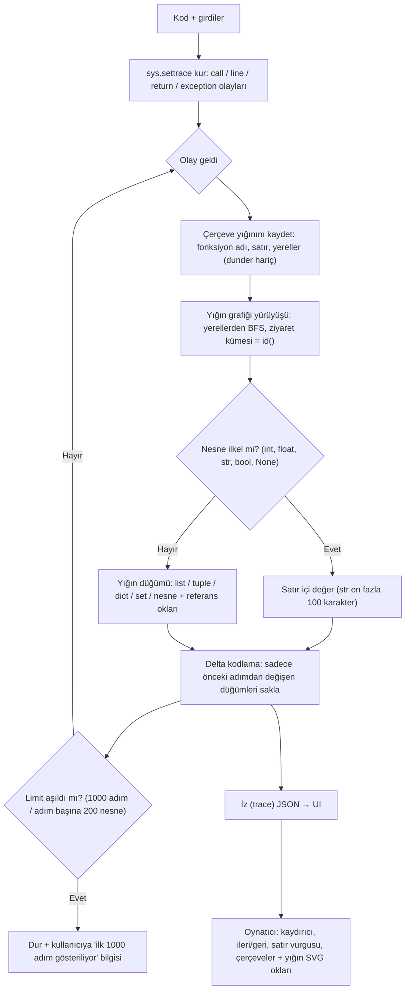
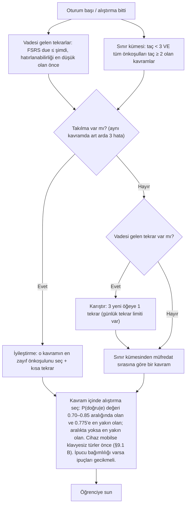
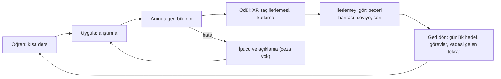
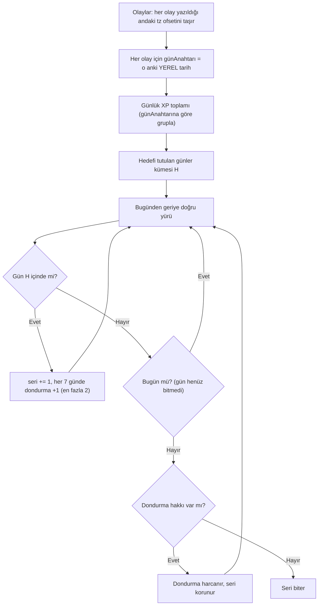
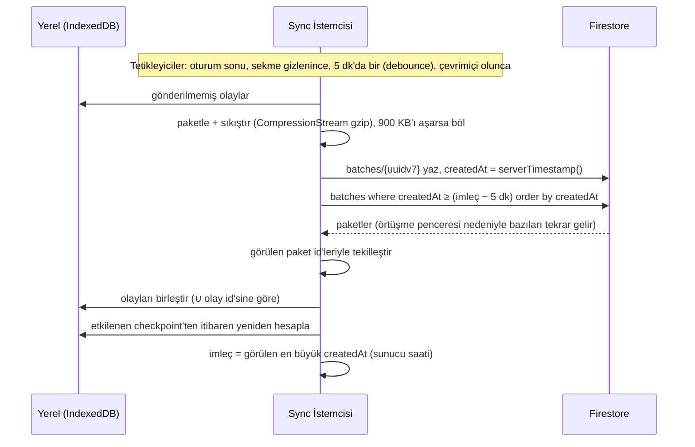
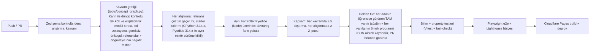

# Python Öğrenme Sistemi — Ana Plan (v0.20)

> v0.20: **F3.4 tamamlandı:** CodeMirror editörü + mobil sembol çubuğu + Storybook. Bulgu: sıkı CSP CodeMirror'ın `<style>` elemanlarını engelliyordu ve editör stilsiz görünürken testler geçiyordu. Editör artık gölge kökte çalışıyor (CSP'de `'unsafe-inline'` stil yok, sadece `style-src-attr`). JS bütçesi üç kategoriye ayrıldı (ilk boyama 50 KB, adacıklar 60 KB, tembel 160 KB) ve hiçbir parçanın sayılmadan kalamayacağı kuralı eklendi. Her Storybook hikâyesi 3 temada axe ile taranıyor ve tarama her koşuda kendini test ediyor (`docs/05-f3-mvp0.md` §5, §8).
> v0.19: **F3.2b tamamlandı:** `fill-gap` türü (her kutucuk çalıştırılıyor, belirsiz soru CI'da reddediliyor, yanlış kutucuk geri bildirimi otomatik) ve ders manifestoları (adımlar, kurallar, örnek çıktıları önceden hesaplanıyor). İlk ders: `vars.use`.
> v0.18: **K18:** Ders adım adım akan kartlara dönüştü (Duolingo tarzı etkileşim kalıpları, kendi görsel kimliğimizle). Oyunlaştırmanın temeli (XP, seri, günlük hedef, öğrenme yolu, ders sonu ekranı) F7'den MVP-0'a alındı. Yeni alıştırma türü `fill-gap`. Ayrıntılar `docs/05-f3-mvp0.md` §13. Can/kalp, mağaza ve ligler yine yok (§3.5.1).
> v0.17: **F3.3 tamamlandı:** hata açıklayıcısı v1. 18 yapısal kural, öğrenciye i18n üzerinden sade İngilizce açıklama. Hem "Kontrol Et" hem "Çalıştır" hatalarında gösteriliyor. Python testleri artık Pyodide'de de CI'da koşuyor (43 test).
> v0.16: **F3.2 tamamlandı:** tek grader (`packages/grader/educrs_grader.py`) hem tarayıcıda hem CI'da çalışıyor; içerik hattı alıştırmaları Pyodide'de çalıştırıp paketi ve golden dosyalarını üretiyor, CI'da CPython 3.14 aynı sonucu vermek zorunda; e2e'de tarayıcı notu golden dosyalarla birebir aynı. Hata fırlatan referans çözüm artık içerik hatası. Notlandırma zaman aşımı worker'ın açılışını da kapsıyor (kararsız test kök nedeni). iPhone emülasyonundaki kararsız testlerin kök nedeni gerçek bir iOS sorunu çıktı: 16 px altı form alanları odaklanınca sayfa yakınlaşıyor. Dar ekranlarda alanlar artık 16 px.
> v0.15: **F3.1 tamamlandı:** sandbox protokolü v1 (el sıkışma + origin izin listesi, mesajlar asla `"*"`'e gitmiyor), notlandırma her zaman taze worker'da (`worker_runs: 1` ile kanıtlı), önizlemeler sandbox'ı kullanabiliyor. e2e 72/72 (18 test × 4 tarayıcı).
> v0.14: F3 kararları (K15–K17): dış kullanıcı testi yok, proje sahibi kendisi değerlendiriyor; içerik incelemesi örnekleyerek; `shell.expressions` M1'de ön tanıtım. F3 tasarımı onaylandı, F3.1 başladı.
> v0.13: F3 (MVP-0) tasarımı yazıldı: `docs/05-f3-mvp0.md`. İçerik formatı, notlandırma her zaman taze worker'da, hata açıklayıcısı v1 (15 yapısal durum), editör + mobil sembol çubuğu, önizleme origin listesi + el sıkışma, yerel olay deposu, kullanıcı testi protokolü, 8 alt faz. 3 karar bekliyor (§12).
> v0.12: **Cloudflare Pages → Cloudflare Workers (sadece statik dosya).** Cloudflare'in Git akışı artık Worker oluşturuyor. Statik dosya istekleri ücretsiz ve sınırsız, `_headers` aynen çalışıyor. Sandbox `python-educrs-run.<hesap>.workers.dev` adresinde kalıyor: `workers.dev` Public Suffix List'te olduğu için `python.educrs.com`'dan ayrı site sayılıyor (doğrulandı). İlk CI koşusu GitHub'da yeşil (PR #1).
> v0.11: F2 iskeleti kuruldu: pnpm monorepo, `packages/core|i18n|ui`, `apps/web` (Astro + Svelte, canlı Python kutusu), `apps/run` (sandbox), CI, Renovate. Bulgular: TypeScript 7 Astro/Svelte araçlarıyla uyumsuz (TS 6'ya kilitlendi); dependency-cruiser `.astro` dosyalarını okumuyor (kendi tarayıcımız eklendi); CPython 3.15 hata mesajı biçimini değiştirdi (hata açıklayıcısı mesaj metnine değil istisna türüne göre çalışmalı); Storybook F3'e ertelendi (henüz bileşen yok).
> v0.10: F1 spike sonuçları işlendi (`docs/03-f1-spike-report.md`): CSP'de `'unsafe-eval'` gerekmiyor; Firefox/WebKit için açık `claim`; önceden yüklenmiş modüllerin anlık görüntüsü; notlandırma her zaman taze worker'da.
> v0.9: Kavram grafiği tamamlandı: 173 kavram, 251 önkoşul bağlantısı, 32 yanılgı, 17 proje (`content/concepts.toml` → `docs/01-concept-graph.md`). Doğrulayıcı ve 13 negatif test hazır (`tools/`). Alıştırma tahmini ~865'e çıktı. **F0 tamamlandı.**
> v0.8: futurecoder incelemesi işlendi (`docs/02-futurecoder-review.md`). Grader yeniden yazıldı (§3.2): `program-with-inputs`, tohumlu rastgele testler, davranışsal yanılgı tespiti, kısmi çözüm açma. CI'a golden file testleri eklendi (§3.7). Yeni alıştırma türleri: `verbatim`, `predict-output`.
> v0.7: K9 değişti. Uygulama doğrudan canlı alan adında açılacak (`python.educrs.com`, onaylandı). Sandbox güvenlik nedeniyle `*.pages.dev` üzerinde kalıyor (§3.1).
> v0.6: Bütün açık kararlar verildi (K7–K14). Yol haritasına sınıf modu (F9) ve YZ öğretmen (F10) eklendi. `TutorProvider` portu tanımlandı.
> v0.5: Dış değerlendirme işlendi (§9.4): COI tamamen bırakıldı (§3.1); senkron imleci sunucu saatine taşındı (§3.6); BKT/KT-IDEM + FSRS tam tanımlandı (§3.4); ödül kuralları sürümlendi (§3.5.6); App Check ertelendi; erken MVP için yol haritası yeniden sıralandı (§8).
> v0.4: Kör nokta denetimi (§9). Kritik bulgu: kullanıcı kodunun ayrı bir origin'de çalıştırılması gerekiyor. Mobil, hukuk, içerik döngüsü, sınıf modu ve Pyodide sınırları eklendi.
> v0.3: Arayüz sistemi ve kütüphane seçimi eklendi (§2.4; sürümler npm'den doğrulandı). Oyunlaştırma algoritmalarıyla birlikte genişletildi (§3.5).
> v0.2: Genişletilebilirlik mimarisi eklendi (§2.3); repo yapısı ve yol haritası buna göre güncellendi.

> Durum: **F2 iskeleti kodda tamamlandı (v0.11), `pnpm run check` yerelde tamamen yeşil. GitHub deposu ve Cloudflare projeleri senin onayını ve adımlarını bekliyor (`docs/04-deploy.md`).** Bu belge sistemin tek doğruluk kaynağıdır.
> Her algoritma haritası (diyagram) koda dönüşmeden önce burada onaylanır, kod
> yazıldıktan sonra da otomatik testlerle bu haritaya karşı doğrulanır.

---

## 0. Kararlar (kullanıcı tarafından verildi)

| # | Konu | Karar |
|---|------|-------|
| K1 | Platform | Web + çevrimdışı (PWA) |
| K2 | İçerik dili | Sadece İngilizce (kod tanımlayıcıları da İngilizce; plan belgeleri Türkçe) |
| K3 | Özellikler | Otomatik kontrollü alıştırma, adım adım görselleştirici, uyarlanabilir öğrenme yolu, projeler + oyunlaştırma |
| K4 | Kullanıcılar | Herkese açık, hesaplı (cihazlar arası senkron) |
| K5 | Altyapı | **Cloudflare Workers, sadece statik dosya** (GitHub entegrasyonuyla deploy; v0.12'ye kadar Pages planlanmıştı) + **Firebase** (Auth + Firestore) |
| K6 | Maliyet | Firebase **Spark** planında kal; bir özellik gerçekten gerektirirse Blaze'e geçilebilir |
| K7 | Site çatısı | **Astro + Svelte 5** |
| K8 | Giriş sağlayıcıları | **Google + GitHub** |
| K9 | Alan adı | **Doğrudan canlı alan adı:** uygulama **`python.educrs.com`** adresinde açılır (onaylandı; educrs.com DNS'i zaten Cloudflare'de). **Sandbox bilerek `python-educrs-run.<hesap>.workers.dev` üzerinde kalır** (§3.1). PR'lar `workers.dev` önizleme adreslerine gider. |
| K10 | Firebase projesi | **Yeni proje.** Identity Platform'a yükseltilmeyecek. |
| K11 | YZ öğretmen | **Evet, iki kaynak birden:** destekleyen tarayıcıda cihaz-üstü YZ, desteklemeyende Firebase AI Logic (Gemini ücretsiz katmanı). İsteğe bağlı, Sokratik, kota dolunca kibarca kapanır. **13 yaş altı ve hesapsız kullanıcılar sadece cihaz-üstü YZ kullanır**, yani verileri cihazdan çıkmaz. → F10 |
| K12 | Lisans | **Açık kaynak:** kod MIT, içerik CC BY-SA 4.0. Repo herkese açık. Topluluk katkısı CI doğrulamasıyla kabul edilir. |
| K13 | Sınıf modu | Senkronizasyondan hemen sonra (**F9**). Veri modeli şimdiden buna uygun hazırlanır. |
| K14 | Yaş politikası | **13 yaş altı hesapsız modda kalır.** Hesap açarken yaş beyanı istenir, hesapsız mod tam özelliklidir. |
| K15 | F3 değerlendirmesi | **Dış kullanıcı testi yok.** Proje sahibi (İngilizcesi C1) MVP-0'ı kendisi dener. Bilinçli olarak kaybedilen: yeni başlayan sinyali (`docs/05-f3-mvp0.md` §9) |
| K16 | İçerik incelemesi | Taslakları Claude yazar, proje sahibi örnekleyerek inceler. Doğruluk CI'da otomatik |
| K17 | `shell.expressions` | M1'de ön tanıtım (`print(2 + 3)`), sayılar M3'te |
| K18 | Oyunlaştırılmış akış | Ders **adım adım kartlar** (tek seferde tek adım, alttan geri bildirim paneli). XP, seri, günlük hedef, öğrenme yolu ve ders sonu ekranı **MVP-0'da**. Seviye, rozet, görev ve taç F7'de. Duolingo'dan sadece etkileşim kalıpları alınıyor, marka ve görsel değil. Can/kalp sistemi yok (`docs/05-f3-mvp0.md` §13) |

## 1. Temel İlkeler

1. **Sıfır sunucu maliyeti:** Python kodu kullanıcının tarayıcısında çalışır (Pyodide/WebAssembly). Sunucu tarafında kod çalıştırma *yok*.
2. **Local-first (önce yerel):** Uygulama hesap olmadan da, internet olmadan da %100 çalışır. Hesap yalnızca senkron ve yedek içindir. Firebase kotası dolsa bile kimse dersinden olmaz.
3. **Olay kaynaklı veri (event sourcing):** Kullanıcının her eylemi değişmez bir olaydır. XP, ustalık, rozet gibi her şey bu olaylardan *deterministik* olarak hesaplanır. Böylece senkron çakışmasız olur ve hata ayıklama kolaylaşır.
4. **Her algoritma kanıtlanır:** Her çekirdek algoritmanın (1) bu belgede bir haritası, (2) birim testleri, (3) özellik tabanlı testleri (property-based, `fast-check`) bulunur. Haritayı "tekrar tekrar kontrol etmek" bu demek: CI her commit'te haritanın değişmezlerini (invariant) test eder.
5. **İçerik de koddur:** Dersler ve alıştırmalar repoda durur. CI her alıştırmanın referans çözümünü gerçekten çalıştırıp doğrular.
6. **Yeni başlayanı asla yalnız bırakma:** Her hata mesajı insan diline çevrilir, her alıştırmada kademeli ipucu vardır, takılma algılanınca sistem önkoşul konuya geri yönlendirir.

---

## 2. Sistem Mimarisi



### 2.1 Teknoloji Yığını ve Gerekçeler (ADR özeti)

| Katman | Seçim | Neden | Elenen alternatifler |
|---|---|---|---|
| Site çatısı | **Astro** (static output) + **Svelte 5** adacıkları | Dersler büyük oranda statik içerik; Astro sıfır JS ile gönderir, sadece interaktif parçalar (editör, görselleştirici) JS yükler → en hızlı ilk açılış | Next.js (ağır), saf SPA (SEO ve ilk yük kötü) |
| İçerik | **MDX** + Astro Content Collections + **Zod** şema | Ders içine `<Exercise>`, `<Visualize>`, `<Quiz>` bileşenleri gömülebilir; şema build anında doğrulanır | CMS (maliyet + dışa bağımlılık) |
| Editör | **CodeMirror 6** | Monaco'dan ~10 kat hafif, mobil ve dokunmatik desteği iyi, erişilebilir | Monaco (mobilde kötü, 2MB+) |
| Python | **Pyodide 314.x = Python 3.14.2** (sürüm sabitlenir, sandbox sitesinden sunulur) | Gerçek CPython; `ast`, `sys.settrace` çalışır; çevrimdışı önbelleklenebilir | Skulpt/Brython (gerçek Python değil, davranış farkları öğretimi bozar) |
| Yerel veri | **IndexedDB + Dexie** | Büyük, kalıcı, asenkron; `navigator.storage.persist()` ile silinmeye karşı korunur | localStorage (5MB, senkron, kırılgan) |
| Aralıklı tekrar | **FSRS** (`ts-fsrs`, MIT) | Bilinen en isabetli açık kaynak zamanlama algoritması | SM-2 (eski, daha az isabetli) |
| Ustalık | **Bayesian Knowledge Tracing (BKT)** | Basit, açıklanabilir, az veriyle çalışır | Derin öğrenme tabanlı KT (veri ve hesap gerektirir) |
| PWA | **@vite-pwa/astro** (Workbox) | Hazır önbellek stratejileri, güncelleme akışı | Elle yazılmış SW (hata riski) |
| Hosting | **Cloudflare Workers, sadece statik dosya** (GitHub entegrasyonu; v0.12), **iki Worker:** app (`python.educrs.com`) + sandbox (`python-educrs-run.<hesap>.workers.dev`) | Sınırsız statik bant genişliği; `_headers` ile CSP ayarlanabilir; `workers.dev` Public Suffix List'te olduğu için sandbox ayrı bir site sayılır (§3.1) | GitHub Pages (header ayarlanamaz) |
| Hesap | **Firebase Auth** (Google, GitHub) | Spark'ta ücretsiz, hazır SDK | E-posta linki (gönderim limiti), şifre (güvenlik yükü) |
| Senkron | **Firestore** (doğrudan istemciden, Security Rules ile) | Cloud Functions gerektirmez → Spark'ta kalır | Realtime DB (sorgu yetenekleri zayıf) |
| Kötüye kullanım | **Security Rules:** hız sınırı + boyut sınırı. App Check **ertelendi.** | reCAPTCHA'nın ücretsiz kotası ayda 10.000 değerlendirme ve kota aşılınca istekler hata veriyor (§9.4 D1) | App Check + reCAPTCHA (Spark'ta ölçeklenmiyor) |
| Test | **Vitest**, **fast-check**, **Playwright**, CI'da **CPython + Pyodide (Node)** | Birim, özellik ve uçtan uca testler; içerik iki Python ortamında doğrulanır | — |
| Monorepo | **pnpm workspaces** | Paketler ayrı test edilir, sınırlar net | — |

### 2.2 Repo Yapısı

```
apps/web/                 Astro sitesi (sayfalar, adacıklar, PWA)
packages/core/            Portlar (arayüzler), kayıt defterleri, olay kayıt defteri + upcaster'lar
packages/i18n/            UI metin anahtarları + çeviri yükleyici
packages/ui/              Tasarım sistemi: token'lar, temalar, sarmalanmış bileşenler (§2.4)
packages/runtime/         Worker + Pyodide köprüsü, timeout/kesme, stdin
packages/grader/          Değerlendirme motoru (Python + TS sarmalayıcı)
packages/tracer/          Adım adım izleyici (Python) + görselleştirici veri modeli
packages/learner-model/   BKT, FSRS, sonraki-öğe seçici (saf TS, %100 test)
packages/store/           Event store, reducer'lar, snapshot, sync istemcisi
packages/gamification/    XP, seri, rozet kural motoru (saf TS)
packages/content-schema/  Zod şemaları (ders, alıştırma, kavram)
content/                  Kavram grafiği, dersler (MDX), alıştırmalar
tools/content-validator/  CI içerik doğrulayıcı
firebase/                 firestore.rules, indexes, emulator ayarları
docs/                     Bu plan + ADR'ler + algoritma spesifikasyonları
```

(Genişletilebilirlik için eklenen paketler: `packages/core` ve `packages/i18n`, bkz. §2.3. Tasarım sistemi için `packages/ui`, bkz. §2.4.)

### 2.3 Genişletilebilirlik Mimarisi (Ports & Adapters + Kayıt Defterleri)

**Ana kural:** Çekirdek hiçbir somut teknolojiyi tanımaz. Pyodide, Firebase, CodeMirror ve Svelte'in hepsi birer **adaptördür**. Çekirdek sadece **arayüzleri (port)** ve **kayıt defterlerini (registry)** bilir. Yeni bir yetenek eklemek, var olan kodu değiştirmek değil, yeni bir parça takmak anlamına gelir.



**Sözleşmeler (taslak):**
```ts
interface LanguageRuntime {
  id: string;                                   // 'python'
  capabilities: { stdin: boolean; trace: boolean; interrupt: boolean };
  load(onProgress?: (p: number) => void): Promise<void>;
  run(req: RunRequest): Promise<RunResult>;
  trace?(req: RunRequest, limits: TraceLimits): Promise<Trace>;
  interrupt(): void;
}

interface ExerciseTypePlugin<Spec, Answer> {
  type: string;                                 // 'code', 'parsons', 'mcq', 'fill-blank', 'predict-output'
  specSchema: ZodType<Spec>;                    // içerik build anında bununla doğrulanır
  View: Component;                              // UI bileşeni
  grade(spec: Spec, answer: Answer, ctx: GradeContext): Promise<GradeResult>;
}

interface SyncBackend {
  push(batch: EncodedBatch): Promise<void>;
  pull(cursor: Cursor): Promise<{ batches: EncodedBatch[]; next: Cursor }>;
}

interface LearnerModel<S> {
  initial(): S;
  apply(state: S, event: Event): S;             // saf fonksiyon
  recommend(state: S, graph: ConceptGraph, now: number): Recommendation;
}

interface TutorProvider {                       // K11: 'on-device' | 'firebase-ai'
  id: string;
  available(): Promise<boolean>;                // tarayıcı desteği, kota durumu, yaş/hesap kuralı
  ask(ctx: TutorContext): AsyncIterable<string>; // akışlı cevap; ctx: alıştırma, kod, hata, kullanılan ipuçları
}
```

**"Yeni bir şey eklemek istersem neye dokunurum?"**

| Eklenecek şey | Dokunulan yer | Var olan koda dokunma |
|---|---|---|
| Yeni alıştırma türü (Parsons, çoktan seçmeli, çıktı tahmini, boşluk doldurma…) | Yeni `ExerciseTypePlugin` + kayıt defterine 1 satır | Yok |
| Yeni kontrol türü | Yeni `CheckType` | Yok |
| Yeni ders bileşeni (ör. etkileşimli diyagram) | MDX bileşen kaydı | Yok |
| Yeni rozet veya görev | JSON kural dosyası | **Kod yok** |
| Yeni ders, modül, proje | `content/` altında dosyalar | Kod yok |
| Yeni programlama dili (JS, SQL…) | Yeni `LanguageRuntime` adaptörü + o dilin grader'ı | Yok |
| Yeni arayüz dili (ör. Türkçe) | Çeviri dosyaları + `content/tr/` | Kod yok |
| Backend değişimi (Firebase → başka bir servis) | Yeni `SyncBackend` + `AuthProvider` adaptörü | Yok |
| Yeni YZ kaynağı (ör. başka bir model) | Yeni `TutorProvider` adaptörü | Yok |
| Daha iyi bir ustalık modeli | Yeni `LearnerModel` stratejisi. **Geçmiş olaylar yeni modelle baştan hesaplanır**, kimsenin ilerlemesi kaybolmaz. | Yok |
| Yeni olay türü | Olay kayıt defteri + ilgili reducer | Yok |

**Sonradan değiştirmesi en pahalı 6 şey (şimdiden kilitleniyor):**

1. **Olay şeması sürümleme:** Her olay `v` taşır. Eski olaylar **asla yeniden yazılmaz**, okunurken bir yükseltici zinciriyle (`v1→v2→v3`) güncel şemaya çevrilir. Bilinmeyen olay türleri silinmez, olduğu gibi saklanıp senkronda taşınır. Böylece eski sürümdeki bir istemci, yeni istemcinin yazdığı veriyi bozmaz (ileri uyumluluk).
2. **Kalıcı içerik kimlikleri:** `concept:for-loop`, `ex:loops/sum-to-n` gibi kimlikler bir kez verilir ve **asla yeniden kullanılmaz**. Yeniden adlandırma bir takma ad (alias) tablosuyla yapılır. Olaylar alıştırmanın `contentHash`'ini taşır, böylece alıştırma sonradan değişirse eski denemeler ayırt edilebilir.
3. **i18n altyapısı baştan:** Bütün UI metinleri anahtarla yazılır (`t('grader.passed')`), içerik `content/en/` altında durur. Bugün sadece İngilizce (K2 değişmiyor), ama yarın Türkçe eklemek bir refactor değil, sadece çeviri işi olur. Bunu şimdi yapmak neredeyse bedava, sonradan yapmak her dosyaya dokunmak demek.
4. **Mimari sınırlar otomatik korunur:** `dependency-cruiser` CI'da çalışır. Örneğin `packages/core` ve `packages/learner-model` asla `firebase`, `pyodide` veya `svelte` import edemez. İhlal varsa build kırılır. Böylece mimari zamanla aşınmaz.
5. **Özellik bayrakları:** Derleme zamanı bayrakları + Firebase Remote Config (Spark'ta ücretsiz). Yeni bir özellik önce küçük bir kitleye açılır, sorun çıkarsa koda dokunmadan kapatılır.
6. **Belgelenmiş veri dışa aktarım formatı:** Kullanıcının bütün verisi = sürümlü JSON olay listesi. Hem kullanıcıya taşınabilirlik sağlar hem de backend değişiminde göç aracı olarak kullanılır.

**Genişletilebilirlik nasıl kanıtlanacak?** Her port için baştan **en az iki uygulama** yazılır. Tek uygulaması olan bir soyutlama genellikle yanlış çıkar.
- `SyncBackend`: `FirestoreSync` + `InMemorySync` (testler bununla koşar)
- `ExerciseType`: `code` + `parsons` (F4'te ikisi birlikte yazılır)
- `LocalStore`: `DexieStore` + bellek içi sahte (fake) uygulama

**Bilinçli olarak yapmadıklarımız (aşırı mühendisliğe karşı koruma):**
- Çalışma anında dışarıdan eklenti yükleme yok. Üçüncü taraf kodu güvenlik riski olur. Eklentiler repo içinde durur ve derleme zamanında kaydedilir.
- Mikroservis yok. Soyutlama sadece ikinci bir uygulaması gerçekten olası olan yerlerde var.

### 2.4 Arayüz Sistemi ve Kütüphane Seçimi

#### 2.4.1 Kütüphane kabul kriterleri

Her bağımlılık bu listeden **tek tek** geçer. Bir maddeden kalan kütüphane alınmaz.

1. **Lisans:** MIT, ISC veya Apache-2.0. Fontlar için OFL. MPL-2.0 sadece değiştirmeden kullanılan paketlerde kabul edilir (Pyodide).
2. **Bakım:** Son 6 ay içinde sürüm çıkmış olmalı. Proje terk edilirse yerine konabilir olmalı. **İstisna:** Küçük (~500 satırın altında), kararlı ve MIT lisanslı bir kütüphane bakımsız kalmışsa repoya kopyalanıp (vendor) sahiplenilebilir. Bu durumda kendi testlerimizle korunur (ör. `sync-message`, §3.1).
3. **Erişilebilirlik:** WAI-ARIA kalıplarına uymalı, klavyeyle ve ekran okuyucuyla çalışmalı.
4. **Boyut:** Tree-shake edilebilmeli ve JS bütçesine (§2.4.4) sığmalı.
5. **Tipler:** TypeScript tipleri pakete gömülü olmalı.
6. **Uyum:** Statik çıktıyla ve Svelte 5 (runes) ile çalışmalı.
7. **Güvenlik:** Geçişli bağımlılığı az olmalı. CI'da `npm audit` ve OSV taraması çalışır.
8. **Sarmalama:** Uygulama kodu hiçbir üçüncü taraf UI kütüphanesini doğrudan import etmez, `packages/ui` içindeki kendi bileşenimiz üzerinden kullanır. Kütüphane değişirse sadece sarmalayıcı değişir (§2.3). Bu kural dependency-cruiser ile zorunlu tutulur.
9. **Güncelleme:** Sürümler kilitlenir (`pnpm-lock.yaml`). Güncellemeleri Renovate bot haftalık PR olarak açar ve PR ancak bütün testler (görsel testler dahil) yeşilse birleşir.

#### 2.4.2 Seçimler

Sürümler 22 Kasım 2026'da npm'den kontrol edildi.

| İhtiyaç | Seçim | Sürüm | Lisans | Neden |
|---|---|---|---|---|
| Site çatısı | `astro` | 7.4 | MIT | Statik çıktı, adacık mimarisi |
| UI çatısı | `svelte` | 5.59 | MIT | Küçük çalışma zamanı, runes ile net reaktivite |
| Erişilebilir bileşen ilkelleri | `bits-ui` | 2.22 | MIT | Headless (stilsiz). Dialog, menü, sekme gibi bileşenlerde erişilebilirliğin zor kısmını çözer, görünüm tamamen bizde kalır. |
| Bileşen kaynağı | `shadcn-svelte` (CLI) | 1.8 | MIT | Bileşenler npm paketi olarak gelmez, **kaynak kodu repoya kopyalanır**. Kodun sahibi biz oluruz, kara kutu kalmaz, üzerine kendi tasarım dilimizi giydiririz. |
| Stil | `tailwindcss` | 4.3 | MIT | Tasarım token'ları CSS değişkenlerinde durur. Derleme zamanında çalışır, tarayıcıya ek yük getirmez. |
| İkonlar | `@lucide/svelte` | 1.77 | ISC | Tutarlı çizgi ikon seti, tree-shake edilebilir. (Eski `lucide-svelte` paketi değil, o 2026-05'ten beri güncellenmiyor.) |
| Bildirim (toast) | `svelte-sonner` | 1.2 | MIT | Erişilebilir, shadcn-svelte ile uyumlu |
| Bölünebilir paneller (editör, çıktı, görselleştirici) | `paneforge` | 1.0 | MIT | Klavye ile boyutlandırılabilir, düzen kaydedilebilir |
| İstatistik grafikleri | `layerchart` | 2.11 | MIT | Svelte'e özgü, SVG tabanlı, erişilebilir |
| Kutlama efekti | `canvas-confetti` | 1.9 | ISC | Çok küçük, sadece kutlama anında yüklenir (lazy) |
| Etkileşimli maskot veya animasyon (ileride, isteğe bağlı) | `@rive-app/canvas-lite` | 2.54 | MIT | Durum makineli etkileşimli animasyon, sadece gerektiğinde yüklenir |
| Fontlar | `@fontsource-variable/inter`, `@fontsource-variable/jetbrains-mono` | 5.3 | OFL-1.1 | Kendi sunucumuzdan servis edilir, çevrimdışı çalışır, Google'a istek gitmez |
| Temel animasyon | Svelte'in yerleşik `transition`, `spring`, `tweened` araçları | — | — | Bağımlılık yok |
| Ses efektleri | Web Audio API (yerleşik) + CC0 lisanslı sesler | — | — | Kütüphane gerekmez |
| Rastgele sayı (görev üretimi) | Kendi `mulberry32` + `cyrb53` uygulamamız | — | — | ~20 satır, property testli |
| Bileşen dokümantasyonu | `storybook` + `@storybook/svelte` | 10.6 | MIT | Her bileşen bütün durumlarıyla belgelenir ve test edilir |

**Elenenler ve nedenleri:**
- `lottie-web`: 2025-05'ten beri güncellenmiyor ve ağır.
- `seedrandom`: 2022'den beri güncellenmiyor. İhtiyacımız 20 satırlık bir algoritma.
- Skeleton, Flowbite gibi hazır görünümlü kütüphaneler: kendi görünümlerini dayatıyorlar ve erişilebilirlik üzerinde kontrolümüz azalıyor.
- Howler.js: Web Audio API zaten yeterli.
- Monaco editör: bkz. §2.1.

#### 2.4.3 Tasarım Sistemi (`packages/ui`)

- **Token'lar tek dosyada** (`packages/ui/tokens.css`), Tailwind `@theme` bunları okur:
  - Renk: anlamsal isimler (`--color-success`, `--color-xp`, `--color-streak`, `--color-danger` …)
  - Boşluk: 4 px ızgara
  - Tipografi ölçeği
  - Köşe yuvarlaklığı ve gölgeler
  - Hareket: süreler ve eğriler
- **Temalar:** açık, koyu, yüksek kontrast. Hepsi aynı token isimlerini kullanır, sadece değerler değişir.
- **Kod editörü teması** da token'lardan üretilir, ayrı bir renk dünyası olmaz.
- **Ana ekranlar:**
  - Ana sayfa (beceri haritası)
  - Ders okuyucu
  - Pratik alanı (editör, çıktı ve görselleştirici panelleri)
  - Tekrar oturumu
  - Profil ve istatistik
  - Ayarlar

#### 2.4.4 Arayüz Kalite Kapıları (CI'da zorunlu)

| Kapı | Nasıl |
|---|---|
| Her bileşenin her durumu belgeli | Storybook hikâyesi: varsayılan, hover, focus, disabled, loading, error, empty |
| Erişilebilirlik | Her hikâye `@axe-core/playwright` ile taranır. İhlal varsa build kırılır. |
| **Kontrast matematiksel olarak garanti** | Birim test bütün metin ve arka plan token çiftlerinin WCAG kontrast oranını hesaplar (normal metin ≥ 4.5, büyük metin ≥ 3). Bir renk değişikliği kontrastı bozarsa test kırılır. |
| Görsel regresyon | Playwright, hikâyelerin ekran görüntüsünü açık tema, koyu tema ve mobil boyutta karşılaştırır |
| Performans bütçesi | **İlk boyamaya kadar** yüklenen JS ≤ 50 KB (gzip). Bu bütçeye **dahil olmayanlar** ilk boyamadan sonra tembel (lazy) yüklenir ve her birinin kendi bütçesi vardır: CodeMirror, Firebase SDK, Pyodide, görselleştirici, grafikler. Bu bütçeler F2'de ölçülüp sabitlenir. **F3.4:** sayfa başına üç kategori: ilk boyama ≤ 50 KB, adacıklar ≤ 60 KB, tembel ≤ 160 KB; `_astro/` altında hiçbir sayfadan erişilemeyen JS dosyası olursa bütçe kırmızıya döner (`docs/05-f3-mvp0.md` §5). LCP < 2 sn (orta seviye mobil); CLS < 0.05 |
| Hareket hassasiyeti | `prefers-reduced-motion` açıkken bütün animasyonlar kapanır veya yumuşar (test edilir) |
| Dokunma hedefleri | Etkileşimli öğeler ≥ 44×44 px |
| Klavye | Bütün akışlar fareye dokunmadan tamamlanabilir (Playwright e2e) |

---

## 3. Algoritma Haritaları

### 3.1 Kod Çalıştırma (Runtime) — v0.5: COI'siz mimari

**Hedefler:**
- Kullanıcı kodu arayüzü asla dondurmamalı.
- Sonsuz döngü 100 ms içinde durdurulabilmeli.
- `input()` gerçek bir girdi kutusu gibi çalışmalı.
- **Kullanıcı kodu hesaba ve ağa asla erişememeli.**

**Karar: Cross-origin isolation (COOP/COEP) kullanılmıyor.** Nedenleri:
- Safari `COEP: credentialless` değerini desteklemiyor ([caniuse](https://caniuse.com/mdn-http_headers_cross-origin-embedder-policy_credentialless), Safari 26.5'e kadar). Safari'de `require-corp` kullanmak gerekirdi. O da bütün çapraz-origin kaynakları bozar.
- COEP açıkken reCAPTCHA iframe'i ve Firebase Auth popup'ı sorun çıkarır. Redirect akışı da auth işleyicisinin kendi alan adımızdan proxy'lenmesini gerektirir.
- SharedArrayBuffer'ın bize sağladığı iki şeyin COI gerektirmeyen karşılığı var:
  - `input()` ve `time.sleep`: **service worker üzerinden senkron XHR.** Bu, futurecoder'ın `sync-message` yaklaşımı.
  - **Kesme:** `terminate()` + sıcak yedek worker. Her çalıştırma zaten temiz başladığı için kesmeyle hiçbir şey kaybedilmiyor.
- Bonus: `/auth` sayfası geçici çözümüne gerek kalmıyor, normal popup girişi çalışıyor.



**İzolasyon kuralları:**
- **Sandbox ayrı bir Cloudflare Worker'ında çalışır** (sadece statik dosya, v0.12): `python-educrs-run.<hesap>.workers.dev`. `workers.dev` Public Suffix List'te olduğu için (22.11.2026'da doğrulandı) bu adres `python.educrs.com`'dan **ayrı bir site** sayılır. Tarayıcı iki sitenin depolamasını, çerezlerini ve service worker'larını tamamen ayırır. ⚠️ Kayıtlı alan adı `<hesap>.workers.dev` olduğu için aynı hesaptaki iki `workers.dev` adresi birbiriyle *aynı site* sayılır. Bu yüzden uygulama asla `workers.dev`'den servis edilmez (`workers_dev: false`).
- **Sandbox neden `educrs.com` altında değil?** (v0.7) `run.educrs.com` gibi bir adres, uygulamadan farklı bir **origin** olurdu ama aynı **site** sayılırdı (kayıtlı alan adı ikisinde de `educrs.com`). Bunun üç sakıncası var:
  1. **Süreç paylaşımı:** Tarayıcıların süreç izolasyonu (Site Isolation) siteye göre çalışır. Aynı sitedeki sandbox, uygulamayla aynı süreci paylaşabilir. Bu da Spectre tipi bellek okuma saldırılarına kapı aralar.
  2. **Ortak çerezler:** educrs.com altındaki başka servislerin `Domain=educrs.com` ile yazdığı çerezler sandbox'a da gider.
  3. **SameSite koruması:** SameSite çerez koruması aynı sitedeki sayfalar arasında devreye girmez.
  
  `workers.dev` ise Public Suffix List'te olduğu için (v0.12, doğrulandı) `python-educrs-run.<hesap>.workers.dev` tamamen ayrı bir site sayılır, üstelik ücretsiz. Kullanıcı bu adresi hiçbir zaman görmez, adres çubuğunda her zaman `python.educrs.com` yazar. İleride sandbox için ayrı bir alan adı alınırsa (ör. `educrs-run.com`) sadece bir ayar değişir.
- **Sandbox CSP:** `default-src 'self'; connect-src 'self'; script-src 'self' 'wasm-unsafe-eval'; worker-src 'self'; frame-ancestors https://python.educrs.com`. **F1'de doğrulandı:** Pyodide 314 `'unsafe-eval'` olmadan çalışıyor, `eval` kullanıcı kodu için de engelli kalıyor. Aynı başlık worker script'inin yanıtına da eklenir. Kullanıcı kodu sadece sandbox'ın kendi statik sunucusuna ulaşabilir, orada da değerli hiçbir şey yok.
- **iframe:** `sandbox="allow-scripts allow-same-origin"`. Buradaki `allow-same-origin` güvenli, çünkü iframe zaten farklı bir sitede. Service worker'ın çalışabilmesi için de iframe'in gerçek bir origin'i olması gerekiyor.
- **Mesajlaşma:** Ana uygulama iframe'den gelen her mesajı `event.origin` ve şema ile doğrular. Sandbox'a hiçbir zaman kimlik bilgisi gönderilmez.

**Çalıştırma hijyeni (her çalıştırmada):**
- Temiz bir `globals` sözlüğü oluşturulur.
- `builtins.__dict__` başlangıçta alınan anlık görüntüden geri yüklenir. Böylece `builtins.print = ...` gibi değişiklikler bir sonraki çalıştırmaya taşınmaz.
- `sys.stdout`, `sys.stderr`, `sys.stdin`, `sys.path`, özyineleme sınırı ve çalışma dizini geri yüklenir.
- `sys.modules` farkı alınıp temizlenir.
- **Önceden yüklenmiş modüllerin sığ anlık görüntüsü** geri yüklenir (F1: Pyodide açılışta 165 modül yüklüyor, geri yükleme ~1 ms). Bu, `json.dumps = None` gibi değişikliklerin bir sonraki çalıştırmaya taşınmasını önler.
- **Grader kendi referanslarını açılışta bağlar** (ör. `TracebackException`). Kullanıcı stdlib modüllerini değiştirse bile grader etkilenmez.
- **Notlandırma her zaman taze bir worker'da yapılır.** Süreç içi hijyen sadece "en iyi çaba" düzeyinde (F1'de `gc` ile sabotaj mümkün oldu, sistem fark edip worker'ı yeniledi). Sıcak yedek worker sayesinde bunun ek maliyeti yok.
- Alıştırmaya özel sanal dosya sistemi dizini sıfırlanır.
- Geri yükleme yetmezse (ör. C seviyesinde bir bozulma) worker değiştirilir.

**Yükleme:**
- Pyodide (~10 MB) **ders okunurken arka planda** yüklenir.
- Pyodide'yi sandbox sitesinin kendi service worker'ı önbelleğe alır. Sonraki açılışlar 1 saniyenin altında sürer.
- **Sıcak yedek worker** sayesinde "durdur, sonra yeniden yükle" beklemesi kullanıcıya hiç görünmez. Belleği az olan cihazlarda (`navigator.deviceMemory < 4`) yedek worker kapatılır.

**F1 sonucu:** Üçüncü taraf iframe içindeki service worker Chromium, Firefox ve WebKit'te çalışıyor. **Firefox ve WebKit'te sayfa kontrolsüz açılabiliyor**, bu yüzden host sayfa service worker'a açıkça `claim` mesajı gönderir. WebKit'te CSP'nin engellediği `fetch` hiç sonuçlanmıyor; öğrenci "Durdur" ile kurtulur, hata açıklayıcısı "ağ erişimi yok" der. **Gerçek Safari ve iOS hâlâ açık risk** (Playwright WebKit birebir Safari değil), F2'deki önizleme ortamında test edilecek.
- **Yedek yol:** Sandbox'ta service worker kullanılamazsa `input()` önceden doldurulan bir girdi kutusuyla çalışır, Pyodide de HTTP önbelleğinden yüklenir.
- **İkinci yedek aday:** Pyodide'nin JSPI desteği (`run_sync`). Destekleyen tarayıcılarda `input()` asenkron olarak çözülebilir.

**Bağımlılık notu:** `sync-message` MIT lisanslı ama son sürümü 2023'te çıkmış. Küçük bir kütüphane olduğu için kopyalama (vendor) istisnası kapsamında `packages/runtime/vendor/` altına alınır ve kendi testlerimizle korunur (§2.4.1).

**Değişmezler (testlenecek):**
- Arayüz thread'i hiçbir zaman 50 ms'den uzun bloklanmaz.
- Her `run` tam olarak bir sonuç üretir, asla askıda kalmaz.
- **Kullanıcı kodu ana uygulamanın depolamasına ve dış ağa erişemez.** CI'da Playwright ile otomatik saldırı testleri çalışır: IndexedDB okuma, dış adrese `fetch`, WebSocket açma ve sahte `postMessage` gönderme denemeleri. Hepsinin başarısız olması gerekir.

### 3.2 Değerlendirme (Grader) — v0.8: futurecoder bulgularıyla



**Kontrol türleri** (bir alıştırmada bir veya birkaçı kullanılır):

| Tür | Ne yapar | Ne zaman |
|---|---|---|
| `stdout` | Çıktıyı karşılaştırır. Normalleştirme: satır sonları, sondaki boşluklar; isteğe bağlı büyük/küçük harf ve sayı toleransı. | Her yerde |
| **`program-with-inputs`** | Program, girdi atamalarıyla başlar (`name = 'Ada'`). Grader bu satırları ayırır, programın geri kalanını **başka girdilerle** (yazarın testleri + rastgele) çalıştırır ve çıktıyı referans çözümle karşılaştırır. | **Fonksiyonlar öğretilmeden önce (M1–M9).** Böylece `print('Hello Ada')` yazıp geçmek mümkün olmaz. (futurecoder'dan, F1) |
| `function` | `solve(x) == beklenen`. Yazarın testleri + rastgele testler kullanılır. | M10'dan sonra |
| `custom` | Yazarın Python kontrol fonksiyonu (ör. "listeyi yerinde mi değiştirdi?") | Özel durumlar |
| `ast` | Zorunlu ve yasak yapılar, `max_count` ile | Yeni yapıyı pratik ettirirken (ör. "`sum` kullanma") |

**Rastgele testler (referans çözüme karşı):**
- `solution.py` içindeki `solve` fonksiyonunun tip ipuçlarından (`str`, `int`, `bool`, `list[int]`, `dict[str, int]` …) N rastgele girdi üretilir. Varsayılan N = 10.
- Öğrencinin çıktısı, aynı girdilerle çalıştırılan referans çözümün çıktısıyla karşılaştırılır.
- Rastgele üreteç `mulberry32(tohum)` ile çalışır ve **tohum olaya yazılır**. Her deneme birebir yeniden üretilebilir. Ayrıca hata raporlarında "şu girdiyle başarısız oldu" net olarak gösterilebilir.
- Yazar sınır durumlarını (boş liste, negatif sayı vb.) her zaman açık test olarak da yazar. Rastgele testler bunların yerine geçmez, ek güvence sağlar.

**Yanılgı tespiti (yanılgı kataloğuyla bağlantılı, §9.2 H):**
- **Davranışsal eşleşme:** Yazar, bilinen yanlış bir programı (ör. `range(1, n)` yerine `range(n)`) bir yanılgı kimliğiyle birlikte kaydeder. Öğrencinin çıktısı bu yanlış programın çıktısıyla **bütün testlerde aynıysa** o yanılgı teşhis edilir. AST kalıbı yazmaktan çok daha kolaydır ve yazıldığı biçimden bağımsızdır.
- **Kalıp eşleşmesi:** Davranışla yakalanamayan durumlar için AST veya çıktı kalıbı kullanılır.
- **Zorunlu kural:** Her yanılgı kontrolünün yanında **onu tetikleyen bir örnek program** bulunur. CI bu programı çalıştırıp mesajın gerçekten tetiklendiğini doğrular. Örneği olmayan yanılgı kontrolü kabul edilmez.

**Kademeli ipucu merdiveni:**
1. Kavramsal dürtme
2. Yaklaşım
3. Kısmi kod
4. **Kısmi çözüm açma:** Çözüm token token, rastgele sırayla açılır. Öğrenci istediği kadarını görür. Çözüm isteğe bağlı olarak Parsons bulmacası şeklinde de sunulabilir.

Her basamak ustalık hesabında "yardım alındı" olarak işlenir (§3.4.1). Kısmi açmada açılan oran da kaydedilir.

**Hata açıklayıcısı:**
- Hata veren satırdaki değişkenlerin değerleri gösterilir (`executing` + `stack_data`). Örnek: "`items[i]` hata verdi; o anda `i = 3`, `len(items) = 3`".
- CPython 3.14'ün kendi "Did you mean…?" önerileri olduğu gibi kullanılır.
- İlk 20 hata türü için yeni başlayan dilinde, bağlama duyarlı açıklama metinleri yazılır.

**Değişmezler:**
- Referans çözüm bütün testlerden (rastgele testler dahil) geçer.
- Başlangıç kodu (starter) testlerden kalır.
- Her yanılgı mesajı kendi örnek programıyla tetiklenir.
- Hepsi CI'da hem CPython 3.14'te hem Pyodide'de doğrulanır ve sonuçlar **golden file** olarak kaydedilir (§3.7).

### 3.3 Adım Adım Görselleştirici (Tracer)



- **Bellek:** Delta kodlama sayesinde iz boyutu O(adım × nesne) yerine O(değişiklik sayısı) olur. Geri sarmak için her 50 adımda tam bir checkpoint tutulur → herhangi bir adıma erişim O(50).
- **Kimlik güvenliği:** İz boyunca görülen her nesneye bir referans tutulur (`keepalive` listesi). Aksi hâlde çöp toplayıcı bir nesneyi silebilir ve onun `id()` değeri başka bir nesneye verilebilir. O zaman diyagramda iki farklı nesne aynı nesne gibi görünürdü. Limitler (1000 adım, adım başına 200 nesne) bu listenin belleğini sınırlar.
- **Performans:** `settrace` yavaştır. Bu yüzden sadece "Görselleştir" modunda kullanılır, değerlendirmede asla kullanılmaz.
- **Yeni başlayana özel:** Değişken ilk oluştuğunda vurgulanır, değeri değişince yanıp söner. "Aynı listeyi gösteren iki isim" (aliasing) okla açıkça görünür.

### 3.4 Uyarlanabilir Öğrenme (Öğrenci Modeli) — v0.5

**Kavram grafiği:** Her kavram (`variables`, `for-loop`, `list-indexing`, …) bir düğümdür. Önkoşullar yönlü kenarlardır. Grafik bir **DAG** olmak zorundadır (CI, Kahn algoritmasıyla doğrular).

#### 3.4.1 Ustalık: alıştırma düzeyli BKT (KT-IDEM)

Klasik BKT kavram düzeyinde çalışır, yani aynı kavramdaki bütün alıştırmalara aynı olasılığı verir. Alıştırma seçebilmek için **tahmin (G) ve dikkatsizlik (S) parametreleri alıştırma başına** tutulur. Bu, BKT'nin KT-IDEM uzantısıdır (Pardos & Heffernan, 2011).

| Parametre | Varsayılan | Not |
|---|---|---|
| `P(L0)` başlangıç bilgisi | 0.10 | Seviye belirleme testi yükseltebilir (§9.1 G) |
| `P(T)` öğrenme hızı | 0.15 | |
| `G_e` tahmin | kolay 0.25, orta 0.15, zor 0.05 | Alıştırmanın zorluğundan gelir |
| `S_e` dikkatsizlik | kolay 0.05, orta 0.10, zor 0.15 | Alıştırmanın zorluğundan gelir |

- **Sınırlar:** `G ≤ 0.3` ve `S ≤ 0.2`. Bu sınırlar dejenere modelleri (öğrenmeyi "tahmin" olarak açıklayan modelleri) önler.
- **Kalibrasyon:** Varsayılanlar sonradan anonim alıştırma istatistikleriyle (§9.1 D) yeniden ayarlanır.

**Güncelleme kuralları:**
- **Doğru cevap:** `P(L|doğru) = P(L)(1−S_e) / [P(L)(1−S_e) + (1−P(L))G_e]`
- **Yanlış cevap:** `P(L|yanlış) = P(L)S_e / [P(L)S_e + (1−P(L))(1−G_e)]`
- **İpucuyla çözüm (yumuşak kanıt):** `P(L|gözlem) = w·P(L|doğru) + (1−w)·P(L|yanlış)`. Kullanılan ipucu sayısına göre `w` şöyledir:
  - 0 ipucu → 1
  - 1 ipucu → 0.75
  - 2 ipucu → 0.5
  - Kısmi çözüm açma (§3.2): açılan oran %30'un altındaysa → 0.25, değilse → 0 (yanlış sayılır)
- **Öğrenme adımı:** Her gözlemden sonra `P(L) ← P(L|gözlem) + (1−P(L|gözlem))·T`

**Alıştırma başarı tahmini:** `P(doğru | e) = P(L)(1−S_e) + (1−P(L))G_e`

**Eşikler:**
- `P(L) ≥ 0.6` → **taç 2**. Bu kavrama bağlı sonraki kavramların kilidi açılır.
- `P(L) ≥ 0.95` → **taç 3, ustalaşıldı.** Kavram FSRS tekrar kuyruğuna girer.

**Simülasyon** (varsayılan değerler, orta zorluk). Bu tablo CI'da bir test olarak yeniden üretilir:

| Cevap dizisi | P(L) gelişimi | Sonuç |
|---|---|---|
| Doğru, doğru, doğru | 0.49 → 0.87 → 0.98 | 2 doğruda kilit açılır, 3 doğruda ustalaşılır |
| Doğru, yanlış, doğru, doğru | 0.49 → 0.24 → 0.70 → 0.94 | Bir hata yaklaşık 1,5 doğruya mal olur |
| Her doğruda 1 ipucu | … → 0.86'da durur | Kilit açılır ama hiçbir zaman ustalaşılmaz |
| Her doğruda 2 ipucu | … → **0.59'da durur** | **Kilit hiçbir zaman açılmaz** ⚠️ |

**İpucu bağımlılığı önlemi:** Bir kavramda art arda 2 ipuculu başarı olursa seçici, benzer bir alıştırmayı **ipuçları gecikmeli** olarak sunar: ipucu ancak ilk denemeden sonra açılır. Buna "iskelenin azaltılması" (scaffold fading) denir. Serbest dolaşım her zaman açık kaldığı için öğrenci hiçbir zaman kilitli kalmaz.

#### 3.4.2 Aralıklı tekrar: FSRS

- **Kart = kavram.** Ustalaşılan her kavram için bir FSRS kartı oluşturulur.
- **Tekrar öğesi:** O kavramın en uzun süredir görülmemiş alıştırması. Mümkünse önceki tekrardan farklı bir alıştırma türü seçilir.
- **Puan eşlemesi:**

| Deneme sonucu | FSRS puanı |
|---|---|
| Başarısız | Again |
| İpucuyla başarılı | Hard |
| İpucusuz başarılı | Good |
| İlk denemede, ipucusuz ve alıştırmanın medyan süresinin yarısından kısa sürede başarılı | Easy |

- **Medyan süre:** Başta yazarın tahmini kullanılır, sonra istatistiklerle güncellenir.
- **Katmanların ilişkisi:** Bir tekrar denemesi hem BKT'yi hem FSRS'yi günceller. İkisi ayrı katmanlardır: BKT bir *tahmin*dir, FSRS bir *zamanlama*dır.

#### 3.4.3 Sonraki öğe seçimi



**Değişmezler (property testleri):**
- Seçici hiçbir zaman önkoşulu taç 2'ye ulaşmamış yeni bir kavram önermez (iyileştirme modu hariç).
- Aynı olay geçmişi her zaman aynı öneriyi verir (determinizm).
- BKT simülasyon tablosu yeniden üretilir. Parametre değişikliği bu tabloyu değiştirirse PR'da görünür olur.
- Kullanıcı her zaman "serbest dolaşım" ile herhangi bir derse gidebilir. Sistem önerir, zorlamaz.

### 3.5 Oyunlaştırma

#### 3.5.1 Etik kurallar (pazarlığa kapalı)

1. **Hata asla cezalandırılmaz.** Can veya kalp sistemi yok. Yanlış cevap hiçbir zaman öğrenmeyi engellemez. Yeni başlayan için hata öğrenmenin kendisidir.
2. **Para birimi, satın alma ve reklam yok.** Yapay aciliyet, kayıp korkusunu sömürme gibi karanlık örüntüler yok.
3. **Hız değil, çaba ve ustalık ödüllendirilir.** Aynı kolay alıştırmayı tekrar tekrar çözerek XP kasılamaz.
4. **Her şey kapatılabilir.** Ayarlar'da tek tıkla "sade mod" var: rozet, ses ve kutlama kapanır, öğrenme aynen devam eder.
5. **Bütün oyun durumu olaylardan türetilir** (§3.6). Rozet, XP veya seri ayrıca saklanmaz. Bu yüzden cihazlar arasında tutarsızlık olamaz.

#### 3.5.2 Çekirdek döngü



#### 3.5.3 Öğeler

> **K18 (v0.18):** XP, seri (dondurma dahil), günlük hedef, öğrenme yolu ve ders sonu ekranı MVP-0'da (F3) uygulanıyor. Diğer öğeler F7'de.

| Öğe | Açıklama |
|---|---|
| **XP + seviye** | Her anlamlı eylem XP kazandırır. Seviye eğrisi ileride yavaşlar ama hiçbir zaman duvara dönüşmez. |
| **Günlük hedef** | Kullanıcı seçer: 10, 20, 30 veya 50 XP |
| **Seri + dondurma** | Hedefin tutulduğu ardışık günler. Dondurma hakkı satın alınmaz, her 7 günlük seride 1 tane **kazanılır** (en fazla 2 birikir). |
| **Kavram taçları (0–5)** | Her kavramın ustalık seviyesi (§3.5.4, madde 6). Taç 2 sonraki kavramların kilidini açar. Tekrarı gelen kavram haritada "çatlak" görünür. Bu bir ceza değil, nazik bir tekrar davetidir. |
| **Beceri haritası** | Kavram grafiğinin oyun haritası şeklinde gösterimi. Uygulamanın ana gezinme ekranı. |
| **Günlük görevler** | Her gün 3 kişiselleştirilmiş görev (ör. "2 tekrar yap", "ipucusuz 1 alıştırma çöz") |
| **Rozetler (kademeli)** | Bronz, gümüş, altın. JSON kurallarıyla tanımlanır, kod gerekmez. |
| **Projeler** | Modül sonunda kilidi açılan çok adımlı rehberli projeler (Tahmin Oyunu, To-Do CLI, Metin Macerası). Her adım normal bir alıştırmadır. Dosyalar Pyodide'nin sanal dosya sisteminde durur. |
| **İstatistik** | Aktivite ısı haritası, kavram ustalık dağılımı, toplam çalışma süresi |
| **Kutlamalar** | Seviye atlama, rozet, seri dönüm noktaları. Kısa sürer, rahatsız etmez. `prefers-reduced-motion` açıksa sade görünüm kullanılır. |
| **Liderlik tablosu** | ⚠️ **Ertelendi.** Spark'ta sunucu doğrulaması olmadığı için hileye açık. Gerekirse Blaze + Cloud Functions ile doğrulanmış skor yapılır (§6). |

#### 3.5.4 Algoritmalar

**1. XP (saf fonksiyon):**
```
xp(deneme) = taban(zorluk) × ipucuÇarpanı × tekrarÇarpanı
  taban:          kolay 10, orta 15, zor 20
  ipucuÇarpanı:   0 ipucu → 1.0 | 1 → 0.75 | 2 → 0.5 | çözüme bakıldı → 0.25
  tekrarÇarpanı:  aynı alıştırmanın k. başarılı çözümü → 1 / 2^(k−1), en az 1 XP   (XP kasmayı önler)
xp(tekrar)  = 5 + (hatırlanabilirlik < 0.7 ise +5)   (unutulmaya yakın konuyu tekrarlamak daha değerli)
xp(ders)    = 5
```

**2. Seviye eğrisi (O(1), iki yönlü):**
- n. seviyeye ulaşmak için gereken toplam XP: `T(n) = 25 · n · (n − 1)`. Seviye 2 için 50, seviye 3 için 150, seviye 10 için 2.250 XP gerekir.
- Ters fonksiyon: `seviye(xp) = ⌊(1 + √(1 + 4·xp/25)) / 2⌋`
- Property testi: her `xp ≥ 0` için `T(seviye(xp)) ≤ xp < T(seviye(xp) + 1)`. Kayan nokta hatalarına karşı tam sayı düzeltmesi yapılır.

**3. Seri (saat dilimi ve seyahat güvenli):**


Uygulamada bu hesap baştan sona her seferinde yapılmaz. Reducer içinde artımlı (incremental) yürür. Yukarıdaki tanım, artımlı versiyonun property testlerde karşılaştırıldığı **referans** algoritmadır.

**4. Günlük görevler (v0.5: atama olayıyla sabitlenir):**
- Gün içindeki ilk gösterimde görevler üretilir: `tohum = cyrb53(learnerId + günAnahtarı)` → `mulberry32(tohum)`. Ağırlıklar **o anki** öğrenci durumundan hesaplanır: vadesi gelen tekrar varsa tekrar görevi öne çıkar, görev zorluğu günlük hedefle ölçeklenir.
- Üretilen görevler hemen bir **`quests.assigned` olayı** olarak yazılır. O günün görevleri artık durum değişse bile değişmez.
- **Çakışma:** İki cihaz çevrimdışıyken aynı gün için farklı görevler atayabilir. Birleşmeden sonra en küçük `(t, id)` değerine sahip atama kazanır. Görev ilerlemesi olaylardan hesaplandığı için kaybedilen ilerleme olmaz.
- Neden? Sadece tohumu deterministik yapmak yetmez. Ağırlıklar duruma bağlı olduğu için, senkronu farklı noktada olan iki cihaz farklı görev görür.
- `learnerId`: ilk açılışta oluşturulur ve bir `profile.created` olayına yazılır. Girişten sonra cihazlar birleşirse kurala göre **sözlük sırasında en küçük learnerId** kazanır. Deterministik olduğu için her cihaz aynı sonuca varır.

**5. Rozet kural motoru (artımlı):**
- Rozet tanımı JSON'dur, desteklenen işlemler: `count`, `distinctCount`, `sum`, `streak`, `all` ve `any` birleştiricileri, `tiers`.
  ```json
  { "id": "loop-master", "tiers": [5, 20, 50],
    "metric": { "count": { "event": "exercise.passed", "concept": "for-loop", "hints": 0 } } }
  ```
- Build anında her kural `{ init, apply, progress }` üçlüsüne derlenir ve **olay türüne göre indekslenir**. Gelen her olayda sadece o olay türünü dinleyen kurallar çalışır. Maliyet O(ilgili kural sayısı), tüm kurallar taranmaz.
- **Geriye dönük adalet:** Yeni bir rozet eklendiğinde geçmiş olaylar yeniden oynatılır. Hak eden herkes rozeti, hak ettiği tarihle birlikte otomatik alır.

**6. Kavram taçları:**

| Taç | Koşul |
|---|---|
| 0 | Başlanmadı |
| 1 | En az bir deneme yapıldı |
| 2 | `P(L) ≥ 0.6` |
| 3 | `P(L) ≥ 0.95` (ustalaşıldı) |
| 4 | Ustalaşıldı + en az bir başarılı aralıklı tekrar |
| 5 | FSRS kararlılığı (stability) ≥ 30 gün (kalıcı bilgi) |

Taçlar bir ödüldür: **ulaşılan en yüksek değer** saklanır (high-water mark) ve model değişse bile düşmez. Seçici ise taçları değil, güncel BKT tahminini kullanır (§3.5.6). Tekrar zamanı geldiğinde (hatırlanabilirlik < 0.85) taç düşmez, haritada "çatlak" olarak görünür. Bir tekrar yapınca çatlak kapanır.

**7. Beceri haritası yerleşimi:**
- Kavram DAG'ı katmanlı olarak yerleştirilir: en uzun yol katmanlaması + barycenter sıralama ile çizgi kesişimlerinin azaltılması (basitleştirilmiş Sugiyama).
- Bu hesap **build anında** içerik hattında yapılır ve koordinatlar JSON olarak gönderilir. Tarayıcıda yerleşim maliyeti sıfırdır.

#### 3.5.5 Değişmezler (property testleri)

- Toplam XP hiçbir zaman azalmaz.
- Aynı olay geçmişinden her zaman aynı XP, seviye, seri, rozet ve görevler çıkar.
- Yeni bir rozet kuralı eklemek var olan hiçbir rozeti geri almaz.
- Hedefi tutulmamış bir gün, ancak bir dondurma hakkı harcanarak seriyi korur.
- Olayların sırası karıştırılsa bile (senkron sırası farklı olsa bile) sonuç değişmez.
- Herhangi bir olay geçmişi ve herhangi bir kural yükseltmesi için: yükseltmeden sonra yeniden oynatılan ödüller ≥ yükseltmeden önceki ödüller.

#### 3.5.6 Kural sürümleme: ödül katmanı ve tahmin katmanı (v0.5)

"XP asla azalmaz" sözü ile "geçmiş baştan hesaplanır" ilkesi, kurallar değiştiğinde çelişir. Çözüm, türetilmiş durumu iki katmana ayırmak:

| Katman | İçerik | Model veya kural değişince |
|---|---|---|
| **Tahmin katmanı** | BKT, FSRS, seçici | Geçmişten baştan hesaplanır. Değeri düşebilir, çünkü kullanıcıya bu konuda bir söz verilmedi. |
| **Ödül katmanı** | XP, seviye, rozet, taç, seri | Kullanıcıya verilmiş bir sözdür, **asla geri alınmaz.** |

- **Sürümlü kurallar:** Ödül kuralları sadece-ekleme (append-only) bir kayıt defterinde sürümlenir: `rules/v1`, `rules/v2`… Her olay yazıldığı andaki sürümü taşır (`rs`). Reducer her olayı **kendi sürümündeki** fonksiyonla değerlendirir. Böylece yeniden oynatma her zaman aynı XP'yi verir.
- **Rozetler:** Yeni rozet eklemek geriye dönük çalışır, ama sadece ekleme yapar. Var olan bir rozetin kuralını değiştirmek **yasaktır**. Bunun yerine yeni bir rozet id'si açılır, eski rozet "emekli" olur ama onu kazananlarda kalır.
- **Seri kuralı:** Seri kuralı değişirse yeni kural sadece geçerlilik tarihinden sonraki günlere uygulanır.
- **Taçlar:** Ulaşılan en yüksek değer saklanır (high-water mark).

### 3.6 Veri: Event Sourcing + Senkron — v0.5

**Olay şeması:**
```ts
type Event = {
  id: string;        // UUIDv7: global benzersiz (sıralama için TEK BAŞINA kullanılmaz)
  t: number;         // istemci zaman damgası (ms)
  tz: number;        // olay anındaki saat dilimi ofseti (dk) — seri hesabı için
  dev: string;       // cihaz kimliği
  type: 'exercise.attempt' | 'hint.used' | 'lesson.completed' | 'review.done' | 'quests.assigned' | ...;
  v: 1;              // olay şeması sürümü (upcaster zinciri, §2.3)
  rs: number;        // olay anındaki ödül kuralları sürümü (§3.5.6)
  p: Record<string, unknown>; // payload
};
```

**Neden çakışmasız?**
- Olay kümesi bir **G-Set CRDT**'dir. İki cihazın verisi `A ∪ B` (olay id'sine göre) şeklinde birleşir. Bu birleşim değişmeli, birleşmeli ve idempotenttir.
- Türetilmiş durum `reduce(sort(events, by (t, id)))` ile hesaplanır ve deterministiktir. Aynı olayları gören her cihaz aynı durumu hesaplar.

**Paket dokümanı** (`users/{uid}/batches/{uuidv7}`):
```ts
{ createdAt: serverTimestamp(),  // İMLEÇ BUNA DAYANIR (istemci saatine değil)
  dev: string, codec: 'gzip+json', count: number, v: 1,
  payload: Bytes,                // ≤ 900 KB
  covers?: string[] }            // sadece arşiv paketlerinde: hangi paketleri içerdiği
```



**Neden sunucu saati?** UUIDv7 istemci saatinden üretilir. Saati geride olan bir cihaz, diğer cihazın imlecinden *küçük* id'li yeni bir paket yazabilir. `id > imleç` sorgusu böyle bir paketi **sonsuza kadar kaçırır**. `serverTimestamp()` bütün cihazlar için tek bir saattir.
- **5 dakikalık örtüşme penceresi** neden var: commit sırasında yazılan paketler, sorgu anında henüz görünür olmayabilir. Pencere bu durumu kapatır.
- Tekilleştirme için görülen paket id'leri tutulur, pencereden eski olanlar budanır.

**Kompaksiyon** (paket sayısı > 50 olunca):
1. İstemci, **kendi çektiği** paketlerin açık bir listesini çıkarır: `covers = [id1, …, idk]`.
2. Bu paketlerdeki olayların birleşimini arşiv paketleri olarak yazar. Her arşiv paketi ≤ 900 KB'tır ve `covers` alanını taşır. Firestore'un doküman sınırı 1 MiB.
3. Arşiv yazıldıktan sonra **sadece `covers` listesindeki** paketleri siler. Başka bir cihazın o arada yazdığı paketlere dokunulmaz.
- **İki cihaz aynı anda kompaksiyon yaparsa:** Tekrarlanan olaylar olay id'siyle elenir. Zaten silinmiş bir dokümanı tekrar silmek zararsızdır.
- **Uzun süre çevrimdışı kalan cihaz:** Arşiv paketlerinin `createdAt` değeri yenidir, bu yüzden imleci eski olan cihaz arşivi mutlaka çeker. Hiçbir şey kaybolmaz.

**Performans:**
- Durum her açılışta sıfırdan hesaplanmaz. Her 500 olayda bir **checkpoint** (türetilmiş durumun anlık görüntüsü) alınır. Geç gelen eski tarihli bir olay, sadece ondan önceki checkpoint'ten itibaren yeniden oynatılır.
- **Firestore kota optimizasyonu:** Olay başına bir doküman yerine **sync başına bir doküman** yazılır. Kullanıcı başına günde yaklaşık 3–6 write ve 3–10 read eder.

**Firestore Security Rules (özet):**
- `users/{uid}/**` yolunu sadece `request.auth.uid == uid` olan kullanıcı okuyabilir ve yazabilir.
- Paket dokümanı değiştirilemez, sadece oluşturulup silinebilir. Boyut ve alan şeması rules içinde doğrulanır.
- `createdAt == request.time` zorunludur, yani istemci sunucu saatini taklit edemez.
- **Hız sınırı:** Aynı yazma işleminde `users/{uid}/meta` dokümanı da güncellenir. Rules, `getAfter()` ile en fazla 30 saniyede 1 paket yazılmasını zorunlu kılar.
- App Check ertelendi (§9.4 D1).

**Hesapsız → hesaplı geçiş:** Kullanıcı istediği an giriş yapabilir. Yerel olaylar olduğu gibi hesaba yüklenir, kayıp yaşanmaz.

**Değişmezler (property testleri):** `InMemorySync` simüle edilmiş bir sunucu saatiyle çalışır. N cihaz rastgele sırayla push, pull ve kompaksiyon yapar. Cihaz saatleri ±1 gün kaymalıdır. Test şunları doğrular:
- Bütün cihazlar sonunda **aynı olay kümesine** ulaşır (yakınsama).
- Hiçbir olay kaybolmaz.
- Hiçbir olay iki kez sayılmaz.

### 3.7 İçerik Doğrulama Hattı (CI)



Herhangi bir adım kırmızıysa deploy olmaz. "Algoritma haritalarını tekrar tekrar kontrol etmek" pratikte bu hatla yapılır.

---

## 4. Müfredat İskeleti (İngilizce içerik)

| Modül | Konu | Örnek proje |
|---|---|---|
| M0 | What is programming? How Python runs code | — |
| M1 | `print`, strings, comments | Kartvizit yazdır |
| M2 | Variables & assignment (görselleştirici burada tanıtılır) | — |
| M3 | Numbers, operators, precedence | Bahşiş hesaplayıcı |
| M4 | `input()`, type conversion, calling functions | Bahşiş hesaplayıcı |
| M5 | Booleans, comparisons, `if/elif/else` | Not hesaplayıcı |
| M6 | `while`, `for`, `range`, `break/continue` | Sayı tahmin oyunu |
| M7 | Lists (indexing, slicing, mutation, aliasing) | Alışveriş listesi |
| M8 | Strings in depth, f-strings, methods | Şifreleyici (Caesar) |
| M9 | Tuples, dicts, sets | Kelime sayacı |
| M10 | Functions, parameters, return | — |
| M11 | Scope, call stack (görselleştirici ile) | — |
| M12 | Errors & exceptions, debugging mindset | Sağlam hesap makinesi |
| M13 | Files (sanal FS), `with` | Not defteri |
| M14 | Modules & the standard library | Zar simülatörü |
| M15 | OOP: classes, objects, methods, inheritance | Banka hesabı |
| M16 | Comprehensions, iterators, generators | — |
| M17 | Recursion | Hanoi kuleleri |
| M18 | Algorithmic thinking: search, sort, complexity | Sıralama görselleştirme |
| M19 | Testing your code | — |
| M20 | Capstone projeleri | Metin macera oyunu, To-Do CLI |
| M21 | Graduation: Python on your own computer (§9.1 F) | — |
| 🎨 | İsteğe bağlı kol: turtle ile yaratıcı kodlama (M4, M6, M10) | Turtle sanat galerisi |

**Kavram grafiği (v0.9, tamamlandı):**
- **173 kavram** (170'i ana yolda, 3'ü isteğe bağlı kolda), 251 önkoşul bağlantısı, 32 yanılgı, 17 proje.
- En uzun önkoşul zinciri 18 adım. Bir anda açık olabilecek en fazla seçenek sayısı 20 kavram.
- **Tek doğruluk kaynağı** `content/concepts.toml` dosyası. `docs/01-concept-graph.md` belgesi bu dosyadan otomatik üretilir, elle düzenlenmez.
- `tools/concept_graph.py` şunları doğrular: DAG (Kahn), tek kök, erişilebilirlik, modül sırası, isteğe bağlı kolların izolasyonu, gereksiz (transitif) önkoşullar, yanılgı ve proje referansları.
- Doğrulayıcının kendisi de test edilir. 13 negatif test bilerek bozulmuş haritaların reddedildiğini kanıtlar (`tools/tests/`).
- İlk çalıştırmada elle yazılmış haritadaki **8 gereksiz bağlantıyı** buldu ve düzeltildi.
- **Modül haritasından çıkan bir sonuç:** M10 (fonksiyonlar) sadece M6'ya bağlı. Yani seçici, listelerden önce fonksiyonlara geçmek isteyen öğrenciye bunu sunabilir. Müfredat doğrusal bir zincir değil.

---

## 5. Kapasite ve Maliyet Analizi (Firebase Spark)

> ⚠️ Kota sayıları bilgimdeki değerlerdir. **Faz 1'de güncel Firebase fiyatlandırma sayfasından doğrulanacak.**

| Kaynak | Spark limiti (yaklaşık) | Kullanıcı başına/gün | Kaç günlük aktif kullanıcıyı (DAU) taşır |
|---|---|---|---|
| Firestore write | 20.000/gün | ~4 | **~5.000 DAU** |
| Firestore read | 50.000/gün | ~8 | ~6.000 DAU |
| Firestore depolama | 1 GiB | ~50–100 KB (sıkıştırılmış) | ~10.000+ hesap |
| Auth (Google/GitHub, klasik Firebase Auth) | Pratikte sınırsız ücretsiz | — | — |
| ⚠️ Auth, proje **Identity Platform**'a yükseltilirse | **3.000 DAU/gün** (Tier 1) | 1 giriş | **3.000 DAU**. Bu yüzden yükseltilmeyecek (§9.4 D2) |
| Cloudflare Pages | Sınırsız statik istek ve bant genişliği | — | — |

**Kota dolarsa ne olur?** Spark'ta fatura **çıkmaz**, sadece o gün senkron durur. Uygulama local-first olduğu için kullanıcı fark etmeden çalışmaya devam eder, senkron ertesi gün kendiliğinden tamamlanır.

---

## 6. Spark mı, Blaze mı? — Karar Noktaları

| Özellik | Spark yeterli mi? | Not |
|---|---|---|
| Hesap + cihazlar arası senkron | ✅ Evet | Cloud Functions olmadan, Security Rules ile |
| Tüm öğrenme özellikleri | ✅ Evet | Hepsi tarayıcıda çalışıyor |
| App Check | ⚠️ Sınırlı | reCAPTCHA'nın ücretsiz kotası ayda 10.000 değerlendirme ve kota aşılınca istekler hata veriyor, bu yüzden ertelendi (§9.4 D1) |
| Doğrulanmış liderlik tablosu / sosyal özellikler | ❌ Blaze | Hileyi önlemek için sunucu fonksiyonu gerekir |
| Zamanlanmış işler (ör. haftalık e-posta) | ❌ Blaze | Cloud Scheduler + Functions |
| Seri hatırlatma push bildirimi | ❌ Blaze | Zamanlanmış gönderim için Functions gerekir (§9.2 L) |
| Yapay zekâ öğretmen (ücretsiz katman) | ✅ Evet, sınırlı | Kota bütün kullanıcılar arasında paylaşılır. Yoğun kullanımda Blaze gerekir (§9.2 K). |
| Anonim içerik istatistikleri | ✅ Evet | Yazma kotasından pay alır, gerekirse örnekleme yapılır (§9.1 D) |
| Öğretmen/sınıf modu | ✅ Evet | Security Rules ile yapılabilir (§9.1 E) |
| ~5.000 DAU üstü | ❌ Blaze | Blaze'de de aynı ücretsiz kota vardır; sadece aşım ücretlenir. **Bütçe alarmı kurulacak.** |

**Sonuç:** Faz 1–8 tamamen **Spark**'ta yapılabilir. Blaze ancak liderlik tablosu veya ölçek gerektiğinde gündeme gelir.

---

## 7. Riskler ve Önlemler

| Risk | Etki | Önlem |
|---|---|---|
| ~~COOP Firebase Auth popup'ını bozar~~ | — | **v0.5: Ortadan kalktı.** COI kullanılmıyor (§3.1). |
| Üçüncü taraf iframe içindeki service worker (özellikle Safari ve iOS) bölümleme nedeniyle çalışmayabilir | Yüksek | F1'de ilk test edilecek madde. Yedek yollar: önceden doldurulan girdi kutusu ve JSPI (§3.1) |
| reCAPTCHA kotası aşılınca App Check kullanıcıları kilitler | Yüksek | App Check ertelendi. Koruma Security Rules hız ve boyut sınırlarıyla sağlanıyor. |
| Pyodide ~10 MB, yavaş mobil bağlantı | Orta | Okuma sırasında arka planda yükleme, SW önbelleği, sadece gerekli paketler |
| iOS Safari, yüklenmemiş PWA verisini 7 gün kullanılmazsa silebilir | Orta | `storage.persist()`, "Ana ekrana ekle" teşviki, hesap ile bulut yedeği |
| educrs.com altındaki diğer servislerin alan adı genelindeki (`Domain=educrs.com`) çerezleri `python.educrs.com`'a da gönderilir | Düşük | Uygulama kimlik doğrulama için çerez kullanmıyor (Firebase Auth IndexedDB kullanır). Sandbox ayrı sitede olduğu için çerezler ona ulaşmıyor (§3.1). |
| Service worker desteklenmeyen ortam | Düşük | Özellik algılama + yedek yol (§3.1) |
| Firebase kotası veya fiyatı değişir | Düşük | Sync katmanı bir arayüz (`SyncBackend`) arkasında; backend değişse de çekirdek değişmez |
| **İçerik hacmi** (asıl büyük iş) | Yüksek | Şablonlar, doğrulayıcı CI, önce dikey dilim (M0–M2 tamamen bitmiş) |

---

## 8. Yol Haritası (v0.5: erken MVP, her fazın çıkış kriteri var)

> Değişiklik: Gerçek kullanıcı testi F6'dan **F3 sonuna** çekildi. Mimari iskelet baştan kurulur, ama özellikler gerçek yeni başlayanlardan gelen veriye göre doldurulur.

| Faz | Kapsam | Çıkış kriteri |
|---|---|---|
| **F0** ✅ | Bu plan + kavram grafiği ✅ + futurecoder incelemesi ✅ | Kullanıcı onayı ✅; futurecoder kararları yazılı ✅; kavram grafiği doğrulayıcıdan ve negatif testlerden geçiyor ✅ |
| **F1** 🟡 | **Teknik keşif (spike):** en riskli varsayımları kanıtla. **Otomatik kısım tamamlandı ✅** (`docs/03-f1-spike-report.md`). **Canlıda (22.11):** Chromium/Firefox/WebKit/iPhone emülasyonu ✅ (ilk açılış 3,3–3,7 sn), **gerçek Safari (macOS) ✅**. Açık kalanlar: iOS Safari, düşük donanımlı Android, yavaş mobil ağ, Firebase konsol adımları | **COI'siz sandbox mimarisi** (§3.1): `input()` service worker üzerinden Chrome, Firefox, Safari ve iOS Safari'de çalışıyor; üçüncü taraf iframe'deki service worker davranışı ölçüldü; **saldırı testleri** kullanıcı kodunun depolamaya ve ağa erişemediğini kanıtlıyor; sonsuz döngü `terminate` ile < 100 ms'de duruyor; gerçek düşük seviye bir Android cihazda bellek ve hız ölçüldü; 1000 adımlık iz < 500 ms; mobil sembol çubuğu prototipi var; **Firebase:** yeni proje açıldı, Identity Platform'a yükseltilmediği doğrulandı, `python.educrs.com` Auth yetkili alan adlarına eklendi, Google OAuth onay ekranı için alan adı doğrulandı, kotalar güncel sayfadan doğrulandı; CPython 3.14.x ile Pyodide 314.x arasında davranış eşliği test edildi |
| **F2** 🟡 | ✅ **Kodda tamamlandı** (ayrıntılar §8.1). Açık kalanlar: GitHub'a push, Cloudflare'de iki proje, alan adı bağlama (`docs/04-deploy.md`). İskelet: **canlı alan adı** (`python.educrs.com` → app projesi; MVP-0 kullanıcı testlerinden geçene kadar `noindex` ve "erken erişim" bandı), **herkese açık GitHub repo** (`LICENSE` MIT, `content/LICENSE` CC BY-SA 4.0, `CONTRIBUTING.md`), pnpm monorepo, CI, **iki Cloudflare Pages projesi** (app + run), `packages/core` portları, i18n, `packages/ui` token'ları ve 3 tema, Storybook, dependency-cruiser, Renovate | `main`'e push → otomatik deploy; bilerek eklenen bir sınır ihlali build'i kırıyor; kontrast testi ve axe taraması çalışıyor; JS bütçeleri ölçülüp sabitlendi |
| **F3** 🟡 | Ayrıntılı tasarım: `docs/05-f3-mvp0.md` (onaylandı, v0.2). Çıkış: proje sahibinin değerlendirmesi (K15). **MVP-0 (tamamen yerel):** sürümlü minimal event store, runtime, editör + mobil sembol çubuğu, `code` alıştırma türü (`stdout` + `program-with-inputs` kontrolleriyle), `verbatim` ve `predict-output` türleri, kademeli ipuçları, hata açıklayıcısı (ilk 20 hata türü), **M0–M2 içeriği** (19 kavram, ~95 alıştırma). Hesap, oyunlaştırma ve öğrenci modeli **yok**. | **5–10 gerçek yeni başlayan** M0–M2'yi tamamladı. Ölçülenler: ilk koda kadar geçen süre (< 60 sn), tamamlama oranı, takılma noktaları, sesli düşünme notları |
| **F4** | **Veriden öğren:** MVP bulgularıyla plan v0.6 | Planda değişen her karar bir bulguya dayanıyor |
| **F5** | Tracer + görselleştirici (metin anlatımı dahil) + **ikinci alıştırma türü (`parsons`)** | M2 ve M7 görselleştiriciyle çalışıyor; `parsons` var olan koda dokunmadan eklendi |
| **F6** | Öğrenci modeli (BKT/KT-IDEM + FSRS + seçici) + seviye belirleme testi | Simüle öğrencilerle seçici testleri; BKT simülasyon tablosu CI'da |
| **F7** | Oyunlaştırmanın geri kalanı (§3.5): seviye, rozet kural motoru, günlük görevler, kavram taçları (BKT'ye bağlı), sürüm 2 ödül kuralları + projeler. **Temel öğeler K18 ile F3'e taşındı.** | XP, seviye, seri, görev ve rozet motorları property testlerinden geçiyor; kural yükseltme testi (ödül hiçbir zaman azalmıyor); sade mod çalışıyor; ilk proje oynanabilir |
| **F8** | Firebase Auth + senkron + **yasal konular** (gizlilik politikası, hesap silme, yaş politikası) | Saat kaymalı çok cihazlı yakınsama testi; Security Rules emulator testleri (hız sınırı dahil); hesap silme e2e testi |
| **F9** | **Sınıf modu** (K13): sınıf oluşturma, katılım kodu, öğrencinin açık izniyle öğretmenin özet durumu görmesi | Security Rules emulator testleri: öğretmen ham olayları göremiyor, izin geri alınınca erişim anında kapanıyor |
| **F10** | **YZ öğretmen** (K11): `TutorProvider` portu ile cihaz-üstü YZ ve Firebase AI Logic. Sokratik sistem talimatı, cevabı vermeme kuralı, kota dolunca kibarca kapanma, gizlilik bildirimi | Değerlendirme seti: 50 gerçek takılma senaryosunda öğretmen hiçbir zaman tam çözümü vermiyor; 13 yaş altı ve hesapsız kullanıcıda veri cihazdan çıkmıyor (testle kanıtlanacak); kota dolunca uygulama etkilenmiyor |
| **F11** | PWA cilası, erişilebilirlik (WCAG AA), performans, anonim alıştırma istatistikleri | Lighthouse ≥ 95, çevrimdışı tam akış, istatistikler kotaya sığıyor |
| **F12+** | Kalan müfredat (M3–M21), topluluk içerik katkısı (K12) | Her modül için doğrulayıcı yeşil; her modül sonunda 5 kişiyle kullanıcı testi |

### 8.1 F2 sonuç raporu (v0.11)

| Çıkış kriteri | Durum | Kanıt |
|---|---|---|
| `main`'e push → otomatik deploy | ⏳ Senin adımın | `docs/04-deploy.md` §1–3 |
| Bilerek eklenen sınır ihlali build'i kırıyor | ✅ | `tools/tests/test_boundaries.mjs`: 8 ihlal türünün hepsi yakalanıyor (`.ts`, `.svelte`, `.astro`, döngü, paket→uygulama) |
| Kontrast testi | ✅ | `packages/ui/src/contrast.test.ts`: 3 tema × 14 renk çifti. İlk koşuda açık temadaki kenarlık rengini yakaladı (2,41:1 → düzeltildi) |
| axe erişilebilirlik taraması | ✅ | e2e: açık ve koyu temada ciddi veya kritik ihlal yok |
| JS bütçeleri ölçülüp sabitlendi | ✅ | İlk boyama **2,0 KB** / 50 KB, sayfanın tamamı **21,2 KB** / 120 KB (`tools/js-budget.mjs`) |
| Kod ve içerik lisansları, katkı rehberi | ✅ | `LICENSE` (MIT), `content/LICENSE` (CC BY-SA 4.0, resmi metin), `CONTRIBUTING.md` |
| Renovate | ✅ yapılandırma | `renovate.json`: haftalık, sürümler sabit, TS < 7 kuralı, Pyodide güncellemeleri ayrı grupta. GitHub uygulamasının kurulumu senin adımın. |
| Storybook | ⏭ F3'e ertelendi → ✅ F3.4 | F3.4'te ilk bileşenlerle kuruldu; her hikâye 3 temada axe ile taranıyor (`pnpm a11y:stories`). |
| F1'den devreden: CPython–Pyodide eşliği | ✅ | `tools/tests/python_parity.mjs`: 22 örnek, CI'da Python 3.14 ile zorunlu |
| F1'den devreden: iPhone emülasyonu | ✅ | e2e'de `mobile-webkit` projesi. Gerçek Safari/iOS hâlâ deploy sonrasında test edilecek. |

**e2e (Chromium, Firefox, WebKit, iPhone emülasyonu): 36/36.** Testler gerçek arayüzü (kod kutusu, Çalıştır, Durdur, girdi kutusu) ve deploy edilecek gerçek `_headers` dosyalarını kullanıyor.

**F2'de öğrenilenler:**
1. `pnpm ci` pnpm'in kendi komutu çıktı (temiz kurulum yapıyor). Bizim betik onun yerine çalışmıyordu. Betiğin adı `check` oldu. "Yeşil" sanılan bir koşu aslında hiç test çalıştırmamıştı.
2. Sınır kuralları ilk yazıldığında **hiçbiri** tetiklenmiyordu. Negatif testler üç ayrı hatayı ortaya çıkardı: JSON çıktısının okunmaması, pnpm'in katı düzeninde çıplak paket adları, `exclude` ayarının hedefleri de gizlemesi. Kural yazmak yetmiyor, tetiklendiği kanıtlanmalı.
3. Chromium, CSP ihlal eden WebSocket'i kurucuda hata fırlatarak değil, sessizce kesiyor. Testin ölçmesi gereken şey "saldırgana sıfır istek" olmalı.
4. Astro, HTML'e satır içi `<script>` ve `<style>` blokları ekliyor. `'unsafe-inline'` yerine bunlar build sırasında hash'lenip CSP'ye sabitleniyor.
5. **PR önizlemelerinde Python kutusu çalışmıyor** (sandbox sadece `python.educrs.com` tarafından gömülebiliyor). F3'e iş olarak eklendi: izin verilen origin listesi + el sıkışma protokolü.

## 9. Gözden Kaçan Noktalar (Kör Nokta Denetimi, v0.4)

Plan bu kez kendisine karşı denetlendi. Bulgular üç önem seviyesine ayrıldı:
- 🔴 **Mimariyi şimdi değiştirir.** Sonraya kalırsa pahalıya patlar.
- 🟠 **Şimdi planlanır, sonra yapılır.**
- 🟢 **Fırsat.**

### 9.1 🔴 Kritik: mimariyi şimdi etkileyenler

**A. Kullanıcı kodu güvenliği (en önemli bulgu).**
Pyodide'nin çalıştığı Web Worker, sitemizle **aynı origin'de**. Bu yüzden kullanıcının çalıştırdığı Python kodu, Pyodide'nin `js` köprüsü üzerinden IndexedDB'ye erişebilir. IndexedDB'de de Firebase oturum anahtarı duruyor. İnternetten kopyalanmış ya da paylaşılan bir kod parçası kullanıcının hesabını ele geçirebilir.
- **Çözüm: kod ayrı bir origin'de çalışır.** Runtime, `sandbox` niteliği verilmiş, kendi origin'i olan bir iframe içine taşınır (ör. `run.<alanadı>`). Bu iframe'in CSP'si sadece kendi sitesine bağlantıya izin verir (`connect-src 'self'`). Ayrı site olduğu için depolama alanımıza da erişemez. Ayrıntılar §3.1'de (v0.5). Ana uygulamayla sadece `postMessage` üzerinden, şeması doğrulanmış mesajlarla konuşur.
- ~~**Bedeli:** iframe'in de cross-origin isolated olması gerekir.~~ **v0.5:** COI tamamen bırakıldı. `input()` için service worker üzerinden senkron XHR kullanılıyor (§3.1). F1'de doğrulanacak olan, üçüncü taraf iframe'deki service worker davranışı.
- **Ek önlem:** Kullanıcı çıktısı her zaman düz metin olarak gösterilir, asla HTML olarak yorumlanmaz.

**B. Mobilde kod yazmak acı verici.** Telefon klavyesinde `:` `(` `[` `"` karakterlerine ve girintiye ulaşmak zor. Ama kitlenin büyük kısmı telefondan gelecek.
- Editörün üstüne özel bir sembol çubuğu eklenir: `Tab` `:` `()` `[]` `""` `=` `#` ve ok tuşları.
- Akıllı girinti ve dokunarak satır seçme.
- Mobilde alıştırma karışımı ağırlıkla klavye gerektirmeyen türlere kayar: Parsons, çıktı tahmini, boşluk doldurma, hata bulma. Uzun kod yazma alıştırmaları masaüstüne bırakılır.
- Seçici (§3.4) cihaz türünü bir girdi olarak alır.

**C. Hukuk: KVKK ve GDPR, hesap silme, yaş.**
- Gizlilik politikası ve kullanım şartları yayından önce hazır olmalı.
- **Hesap silme** uygulama içinden yapılabilmeli. İstemci Firestore verisini siler, ardından Firebase'in `deleteUser` fonksiyonuyla hesap silinir. Spark'ta yapılabilir.
- **Yaş:** Python öğrenen çocuk çok olacak. Hesap açmak için yaş beyanı istenir. 13 yaş altındakiler (Türkiye ve AB'de bazı durumlarda 16) hesapsız modda kalır. Hesapsız mod zaten tam özellikli olduğu için çocuk hiçbir şey kaybetmez.
- **Çerez onayı:** Takip çerezi kullanmadığımız için çerez banner'ı gerekmez. Analitik için Cloudflare Web Analytics kullanılır: çerezsiz, ücretsiz.

**D. İçerik iyileştirme döngüsü yoktu.** Hangi alıştırmanın herkesi takıldığını bilmeden içerik iyileşmez. Ayrıca BKT parametreleri gerçek veriyle kalibre edilmeli.
- **Anonim, isteğe bağlı (opt-in) öğe istatistikleri:** Her istemci günde bir kez alıştırma başına sayaçları gönderir (deneme, başarı, ipucu, süre dağılımı). Bunlar kişisel olaylarla bağlantısızdır.
- Firestore'da `stats/{gün}/{alıştırma}` dokümanında `increment()` ile toplanır.
- Bu, yazma kotasından pay ister. Spark bütçesinde ayrı bir satır olarak hesaplanır ve gerekirse örnekleme yapılır (kullanıcıların %10'u gönderir).
- Ayrıca her alıştırmada "bu kafa karıştırıcıydı" butonu bulunur.

**E. Öğretmen ve sınıf modu: veri modeli şimdi düşünülmeli.** Okullar ve kurslar bu sistemin en büyük büyüme kanalı olabilir. Şimdi yapmayacağız, ama Firestore Security Rules ve olay modeli buna kapıyı kapatmamalı.
- Model: `classes/{id}` dokümanı + üyelik listesi. Öğrenci açıkça izin verirse öğretmen öğrencinin *özet* durumunu okuyabilir, ham olaylarını göremez.
- Spark'ta yapılabilir.

**F. Pyodide'nin sınırları müfredatı etkiliyor.**

| Sınır | Etkisi | Çözüm |
|---|---|---|
| `turtle` modülü yok | Yeni başlayanların en sevdiği görsel modül eksik | Canvas üzerinde çalışan kendi `turtle` uyumlu modülümüz. Yeni bir runtime yeteneği olarak eklenir: `capabilities.graphics`. |
| Ağ erişimi yok (`requests` çalışmaz) | Sandbox kararıyla (A) zaten kapalı | Müfredatta ağ konuları sahte (mock) verilerle işlenir |
| `time.sleep` gerçek bekleme yapmaz | Animasyonlu küçük oyunlar zorlaşır | Service worker üzerinden senkron XHR ile uyku shim'i (§3.1) |
| Gerçek dünya ortamı değil | Öğrenci kendi bilgisayarında Python kurmayı öğrenmez | **"Mezuniyet" modülü (M21):** Python kurulumu, terminal, VS Code, `pip`, sanal ortam |

**G. İlk 60 saniye ve seviye belirleme.**
- **İlk 60 saniye:** Kayıt veya giriş istemeden, açılıştan sonraki **60 saniye içinde** ilk kod çalıştırılmış olmalı. Bu bir ürün metriği olarak ölçülür.
- **Seviye belirleme testi** (biraz bilenler için): kavram grafiğinin topolojik katmanları üzerinde ikili arama yapılır. Yaklaşık 8–12 soruda öğrencinin sınırı bulunur ve önceki kavramlar BKT'de "ön bilgi" olarak işaretlenir (`P(L0)` yükseltilir). Böylece öğrenci bildiği konularda sıkılmaz.

### 9.2 🟠 Önemli: şimdi planlanır, sonra yapılır

| # | Konu | Plan |
|---|---|---|
| H | **Pedagojik çerçeve açıkça yazılmamıştı** | Her ders **PRIMM** akışını izler: Predict (tahmin et) → Run (çalıştır) → Investigate (incele) → Modify (değiştir) → Make (yap). Önce çözülmüş örnek, sonra kısmi çözümlü örnek, sonra serbest problem. Bilinen yeni başlayan yanılgıları ayrı bir katalogda tutulur (`=` ile `==`, `print` ile `return`, liste takma adları, bir eksik/fazla indeks hatası, girinti, string'in değiştirilemezliği…) ve her yanılgının ona özel alıştırması ve geri bildirimi olur. |
| I | **Dil sadeliği** | İngilizce içerik, ana dili İngilizce olmayanlar için de anlaşılır olmalı: **B1 seviyesi sade İngilizce**, kısa cümleler. Okunabilirlik puanı CI'da ölçülür. Teknik terimler fareyle üstüne gelince açılan bir sözlükle desteklenir. |
| J | **İçerik üretimi asıl darboğaz** | Kavram grafiğine göre güncel hesap (v0.9): 173 kavram × 5 alıştırma = **~865 alıştırma**. Kaliteli bir alıştırma (ipuçları ve yanılgı kontrolleriyle) yaklaşık 30–45 dakika sürer, toplam **~430–650 saat** eder. futurecoder havuzu (`docs/02-futurecoder-review.md` §5) bu yükü azaltır. Önlemler: yazar araçları (`pnpm new:exercise` iskelet üretir, canlı önizleme), yazım stil rehberi, şablonlar. Taslaklar yapay zekâyla hızlandırılabilir, ama her alıştırma insan incelemesinden ve CI doğrulamasından geçer. |
| K | **Yapay zekâ öğretmen (karar gerekiyor)** | [Firebase AI Logic](https://firebase.google.com/docs/ai-logic/pricing), Gemini Developer API'nin ücretsiz katmanını **Spark planında** kullanmaya izin veriyor. Kısıtlar: (1) Kota bütün kullanıcılar arasında paylaşılır, yoğunlukta dolar. Bu yüzden özellik isteğe bağlı olmalı ve kota dolunca kibarca devre dışı kalmalı. (2) Ücretsiz katmanda gönderilen verinin Google tarafından ürün geliştirmede kullanılabileceği bilgisi **doğrulanmalı** ve kullanıcıya açıkça söylenmeli. (3) Öğretmen cevabı vermemeli, sorularla yönlendirmeli (Sokratik yöntem). Alternatif: tarayıcının kendi cihaz-üstü yapay zekâsı (Chrome Prompt API). Ücretsiz ve gizlilik dostu, ama her tarayıcıda yok. |
| L | **Hatırlatma bildirimleri Blaze ister** | Seri hatırlatması için zamanlanmış push bildirimi gerekir. Bunun için Cloud Functions + zamanlayıcı gerekiyor, yani Blaze. Spark'ta yapılabilecek olan: uygulama açıkken gösterilen hatırlatmalar ve kullanıcının kendi takvimine ekleyebileceği `.ics` dosyası. |
| M | **Hata izleme** | Sentry'nin ücretsiz planı ya da kendi minimal hata raporlayıcımız. İsteğe bağlı (opt-in) ve kişisel veri içermez. |
| N | **PWA güncelleme akışı** | Yeni sürüm hiçbir zaman ders ortasında zorla yüklenmez. "Yeni sürüm hazır" bildirimi gösterilir ve güncelleme bir sonraki gezinmede uygulanır. Pyodide sürümü yükseltildiğinde bütün içerik CI'da yeniden doğrulanır. |
| O | **Firestore kötüye kullanımı** | Kimliği doğrulanmış kötü niyetli bir kullanıcı kotayı tüketebilir. Önlem: Security Rules içinde `lastWrite` zaman damgasıyla hız sınırı (ör. 30 saniyede en fazla 1 paket) ve doküman boyut sınırı (§3.6). App Check ertelendi (§9.4 D1). |
| P | **Yedekleme** | Spark'ta zamanlanmış Firestore yedeği yok. Local-first sayesinde her cihaz tam bir kopya taşıyor. Ek olarak kullanıcıya "verimi indir" seçeneği var (§2.3 madde 6). |
| Q | **Saat hileleri ve saat kayması** | İstemci saati yanlış olabilir. Sıralama `(t, id)` ile tutarlı kalır. Liderlik tablosu olmadığı için saat hilesi sadece kişinin kendisini etkiler. Paketlere ayrıca sunucu zaman damgası eklenir, ileride gerekirse kullanılır. |
| R | **Düşük donanımlı cihazlar** | Pyodide 50–100 MB bellek kullanır. F1'de gerçek düşük seviye bir Android cihazda ölçülecek. Yetersiz cihazlarda kibar bir uyarı gösterilir ve klavyesiz alıştırma türleri (Parsons, tahmin) öne çıkarılır. Bu türlerin bir kısmı Pyodide olmadan da çalışabilir. |
| S | **Görselleştiricinin erişilebilirliği** | Her adımın metin anlatımı olur (ör. "`x` artık `[1, 2]` listesini gösteriyor"). Ekran okuyucu kullanıcısı da görselleştiriciyi kullanabilir. Disleksi dostu font ve yazı boyutu ayarları sunulur. |
| T | **"Python" markası** | Python Software Foundation'ın marka politikası "X for Python" gibi tanımlayıcı kullanımlara izin verir, ancak Python logosunun değiştirilmesini kısıtlar. Proje adı ve logo bu politikaya göre seçilmeli. `python.educrs.com` tanımlayıcı bir kullanım olduğu için büyük olasılıkla uygun, ama F0'da politika metnine karşı kontrol edilecek. |
| U | **Hata açıklayıcısı için hazır kütüphane** | `friendly-traceback` (2022) bakımsız. **v0.8:** Temel `executing` + `stack_data` (değişken değerli hata izi) ve CPython 3.14'ün yerleşik önerileri olacak. Açıklama metinlerini biz yazacağız. Bağımlılık kararları için bkz. `docs/02-futurecoder-review.md` §3. |
| V | **Başarı metrikleri tanımlı değildi** | Ana metrik: **haftalık ustalaşılan kavram sayısı.** Destek metrikleri: ilk koda kadar geçen süre (< 60 sn), M1'i tamamlama oranı, 7. gün ve 30. gün geri dönüş oranı, alıştırma başına takılma oranı. Hepsi çerezsiz ve anonim ölçülür. |
| W | **Gerçek yeni başlayanlarla test** | Her fazın sonunda 5 gerçek yeni başlayanla sesli düşünme oturumu yapılır. Bulgular bir sonraki fazın girdisi olur. |

### 9.3 🟢 Fırsatlar (neredeyse bedava, büyük etki)

- **Sunucusuz kod paylaşımı:** Kod sıkıştırılıp URL'nin `#` kısmına yazılır, sunucuya hiçbir şey gitmez. Paylaşılan kod açılınca **otomatik çalışmaz**, kullanıcı "Çalıştır"a basar. Sandbox (A) kodu zaten zararsız hâle getirir.
- **Serbest oyun alanı (playground):** Derslerden bağımsız bir editör, kod parçalarını yerelde saklar.
- **Görsel ve yaratıcı çıktı:** turtle, basit canvas oyunları. Motivasyon üzerinde çok güçlü etkisi var.
- **Paylaşılabilir başarı kartları:** Rozet görseli tarayıcıda canvas ile üretilir, sunucu gerekmez.
- **SEO:** Ders sayfaları statik ve indekslenebilir. `Course` yapısal verisi (schema.org), site haritası, build anında üretilen Open Graph görselleri.
- **Açık kaynak içerik (karar gerekiyor):** İçerik CC BY-SA, kod MIT lisanslı olursa topluluk alıştırma katkısı yapabilir. CI doğrulayıcısı bu katkıları güvenle kabul etmemizi sağlar. Böylece J maddesindeki içerik darboğazı hafifler.
- **Topluluk:** Takılan öğrenci için GitHub Discussions veya Discord bağlantısı. Ücretsiz.

### 9.4 Dış Değerlendirme ve Yanıtları (v0.5)

Bağımsız bir değerlendirme planı inceledi. Hiçbir madde körü körüne kabul edilmedi. Her olgusal iddia kaynağından, her algoritma iddiası simülasyonla kontrol edildi. Değerlendirme v0.3'e göre yazıldığı için bazı maddeler v0.4'te zaten ele alınmıştı.

| # | Madde | Karar | Değişiklik |
|---|---|---|---|
| A1 | İstemci saatine dayalı imleç yüzünden senkronda paket kaybı | ✅ Kabul. Doğru ve ciddi bir hata. | §3.6: imleç sunucu saatine (`serverTimestamp`) taşındı, 5 dk örtüşme penceresi ve id ile tekilleştirme eklendi. Kompaksiyon artık sadece `covers` listesindeki paketleri siliyor, arşiv paketleri 900 KB'tan büyükse bölünüyor. Saat kaymalı yakınsama testi eklendi. |
| A2 | COI'nin zincirleme sorunları | ✅ Kabul. Doğrulandı: Safari `credentialless` desteklemiyor ([caniuse](https://caniuse.com/mdn-http_headers_cross-origin-embedder-policy_credentialless)). | §3.1: COI tamamen bırakıldı. `input()` ve `sleep` service worker üzerinden senkron XHR ile, kesme `terminate()` + yedek worker ile yapılıyor. `/auth` geçici çözümüne gerek kalmadı. |
| A3 | "XP asla azalmaz" ile "geçmiş baştan hesaplanır" çelişkisi | ✅ Kabul | §3.5.6: ödül ve tahmin katmanları ayrıldı, ödül kuralları sürümlü ve sadece-ekleme oldu, taçlar en yüksek değeri saklıyor. |
| A4 | Günlük görevler aslında deterministik değil | ✅ Kabul | §3.5.4 madde 4: `quests.assigned` olayı eklendi, çakışmada en küçük `(t, id)` kazanıyor. |
| A5 | Tracer'da `id()` yeniden kullanımı ve `builtins` sızıntısı | ✅ Kabul | §3.3: `keepalive` listesi eklendi. §3.1: çalıştırma hijyeni listesi eklendi. |
| B1 | %70–85 hedef başarı kuralı tanımsız | ✅ Kabul | §3.4.1: KT-IDEM ile alıştırma başına G ve S parametreleri, `P(doğru\|e)` formülü. |
| B2 | FSRS kartı ve puan eşlemesi tanımsız | ✅ Kabul | §3.4.2: kart = kavram, puan eşleme tablosu. |
| B3 | BKT parametrelerinin kaynağı ve ipucu formülü yok | ✅ Kabul | §3.4.1: varsayılan değerler, sınırlar, kalibrasyon planı ve yumuşak kanıt formülü. |
| B4 | 0.95 önkoşul eşiği fazla katı | 🟡 Kısmen | Simülasyon: varsayılanlarla art arda 3 doğru cevap 0.98'e ulaşıyor, yani "fazla katı" iddiası abartılı. Yine de akış açısından kilit açma eşiği **0.6 (taç 2)** olarak değiştirildi. **Simülasyon yeni bir sorun buldu:** her doğruda 2 ipucu kullanan öğrenci 0.59'da takılıp kilidi hiç açamıyor. İpucu bağımlılığı tespiti ve iskelenin azaltılması eklendi. |
| C1–C3 | Ölçüm, yasal konular, içerik üretim planı | ⚪ v0.4'te zaten vardı | §9.1 C, §9.1 D, §9.2 J, §9.2 V |
| C4 | Önceki örnekler (futurecoder, Python Tutor) | ✅ Kabul. Yeni ve değerli. | **futurecoder:** MIT lisanslı, aktif (son push 2026-05). F0'da incelenecek, parçaları yeniden kullanılabilir. **Python Tutor:** GitHub deposuna artık erişilemiyor (404), sadece fikir kaynağı olabilir. **`sync-message`:** MIT ama son sürümü 2023'te çıkmış, kopyalama (vendor) istisnası uygulanacak (§2.4.1). |
| C5 | Erişilebilirlik ve mobil | ⚪ v0.4'te zaten vardı | §9.1 B, §9.2 S |
| D1 | reCAPTCHA ücretsiz kotası | ✅ Doğrulandı, durum beklenenden kötü | Ücretsiz kota ayda 10.000 değerlendirme. Aşılınca faturalandırma açılmamışsa **yeni istekler hata veriyor** ([Google](https://docs.cloud.google.com/recaptcha/docs/migration-overview)). App Check zorunlu tutulsaydı kullanıcılar kilitlenirdi. **App Check ertelendi**, koruma Security Rules hız ve boyut sınırlarıyla sağlanıyor. |
| D2 | Identity Platform günlük kullanıcı sınırı | ✅ Doğrulandı | Proje yükseltilmişse Spark'ta **günde 3.000 aktif kullanıcı** (Tier 1) ([Firebase](https://firebase.google.com/docs/auth/limits)). Karar: yükseltilmeyecek. F1'de yeni projenin durumu konsoldan kontrol edilecek. |
| D3 | JS bütçesinin kapsamı belirsiz | ✅ Kabul | §2.4.4: ilk boyama bütçesi ile tembel yüklenen modüllerin bütçeleri ayrıldı. |
| D4 | CI'daki Python sürümü belirsiz | ✅ Kabul + doğrulandı | `pyodide@314.0.8` = Python 3.14.2. CI CPython 3.14.x'e kilitlendi. |
| E1 | Başlıkta sürüm tutarsızlığı | ⚪ v0.4'te düzeltilmişti | — |
| E2–E3 | `packages/ui` eksik, belirsiz atıf | ✅ Düzeltildi | §2.2, §3.5.3 |
| F | Erken MVP | ✅ Kabul. En değerli öneri. | §8 yeniden sıralandı: **F3 = MVP-0** (M0–M2, sadece `code` türü, ipuçları, tamamen yerel) ve gerçek kullanıcı testi. F4'te bulgularla plan v0.6 çıkacak. |

---

## 10. Kararlar (v0.6 — hepsi verildi)

Bütün açık sorular cevaplandı. Kararlar §0 tablosunda K7–K14 olarak kayıtlı.

| Soru | Karar |
|---|---|
| 1. Çatı | Astro + Svelte 5 (K7) |
| 2. Giriş sağlayıcıları | Google + GitHub (K8) |
| 3. Alan adı | Canlı: `python.educrs.com`; sandbox `python-educrs-run.<hesap>.workers.dev` (K9, v0.12) |
| 4. Firebase projesi | Yeni proje, Identity Platform yok (K10) |
| 5. YZ öğretmen | Cihaz-üstü YZ + Firebase AI Logic, F10 (K11) |
| 6. Açık kaynak | Kod MIT, içerik CC BY-SA (K12) |
| 7. Sınıf modu | F9, senkronizasyondan sonra (K13) |
| 8. Yaş politikası | 13 yaş altı hesapsız (K14) |

**YZ öğretmenle ilgili not:** Firebase AI Logic'in API anahtarı istemcide bulunur. App Check ertelendiği için (§9.4 D1) kötü niyetli biri ücretsiz kotayı tüketebilir. Spark'ta bu bir fatura çıkarmaz, sadece Firebase AI kaynağı o gün kapanır ve cihaz-üstü YZ çalışmaya devam eder. Kötüye kullanım gerçekten olursa F10'da tekrar değerlendirilecek: App Check'i sadece YZ uç noktasında açmak ya da hesabı olan kullanıcıya sınırlamak.
