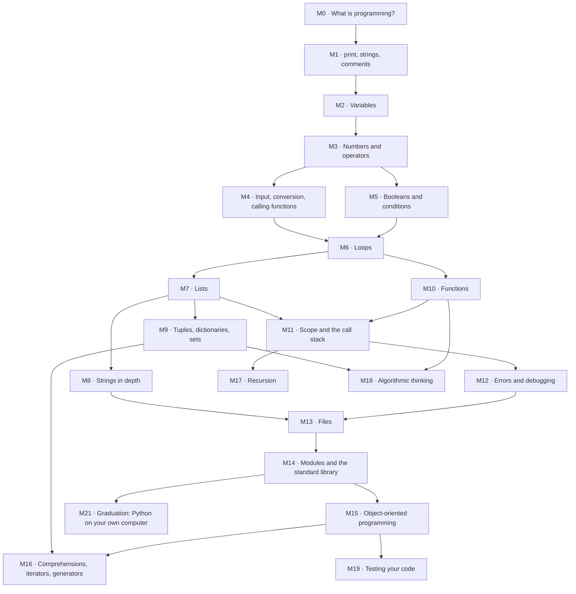

# Kavram Grafiği (F0)

> ⚙️ **Bu belge otomatik üretilir. Elle düzenlemeyin.**
> Kaynak: `content/concepts.toml` · Üretici ve doğrulayıcı: `tools/concept_graph.py --write-doc`

## 1. Tasarım kuralları

- **Kavram = öğretilebilir tek fikir.** En az 5 farklı alıştırmayla ölçülebilmeli ve 10–20 dakikada öğretilebilmeli.
- **Kimlikler kalıcıdır** (`modül.kavram`). Bir kimlik asla yeniden kullanılmaz. Yeniden adlandırma bir takma ad (alias) tablosuyla yapılır (ana plan §2.3).
- **Önkoşullar sadece doğrudan ve gerekli olanlardır.** Başka bir önkoşul üzerinden zaten gelen bir bağlantı doğrulayıcı tarafından reddedilir. Böylece harita sade kalır ve seçici (§3.4) doğru çalışır.
- **Modül sırası korunur:** Bir kavram, sonraki bir modüldeki kavrama bağımlı olamaz.
- **İsteğe bağlı kollar** (🎨 yaratıcı kodlama gibi) ana yolu asla bloklamaz.
- **Tek kök:** Her kavram `intro.program`'dan erişilebilir olmalı.
- **Yanılgılar kavramlara bağlıdır.** Her yanılgının bir tespit yöntemi vardır (ana plan §3.2): `behavioral` (davranışsal eşleşme), `ast` (kod kalıbı), `exception` (hata türü ve bağlamı), `predict` (çıktı tahmini alıştırmalarıyla öğretilir).

## 2. Doğrulama sonucu

✅ **Hata yok.** DAG (Kahn), tek kök, erişilebilirlik, modül sırası, kol izolasyonu, gereksiz önkoşul, yanılgı ve proje referansları kontrol edildi.

## 3. Sayılar

| Ölçü | Değer |
|---|---|
| Kavram | **173** (ana yol 170 + isteğe bağlı 3) |
| Önkoşul bağlantısı | 251 |
| En uzun önkoşul zinciri (derinlik) | 18 adım |
| En geniş katman | 20 kavram (aynı anda açık olabilecek seçenek sayısının üst sınırı) |
| Yanılgı | 32 (bunlarla bağlantılı 31 kavram) |
| Proje | 17 |
| Tahmini alıştırma sayısı | ~865 (kavram başına 5) |

**En çok bağımlılık taşıyan kavramlar** (iyi öğretilmeleri en kritik olanlar):

`funcs.return` (9), `modules.import` (8), `lists.index` (7), `funcs.call` (6), `numbers.int` (6), `funcs.params` (5), `lists.literal` (5), `blocks.indentation` (4)

## 4. Modül haritası

Modüller arası bağımlılıklar. Diyagramı sade tutmak için transitif indirgeme uygulandı: dolaylı olarak zaten gelen oklar gösterilmiyor. M20 sadece projelerden oluşur.

## 5. Kavramlar

### M0 · What is programming? (4)

| Kimlik | Başlık | Önkoşullar | Katman | Yanılgılar |
|---|---|---|---|---|
| `intro.program` | What a program is | — | 0 |  |
| `intro.run-code` | Running code | `intro.program` | 1 |  |
| `intro.errors-are-normal` | Errors are feedback | `intro.run-code` | 2 |  |
| `intro.sequence` | Top-to-bottom execution | `intro.run-code` | 2 |  |

### M1 · print, strings, comments (8)

| Kimlik | Başlık | Önkoşullar | Katman | Yanılgılar |
|---|---|---|---|---|
| `print.basic` | print() | `intro.run-code` | 2 |  |
| `comments.basic` | Comments | `intro.sequence` | 3 |  |
| `shell.expressions` | Expressions have values | `print.basic` | 3 |  |
| `strings.literal` | String literals | `print.basic` | 3 |  |
| `print.multiple-args` | print() with several values | `strings.literal` | 4 |  |
| `strings.quotes-mixed` | Quotes inside strings | `strings.literal` | 4 |  |
| `print.end-sep` | sep= and end= | `print.multiple-args` | 5 |  |
| `strings.escape` | Escape sequences | `strings.quotes-mixed` | 5 |  |

### M2 · Variables (7)

| Kimlik | Başlık | Önkoşullar | Katman | Yanılgılar |
|---|---|---|---|---|
| `vars.assign` | Assignment | `strings.literal`, `intro.sequence` | 4 |  |
| `vars.naming` | Naming rules | `vars.assign` | 5 |  |
| `vars.use` | Using variables | `vars.assign` | 5 | `mc.quoted-name` |
| `vars.name-error` | NameError | `vars.use`, `intro.errors-are-normal` | 6 |  |
| `vars.reassign` | Reassignment | `vars.use` | 6 | `mc.vars-auto-update`, `mc.var-remembers-history` |
| `vars.trace` | Tracing program state | `vars.reassign` | 7 |  |
| `vars.swap` | Order of updates | `vars.trace` | 8 |  |

### M3 · Numbers and operators (11)

| Kimlik | Başlık | Önkoşullar | Katman | Yanılgılar |
|---|---|---|---|---|
| `numbers.int` | Integers and arithmetic | `shell.expressions` | 4 |  |
| `numbers.float` | Floats and division | `numbers.int` | 5 | `mc.int-division` |
| `numbers.floor-mod` | // and % | `numbers.int` | 5 |  |
| `numbers.power` | Exponents | `numbers.int` | 5 |  |
| `strings.concat` | String + and * | `strings.literal`, `numbers.int` | 5 |  |
| `numbers.builtins` | abs, min, max, round | `numbers.float` | 6 |  |
| `numbers.float-precision` | Float precision | `numbers.float` | 6 | `mc.float-exact` |
| `types.type-fn` | Types and type() | `numbers.float` | 6 |  |
| `numbers.precedence` | Operator precedence | `numbers.power`, `numbers.floor-mod` | 6 |  |
| `types.type-error` | TypeError | `types.type-fn`, `strings.concat` | 7 |  |
| `vars.augmented` | Augmented assignment | `vars.reassign`, `numbers.int` | 7 |  |

### M4 · Input, conversion, calling functions (7)

| Kimlik | Başlık | Önkoşullar | Katman | Yanılgılar |
|---|---|---|---|---|
| `io.input` | input() | `vars.assign` | 5 |  |
| `strings.fstring-basic` | f-strings | `vars.use` | 6 |  |
| `types.convert` | Type conversion | `types.type-fn` | 7 |  |
| `funcs.call` | Calling functions | `io.input`, `types.convert` | 8 |  |
| `io.input-number` | Numbers from input | `io.input`, `types.convert` | 8 | `mc.input-is-number` |
| `types.value-error` | ValueError | `types.convert` | 8 |  |
| `gfx.turtle-basic` 🎨 | Drawing with turtle | `funcs.call` | 9 |  |

### M5 · Booleans and conditions (11)

| Kimlik | Başlık | Önkoşullar | Katman | Yanılgılar |
|---|---|---|---|---|
| `bool.values` | True and False | `types.type-fn` | 7 |  |
| `bool.compare` | Comparisons | `bool.values` | 8 |  |
| `bool.and-or-not` | and, or, not | `bool.compare` | 9 | `mc.or-english` |
| `bool.compare-strings` | Comparing strings | `bool.compare` | 9 |  |
| `cond.if` | if | `bool.compare` | 9 | `mc.assign-vs-equals` |
| `bool.chained-compare` | Chained comparisons | `bool.and-or-not` | 10 |  |
| `blocks.indentation` | Indentation and blocks | `cond.if` | 10 | `mc.indentation-cosmetic` |
| `bool.truthiness` | Truthiness | `bool.and-or-not`, `cond.if` | 10 |  |
| `cond.else` | else | `cond.if` | 10 |  |
| `cond.elif` | elif chains | `cond.else` | 11 | `mc.elif-all-run` |
| `cond.nested` | Nested conditions | `cond.elif`, `blocks.indentation` | 12 |  |

### M6 · Loops (12)

| Kimlik | Başlık | Önkoşullar | Katman | Yanılgılar |
|---|---|---|---|---|
| `modules.random-intro` | Random numbers (first look) | `funcs.call` | 9 |  |
| `loops.for-string` | for over a string | `blocks.indentation` | 11 |  |
| `loops.while` | while loops | `blocks.indentation`, `vars.augmented` | 11 | `mc.loop-update-missing` |
| `loops.range` | range() | `loops.for-string` | 12 | `mc.range-inclusive`, `mc.loop-var-control` |
| `loops.break-continue` | break and continue | `loops.while` | 12 |  |
| `loops.infinite` | Infinite loops | `loops.while` | 12 | `mc.loop-update-missing` |
| `loops.sentinel` | Input loops | `loops.while`, `io.input` | 12 |  |
| `gfx.turtle-loops` 🎨 | Patterns with loops | `gfx.turtle-basic`, `loops.range` | 13 |  |
| `loops.accumulator` | Accumulator pattern | `loops.range`, `vars.augmented` | 13 | `mc.accumulator-reset` |
| `loops.nested` | Nested loops | `loops.range` | 13 |  |
| `loops.while-vs-for` | Choosing while or for | `loops.while`, `loops.range` | 13 |  |
| `loops.loop-condition` | Loops with conditions | `loops.accumulator` | 14 |  |

### M7 · Lists (17)

| Kimlik | Başlık | Önkoşullar | Katman | Yanılgılar |
|---|---|---|---|---|
| `lists.literal` | Lists | `vars.assign` | 5 |  |
| `lists.index` | Indexing | `lists.literal`, `numbers.int` | 6 | `mc.index-starts-at-1` |
| `lists.builtins` | sum, min, max on lists | `lists.literal`, `numbers.builtins` | 7 |  |
| `lists.index-error` | IndexError | `lists.index` | 7 |  |
| `lists.mutate` | Changing items | `lists.index` | 7 |  |
| `lists.negative-index` | Negative indices | `lists.index` | 7 |  |
| `lists.in` | Membership | `lists.literal`, `bool.values` | 8 |  |
| `lists.aliasing` | Aliasing | `lists.mutate`, `vars.reassign` | 8 | `mc.aliasing-copies` |
| `lists.slicing` | Slicing | `lists.negative-index` | 8 |  |
| `lists.len` | len() | `lists.literal`, `funcs.call` | 9 |  |
| `lists.copy` | Copying lists | `lists.aliasing`, `lists.slicing` | 9 |  |
| `lists.iterate` | Looping over a list | `lists.literal`, `loops.for-string` | 12 |  |
| `lists.index-loop` | Looping with positions | `lists.iterate`, `lists.len`, `lists.index` | 13 |  |
| `lists.append` | append() | `lists.iterate`, `loops.accumulator` | 14 |  |
| `lists.nested` | Lists of lists | `lists.index`, `loops.nested` | 14 |  |
| `lists.methods` | List methods | `lists.append` | 15 |  |
| `lists.sorted-vs-sort` | sorted() vs .sort() | `lists.methods` | 16 | `mc.sort-returns-list` |

### M8 · Strings in depth (8)

| Kimlik | Başlık | Önkoşullar | Katman | Yanılgılar |
|---|---|---|---|---|
| `strings.fstring-format` | Formatting numbers | `strings.fstring-basic`, `numbers.float` | 7 |  |
| `strings.index-slice` | Indexing and slicing strings | `lists.slicing` | 9 |  |
| `strings.char-codes` | ord() and chr() | `strings.index-slice` | 10 |  |
| `strings.immutable` | Strings cannot change | `strings.index-slice`, `lists.mutate` | 10 | `mc.string-mutable` |
| `strings.in` | Substrings | `strings.index-slice`, `lists.in` | 10 |  |
| `strings.methods` | String methods | `strings.immutable` | 11 |  |
| `strings.split-join` | split() and join() | `strings.methods` | 12 |  |
| `strings.build-loop` | Building strings in loops | `strings.methods`, `loops.accumulator` | 14 |  |

### M9 · Tuples, dictionaries, sets (11)

| Kimlik | Başlık | Önkoşullar | Katman | Yanılgılar |
|---|---|---|---|---|
| `dicts.basic` | Dictionaries | `lists.index` | 7 | `mc.dict-positional` |
| `tuples.basic` | Tuples | `lists.index` | 7 |  |
| `dicts.key-error` | KeyError and get() | `dicts.basic` | 8 |  |
| `dicts.update` | Adding and changing keys | `dicts.basic` | 8 |  |
| `sets.basic` | Sets | `lists.in` | 9 |  |
| `tuples.unpacking` | Unpacking | `tuples.basic`, `vars.swap` | 9 |  |
| `collections.choose` | Choosing a collection | `dicts.basic`, `sets.basic`, `tuples.basic` | 10 |  |
| `sets.ops` | Set operations | `sets.basic` | 10 |  |
| `dicts.iterate` | Looping over dictionaries | `dicts.update`, `tuples.unpacking`, `lists.iterate` | 13 |  |
| `dicts.counting` | Counting with a dictionary | `dicts.iterate`, `dicts.key-error`, `loops.accumulator` | 14 |  |
| `dicts.nested` | Nested data | `dicts.iterate`, `lists.nested` | 15 |  |

### M10 · Functions (11)

| Kimlik | Başlık | Önkoşullar | Katman | Yanılgılar |
|---|---|---|---|---|
| `funcs.def` | Defining functions | `funcs.call`, `blocks.indentation` | 11 | `mc.def-runs-function` |
| `funcs.docstring` | Docstrings | `funcs.def`, `comments.basic` | 12 |  |
| `funcs.params` | Parameters | `funcs.def` | 12 | `mc.params-via-input` |
| `funcs.default-args` | Default parameters | `funcs.params` | 13 |  |
| `funcs.return` | return | `funcs.params` | 13 |  |
| `funcs.keyword-args` | Keyword arguments | `funcs.default-args` | 14 |  |
| `funcs.decompose` | Breaking problems into functions | `funcs.return` | 14 |  |
| `funcs.early-return` | Returning early | `funcs.return`, `loops.break-continue` | 14 | `mc.return-in-loop` |
| `funcs.none` | None | `funcs.return` | 14 |  |
| `funcs.print-vs-return` | print vs return | `funcs.return` | 14 | `mc.print-vs-return` |
| `gfx.turtle-functions` 🎨 | Drawing functions | `gfx.turtle-loops`, `funcs.params` | 14 |  |

### M11 · Scope and the call stack (5)

| Kimlik | Başlık | Önkoşullar | Katman | Yanılgılar |
|---|---|---|---|---|
| `scope.local` | Local variables | `funcs.params` | 13 | `mc.local-visible-outside` |
| `scope.call-stack` | The call stack | `scope.local`, `funcs.return` | 14 |  |
| `scope.global` | Global variables | `scope.local` | 14 | `mc.assign-global` |
| `scope.mutable-args` | Passing lists to functions | `scope.local`, `lists.aliasing` | 14 |  |
| `funcs.mutable-default` | Mutable default trap | `funcs.default-args`, `scope.mutable-args` | 15 | `mc.mutable-default` |

### M12 · Errors and debugging (8)

| Kimlik | Başlık | Önkoşullar | Katman | Yanılgılar |
|---|---|---|---|---|
| `debug.assert` | assert | `funcs.return` | 14 |  |
| `errors.read-traceback` | Reading tracebacks | `scope.call-stack` | 15 |  |
| `debug.strategies` | Debugging strategies | `errors.read-traceback` | 16 |  |
| `errors.try-except` | try / except | `errors.read-traceback` | 16 |  |
| `errors.else-finally` | else and finally | `errors.try-except` | 17 |  |
| `errors.specific` | Catching specific errors | `errors.try-except`, `types.value-error` | 17 | `mc.bare-except` |
| `errors.raise` | raise | `errors.specific` | 18 |  |
| `errors.validate-input` | Validating input | `errors.specific`, `loops.sentinel` | 18 |  |

### M13 · Files (5)

| Kimlik | Başlık | Önkoşullar | Katman | Yanılgılar |
|---|---|---|---|---|
| `files.read` | Reading files | `strings.split-join`, `funcs.call` | 13 | `mc.file-read-twice` |
| `files.with` | with | `files.read` | 14 |  |
| `files.lines` | Line by line | `files.with` | 15 |  |
| `files.write` | Writing files | `files.with` | 15 |  |
| `files.not-found` | FileNotFoundError | `files.read`, `errors.specific` | 18 |  |

### M14 · Modules and the standard library (7)

| Kimlik | Başlık | Önkoşullar | Katman | Yanılgılar |
|---|---|---|---|---|
| `modules.import` | import | `modules.random-intro` | 10 |  |
| `modules.datetime` | datetime | `modules.import` | 11 |  |
| `modules.docs` | Reading documentation | `modules.import` | 11 |  |
| `modules.math` | math | `modules.import` | 11 |  |
| `modules.own` | Your own modules | `modules.import`, `funcs.def` | 12 |  |
| `modules.main-guard` | if __name__ == '__main__' | `modules.own` | 13 |  |
| `modules.csv` | csv | `modules.import`, `files.lines` | 16 |  |

### M15 · Object-oriented programming (11)

| Kimlik | Başlık | Önkoşullar | Katman | Yanılgılar |
|---|---|---|---|---|
| `oop.objects` | Objects and methods | `strings.methods`, `funcs.call` | 12 |  |
| `oop.class` | Classes and instances | `oop.objects`, `funcs.def` | 13 |  |
| `oop.init-self` | __init__ and self | `oop.class`, `funcs.params` | 14 |  |
| `oop.dataclass` | Dataclasses | `oop.init-self`, `modules.import` | 15 |  |
| `oop.methods` | Methods | `oop.init-self`, `funcs.return` | 15 | `mc.self-missing` |
| `oop.inheritance` | Inheritance | `oop.methods` | 16 |  |
| `oop.state` | State and identity | `oop.methods`, `lists.aliasing` | 16 | `mc.is-vs-equals` |
| `oop.str-repr` | __str__ and __repr__ | `oop.methods` | 16 |  |
| `oop.composition` | Composition | `oop.inheritance` | 17 |  |
| `oop.super` | Overriding and super() | `oop.inheritance` | 17 |  |
| `oop.dunder` | Special methods | `oop.str-repr` | 17 |  |

### M16 · Comprehensions, iterators, generators (9)

| Kimlik | Başlık | Önkoşullar | Katman | Yanılgılar |
|---|---|---|---|---|
| `iter.zip-enumerate` | zip and enumerate | `lists.index-loop`, `tuples.unpacking` | 14 |  |
| `iter.protocol` | Iterables and iterators | `iter.zip-enumerate`, `oop.objects` | 15 |  |
| `comp.list` | List comprehensions | `lists.append`, `loops.loop-condition` | 15 |  |
| `gen.basic` | Generators | `iter.protocol`, `funcs.return` | 16 | `mc.generator-reusable` |
| `comp.dict-set` | Dict and set comprehensions | `comp.list`, `dicts.iterate`, `sets.basic` | 16 |  |
| `comp.filter` | Filtering comprehensions | `comp.list` | 16 |  |
| `gen.expr` | Generator expressions | `gen.basic`, `comp.list` | 17 |  |
| `funcs.lambda` | lambda and key functions | `funcs.return`, `lists.sorted-vs-sort` | 17 |  |
| `funcs.first-class` | Functions as values | `funcs.lambda` | 18 |  |

### M17 · Recursion (5)

| Kimlik | Başlık | Önkoşullar | Katman | Yanılgılar |
|---|---|---|---|---|
| `rec.basic` | Recursion | `scope.call-stack`, `funcs.early-return` | 15 | `mc.recursion-no-base` |
| `rec.recursion-error` | RecursionError | `rec.basic` | 16 |  |
| `rec.trace` | Tracing recursion | `rec.basic` | 16 |  |
| `rec.vs-iteration` | Recursion vs loops | `rec.basic`, `loops.while-vs-for` | 16 |  |
| `rec.structures` | Recursion on nested data | `rec.trace`, `lists.nested` | 17 |  |

### M18 · Algorithmic thinking (6)

| Kimlik | Başlık | Önkoşullar | Katman | Yanılgılar |
|---|---|---|---|---|
| `algo.sorting` | Simple sorting | `lists.index-loop`, `loops.nested`, `vars.swap` | 14 |  |
| `algo.problem-solving` | Problem solving | `funcs.decompose` | 15 |  |
| `algo.linear-search` | Linear search | `lists.iterate`, `funcs.early-return` | 15 |  |
| `algo.patterns` | Common patterns | `dicts.counting`, `algo.linear-search` | 16 |  |
| `algo.binary-search` | Binary search | `algo.linear-search`, `numbers.floor-mod`, `lists.sorted-vs-sort` | 17 |  |
| `algo.complexity` | How fast is it? | `algo.binary-search`, `algo.sorting` | 18 |  |

### M19 · Testing your code (5)

| Kimlik | Başlık | Önkoşullar | Katman | Yanılgılar |
|---|---|---|---|---|
| `test.why` | Why test? | `debug.assert` | 15 |  |
| `test.assert-tests` | Writing tests | `test.why`, `funcs.decompose` | 16 |  |
| `test.edge-cases` | Edge cases | `test.assert-tests` | 17 |  |
| `test.framework` | A test framework | `test.edge-cases`, `oop.class`, `modules.import` | 18 |  |
| `test.tdd` | Test first | `test.edge-cases` | 18 |  |

### M21 · Graduation: Python on your own computer (5)

| Kimlik | Başlık | Önkoşullar | Katman | Yanılgılar |
|---|---|---|---|---|
| `grad.install` | Installing Python | `modules.import` | 11 |  |
| `grad.terminal` | The terminal | `grad.install` | 12 |  |
| `grad.editor` | A real editor | `grad.terminal` | 13 |  |
| `grad.pip-venv` | pip and virtual environments | `grad.terminal` | 13 |  |
| `grad.next-steps` | Where to go next | `grad.pip-venv`, `grad.editor` | 14 |  |

## 6. Yanılgı kataloğu

| Kimlik | Yanlış inanç | Kavram | Tespit |
|---|---|---|---|
| `mc.assign-vs-equals` | = compares values (if x = 5:). | `cond.if` | exception |
| `mc.vars-auto-update` | After b = a + 1, changing a later also changes b. | `vars.reassign` | predict |
| `mc.var-remembers-history` | A variable keeps all the values it was ever given. | `vars.reassign` | predict |
| `mc.quoted-name` | print('name') prints the value of the variable name. | `vars.use` | behavioral |
| `mc.input-is-number` | input() returns a number when the user types digits. | `io.input-number` | exception |
| `mc.int-division` | / between two ints gives an int. | `numbers.float` | predict |
| `mc.float-exact` | Floats are always exact, so 0.1 + 0.2 == 0.3. | `numbers.float-precision` | predict |
| `mc.or-english` | if x == 1 or 2: checks whether x is 1 or 2. | `bool.and-or-not` | ast |
| `mc.elif-all-run` | Every true branch of an if/elif chain runs. | `cond.elif` | predict |
| `mc.indentation-cosmetic` | Indentation is only for looks; a line's block doesn't change behaviour. | `blocks.indentation` | behavioral |
| `mc.loop-update-missing` | A while loop stops by itself eventually. | `loops.while`, `loops.infinite` | ast |
| `mc.range-inclusive` | range(1, 5) includes 5. | `loops.range` | behavioral |
| `mc.accumulator-reset` | The total can be set to 0 inside the loop. | `loops.accumulator` | behavioral |
| `mc.loop-var-control` | Changing the loop variable inside a for loop changes which items are visited. | `loops.range` | predict |
| `mc.index-starts-at-1` | The first item is items[1]. | `lists.index` | behavioral |
| `mc.aliasing-copies` | b = a makes a separate copy of the list. | `lists.aliasing` | predict |
| `mc.sort-returns-list` | items = items.sort() gives back the sorted list. | `lists.sorted-vs-sort` | ast |
| `mc.string-mutable` | s.upper() changes s, or s[0] = 'H' works. | `strings.immutable` | ast |
| `mc.dict-positional` | d[0] gives the first entry of a dictionary. | `dicts.basic` | exception |
| `mc.def-runs-function` | Defining a function runs its body. | `funcs.def` | behavioral |
| `mc.params-via-input` | A function should get its values with input() instead of parameters. | `funcs.params` | ast |
| `mc.print-vs-return` | Printing a value inside a function is the same as returning it. | `funcs.print-vs-return` | behavioral |
| `mc.return-in-loop` | return False in an else inside the loop is fine for 'none of the items'. | `funcs.early-return` | behavioral |
| `mc.local-visible-outside` | Variables created in a function exist after it returns. | `scope.local` | exception |
| `mc.assign-global` | Assigning to a name inside a function changes the global one. | `scope.global` | exception |
| `mc.mutable-default` | A default list starts fresh on every call. | `funcs.mutable-default` | predict |
| `mc.bare-except` | A bare except is a safe way to handle errors. | `errors.specific` | ast |
| `mc.file-read-twice` | Calling read() twice returns the content twice. | `files.read` | predict |
| `mc.self-missing` | Methods don't need self as their first parameter. | `oop.methods` | exception |
| `mc.is-vs-equals` | is and == mean the same thing. | `oop.state` | predict |
| `mc.recursion-no-base` | A recursive function stops on its own. | `rec.basic` | exception |
| `mc.generator-reusable` | A generator can be looped over again and again. | `gen.basic` | predict |

## 7. Projeler

| Kimlik | Modül | Başlık | Gerektirdiği kavramlar |
|---|---|---|---|
| `proj.business-card` | M1 | Business card | `print.end-sep`, `strings.escape` |
| `proj.tip-calculator` | M4 | Tip calculator | `io.input-number`, `numbers.float-precision`, `strings.fstring-basic` |
| `proj.grade-calculator` | M5 | Grade calculator | `cond.elif`, `io.input-number` |
| `proj.guess-number` | M6 | Number guessing game | `loops.while`, `loops.break-continue`, `modules.random-intro`, `cond.elif` |
| `proj.shopping-list` | M7 | Shopping list | `lists.methods`, `loops.sentinel`, `lists.in` |
| `proj.caesar` | M8 | Caesar cipher | `strings.char-codes`, `strings.build-loop`, `numbers.floor-mod` |
| `proj.word-counter` | M9 | Word counter | `dicts.counting`, `strings.split-join`, `lists.sorted-vs-sort` |
| `proj.tic-tac-toe` | M10 | Tic-tac-toe | `lists.nested`, `funcs.decompose`, `loops.sentinel` |
| `proj.robust-calculator` | M12 | Robust calculator | `errors.validate-input`, `funcs.decompose` |
| `proj.notebook` | M13 | Notebook | `files.write`, `files.lines`, `files.not-found` |
| `proj.dice-sim` | M14 | Dice simulator | `modules.import`, `dicts.counting`, `strings.fstring-format` |
| `proj.bank-account` | M15 | Bank account | `oop.methods`, `errors.raise`, `oop.str-repr` |
| `proj.hanoi` | M17 | Towers of Hanoi | `rec.trace`, `lists.methods` |
| `proj.sorting-viz` | M18 | Sorting visualizer | `algo.sorting`, `algo.complexity` |
| `proj.text-adventure` | M20 | Text adventure | `dicts.nested`, `oop.composition`, `loops.sentinel`, `funcs.decompose` |
| `proj.todo-cli` | M20 | To-do manager | `files.write`, `errors.validate-input`, `modules.own`, `test.assert-tests` |
| `proj.turtle-art` 🎨 | M10 | Turtle art gallery | `gfx.turtle-functions` |
