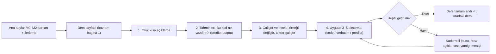
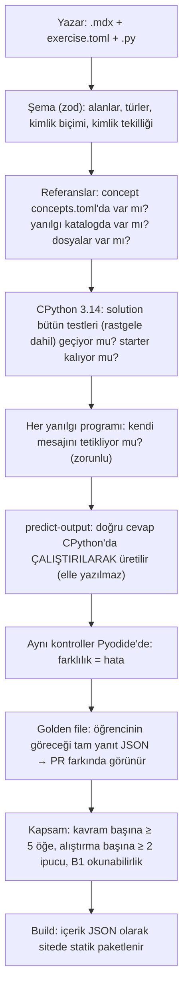
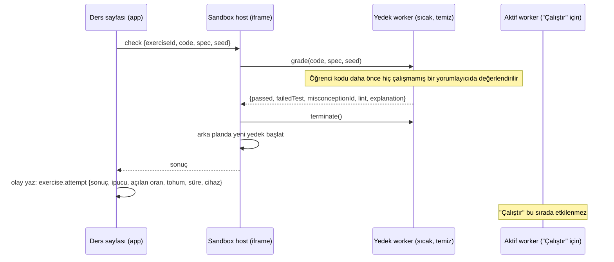
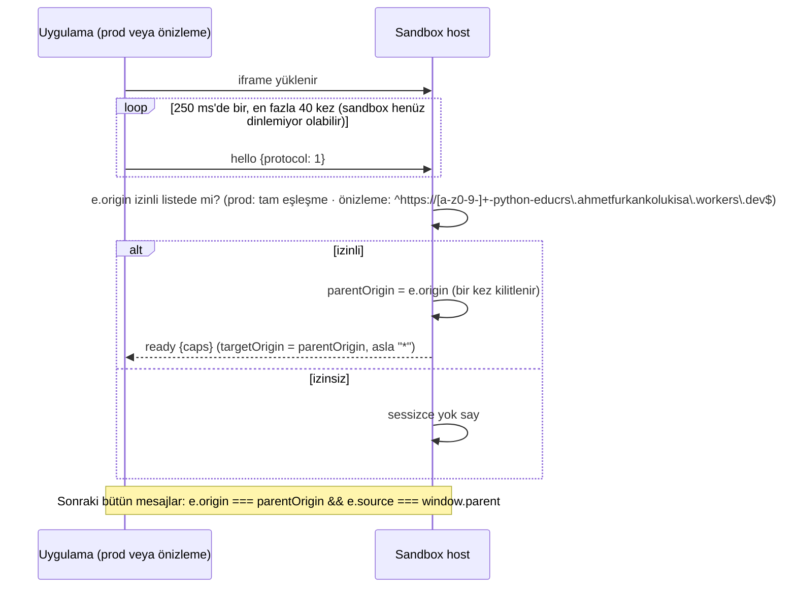
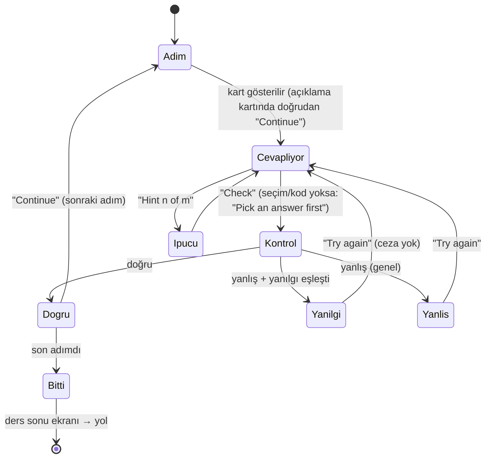

# F3 — MVP-0 Tasarımı (v0.6)

> **v0.6 (F3.6, harita ve bulgular §15):** ✅ Tamamlandı. XP ve seri kurallarında üç düzeltme var. (1) Tekrar çarpanı artık aynı gün içinde uygulanıyor ve en iyi çözümden başlayarak sıralanıyor. Zaman sırasına göre sayıldığında senkron toplam XP'yi düşürebiliyordu. (2) Seri ileri doğru yürüyor, çünkü dondurma hakkı zaman içinde ileri doğru kazanılıyor. (3) "En fazla 2 hak birikir" yerine "art arda en fazla 2 gün dondurulur". Tavan yüzünden boşa giden bir hak, geçmişe eklenen bir hedef gününün seriyi 51'den 0'a düşürmesine yol açıyordu. `exercise.attempt` yükü `difficulty` alanını taşıyor. Yeni olay: `settings.changed`.
> **v0.5 (F3.5 haritası, §14):** Yerel kayıt (`packages/store`) F3.6'dan F3.5'e alındı, çünkü yol durumları ve "kaldığın yerden devam" ona bağlı. Olay listesi sadeleşti: `lesson.started`, `exercise.attempt`, `lesson.completed`. `predict-output` şıklarının yanılgıları artık öğrenciye gösterilecek mesajı da taşıyor.
> **v0.4 (F3.4):** Editör kodda. Sıkı CSP ile CodeMirror'ın birlikte çalışması için alınan kararlar §5'te (gölge kök, `style-src-attr`, satır kaydırma). JS bütçesi üç kategoriye ayrıldı. Storybook kuruldu, her hikâye 3 temada axe ile taranıyor.
> **v0.3 (K18):** Ders artık uzun bir sayfa değil, **adım adım akan kartlar.** Oyunlaştırmanın temeli (XP, seri, günlük hedef, öğrenme yolu, ders sonu ekranı) MVP-0'a alındı. Ayrıntılar §13'te. §1'deki akış §13 ile güncellendi, ilkeler aynı.

> **Amaç:** Hesapsız ve tamamen yerel çalışan **ilk gerçek ders deneyimi.** M0–M2'yi (19 kavram) baştan sona öğretecek. Bitince **proje sahibi kendisi deneyip değerlendirecek** (v0.2 kararı, §12).
> **Kapsam dışı:** Hesap ve senkron, seviye/rozet/görev (F7), öğrenci modeli (BKT/FSRS), görselleştirici, YZ öğretmen.
> **İlke:** Algoritma haritaları burada onaylanır, kod ondan sonra yazılır. Her harita bir testle kanıtlanır.
> Kütüphane sürümleri 22.11.2026'da npm'den doğrulandı: CodeMirror 6 (`@codemirror/view` 6.43, `lang-python` 6.2), `@astrojs/mdx` 8.1, `zod` 4.6, `dexie` 4.4, Storybook 10.6, `bits-ui` 2.22.

---

## 1. Öğrencinin deneyimi (v0.3: ekran düzeni §13'te)



- Her ders **PRIMM** akışını izler (ana plan §9.2 H): Predict (tahmin et) → Run (çalıştır) → Investigate (incele) → Modify (değiştir) → Make (yap).
- **İlk 60 saniye hedefi:** Ana sayfaya giren öğrenci kayıt olmadan, tek tıkla ilk dersin çalıştırılabilir örneğine ulaşır.
- Bir dersten diğerine geçmek serbest. Kilit yok, sadece "önerilen sıra" gösterilir. Öğrenci modeli F6'da gelecek.

**Sayfalar** (hepsi statik, Astro):

| Yol | İçerik |
|---|---|
| `/` | Kısa tanıtım + "Başla" + M0–M2 modül kartları (yerel ilerlemeyle) |
| `/learn/<modül>/<kavram>/` | Ders sayfası: MDX içerik + gömülü alıştırmalar |
| `/learn/<modül>/project/` | M1 sonu projesi: Kartvizit (`proj.business-card`) |
| `/about/privacy` | Gizlilik: hiçbir veri cihazdan çıkmıyor (Cloudflare Web Analytics çerezsiz sayfa sayımı hariç) |

## 2. İçerik formatı ve hattı

### 2.1 Dosya yapısı

```
content/
  concepts.toml                       (var: kavram grafiği)
  en/lessons/M1/print.basic.mdx       ders metni (frontmatter: concept, title, order)
  en/exercises/print.basic/
    hello-world/
      exercise.toml                   tür, zorluk, kontroller, ipuçları, yanılgılar
      starter.py                      başlangıç kodu
      solution.py                     referans çözüm
      wrong/quoted-name.py            yanılgı tetikleyicisi (davranışsal eşleşme için)
  golden/                             CI'ın ürettiği "öğrencinin göreceği tam yanıt" kayıtları
```

### 2.2 Alıştırma tanımı (örnek)

```toml
id = "ex:vars.use/greet-by-name"      # kalıcı kimlik, asla yeniden kullanılmaz
concept = "vars.use"
type = "code"                         # code | verbatim | predict-output
difficulty = "easy"                   # easy | medium | hard  → BKT G/S (ana plan §3.4.1)
title = "Greet someone by name"
prompt = """
The program starts with a variable `name`. Make it print `Hello, ` followed by the name.
"""
source = "original"                   # veya "futurecoder@def491c" (MIT, uyarlanmış)

[check]
kind = "program-with-inputs"          # stdout | program-with-inputs
inputs = ["name"]                     # programın başındaki atamalar; grader bunları değiştirir
tests = [{ name = "Ada" }, { name = "Grace Hopper" }]
random = { count = 6, types = { name = "str" } }  # tohumlu rastgele testler

[[hints]]
text = "You already have the name in a variable. How do you print a variable?"
[[hints]]
text = "Use `print(\"Hello,\", name)` — two values separated by a comma."

[[misconceptions]]
id = "mc.quoted-name"                 # concepts.toml'daki katalogda tanımlı olmalı
program = "wrong/quoted-name.py"      # öğrenci bununla AYNI davranırsa bu yanılgı teşhis edilir
message = "You printed the word `name` itself. Remove the quotes to print what the variable holds."
```

### 2.3 Doğrulama hattı (CI)



**Önemli kararlar:**
- **Çıktı tahmini sorularının doğru cevabı elle yazılmaz.** CI programı çalıştırıp cevabı kendisi üretir. Yazar hatası imkânsız hale gelir. "Hata verir" seçeneği her zaman eklenir (futurecoder F6).
- **Çözümler istemciye gider.** Rastgele testler referans çözümle karşılaştırıldığı için çözüm koda gömülü olmak zorunda. İsteyen öğrenci bulabilir. İçerik zaten açık kaynak (CC BY-SA) ve liderlik tablosu yok. Bu bilinçli olarak kabul edildi.

## 3. Notlandırma (grader) v1

### 3.1 "Kontrol Et" akışı: her kontrol taze bir worker'da



- **Neden taze worker?** F1'de kullanıcı kodunun süreç içi hijyeni atlatabildiği görüldü (`gc` ile sabotaj). Notlandırma sonucunun güvenilir olması için kod kirlenmemiş bir yorumlayıcıda çalışmalı (CLAUDE.md, pazarlığa kapalı kural).
- **Maliyet:** Her kontrol bir yedek worker tüketir. Yeni yedek arka planda yüklenir: masaüstünde ~0,6–0,8 sn, düşük donanımlı telefonda ölçülecek. Art arda iki kontrol gelirse ikincisi yedek hazır olana kadar bekler ve arayüzde "kontrol ediliyor…" görünür.
- **Tohum:** Uygulama `crypto.getRandomValues` ile üretir, olaya yazar, grader `random.Random(tohum)` ile kullanır. Aynı tohum + aynı kod = aynı sonuç (ana plan §3.2).

### 3.2 Kontrol türleri (M0–M2 için yeterli olanlar)

| Tür | Algoritma |
|---|---|
| `stdout` | Çıktıyı normalleştir (satır sonları, sondaki boşluklar) ve karşılaştır |
| `program-with-inputs` | AST ile baştaki `ad = değer` atamalarını ayır → her test girdisi için atamaları değiştirip programı çalıştır → çıktıyı aynı girdilerle çalıştırılan referans çözümün çıktısıyla karşılaştır (futurecoder F1) |
| `verbatim` | Öğrencinin kodu ve hedef kod `ast.dump()` ile karşılaştırılır. Boşluk ve yorum farkı önemsiz, yapı birebir aynı olmalı |
| `predict-output` | Seçilen şık ile CI'ın ürettiği doğru cevap karşılaştırılır. Kod çalıştırılmaz. |

**Rastgele metin girdileri:** Rastgele harf dizileri değil, **seçilmiş bir isim ve kelime listesi** kullanılır: "Ada", "Grace Hopper", "Çağla", "Ömer", "Zoë", tek harfli ve boşluklu isimler, boş metin. İki faydası var: öğrenci hata mesajında anlamlı bir girdi görür, ve Unicode/Türkçe karakter sorunları erkenden yakalanır.

### 3.3 Geri bildirim sırası

1. `SyntaxError` → hata açıklayıcısı (§4).
2. Yanılgı eşleşmesi: öğrencinin çıktısı bilinen yanlış programın çıktısıyla bütün testlerde aynıysa hedefli mesaj gösterilir.
3. Başarısız test: hangi girdiyle, beklenen ve öğrencinin çıktısı yan yana.
4. Çalışma zamanı hatası: değişken değerleriyle açıklama (§4).
5. Sadece başarısızlıkta `pyflakes` uyarıları (ör. "`nmae` hiç tanımlanmadı"). `pyflakes` saf Python wheel olarak sandbox'a eklenecek.

## 4. Hata açıklayıcısı v1 (M0–M2'ye özel)

**İlke** (F2 bulgusu): Python sürümleri arasında hata mesajlarının metni değişebiliyor. Bu yüzden açıklayıcı mesaj metnine değil, **istisna türüne ve yapısal bilgiye** bakar: `e.name`, `e.text`, `e.offset`, token akışı, tanımlı isimler.

| # | Durum (yapısal tespit) | Öğrenciye (sade İngilizce) |
|---|---|---|
| 1 | `NameError` + isim bir kelimeye benziyor ve tırnak yok (`print(Hello)`) | Forgot the quotes? Text must be inside `"..."`. |
| 2 | `NameError` + yalnızca büyük/küçük harf farkı olan tanımlı isim var (`Print`, `Name`) | Python cares about capital letters: `Print` is not `print`. |
| 3 | `NameError` + tanımlı bir isme çok benziyor (difflib) | Did you mean `name`? (yazım hatası) |
| 4 | `NameError` + isim hiç atanmamış veya atamadan önce kullanılmış | Variables must be created (`name = ...`) before you use them. |
| 5 | `SyntaxError` + satırda `“ ” ‘ ’` karakterleri | These are "smart quotes" (from Word or a phone keyboard). Use plain `"` quotes. |
| 6 | `SyntaxError` + kapanmamış tırnak (tokenize hatası) | Your text starts with `"` but never ends. Add the closing quote. |
| 7 | `SyntaxError` + `print` sonrası parantez yok | In Python 3, `print` needs parentheses: `print("hi")`. |
| 8 | `SyntaxError` + açık parantez sayısı ≠ kapalı | A `(` is missing its `)` (or the other way round). |
| 9 | `SyntaxError` + atamanın sol tarafı literal (`"Ada" = name`) | The name goes on the left: `name = "Ada"`. |
| 10 | `SyntaxError` + iki değer arasında virgül yok (`print("Hi" name)`) | Separate values with a comma. |
| 11 | `SyntaxError` + değişken adında boşluk veya rakamla başlama | Variable names can't contain spaces or start with a digit. Try `my_name`. |
| 12 | `SyntaxError` + anahtar kelimeyi değişken adı yapma (`class = ...`) | `class` is a reserved word in Python. Pick another name. |
| 13 | `IndentationError` + beklenmeyen girinti | This line starts with spaces it doesn't need. Remove them. |
| 14 | `TypeError` + `'str' object is not callable` + öğrenci `print`'e değer atamış | You replaced `print` with a value (`print = ...`). Rename your variable. |
| 15 | Diğer her şey | Kısa, genel açıklama + hatanın olduğu satır + değişken değerleri (`stack_data`) |

Her satır için bir **örnek tetikleyici program** ve bir test yazılır: "bu program bu açıklamayı üretmeli". Aynı testler CPython 3.14'te ve Pyodide'de çalışır.

**Yanılgı kataloğu genişlemesi:** `concepts.toml` dosyasına M0–M2 için ekleniyor:

| Yanılgı | Kavram |
|---|---|
| `mc.missing-quotes` | `strings.literal` |
| `mc.smart-quotes` | `strings.literal` |
| `mc.case-insensitive` | `print.basic` |
| `mc.shadow-builtin` | `vars.naming` |
| `mc.assign-direction` | `vars.assign` |
| `mc.comma-vs-plus` | `print.multiple-args` |

## 5. Editör ve mobil sembol çubuğu (`packages/ui`)

- **`CodeEditor.svelte`:** CodeMirror 6 + `lang-python`. Renk teması tasarım token'larından üretilir, 3 temanın hepsinde çalışır. Ekran okuyucu etiketleri var. `Ctrl/⌘+Enter` = Çalıştır.
  - Uygulama CodeMirror'ı doğrudan import edemez, sadece bu sarmalayıcı üzerinden kullanır. dependency-cruiser kuralı ve negatif testi de eklenecek.
- **iOS yakınlaştırma kuralı (F3.2 bulgusu):** iOS Safari, yazı boyutu 16 px'ten küçük bir form alanına odaklanınca sayfayı otomatik yakınlaştırır. Bu yüzden editör ve girdi kutuları dar ekranlarda **en az 16 px** olacak (e2e regresyon testi var).
- **`SymbolBar.svelte`:** Dokunmatik cihazlarda editörün hemen üstünde durur. Tuşlar: `Tab` (4 boşluk) `:` `( )` `" "` `' '` `=` `,` `#` `[ ]` `←` `→`. Her tuş imleç konumuna ekleme yapar, parantez ve tırnakları çift olarak ekler. ≥ 44 px dokunma hedefi.
- **Yükleme:** CodeMirror ders sayfasında ilk boyamadan sonra tembel (lazy) yüklenir. Yüklenene kadar düz bir `<textarea>` gösterilir, öğrenci beklemeden yazmaya başlayabilir. O ana kadar yazılanlar editöre taşınır.
- **JS bütçesi (F3.4'te ölçüldü ve sabitlendi, `tools/js-budget.mjs`, gzip):**
  - **İlk boyama** ≤ 50 KB (ölçülen 2,0 KB): satır içi script'ler, `<script src>`, `modulepreload` ve bunların statik import'ları.
  - **Adacıklar** ≤ 60 KB (ölçülen 25,3 KB): Svelte bileşenlerinin hidrasyonda hemen yüklediği kod.
  - **Tembel** ≤ 160 KB (ölçülen 120,4 KB): dinamik `import()` ile sonradan gelenler (CodeMirror).
  - **Sahipsiz parça kuralı:** `_astro/` altındaki her `.js` dosyası bir sayfadan erişilebilir olmalı. Tarayıcı bir import sözdizimini kaçırırsa (ilk sürüm `` import(`...`) `` biçimini kaçırıp 123 KB'lık CodeMirror parçasını hiç saymıyordu) bütçe geçmek yerine kırmızıya döner. Bilerek eklenen sahipsiz bir dosyayla kanıtlandı.

### 5.1 CodeMirror + sıkı CSP (F3.4 bulguları)

| Sorun | Çözüm | Test |
|---|---|---|
| CodeMirror stillerini `<style>` elemanı ekleyerek kuruyor. CSP bunu engelliyor ve **editör stilsiz görünürken testler geçiyordu.** | Editör bir **gölge kökte** (`EditorView({root})`) çalışıyor. Orada CodeMirror `adoptedStyleSheets` kullanıyor, CSP buna izin veriyor. CSS değişkenleri gölge köke miras kaldığı için tema token'ları aynen çalışıyor. `'unsafe-inline'` stil **eklenmedi**. | e2e: editörün gerçekten stilli olduğu ölçülüyor (köşe yarıçapı, monospace yazı, konumlandırma) |
| CodeMirror çalışırken elemanlara `style="..."` özniteliği yazıyor (imleç, seçim, satır yüksekliği). | CSP'ye sadece `style-src-attr 'unsafe-inline'` eklendi. Bu, `<style>` elemanlarına ve harici stil dosyalarına izin vermiyor, sadece öznitelikleri kapsıyor. Script tarafı (`script-src`) değişmedi. | e2e'de CSP ihlali yok |
| axe `scrollable-region-focusable`: uzun satırda `.cm-scroller` klavyeyle kaydırılamayan bir alan oluyordu. | `EditorView.lineWrapping`: satırlar kaydırılıyor. Telefonda yana kaydırma da gerekmiyor. | axe (e2e + Storybook "Long line wraps") |
| Sembol çubuğundaki `Tab` tuşunun erişilebilir adı "Insert indent" idi. Görünen metin adın içinde olmadığı için sesli komutla ("click Tab") basılamıyordu (WCAG 2.5.3). | Ad "Tab: insert indent (4 spaces)" oldu. Storybook axe taraması yakaladı. | Storybook axe |

- **Klavye tuzağı yok:** `Tab` editörde girinti yapar. `Esc` ve ardından `Tab` editörden çıkar (CodeMirror'ın standart kaçış yolu).
- **Sembol çubuğu odağı çalmıyor:** Tuşlar `pointerdown` olayını iptal ediyor. Klavye açık kalıyor, imleç yerinde duruyor (e2e: odak eklemeden sonra hâlâ editörün içinde).
- **e2e'de kod yapıştırma:** Testler kodu bir insanın yapacağı gibi yapıştırıyor: tümünü seç, yapıştır (çok satırlı yazmak otomatik girintiyi tetikler). İki tuzak bulundu, ikisi de küçük deneylerle doğrulandı (`e2e/helpers.ts`):
  - Firefox, `ClipboardEvent` oluştururken verilen `clipboardData`'yı yok sayıp boş bir tane koyuyor (Chromium ve WebKit koruyor). Veri her motor için açıkça atanıyor.
  - iOS modunda CodeMirror, Backspace tuşunu iptal edip 50 ms sonra bir zamanlayıcıyla uyguluyor. Yük altında yardımcı fonksiyonun "boşaldı mı?" kontrolü zamanlayıcıdan önce koşunca döngü tekrar deniyordu. O tekrardaki Backspace yapıştırmadan **sonra** uygulanıp son karakteri siliyordu: tam koşuda `print("Hi", name` çalıştı. Masaüstü motorlarında olmuyor. Gerçek kullanıcıyı etkilemiyor, çünkü Backspace ile yapıştırma arasında 50 ms'den az süre olmaz. Yardımcı artık Backspace kullanmıyor: seçimin üstüne yapıştırmak her şeyi tek adımda değiştiriyor. iPhone emülasyonunda daha önce bir kez görülen kararsız `input()` testinin de büyük ihtimalle kök nedeni bu (aynı test; o koşunun ayrıntısı kaydedilmemişti, kanıtlanmadı).
- **Sınır kuralı:** `@codemirror/*`, `codemirror` ve `@lezer/*` sadece `packages/ui` içinden import edilebilir. Negatif testi var (`tools/tests/test_boundaries.mjs`, "app uses CodeMirror directly").

## 6. Önizleme origin listesi + el sıkışma (F2'den devreden)



- **`frame-ancestors`:** `https://python.educrs.com https://*.ahmetfurkankolukisa.workers.dev`
  - ⚠️ Joker karakter, hesaptaki bütün `workers.dev` adreslerini kapsıyor. Bu, kendi hesabındaki başka bir Worker'ın da sandbox'ı gömebileceği anlamına geliyor. Kabul edilebilir bir risk, ama belgelendi.
- **Önizlemede site ayrımı yok:** Önizleme uygulaması da sandbox da aynı `<hesap>.workers.dev` altında olduğu için birbirleriyle aynı site sayılırlar. Önizlemeler gerçek kullanıcı verisi taşımadığı için kabul edildi (deploy rehberi §5).
- **Testler (e2e):**
  - prod origin ✓
  - önizleme deseni ✓
  - benzer görünen sahte origin ✗ (`https://evil-python-educrs.example.workers.dev`)
  - kilitlendikten sonra farklı bir origin'den gelen mesaj ✗

## 7. Yerel ilerleme: `packages/store`

- `LocalStore` portunun iki uygulaması olacak (iki uygulama kuralı):
  - **`DexieStore`:** IndexedDB. Açılışta `navigator.storage.persist()` istenir.
  - **`MemoryStore`:** Testler için.
- **MVP-0 olayları:**
  - `profile.created {learnerId}`
  - `exercise.attempt {exerciseId, contentHash, result, hints, revealRatio, seed, durationMs, device}`
  - `hint.used`
  - `lesson.completed`
  - Hepsi `v: 1`, `rs: 1`, `tz` alanlarını taşır (ana plan §3.6).
- **Türetilmiş durum** (saf reducer, property testli): tamamlanan alıştırmalar, tamamlanan dersler, "kaldığın yerden devam et".
- **"Verimi indir" butonu:** Bütün olayları JSON olarak indirir. Kullanıcı testlerinde katılımcı bu dosyayı **isterse** paylaşır. Sunucuya hiçbir şey gitmez (§9).

## 8. Storybook

- ✅ `packages/ui` içinde Storybook 10.6 (`@storybook/svelte-vite`) + `@storybook/addon-a11y` kuruldu. Araç çubuğunda tema seçici var (açık, koyu, yüksek kontrast).
- ✅ F3.4 hikâyeleri: `CodeEditor` (varsayılan, boş, satırda hata, salt okunur, sembol çubuklu, uzun satır, yüklenmeden önceki `textarea`) ve `SymbolBar`.
- Sonraki bileşenler hikâyeleriyle birlikte gelir: `Button`, `OutputPanel`, `HintLadder`, `ExerciseCard` (F3.5). Her birinin bütün durumları yazılır: boş, yükleniyor, hata, başarılı, devre dışı.
- ✅ `pnpm a11y:stories` (`tools/storybook-a11y.mjs`) Storybook'u derler ve **her hikâyeyi 3 temada** axe ile tarar (WCAG 2.2 AA etiketleri). Ciddi veya kritik ihlal varsa kırmızıya döner. CI'daki e2e işinde ve `pnpm run check` içinde koşuyor.
- ✅ **Kendi kendini test ediyor:** Her koşuda tarama bittikten sonra bilinen iki ihlal ekleniyor: biri normal DOM'a, biri CodeMirror'ın yaşadığı gölge köke. axe ikisini de bulamazsa kontrol kırmızıya döner. Böylece "tarama aslında hiçbir şeye bakmıyor" durumu fark edilmeden kalamaz.
- Görsel regresyon F11'de eklenecek.

## 9. Değerlendirme (v0.2: dış kullanıcı testi yok)

**Karar (§12-1):** F3'ün çıkışında dış katılımcılarla test yapılmayacak. Proje sahibi (İngilizcesi C1) M0–M2'yi baştan sona kendisi deneyecek.

- **Bilinçli olarak kaybedilen şey:** "Hiç kod yazmamış biri nerede takılıyor?" sinyali. Proje sahibi yeni başlayan değil, bu yüzden bazı engelleri (ör. tırnakları unutmak) kendisi yaşamayacak.
- **Bu kaybı kısmen telafi eden önlemler:**
  1. Yanılgı tetikleyicileri ve hata açıklayıcısı testleri, yeni başlayan hatalarını **otomatik olarak** deniyor (§3.3, §4).
  2. Proje sahibi denerken bilerek yeni başlayan hataları yapar. Bunun için kısa bir kontrol listesi `docs/06-f3-review.md` içinde verilecek: tırnaksız metin, akıllı tırnak, `Print`, `print = ...`, girinti, eksik parantez.
  3. Anonim, isteğe bağlı alıştırma istatistikleri (ana plan §9.1 D) sonraki fazlarda eklendiğinde gerçek takılma noktaları veriyle görülecek.
- **Çıktı:** `docs/06-f3-review.md`: proje sahibinin notları + ölçümler (ilk koda kadar geçen süre, ders başına süre, bulunan hatalar). F4'te plan v0.14 bu notlara dayanacak.

## 10. Alt fazlar ve çıkış kriterleri

| Alt faz | İş | Çıkış kriteri (test) |
|---|---|---|
| **F3.1** ✅ | Sandbox protokolü v1: el sıkışma, origin listesi, taze worker'da notlandırma | ✅ e2e 9 yeni test × 4 tarayıcı. **Mutasyon testi:** izin listesi bilerek bozulunca "sahte origin" testi kırmızıya dönüyor. Her kontrol `worker_runs: 1` raporluyor (yepyeni yorumlayıcı). Sabotaj ve sonsuz döngü notlandırmayı etkilemiyor. |
| **F3.2** ✅ | Grader v1 (Python) + içerik şeması + doğrulayıcı + golden files | ✅ Tek grader (`packages/grader`) tarayıcıda ve CI'da; 18 birim testi (4 kasıtlı bozukluğun hepsi yakalandı); içerik hattının 16 negatif testi; Pyodide üretir, CPython 3.14 aynı sonucu vermek zorunda; **tarayıcı notu golden dosyalarla alan alan aynı** (e2e); 4 örnek alıştırma |
| **F3.3** ✅ | Hata açıklayıcısı v1 (§4) | ✅ 18 kural (`packages/grader/educrs_explain.py`); 23 tetikleyici program, her kural en az birini taşıyor (test zorunlu kılıyor); yanlış alarm testleri; CPython **ve Pyodide 3.14.2**'de geçiyor; her kuralın `explain.<id>` metni var ve metin sadece kuralın verdiği parametreleri kullanıyor; Runner'da "What went wrong" kutusu (e2e). Yazım hatası tespiti `difflib` yerine harf yer değiştirmeyi tek hata sayan bir uzaklık ölçüsü kullanıyor (`nmae`→`name`). |
| **F3.4** ✅ | `CodeEditor` + `SymbolBar` + Storybook | ✅ Storybook: 8 hikâye × 3 tema axe temiz, planlanmış ihlal öz-testi (normal DOM + gölge kök) her koşuda geçiyor; e2e: editör 16 px, gerçekten stilli, hata satırı vurgulanıyor ve düzenleyince kalkıyor, `Ctrl/⌘+Enter` çalıştırıyor, sembol çubuğu sadece dokunmatikte ve odağı çalmıyor; JS bütçesi 3 kategoride sabitlendi + sahipsiz parça kuralı (§5) |
| **F3.2b** ✅ | `fill-gap` alıştırma türü (§13.4) + ders manifestosu doğrulaması (§13.2) | ✅ İçerik hattı her kutucuğu çalıştırıyor ve belirsiz soruyu reddediyor; yanlış kutucukların geri bildirimi otomatik (yanılgı mesajı, açıklayıcı kodu ya da çıktı); 17 yeni negatif test (8 `fill-gap`, 9 ders); ilk ders manifestosu (`vars.use`, 3 alıştırma) |
| **F3.5** ✅ | **Adım adım ders akışı** (§13.3): kartlar, alttan açılan geri bildirim paneli, ipucu merdiveni, ders sonu ekranı + **öğrenme yolu** (§13.6) + **yerel kayıt** (`packages/store`, v0.5'te F3.6'dan alındı; harita §14) | ✅ e2e **183/183** (4 tarayıcı), dersle ilgili olanlar: `vars.use` baştan sona, beş adım türünün hepsinde önce yanlış sonra doğru cevap, ceza yok; klavyeyle tam akış (Enter, 1–4, odak her kartta başlıkta); iki yanlıştan sonra "Show me"; × ile çıkıp kaldığı adımdan devam; yol durumları; CSP ihlali yok; panel açıkken ve yolda axe temiz. Birim: akış reducer'ının değişmezleri property testli ve **mutasyon testiyle kanıtlı** (3 bozulmanın 3'ü yakalandı); aynı store test takımı Dexie ve bellek üzerinde; içerik hattının 5 yeni negatif testi; sınır testleri 13/13; Storybook 26 hikâye × 3 tema |
| **F3.6** ✅ | **`packages/gamification`** (XP, seri, günlük hedef reducer'ları, §13.5; harita §15) + "verimi indir" + sade mod + ayarlar sayfası | ✅ Property testleri (ana plan §3.5.5): olay eklemek XP'yi ve **hiçbir günün** XP'sini azaltmaz; bir olay sadece kendi gününü etkiler; olay sırası ve tekrarı sonucu değiştirmez; seri gün gün yürüyen referansla aynı, dondurma kuralları ve monotonluk korunuyor. **Yedi kasıtlı bozulmanın yedisini sadece property testleri yakalıyor** (her biri 3/3). `rs: 1` dondurulmuş tabloyla korunuyor. e2e **215/215** (4 tarayıcı; 5 atlanan mobil/masaüstü ayrımı): ilk derste +45 XP, hedef sorusu, iki günlük seri (sabit saatle), sayfa yenilenince ilerleme korunuyor, sade mod, verimi indir, ayarlarda axe ve CSP. Birim 216, sınır 15/15, Storybook 39 hikâye × 3 tema. Bulgular §15.10. |
| **F3.7** | **İçerik: M0–M2** (19 ders manifestosu, ≥ 95 öğe, Kartvizit projesi) | İçerik doğrulayıcısı yeşil; her derste ≥ 1 açıklama + ≥ 3 alıştırma adımı; B1 okunabilirlik eşiği geçiliyor |
| **F3.8** | Cilalama: **görsel kimlik** (önce bir görsel yön dokümanı ve 2–3 seçenek, proje sahibi seçer; sonra tipografi, ders kartları, yol haritası, kutlamalar, mobil yerleşim), erişilebilirlik, mobil, iOS Safari | Lighthouse ≥ 90; iPhone'da gerçek test; her bileşenin yeni hali Storybook'ta 3 temada axe temiz |
| **F3 çıkışı** | **Proje sahibinin değerlendirmesi** (§9) | M0–M2 baştan sona denendi, `docs/06-f3-review.md` yazıldı |

**Sıralama:** F3.1–F3.3 birbirine bağımlı (protokol → grader → açıklayıcı). F3.4 bunlardan bağımsız, paralel ilerleyebilir. F3.7 (içerik), F3.2'deki şema donduğu anda başlayabilir.

## 11. Riskler

| Risk | Önlem |
|---|---|
| **İçerik hacmi** (95 öğe, bu fazın asıl işi) | Yazar şablonları, doğrulayıcı, futurecoder havuzundan kaynak göstererek uyarlama |
| Her kontrol için taze worker: düşük donanımlı telefonda gecikme | Sıcak yedek worker; "kontrol ediliyor" geri bildirimi; F3.8'de gerçek cihazda ölçüm. Gerekirse kontrol için ikinci bir yedek worker. |
| CodeMirror'un mobil boyutu ve davranışı | Tembel yükleme + textarea yedeği; iOS'ta klavye ve seçim testleri |
| iOS Safari (henüz test edilmedi) | F3.8'de gerçek cihaz; sorun çıkarsa yedek yol (önceden doldurulan girdi) zaten var |
| Dış kullanıcı testi yok: yeni başlayan sinyali eksik (§9) | Otomatik yanılgı testleri + bilerek hata yapma kontrol listesi + ileride anonim istatistikler |

## 12. Kararlar (22.11.2026)

| # | Soru | Karar |
|---|---|---|
| 1 | Test katılımcıları ve dil | **Dış test yok.** Proje sahibi (İngilizcesi C1) kendisi deneyecek. İçerik İngilizce kalıyor (K2 değişmedi). §9 buna göre güncellendi. |
| 2 | İçerik incelemesi | Taslakları Claude yazar, **proje sahibi örnekleyerek** inceler. Doğruluk CI'da otomatik kontrol ediliyor. |
| 3 | `shell.expressions` | **M1'de küçük bir ön tanıtım** (`print(2 + 3)`). Sayılar M3'te ayrıntılı işlenir. Kavram grafiği değişmedi. |

---

## 13. Oyunlaştırılmış, adım adım akış (v0.3, K18)

### 13.1 Ne alıyoruz, ne almıyoruz

**Alıyoruz:** Duolingo'nun markası ya da görseli değil, kanıtlanmış **etkileşim kalıpları**:
- tek seferde tek adım
- üstte ilerleme çubuğu
- alttan açılan geri bildirim paneli
- öğrenme yolu
- seri, XP ve günlük hedef
- ders sonu ekranı

Görsel kimlik bizim token'larımız (`packages/ui`) ve kendi ikonlarımızla kurulacak.

**Almıyoruz** (ana plan §3.5.1):
- Can veya kalp sistemi
- Mağaza, elmas, reklam
- Kayıp korkusuna oynayan bildirimler (Spark'ta zaten mümkün değil)
- Lig ve liderlik tablosu (hileye açık, ertelendi)

**Python'a özel:** Yanlış şıklar yanılgı kataloğuna bağlı. Öğrenci genel bir "Yanlış" değil, tam olarak neyi karıştırdığını görüyor.

### 13.2 Ders manifestosu

Bir ders, sıralı adımlardan oluşan bir TOML dosyasıdır: `content/en/lessons/<concept>.toml`.

```toml
concept = "vars.reassign"
title = "Reassignment"

[[steps]]
kind = "explain"                     # markdown kart, isteğe bağlı çalıştırılabilir örnek
text = """A variable can get a new value later. The old value is gone."""
example = "colour = 'red'\ncolour = 'blue'\nprint(colour)"

[[steps]]
kind = "exercise"
id = "ex:vars.reassign/predict-copy"  # predict-output | fill-gap | code | verbatim

[[steps]]
kind = "exercise"
id = "ex:vars.reassign/fill-new-value"
```

**Doğrulama** (içerik hattına eklenecek, negatif testleriyle):
- Kavram `concepts.toml` içinde var.
- Bütün alıştırma kimlikleri var ve bu kavrama ait.
- Derste en az 1 `explain` ve en az 3 alıştırma adımı var.
- İlk adım `explain`, son adım bir alıştırma.
- Her `example` hatasız çalışıyor.
- Aynı alıştırma iki derste kullanılmıyor.

### 13.3 Ders akışı (durum makinesi)



- **Geri bildirim paneli:**
  - Doğru → yeşil.
  - Yanılgı → sarı, başlığı "Common mix-up".
  - Genel yanlış → kırmızı.
  - Her durumda panelde tek bir büyük buton var.
  - Kod adımlarında açıklama §4'teki açıklayıcıdan geliyor.
- **Kod adımı:** Editör ve sembol çubuğu olan bir "çalışma alanı" kartı açılıyor. "Run" serbest, "Check" taze worker'da notlandırıyor (§3.1).
- **Kısmi çözüm açma:** 2 başarısız denemeden sonra "Show me" düğmesi açılıyor ve çözüm kademeli olarak gösteriliyor (§3.2). Akış asla kilitlenmiyor.
- **Dersten çıkmak:** "×" ile çıkılabilir, ilerleme olay olarak kaydedildiği için ders kaldığı yerden devam eder.
- **Klavye:** Enter = Check/Continue, 1–4 = şık seçimi. Odak her geçişte yeni kartın başlığına taşınır, ekran okuyucu durumu duyurur (`aria-live`).
- **Hareket:** Kart geçişleri ve panel 200 ms. `prefers-reduced-motion` açıksa animasyonsuz.

### 13.4 Yeni alıştırma türü: `fill-gap` (boşluk doldurma)

Telefonda klavyesiz pratik için kullanılıyor (ana plan §9.1 B).

```toml
id = "ex:vars.use/fill-print-name"
concept = "vars.use"
type = "fill-gap"
difficulty = "easy"
title = "Print the name"
prompt = "Make it print Hello, followed by the name."
template = "name = \"Ada\"\nprint(\"Hello,\", ____)"   # tam olarak bir boşluk (v1)
tiles = ["name", "\"name\"", "Name"]
answer = "name"
explanation = "Without quotes, Python uses the value stored in name."
[tile_misconceptions]
'"name"' = { id = "mc.quoted-name", message = "With quotes, Python prints the word name itself." }
```

- **Doğrulama:**
  - İçerik hattı her kutucuğu boşluğa koyup programı **çalıştırır**.
  - Cevap kutucuğu hatasız çalışmalı.
  - Diğer kutucukların her biri cevaptan **farklı bir sonuç** vermeli. Aynı sonucu veren kutucuk varsa soru belirsizdir ve hata verilir (`ambiguous-tiles`).
  - Kutucuklara bağlanan yanılgılar katalogda olmalı.
- **Notlandırma istemcide yapılır.** Kutucuk kimliği karşılaştırılır, Python gerekmez, anında yanıt verir. Golden dosya her kutucuğun çalışma sonucunu kaydeder.
- **Yanlış kutucukların geri bildirimi içerik hattında hesaplanır** (`tile_feedback`):
  - Kutucuğun yanılgı etiketi varsa yanılgının mesajı gösterilir.
  - Kutucuk hata veriyorsa açıklayıcının yapısal açıklaması kullanılır. Örneğin `Name` kutucuğu `NameError` verir ve `name.case` açıklaması gelir.
  - Hata vermiyorsa "bu şunu yazdırır" bilgisi, beklenen çıktıyla (`expected_output`) yan yana gösterilir.
  - Yazarın her kutucuk için ayrı mesaj yazması gerekmez.

### 13.5 Oyunlaştırmanın temeli (MVP-0)

Her şey **olaylardan türetilir** (ana plan §3.6). Ödül kuralları sürüm 1'dir (`rs: 1`, §3.5.6), değeri saklanmaz.

| Öğe | Kural (rs: 1) |
|---|---|
| **XP** | Alıştırma başına: taban (kolay 10, orta 15, zor 20) × ipucu çarpanı (0 ipucu → 1, 1 → 0,75, 2 → 0,5, kısmi çözüm → 0,25) × tekrar çarpanı (**v0.6:** aynı gün aynı alıştırmanın değerleri büyükten küçüğe sıralanır, r. sıradaki → 1/2^(r−1), en az 1; ayrıntı ve gerekçe §15.2). **Yanlış denemeler XP'yi azaltmaz.** Ders tamamlama +5 (aynı kurala tabi). |
| **İlk denemede doğru** | Sadece ders sonu ekranında gösterilir, XP'yi etkilemez (yanlış cezası yok) |
| **Günlük hedef** | 10 / 20 / 30 / 50 XP (varsayılan 20). İlk ders bitince sorulur, ayarlardan değiştirilebilir. |
| **Seri** | Ana plan §3.5.4 madde 3: olayın yerel saat dilimine göre gün; günlük hedefi tutan ardışık günler; her 7 günlük seride 1 dondurma hakkı kazanılır, kaçırılan bir gün dondurmayla otomatik kapatılır. **v0.6:** yürüyüş ileri doğru; "en fazla 2 birikir" yerine "art arda en fazla 2 gün" (§15.4). |
| **Seviye, rozet, görev, taç** | **F7'de** (BKT ve kural motoru gerektiriyor) |
| **Sade mod** | Ayarlarda tek düğme: üst çubuktaki sayılar, kutlama ve ders sonu istatistikleri gizlenir. Öğrenme aynen devam eder (§3.5.1 madde 4). |

**Olaylar** (hepsi `v: 1`, `rs: 1`, `tz`):
- `lesson.started {lessonId}`
- `step.answered {lessonId, step, exerciseId, correct, attempt, hints, revealRatio}`
- `exercise.attempt` (kod adımları, §7)
- `lesson.completed {lessonId}`
- `settings.changed {dailyGoal | plainMode}`

**`packages/gamification`:** Saf TypeScript reducer'larından oluşur: `xp`, `dailyProgress`, `streak`. `packages/core` dışında hiçbir şeye bağımlı değil (sınır kuralı eklenecek). Ana plan §3.5.5'teki değişmezler property testleriyle korunacak.

### 13.6 Öğrenme yolu

- **Düğümler:** Her modül, `concepts.toml` sırasındaki kavramların dersleridir. Modül sonunda proje düğümü var (M1: Kartvizit).
- **Yerleşim derleme anında hesaplanır:** Zikzak deseniyle x kayması (−60, 0, +60, 0 …), düğümler arası 104 px. Tam grafik yerleşimi (Sugiyama, ana plan §3.5.4 madde 7) modül sayısı artınca gelecek.
- **Durumlar olaylardan türetilir:**
  - tamamlandı (yeşil ✓)
  - **sıradaki** (büyük, vurgulu, "Start" etiketi): önerilen sıradaki ilk tamamlanmamış ders
  - başlanmadı (kesik çizgi)
- **Kilit yok.** Her düğüm tıklanabilir.
- **Üst çubuk:** seri (alev), XP ve günlük hedef halkası. Sade modda gizlenir.

### 13.7 Erişilebilirlik ve kalite kapıları (eklenenler)

- Paneldeki renkler tek başına bilgi taşımaz. Her durumda ikon + başlık da var (yeşil/kırmızı ayrımı yapamayanlar için).
- Kutucuklar ve şıklar ≥ 44 px, klavyeyle seçilebilir, ekran okuyucuya "1 of 4: cat" diye okunur.
- Akışın e2e testleri 4 tarayıcıda çalışacak. Mobil projede kutucukla tam ders akışı test edilecek.


## 14. F3.5 uygulama haritası (v0.5)

> Kod yazılmadan önce yazıldı. Her madde bir testle kanıtlanacak (§14.7).

### 14.1 Sıralama kararı: yerel kayıt F3.5'e alındı

F3.5'in çıkış kriterinde "yol durumları doğru" ve "× ile çıkınca kaldığı yerden devam" var. İkisi de sayfalar arasında kalıcı olay kaydı gerektiriyor. Bu yüzden `packages/store` (`DexieStore` + `MemoryStore`) F3.6'dan F3.5'e alındı. F3.6'da XP, seri, günlük hedef, sade mod ve "verimi indir" kalıyor.

- **Dexie 4.4.7** (npm'den doğrulandı, ana plan §2.4 kararı): gzip ~29,6 KB. Dinamik import ile **tembel** yükleniyor. Ders sayfasının tembel bütçesi: CodeMirror 120 KB + Dexie ~30 KB ≈ 150 / 160 KB. Firebase SDK geldiğinde (F4) tembel bütçe kategorisi ayrılacak.
- Elle IndexedDB yazmak ~2 KB olurdu ama Safari'nin IndexedDB hatalarına karşı Dexie'nin yıllardır biriken çözümlerini kaybederiz. Plan kararı korunuyor.
- **Sınır kuralı:** `dexie` sadece `packages/store` içinden import edilebilir (negatif testiyle).

### 14.2 Paketler ve sorumluluklar

| Yer | İçerik | Bağımlılık |
|---|---|---|
| `packages/core` | Ders ve alıştırma tipleri; akış reducer'ı (§14.3); yerel notlandırma (§14.4); yol durumları ve "kaldığın yerden devam" (§14.5); olay tipleri, `uuidv7`, `newEvent` | Hiçbir şey (saf TS) |
| `packages/store` | `LocalStore` portu: `DexieStore`, `MemoryStore`; cihaz kimliği | `dexie`, `core` |
| `packages/ui` | Sunum bileşenleri, sadece props ve geri çağrılar: `LessonHeader` (ilerleme çubuğu + ×), `ChoiceList`, `GapFill`, `FeedbackPanel`, `HintLadder`, `LessonComplete`, `LearningPath`. Her birinin Storybook hikâyesi ve axe taraması var. | `svelte`, `i18n` |
| `apps/web` | Sayfalar; `sandbox-client.ts` (Runner'dan çıkarılıyor: el sıkışma, `run`, `check`); `CodeWorkspace.svelte` (editör + Run/Stop + girdi + çıktı + isteğe bağlı Check; ana sayfadaki Runner da bunu kullanıyor); `LessonFlow.svelte` (reducer + sandbox + store'u birleştiriyor); `PathIsland.svelte` | hepsi |

**Sayfalar:** `/learn/` öğrenme yolu, `/learn/<modül>/<kavram>/` ders. Kavramdaki noktalar tireye çevriliyor (ör. `/learn/m2/vars-use/`), çünkü statik sunucular `.use` gibi bir uzantıyı dosya türü sanabilir. İkisi de derleme anında içerik paketinden üretiliyor. Ana sayfaya "Start learning" bağlantısı ekleniyor.

### 14.3 Akış reducer'ı (§13.3 durum makinesinin kodu)

```
durum = { adım, evre: "answering" | "feedback" | "done", deneme, ipucu, gösterilen, geriBildirim, ilkDenemede[] }

continue  : açıklama adımı → sonraki adım | doğru geri bildirim → sonraki adım ya da "done"
checked(s): evre answering → feedback; deneme + 1; ilk denemeyse ilkDenemede[adım] = s.doğru
retry     : yanlış/yanılgı geri bildirimi → answering (ceza yok, deneme sayısı korunur)
hint      : ipucu < ipucu sayısı → ipucu + 1
reveal    : sadece deneme ≥ 2 iken; predict/fill-gap → doğru seçenek işaretlenir; code → çözümün bir satırı daha açılır (gösterilen / toplam = revealRatio)
```

- **Değişmezler** (property testi): adım hiç geri gitmez; her durumdan "done"a giden bir eylem dizisi vardır (akış asla kilitlenmez, `reveal` bunu garanti eder); deneme ve ipucu her adımda sıfırlanır; `ilkDenemede[i]` sadece i. adımın ilk kontrolü doğruysa true.
- **Sandbox cevap vermezse** (zaman aşımı, worker açılamadı): geri bildirim "Couldn't check, try again" olur ve **deneme sayılmaz**.

### 14.4 Geri bildirim (her tür için)

| Tür | Doğru | Yanılgı (sarı, "Common mix-up") | Genel yanlış (kırmızı) |
|---|---|---|---|
| `predict-output` | açıklama metni | şıkkın yanılgı mesajı | "Not quite. Go through the program one line at a time." + varsa ipucu |
| `fill-gap` | açıklama metni | kutucuğun yanılgı mesajı | hata veriyorsa açıklayıcı metni (`explain.<id>`); vermiyorsa "This prints X, but we need Y" |
| `code` | "Well done" + kaç testin geçtiği | grader'ın yanılgı mesajı | sözdizimi/çalışma hatası → açıklayıcı + hata satırı vurgusu; yanlış çıktı → hangi girdiyle, beklenen ve senin çıktın yan yana |
| `verbatim` | "Exactly right" | — | yapı farklı → "Not exactly the same yet. Compare it character by character." |

- **İçerik şeması değişikliği:** `predict-output` şıklarının yanılgıları artık `fill-gap` kutucuklarıyla aynı biçimde: `{ id, message }`. Şimdiye kadar sadece kimlik vardı ve öğrenciye gösterilecek metin yoktu (katalogdaki `belief` alanı öğrenciye yönelik değil). Eski biçim içerik hattında hata veriyor (negatif testiyle).
- `predict-output` ve `fill-gap` uygulamada, Python'suz notlandırılır (§13.4). `code` ve `verbatim` her zaman taze worker'da (§3.1).

### 14.5 Olaylar, kaldığın yerden devam, yol durumları

**Olaylar** (§7 ve §13.5'teki listeler tek listede birleştirildi; hepsi `v: 1`, `rs: 1`, `tz`):

| Olay | Yük | Neden |
|---|---|---|
| `lesson.started` | `lessonId, contentHash` | Devam noktası; içerik değiştiyse baştan başlatmak için |
| `exercise.attempt` | `exerciseId, contentHash, lessonId, step, correct, attempt, hints, revealRatio, problem?, misconceptionId?, seed?, durationMs` | Her kontrol. Tek kaynak: XP (F3.6) ve öğrenci modeli (F6) bunu okuyacak. Ders dışında da kullanılabilir. |
| `lesson.completed` | `lessonId, contentHash` | Yol durumu |

- `step.answered` ve `hint.used` **eklenmedi**: ikisinin bilgisi de `exercise.attempt` içinde var. Olay adları kalıcı olduğu için (olaylar asla yeniden yazılmaz) gereksiz tür eklemiyoruz.
- `id` UUIDv7 (zaman sıralı). `dev` cihaz kimliği store'da bir kez üretilir.

**Kaldığın yerden devam** (saf fonksiyon): bu ders için son `lesson.started` bulunur. Ondan sonra `lesson.completed` varsa ya da `contentHash` farklıysa ders baştan başlar. Yoksa devam adımı = doğru cevaplanmış en büyük adım + 1.

**Yol durumları** (saf fonksiyon, §13.6): `lesson.completed` olan ders "tamamlandı"; sıradaki ilk tamamlanmamış ders "sıradaki" (yarım kalmışsa etiketi "Continue", değilse "Start"); diğerleri "başlanmadı". Sıra `concepts.toml`'daki modül ve kavram sırası. Sadece dersi olan kavramlar gösterilir. Modül başlıkları katalogdan gelir.

### 14.6 İçerik hattı eklemeleri

- Ders kayıtlarına `module` alanı, pakete `path` (modül sırasına göre dersler) ekleniyor.
- `predict-output` yanılgı biçimi `{ id, message }` (§14.4).
- `vars.use` dersine bir `verbatim` adımı ekleniyor. Böylece tek ders beş adım türünün hepsini içeriyor: açıklama, tahmin, boşluk doldurma, aynen yazma, kod.
- İkinci ders: `vars.reassign` (mevcut `predict-copy` + 2 yeni alıştırma). Yol durumlarının geçişini ("sıradaki" bir sonraki derse geçiyor) e2e'de görmek için gerekli. İçerik proje sahibinin örnekleme incelemesinden geçecek (K16).

### 14.7 Test planı

- **Birim (vitest):**
  - reducer geçiş tablosu ve property testleri (§14.3 değişmezleri)
  - yerel notlandırma: her tür, her geri bildirim yolu
  - devam noktası ve yol durumları (karışık sıra, içerik değişimi, tekrar)
  - `uuidv7` sıralaması
  - **aynı test takımı hem `MemoryStore` hem `DexieStore` üzerinde** koşuyor (Node'da `fake-indexeddb` ile)
- **İçerik hattı:** yeni şema için negatif testler (eski biçim, bilinmeyen şık, boş mesaj).
- **Storybook:** her yeni bileşenin bütün durumları, 3 temada axe (§8).
- **e2e (4 tarayıcı):**
  - `vars.use` fareyle baştan sona: her türde önce yanlış cevap ("Try again", ceza yok), sonra doğru; ders sonu ekranı
  - klavyeyle tam akış: Enter, 1–4, odak her kartta başlığa taşınıyor
  - mobilde dokunarak şık ve kutucuk seçimi
  - × ile çıkış, sayfayı yenileme, kaldığı adımdan devam
  - yol durumları: önce `vars.use` sıradaki; bitince tamamlandı ve `vars.reassign` sıradaki
  - ders sayfasında CSP ihlali yok; geri bildirim paneli açıkken axe temiz
- **Bütçe:** ders sayfası ölçülüp sabitlenir; Dexie'nin tembel yüklendiği doğrulanır.

### 14.8 F3.5'te olmayanlar

- XP, seri, günlük hedef, sade mod, "verimi indir" (F3.6).
- Açıklama kartındaki örnek kodu çalıştırmak. Örnek, içerik hattının önceden hesapladığı çıktıyla gösteriliyor. Çalıştırma sonra eklenebilir.
- Kart geçiş animasyonları en sade haliyle (200 ms, `prefers-reduced-motion`'da yok). Görsel cilalama F3.8'de.

### 14.9 F3.5 bulguları

| Bulgu | Ne yapıldı |
|---|---|
| **Mutasyon testi zayıf bir property testi yakaladı.** "Akış asla kilitlenmez" testindeki sanal öğrenci, "Show me" olmasa da sonunda doğru cevap veriyordu. Yani test, kilitlenmeyi önleyen kuralı aslında hiç denemiyordu: "Show me" kapatıldığında bile geçiyordu. | Sanal öğrenci artık cevap gösterilene kadar **hiç** doğru cevap veremiyor. "Show me" kapatılınca test kırmızıya dönüyor. Diğer iki bozulma (ilk deneme bayrağının üzerine yazılması, cevapsız kontrolün deneme sayılması) da yakalanıyor. |
| **Açıklayıcı `colour = blue` için "önce değer ver" diyor**, "tırnak mı unuttun?" demiyor. Kural bilinçli olarak temkinli: tırnak önerisi sadece fonksiyon argümanında ya da büyük harfle başlayan isimde veriliyor (yanlış alarm olmasın). | Açıklayıcı değiştirilmedi. Bu soru tırnaklarla ilgili olduğu için içerikteki geçersiz kılma kullanıldı: `blue` kutucuğu `mc.missing-quotes` yanılgısıyla etiketlendi. |
| **`@educrs/ui`'nin tek giriş dosyası her bileşeni her sayfaya taşıyordu.** Paketler yan etkisiz olarak işaretlenmediği için paketleyici kullanılmayan dışa aktarımları atamıyordu. Yol sayfası CodeMirror'ı "tembel" olarak sayıyordu (151 KB), ana sayfa ders bileşenlerini indiriyordu. | Paketlere `sideEffects` eklendi (ui: sadece `.css`). Yol sayfasının tembel yükü **151 → 30,8 KB** (sadece Dexie), ana sayfanın adacıkları **32,6 → 28,4 KB**. |
| **axe animasyonun ortasında tarıyordu.** Geri bildirim paneli 200 ms'de belirirken yazılar yarı saydam. Kontrast hatası üç temada da çıktı, yüksek kontrast dahil. | Storybook taraması artık animasyonların bitmesini bekliyor. Renkler değişmedi, çünkü öğrencinin 200 ms'den uzun gördüğü bir durum değil. |
| **Programla odaklanan başlıkta odak çerçevesi görünüyordu.** Global `:focus-visible` kuralı katmansız olduğu için Tailwind'in katmanlı `focus:outline-none` sınıfını eziyordu. | `tabindex="-1"` olan, yani sadece programla odaklanan başlıklarda çerçeve kapatıldı. Ekran okuyucu yine başlığa iniyor. |
| **CI'da iPhone projesindeki bütün editör testleri kırıldı (PR #6).** iPhone kullanıcı aracısında CodeMirror sayfayı Mac sanıyor ve "tümünü seç"i Cmd+A'ya bağlıyor. Playwright'ın `ControlOrMeta` tuşu ise test makinesinin işletim sistemine bakıyor ve Linux'ta Ctrl+A gönderiyor. Mac'te Ctrl+A satır başına gidiyor, yani hiçbir şey seçilmiyordu ve her deneme kodu eskisinin üstüne yapıştırıyordu. Yerelde makine Mac olduğu için görünmüyordu. | Durum yeniden üretildi (iPhone + Ctrl+A satır başına ekliyor, Meta+A hepsini seçiyor). Yardımcı fonksiyon artık tuşu CodeMirror'ın kendi platform tespitiyle seçiyor (`f3/editor`, 577276c). |
| **Headless Firefox, yol sayfasında axe çalışırken çöktü** (içerik süreci SIGSEGV, öncesinde "RenderCompositorSWGL failed mapping default framebuffer"). Sadece test çalıştırıcısında oluyordu, yaklaşık her iki testte bir. Bağımsız betikle hiç üretilemedi. Sebep tema, hareket emülasyonu, `translate` ya da açık IndexedDB bağlantısı değil (hepsi denendi). | Belirleyici fark hazır olma beklemesiydi. `expect().toHaveAttribute()` ile sık sık çöküyordu, `waitForSelector` ile hiç çökmedi (19/19, sonra 16/16 tekrar). Test `waitForSelector` kullanıyor. Kök neden tarayıcıda; aynı sayfa Chromium, WebKit, iPhone ve Storybook'ta axe'tan temiz geçiyor. Gerçek Firefox'ta (GPU ile) ayrıca denenecek (F3.8). |
| **Masaüstü WebKit'te iki tıklama "`<html>` intercepts pointer events" ile zaman aşımına uğradı.** Bu, tam test koşusu sırasında yanında typecheck ve birim testleri çalışırken oldu. | Tek başına 9/9 geçti. Son tam kontrol yanında hiçbir şey çalışmadan koştu: e2e **183/183**, masaüstü WebKit dahil, tekrarlamadı. Tekrarlarsa ayrıca incelenecek. |

## 15. F3.6 uygulama haritası (v0.6)

> Kod yazılmadan önce yazıldı. Her madde bir testle kanıtlanacak (§15.8). Bu harita §13.5'teki iki kuralı düzeltiyor: XP tekrar çarpanı (§15.2) ve seri yürüyüşünün yönü (§15.4). İkisinde de plandaki tanım, planın kendi değişmezlerini (ana plan §3.5.5) bozuyordu.

### 15.1 Paket: `packages/gamification`

- Saf TypeScript. Sadece `@educrs/core`'u import edebilir (sınır kuralı + iki negatif test: çerçeve importu, başka paket importu). `sideEffects: false`.
- Dosyalar:
  - `days.ts`: olayın yerel günü
  - `rules.ts`: sürümlü ödül kuralları, sadece ekleme yapılır
  - `xp.ts`: toplam ve gün gün XP
  - `settings.ts`: ayarlar ve günün hedefi
  - `streak.ts`: seri ve dondurma
  - `index.ts`: `progressOf(events, now)` hepsini tek yerde birleştirir
- **Hiçbir değer saklanmaz.** Her şey olaylardan hesaplanır (ana plan §3.5.1 madde 5). MVP-0'da olay sayısı küçük olduğu için her açılışta baştan hesaplanıyor. 500 olayda bir alınan ara görüntü (checkpoint, ana plan §3.6) senkronla birlikte F4'te gelecek.
- Bütün fonksiyonlar olayları önce kimliğe göre tekilleştirir (G-Set). Böylece aynı olayın iki kez gelmesi sonucu değiştirmez.

### 15.2 XP (ödül kuralları sürüm 1, `rs: 1`)

**Bulgu: plandaki tekrar çarpanı senkronda XP'yi düşürüyor.** Planda kural şuydu: "aynı alıştırmanın k. çözümü 1/2^(k−1) kazandırır". Burada k, zaman sırasına göre sayılıyor. Karşı örnek:
- A cihazında zor bir alıştırma ipucusuz çözülüyor: 20 XP.
- Sonra B cihazının çevrimdışıyken daha **önce** yaptığı çözüm geliyor. Bu çözümde "Show me" kullanılmıştı.
- Sıralamada B'nin çözümü öne geçiyor: B 20 × 0,25 = 5 XP alıyor, A'nın çözümü ikinci sıraya düşüyor ve 10 XP alıyor.
- Toplam 20'den 15'e iniyor. Bu, §3.5.5'teki "toplam XP hiç azalmaz" değişmezini bozuyor.

Zaman sırasına göre sayılan her tekrar çarpanında bu sorun var. Tersini yapmak, yani en iyi çözüme tam puan vermek de yetmiyor: o zaman yarın daha iyi bir çözüm gelince dünkü XP'nin bir kısmı bugüne kayar. Dünün hedefi geriye dönük olarak tutulmamış hale gelir ve seri kırılır.

**Kural (`rs: 1`):**

```
değer(deneme) = taban(zorluk) × ipucuÇarpanı            (sadece correct = true denemeler)
  taban          : easy 10, medium 15, hard 20 (zorluk olayda yoksa ya da geçersizse 10)
  ipucuÇarpanı   : "Show me" kullanıldı (revealRatio > 0) → 1/4
                   değilse: 0 ipucu → 1, 1 ipucu → 3/4, 2 ve üstü → 1/2
değer(ders)     = 5                                     (her lesson.completed)

Gruplar: (rs, yerel gün, anahtar). Anahtar alıştırmada "ex:<id>", derste "lesson:<id>".
Bir grubun içinde değerler büyükten küçüğe sıralanır:
  r. sıradaki XP = max(1, ⌊değer / 2^(r−1)⌋)
Toplam XP = bütün grupların toplamı. Günün XP'si = o günün gruplarının toplamı.
```

- **Örnekler:**
  - easy: ipucusuz 10, 1 ipucu 7, 2 ipucu 5, "Show me" 2
  - medium: 15, 11, 7, 3
  - hard: 20, 15, 10, 5
  - aynı gün aynı alıştırma (ipucusuz, easy): 10, 5, 2, 1, 1…
  - ertesi gün aynı alıştırma yine 10
- **Kesirler aşağı yuvarlanır.** Hesap tam sayıyla yapılır: değer çeyrek XP birimiyle (değer₄ = taban × 4, 3, 2 ya da 1) tutulur, r. sıradaki XP = max(1, ⌊değer₄ / 2^(r+1)⌋). Kayan nokta hatası olamaz.
- **Neden aynı gün?** Bir günün XP'si sadece o günün olaylarına bağlı. Yarın yapılan bir şey dünün XP'sini, dolayısıyla dünkü hedefi ve seriyi değiştiremez.
- **Neden büyükten küçüğe sıralama?** Grubun toplamı olayların hangi sırayla geldiğine bağlı olmuyor. Senkronla yeni bir olay eklenince toplam hiç azalmıyor. Kanıt kısa:
  - Eklenen değer w (çeyrek birim) j. sıraya giriyor. c = ⌊w/2^(j+1)⌋.
  - Altındaki her eleman bir sıra kayar. Kaybı en fazla ⌈c_k/2⌉ olur, burada c_k = ⌊c/2^(k−j)⌋.
  - Kayıpların toplamı teleskopik olarak ≤ c olur. Eklenen eleman ise max(1, c) ≥ c kazandırır.
  - Bu kanıt bir property testiyle de denetleniyor.
- **XP kasmak:** Aynı gün aynı alıştırmayı tekrar çözmek 5, 2, 1, 1… kazandırır. Ertesi gün tam puan yeniden geliyor. Bu bilinçli bir seçim: ertesi gün yeniden çözmek aralıklı tekrardır ve teşvik edilmeli. Tekrarın kendi XP'si (ana plan §3.5.4, "tekrar") F6/F7'de öğrenci modeliyle gelecek. Ders tamamlama da aynı kurala tabi: aynı gün aynı ders 5, 2, 1…
- **Yanlış denemeler XP'yi hiçbir zaman değiştirmez** (sıfır değer, grup oluşturmaz).
- **Bilinmeyen `rs`** (daha yeni bir istemcinin yazdığı olay) 0 sayılır. Uygulama güncellenince sayılır. XP yine de azalmaz.
- **Kurallar sadece eklenir:** `RULES` tablosunda 1 numaralı kayıt dondurulmuş bir test tablosuna (golden) bağlı. Sürüm 1'deki bir değeri değiştirmek bu testi kırar. Değişiklik gerekiyorsa `rs: 2` eklenir, `REWARD_RULESET` artırılır (§3.5.6).
- **Olay değişikliği:** `exercise.attempt` yüküne `difficulty` eklendi. Değer olaydan hesaplanmalı, içerik paketinden değil: içerikte bir alıştırmanın zorluğu sonradan değişirse geçmiş XP değişmemeli. Eski olaylarda alan yok, onlar `easy` sayılıyor (en düşük taban). F3.5 olayları henüz yayında değildi.

### 15.3 Ayarlar ve günlük hedef

- **Olay:** `settings.changed { dailyGoal?: 10 | 20 | 30 | 50, plainMode?: boolean }`. Bu olay `core`'daki `EVENT` listesine ve kayıt defterine ekleniyor.
- **Güncel ayar:** Her alan için (t, id) sırasında son yazılan değer geçerli. Geçersiz değerler yok sayılıyor. Varsayılanlar: hedef 20, sade mod kapalı.
- **Bir günün hedefi** = o gün içinde geçerli olmuş hedeflerin **en küçüğü**. Yani günün başındaki hedef ile gün içinde seçilen hedeflerin en küçüğü. Bu yüzden:
  - Hedefi gün içinde düşürmek o günü hemen kurtarır.
  - Hedefi yükseltmek bugünü ve geçmişi asla bozmaz. Etkisi yarından itibaren başlar.
- **Hedef sorusu:** İlk ders bitince, henüz hiç hedef seçilmemişse ders sonu ekranında sorulur (10/20/30/50). Hiçbiri seçili gelmiyor, çünkü zaten seçili olan bir radyo düğmesine tıklamak değişiklik olayı üretmez ve önceden seçili 20 hiçbir zaman onaylanamazdı. Metin, seçilene kadar 20'nin geçerli olduğunu söylüyor. Seçmeden geçilirse soru sonraki ders sonunda tekrar gelir. Sade modda sorulmaz. Ayarlardan her zaman değiştirilebilir.

### 15.4 Seri ve dondurma

**Bulgu: plandaki yürüyüş yönü yanlış.** Ana plan §3.5.4 madde 3 bugünden geriye doğru yürüyor. Ama dondurma hakkı zaman içinde **ileri** doğru kazanılıyor: 7 gün sonra 1 hak, sonra kaçırılan bir günde harcanıyor. Geriye yürürken kaçırılan güne, o hakkı kazandıran 7 günden önce varılıyor. Bu yüzden elde hak olup olmadığı bilinemiyor. Yürüyüş ileri doğru yapılıyor:

```
gün(olay)     = ⌊(t + tz·60 000) / 86 400 000⌋  (olayın kendi saat dilimindeki takvim günü)
                 tz geçersizse (tam sayı değilse ya da ±840 dk dışındaysa) 0 sayılır
bugün         = max(şimdiki yerel gün, en son olayın günü)
tutulanGünler = { g : günXP(g) ≥ hedef(g) }

seri = 0, hak = 0, artArda = 0
ilk tutulan günden bugüne kadar her g için:
  g tutulduysa                       : seri += 1; artArda = 0; seri 7'nin katıysa hak += 1
  g bugünse                          : (gün bitmedi) hiçbir şey olmaz
  seri > 0, hak > 0 ve artArda < 2   : hak −= 1; artArda += 1; g "donduruldu" (seri korunur ama artmaz)
  değilse                            : seri = 0, hak = 0 (haklar seriyle birlikte biter)
```

**İkinci bulgu: "en fazla 2 hak birikir" kuralı da bir değişmezi bozuyor.** Bunu ilk yazdığım property testi buldu ("bir güne hedef eklemek seriyi asla kısaltmaz"), fast-check örneği küçülttü:
- Öğrenci 20 gün çalışıyor, sonra beş hafta boyunca haftada bir gün dinleniyor, en sonda da 2 günlük bir ara veriyor.
- Kazanılan her hak bir sonraki dinlenme gününde harcanıyor. Seri 51.
- Senkronla en başa tek bir gün eklenince hakların hangi gün kazanıldığı bir gün kayıyor. İlk blokta üçüncü hak tavana (2) takılıp boşa gidiyor.
- Sondaki 2 günlük arada bir hak eksik kalıyor ve seri **51'den 0'a** düşüyor.

Daha fazla çalışmak seriyi bitirmemeli. Ayrıca seri ödül katmanında ve ana plan §3.5.6'ya göre "asla geri alınmaz". MVP-0'da bu durum yaşanamaz, çünkü olaylar sadece bugüne ekleniyor. Senkronla (F4) yaşanabilir.

**Kural (seri kuralı sürüm 1):** Haklar biriktirilirken tavan yok. Onun yerine **art arda en fazla 2 gün dondurulabilir**, 3 günlük ara seriyi her zaman bitirir. Tavanın amacı korunuyor: uzun bir ara hiçbir zaman köprülenmiyor. Ama hiçbir hak boşa gitmiyor. Üç varyant 200 000 rastgele örnekle denendi:

| Varyant | Hedef günü eklemek seriyi kısaltabilir mi? |
|---|---|
| Plandaki: en fazla 2 hak birikir | Evet (51 → 0) |
| Tavansız: istenen uzunlukta ara köprülenir | Hayır, ama uzun seri haftalarca arayı kapatır |
| **Seçilen:** tavansız birikim, art arda en fazla 2 gün | Hayır |

- **Uygulama:** Gün gün yürümek yerine, tutulan günlerin arasındaki boşluklar tek adımda işleniyor: n gün boşluk, n ≤ hak ve n ≤ 2 ise donar, değilse seri biter. Maliyet tutulan gün sayısı kadar, uzun aralar pahalı değil. Gün gün yürüyen sürüm testlerde **referans** olarak duruyor. İkisi rastgele gün kümelerinde aynı sonucu vermek zorunda (§3.5.4'teki "referans algoritma" ilkesi).
- **Değişmezler:**
  - hak ≥ 0
  - hak + dondurulan gün sayısı = ⌊seri / 7⌋
  - seri 0 ise hak da 0
  - serinin içinde kalan, tutulmamış her geçmiş gün bir hak harcanarak donduruldu (§3.5.5)
  - art arda 2'den fazla dondurulmuş gün yok
  - bir güne hedef eklemek seriyi asla kısaltmaz
  - seri ≤ tutulan gün sayısı
- **Bugün henüz tutulmadıysa** seri dünkü haliyle gösterilir, alev sönük görünür ve "bugün de devam et" yazar. Bu bir uyarı değil, bilgi. Bildirim yok (§3.5.1).
- **Seyahat:** Her olay kendi `tz`'sini taşıdığı için gün anahtarı olayın yazıldığı yerdeki takvim günü. Batıya uçunca "bugün", en son olayın gününden geride kalabilir. Bu yüzden bugün, ikisinin büyüğü olarak alınıyor.

### 15.5 Sade mod

- Ayarlarda tek düğme (`role="switch"` olan yerel bir onay kutusu).
- **Açıkken gizlenenler:** yoldaki üst çubuk (seri, XP, hedef halkası), ders sonu ekranındaki istatistikler (+XP, ilk denemede doğru, bugünkü hedef, seri), kutlama animasyonu, hedef sorusu.
- **Değişmeyenler:** XP ve seri arka planda hesaplanmaya devam eder (olaylar aynı). Sade mod kapatılınca hepsi yerinde.
- Ayar da olayla saklanıyor. Bu yüzden ileride senkronla cihazlar arasında taşınacak.

### 15.6 "Verimi indir"

- Ayarlar sayfasında bir buton.
- İndirilen dosya `educrs-progress-YYYY-MM-DD.json`. İçeriği:
  ```
  { format: "educrs-progress", version: 1, exportedAt, device, events: [...] }
  ```
  Olaylar kanonik sırada (t, id), olduğu gibi yazılıyor.
- `Blob` + `URL.createObjectURL` + `<a download>` ile indiriliyor, ağ yok. CSP değişmiyor: indirme bir bağlantı ya da navigasyon değil.
- Dosyayı oluşturan fonksiyon saf bir fonksiyon (`apps/web/src/lib/export.ts`) ve birim testi var.
- **İçe aktarma kapsam dışı.** Senkron gelince (F4) hesaba bağlanmak bu işi görecek.
- Tarayıcı kalıcı depolama vermiyorsa (bazı gizli pencereler), ayarlar sayfası bunu söyler: "Bu tarayıcı ilerlemeni kaydetmiyor."

### 15.7 Arayüz

| Yer | Ne |
|---|---|
| `packages/ui` | `StatsBar` (alev + seri, XP, hedef halkası; görünür kısa etiketler + ekran okuyucu için tam cümle), `GoalRing` (SVG halka, `role="progressbar"`; ilerleme `stroke-dasharray` ile çiziliyor, bu bir SVG niteliği olduğu için CSP'ye takılmıyor), `GoalPicker` (yerel radyo grubu, kısayol tuşu yok), `Toggle` (`role="switch"`). `LessonComplete` şunları kazanıyor: +XP, bugünkü hedef, seri, "Daily goal reached!" kutlaması, `plain` ve hedef sorusu için bir `children` yuvası. Her durumun bir hikâyesi var ve 3 temada axe ile taranıyor. |
| `packages/i18n` | Yeni metinler. Çoğul için `plural(key, n)`: `Intl.PluralRules` ile `.one` / `.other` anahtarını seçer ("1-day streak", "2 streak freezes"). Tip düzeyinde sadece iki anahtarı da olan kökler kabul ediliyor. |
| `apps/web` | `lib/progress.ts`: store'u açar, olay bağlamını kurar (saat, `tz`, cihaz), olayları bellekte tutar, `record()` sağlar. Ders, yol ve ayarlar sayfası bunu ortak kullanıyor. `/settings/` sayfası: hedef, sade mod, verimi indir. Yol sayfasının üstünde `StatsBar` ve ayarlar bağlantısı. Altbilgide yol ve ayarlar bağlantıları. |

- **Ders sonu XP'si:** `toplamXP(bütün olaylar) − toplamXP(bu koşunun olayları hariç)`. Koşu, bu ders için son `lesson.started`'dan sonraki olaylar. Böylece yarıda bırakılıp devam edilen derste önceki oturumun denemeleri de sayılıyor. XP azalmadığı için fark hiçbir zaman negatif değil.
- **"Daily goal reached!"** sadece bu ders bugünün hedefini tutturduysa gösterilir (öncesi < hedef ≤ sonrası).
- **Yerleşim kayması yok:** İstatistikler olaylar okununca beliriyor. Üst satırın yüksekliğini statik ayarlar bağlantısı belirliyor.

### 15.8 Test planı

- **Birim (vitest, `fast-check`):**
  - **XP:**
    - kural tablosu örnekleri
    - **dondurulmuş `rs: 1` tablosu**
    - property: olay sırası karışınca sonuç aynı; aynı olay iki kez gelince aynı; olay eklemek toplamı ve **hiçbir günün** XP'sini azaltmaz; bir güne olay eklemek başka günlerin XP'sini değiştirmez; yanlış deneme, bilinmeyen tür ve bilinmeyen `rs` hiçbir şeyi değiştirmez
  - **Ayarlar:** son yazan kazanır; günün hedefi en küçük olan; hedefi yükseltmek geçmiş günleri bozmaz.
  - **Seri:**
    - referans yürüyüşle eşitlik
    - §15.4'teki değişmezler
    - saat dilimi örnekleri (aynı an, farklı `tz` → farklı gün; gece yarısını geçen seyahat)
    - 7 günde 1 hak
    - art arda kaçırılan iki gün iki hakla kapanır, üçüncü gün kaç hak olursa olsun seriyi bitirir
    - plandaki kuralın 51 → 0 karşı örneği
  - **Mutasyon testi:** Kanıt olarak şu bozulmalar elle denenecek ve her biri **sadece property testleriyle** en az bir testi kırmalı:
    - sıralamayı zamana göre yapmak (plandaki eski kural)
    - sıralamayı geliş sırasına göre yapmak
    - plandaki "en fazla 2 hak" tavanı
    - günü gruptan çıkarmak
    - dondurmayı harcamamak
    - dondurulan günü seriye saymak
    - hedefte en küçük yerine son değeri almak
  - **Dışa aktarma:** biçim, kanonik sıra, dosya adı.
  - **Ders koşusu:** devam eden derste koşu doğru bulunuyor, XP farkı ≥ 0.
- **Sınır:** iki yeni negatif test.
- **Storybook:** `StatsBar` (yeni öğrenci, seri sürüyor, bugün tutuldu, dondurma hakkı var), `GoalRing`, `GoalPicker`, `Toggle`, `LessonComplete` (istatistikli, hedef tutuldu, hedef sorusu, sade).
- **e2e (4 tarayıcı):**
  - İlk ders: +45 XP (4 easy alıştırma × 10 + 5), "Daily goal reached!", 1 günlük seri, hedef sorusu (hiçbiri seçili değil). 30 seçilince bugün yine 20'ye göre sayılıyor (yükseltme yarın başlar), yolda "45 / 20". Hedef seçildikten sonra soru bir daha gelmiyor.
  - **İki gün:** Playwright'ın sabit saatiyle (`page.clock.setFixedTime`), saat dilimi sabit. 1. gün `vars.use`. 2. gün yolda seri 1 ve alev sönük. `vars.reassign` bitince seri 2, XP 85. Sayfa yenilenince değerler korunuyor (F3.6 çıkış kriteri).
  - **Sade mod:** yol ve ders sonu ekranında sayı yok, ders aynen işliyor. Kapatınca, sade moddayken kazanılan XP görünüyor.
  - **Verimi indir:** dosya iniyor, JSON geçerli, olaylar zarfın bütün alanlarını taşıyor, ayar ve deneme olayları içinde.
  - Ayarlar sayfasında axe (açık/koyu) ve CSP ihlali yok.
- **Bütçe:** yol ve ders sayfası yeniden ölçülüp sabitlenir. Yeni `/settings/` sayfası ölçülür.

### 15.9 F3.6'da olmayanlar

- Seviye, rozet, görev, taç (F7).
- Ses efektleri. Kutlama sadece ders sonu ekranındaki kısa animasyon (`prefers-reduced-motion`'da yok).
- Verileri içe aktarma (F4'te senkron).
- Hedef ve seri bildirimleri (Spark'ta yok, §3.5.1).

### 15.10 F3.6 bulguları

| Bulgu | Ne yapıldı |
|---|---|
| **Plandaki XP tekrar çarpanı senkronda toplam XP'yi düşürüyordu** (k. çözüm zaman sırasına göre sayılınca: 20 → 15, §15.2). | Tekrar çarpanı aynı gün içinde, değere göre büyükten küçüğe uygulanıyor. Toplamın hiç azalmadığı kısa bir kanıtla ve property testiyle gösterildi. Plandaki kural mutasyon olarak geri konunca "olay eklemek XP'yi azaltmaz" testi her koşuda kırılıyor. |
| **Plandaki seri şeması geriye doğru yürüyordu.** Dondurma hakkı ileri doğru kazanıldığı için geriye yürürken elde hak olup olmadığı bilinemiyor. | İleri doğru yürüyen tanım (§15.4). Gün gün yürüyen referans ile boşlukları atlayan uygulama rastgele gün kümelerinde karşılaştırılıyor. |
| **"En fazla 2 hak birikir" kuralı, geçmişe eklenen bir hedef gününün seriyi bitirmesine yol açıyordu** (51 → 0, fast-check buldu ve küçülttü). Sebep, tavana takılıp boşa giden bir hak. | "Art arda en fazla 2 gün dondurulur" (§15.4). Üç varyant 200 000 örnekle denendi, seçilen varyant monoton. Karşı örnek kalıcı bir test oldu. |
| **Property testleri ilk halinde zayıftı.** Beş bozulmanın dördünü sadece örnek testleri yakaladı. fast-check'in varsayılan boyutu dizileri ~10 elemanda tutuyor, bu yüzden aynı gün tekrar ve 7 günlük seri neredeyse hiç üretilmiyordu. Yeni olay hep dizinin sonuna eklendiği için "geliş sırasına göre sıralama" bozulması da görünmüyordu. | Üreteçler yoğunlaştırıldı: `size: "max"`, az gün ve az alıştırma, seri blokları üreten gün kümeleri, senkronu taklit etmek için yeni olay rastgele bir yere ekleniyor. **Yedi bozulmanın yedisi de artık sadece property testleriyle yakalanıyor**, her biri 3 koşunun 3'ünde. |
| `size: "max"` tek başına verilince fast-check 2³¹ elemanlı dizi üretmeye çalıştı ve bellek bitti. | `size: "max"` her zaman bir `maxLength` ile birlikte veriliyor (CLAUDE.md'ye yazıldı). |
| **`astro check`, `apps/web` içindeki `.svelte` dosyalarını hiç denetlemiyormuş.** Aynı isimli iki tanım (`plain`) ancak derlemede ortaya çıktı. F3.5'ten kalan iki "prop'un sadece ilk değeri yakalanıyor" uyarısı da görünmüyordu. | `apps/web` tip kontrolü artık `astro check` + `svelte-check --fail-on-warnings`. İki uyarı düzeltildi (`$derived`). |
| **Deneme olayı, geri bildirim gösterildikten sonra yazılıyordu** (beklenmeden). "Correct!" görünür görünmez sayfadan çıkılırsa IndexedDB yazımı yarıda kalıyordu. e2e'de yolda 10 yerine 0 XP göründü. Bu F3.5'ten kalan bir hataydı, "kaldığın yerden devam" da bundan etkilenebilirdi. | Olay artık geri bildirimden **önce** yazılıyor (birkaç ms). Ekranda görülen sonuç her zaman kaydedilmiş oluyor. Hatayı yakalayan iki e2e testi kalıcı. |
| **Hedef sorusunda 20 önceden seçili gelemez:** zaten seçili radyo düğmesine tıklamak değişiklik olayı üretmiyor, yani "20" hiçbir zaman onaylanamazdı. | Hiçbiri seçili gelmiyor. Metin, seçilene kadar 20'nin geçerli olduğunu söylüyor (§15.3). |
| Hedef yükseltilince halka bugün hâlâ eski hedefi gösteriyor (45 / 20). Bu kuralın kendisi (§15.3): bugün asla elden alınmaz. | Ayarlar sayfasında "Daha yüksek hedef yarın başlar" notu var. Halka ve seri aynı hedefe bakıyor, bu yüzden tutarlılar. |
| **Masaüstü WebKit yerel bir uzun koşuda yine "`<html>` intercepts pointer events" verdi** (F3.5'te de görülmüştü). 20:55–21:07 arasında 7 tıklama testi zaman aşımına uğradı. Ondan sonra koşan WebKit testleri ve Firefox/iPhone testlerinin hepsi geçti (68/76). Bu sefer yanında hiçbir şey çalışmıyordu, ama kullanıcı o aralıkta bilgisayardan uzaktaydı. | Aynı testler WebKit'te tek başına 19/19 geçti. Kodla ilgili değil. Tahmin (doğrulanmadı): ekran uyuyunca macOS, headless WebKit'in pencere çizimini kısıyor ve vuruş testi `<html>`'e düşüyor. CI Linux'ta koşuyor, orada hiç görülmedi. Yerelde tekrarlarsa: önce makinenin uyanık olduğundan emin ol, sonra yeniden koş. |
