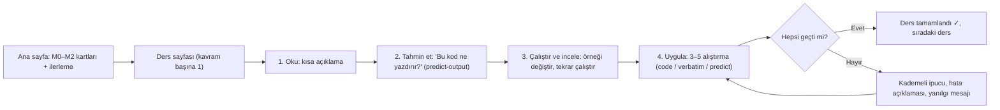
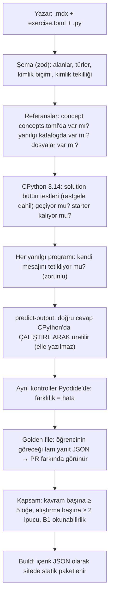
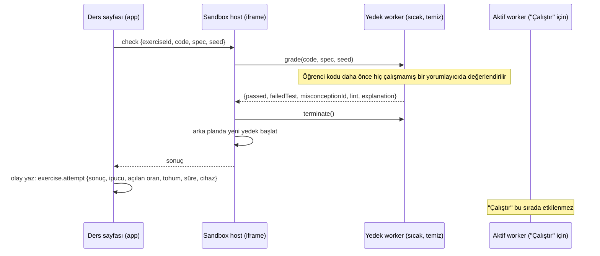
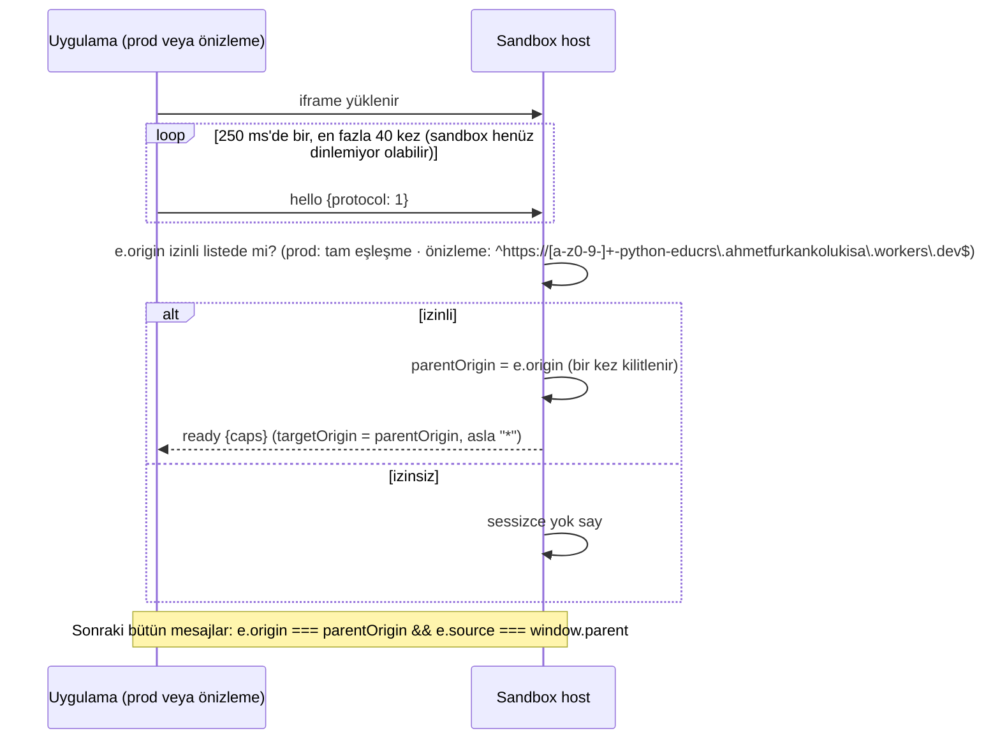
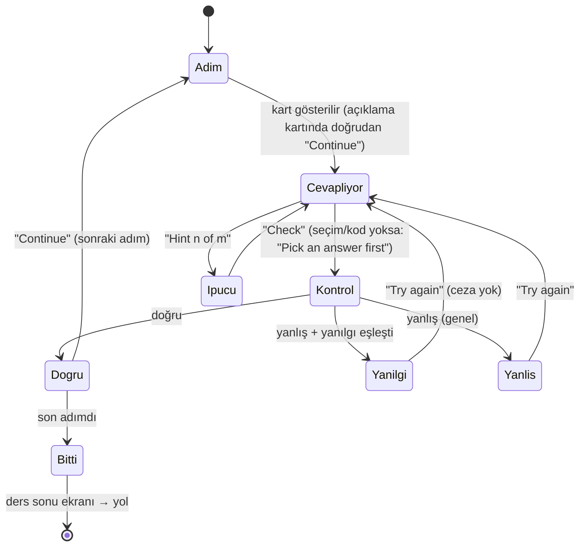

# F3 — MVP-0 Tasarımı (v0.4)

> **v0.4 (F3.4):** Editör kodda. Sıkı CSP ile CodeMirror'ın birlikte çalışması için alınan kararlar §5'te (gölge kök, `style-src-attr`, satır kaydırma). JS bütçesi üç kategoriye ayrıldı. Storybook kuruldu, her hikâye 3 temada axe ile taranıyor.
> **v0.3 (K18):** Ders artık uzun bir sayfa değil, **adım adım akan kartlar.** Oyunlaştırmanın temeli (XP, seri, günlük hedef, öğrenme yolu, ders sonu ekranı) MVP-0'a alındı. Ayrıntılar §13'te. §1'deki akış §13 ile güncellendi, ilkeler aynı.

> **Amaç:** Hesapsız ve tamamen yerel çalışan **ilk gerçek ders deneyimi.** M0–M2'yi (19 kavram) baştan sona öğretecek. Bitince **proje sahibi kendisi deneyip değerlendirecek** (v0.2 kararı, §12).
> **Kapsam dışı:** Hesap ve senkron, oyunlaştırma, öğrenci modeli (BKT/FSRS), görselleştirici, YZ öğretmen.
> **İlke:** Algoritma haritaları burada onaylanır, kod ondan sonra yazılır. Her harita bir testle kanıtlanır.
> Kütüphane sürümleri 22.11.2026'da npm'den doğrulandı: CodeMirror 6 (`@codemirror/view` 6.43, `lang-python` 6.2), `@astrojs/mdx` 8.1, `zod` 4.6, `dexie` 4.4, Storybook 10.6, `bits-ui` 2.22.

---

## 1. Öğrencinin deneyimi (v0.3: ekran düzeni §13'te)



- Her ders **PRIMM** akışını izler (ana plan §9.2 H): Predict (tahmin et) → Run (çalıştır) → Investigate (incele) → Modify (değiştir) → Make (yap).
- **İlk 60 saniye hedefi:** Ana sayfaya giren öğrenci kayıt olmadan, tek tıkla ilk dersin çalıştırılabilir örneğine ulaşır.
- Bir dersten diğerine geçmek serbest. Kilit yok, sadece "önerilen sıra" gösterilir. Öğrenci modeli F6'da gelecek.

**Sayfalar** (hepsi statik, Astro):

| Yol | İçerik |
|---|---|
| `/` | Kısa tanıtım + "Başla" + M0–M2 modül kartları (yerel ilerlemeyle) |
| `/learn/<modül>/<kavram>/` | Ders sayfası: MDX içerik + gömülü alıştırmalar |
| `/learn/<modül>/project/` | M1 sonu projesi: Kartvizit (`proj.business-card`) |
| `/about/privacy` | Gizlilik: hiçbir veri cihazdan çıkmıyor (Cloudflare Web Analytics çerezsiz sayfa sayımı hariç) |

## 2. İçerik formatı ve hattı

### 2.1 Dosya yapısı

```
content/
  concepts.toml                       (var: kavram grafiği)
  en/lessons/M1/print.basic.mdx       ders metni (frontmatter: concept, title, order)
  en/exercises/print.basic/
    hello-world/
      exercise.toml                   tür, zorluk, kontroller, ipuçları, yanılgılar
      starter.py                      başlangıç kodu
      solution.py                     referans çözüm
      wrong/quoted-name.py            yanılgı tetikleyicisi (davranışsal eşleşme için)
  golden/                             CI'ın ürettiği "öğrencinin göreceği tam yanıt" kayıtları
```

### 2.2 Alıştırma tanımı (örnek)

```toml
id = "ex:vars.use/greet-by-name"      # kalıcı kimlik, asla yeniden kullanılmaz
concept = "vars.use"
type = "code"                         # code | verbatim | predict-output
difficulty = "easy"                   # easy | medium | hard  → BKT G/S (ana plan §3.4.1)
title = "Greet someone by name"
prompt = """
The program starts with a variable `name`. Make it print `Hello, ` followed by the name.
"""
source = "original"                   # veya "futurecoder@def491c" (MIT, uyarlanmış)

[check]
kind = "program-with-inputs"          # stdout | program-with-inputs
inputs = ["name"]                     # programın başındaki atamalar; grader bunları değiştirir
tests = [{ name = "Ada" }, { name = "Grace Hopper" }]
random = { count = 6, types = { name = "str" } }  # tohumlu rastgele testler

[[hints]]
text = "You already have the name in a variable. How do you print a variable?"
[[hints]]
text = "Use `print(\"Hello,\", name)` — two values separated by a comma."

[[misconceptions]]
id = "mc.quoted-name"                 # concepts.toml'daki katalogda tanımlı olmalı
program = "wrong/quoted-name.py"      # öğrenci bununla AYNI davranırsa bu yanılgı teşhis edilir
message = "You printed the word `name` itself. Remove the quotes to print what the variable holds."
```

### 2.3 Doğrulama hattı (CI)



**Önemli kararlar:**
- **Çıktı tahmini sorularının doğru cevabı elle yazılmaz.** CI programı çalıştırıp cevabı kendisi üretir. Yazar hatası imkânsız hale gelir. "Hata verir" seçeneği her zaman eklenir (futurecoder F6).
- **Çözümler istemciye gider.** Rastgele testler referans çözümle karşılaştırıldığı için çözüm koda gömülü olmak zorunda. İsteyen öğrenci bulabilir. İçerik zaten açık kaynak (CC BY-SA) ve liderlik tablosu yok. Bu bilinçli olarak kabul edildi.

## 3. Notlandırma (grader) v1

### 3.1 "Kontrol Et" akışı: her kontrol taze bir worker'da



- **Neden taze worker?** F1'de kullanıcı kodunun süreç içi hijyeni atlatabildiği görüldü (`gc` ile sabotaj). Notlandırma sonucunun güvenilir olması için kod kirlenmemiş bir yorumlayıcıda çalışmalı (CLAUDE.md, pazarlığa kapalı kural).
- **Maliyet:** Her kontrol bir yedek worker tüketir. Yeni yedek arka planda yüklenir: masaüstünde ~0,6–0,8 sn, düşük donanımlı telefonda ölçülecek. Art arda iki kontrol gelirse ikincisi yedek hazır olana kadar bekler ve arayüzde "kontrol ediliyor…" görünür.
- **Tohum:** Uygulama `crypto.getRandomValues` ile üretir, olaya yazar, grader `random.Random(tohum)` ile kullanır. Aynı tohum + aynı kod = aynı sonuç (ana plan §3.2).

### 3.2 Kontrol türleri (M0–M2 için yeterli olanlar)

| Tür | Algoritma |
|---|---|
| `stdout` | Çıktıyı normalleştir (satır sonları, sondaki boşluklar) ve karşılaştır |
| `program-with-inputs` | AST ile baştaki `ad = değer` atamalarını ayır → her test girdisi için atamaları değiştirip programı çalıştır → çıktıyı aynı girdilerle çalıştırılan referans çözümün çıktısıyla karşılaştır (futurecoder F1) |
| `verbatim` | Öğrencinin kodu ve hedef kod `ast.dump()` ile karşılaştırılır. Boşluk ve yorum farkı önemsiz, yapı birebir aynı olmalı |
| `predict-output` | Seçilen şık ile CI'ın ürettiği doğru cevap karşılaştırılır. Kod çalıştırılmaz. |

**Rastgele metin girdileri:** Rastgele harf dizileri değil, **seçilmiş bir isim ve kelime listesi** kullanılır: "Ada", "Grace Hopper", "Çağla", "Ömer", "Zoë", tek harfli ve boşluklu isimler, boş metin. İki faydası var: öğrenci hata mesajında anlamlı bir girdi görür, ve Unicode/Türkçe karakter sorunları erkenden yakalanır.

### 3.3 Geri bildirim sırası

1. `SyntaxError` → hata açıklayıcısı (§4).
2. Yanılgı eşleşmesi: öğrencinin çıktısı bilinen yanlış programın çıktısıyla bütün testlerde aynıysa hedefli mesaj gösterilir.
3. Başarısız test: hangi girdiyle, beklenen ve öğrencinin çıktısı yan yana.
4. Çalışma zamanı hatası: değişken değerleriyle açıklama (§4).
5. Sadece başarısızlıkta `pyflakes` uyarıları (ör. "`nmae` hiç tanımlanmadı"). `pyflakes` saf Python wheel olarak sandbox'a eklenecek.

## 4. Hata açıklayıcısı v1 (M0–M2'ye özel)

**İlke** (F2 bulgusu): Python sürümleri arasında hata mesajlarının metni değişebiliyor. Bu yüzden açıklayıcı mesaj metnine değil, **istisna türüne ve yapısal bilgiye** bakar: `e.name`, `e.text`, `e.offset`, token akışı, tanımlı isimler.

| # | Durum (yapısal tespit) | Öğrenciye (sade İngilizce) |
|---|---|---|
| 1 | `NameError` + isim bir kelimeye benziyor ve tırnak yok (`print(Hello)`) | Forgot the quotes? Text must be inside `"..."`. |
| 2 | `NameError` + yalnızca büyük/küçük harf farkı olan tanımlı isim var (`Print`, `Name`) | Python cares about capital letters: `Print` is not `print`. |
| 3 | `NameError` + tanımlı bir isme çok benziyor (difflib) | Did you mean `name`? (yazım hatası) |
| 4 | `NameError` + isim hiç atanmamış veya atamadan önce kullanılmış | Variables must be created (`name = ...`) before you use them. |
| 5 | `SyntaxError` + satırda `“ ” ‘ ’` karakterleri | These are "smart quotes" (from Word or a phone keyboard). Use plain `"` quotes. |
| 6 | `SyntaxError` + kapanmamış tırnak (tokenize hatası) | Your text starts with `"` but never ends. Add the closing quote. |
| 7 | `SyntaxError` + `print` sonrası parantez yok | In Python 3, `print` needs parentheses: `print("hi")`. |
| 8 | `SyntaxError` + açık parantez sayısı ≠ kapalı | A `(` is missing its `)` (or the other way round). |
| 9 | `SyntaxError` + atamanın sol tarafı literal (`"Ada" = name`) | The name goes on the left: `name = "Ada"`. |
| 10 | `SyntaxError` + iki değer arasında virgül yok (`print("Hi" name)`) | Separate values with a comma. |
| 11 | `SyntaxError` + değişken adında boşluk veya rakamla başlama | Variable names can't contain spaces or start with a digit. Try `my_name`. |
| 12 | `SyntaxError` + anahtar kelimeyi değişken adı yapma (`class = ...`) | `class` is a reserved word in Python. Pick another name. |
| 13 | `IndentationError` + beklenmeyen girinti | This line starts with spaces it doesn't need. Remove them. |
| 14 | `TypeError` + `'str' object is not callable` + öğrenci `print`'e değer atamış | You replaced `print` with a value (`print = ...`). Rename your variable. |
| 15 | Diğer her şey | Kısa, genel açıklama + hatanın olduğu satır + değişken değerleri (`stack_data`) |

Her satır için bir **örnek tetikleyici program** ve bir test yazılır: "bu program bu açıklamayı üretmeli". Aynı testler CPython 3.14'te ve Pyodide'de çalışır.

**Yanılgı kataloğu genişlemesi:** `concepts.toml` dosyasına M0–M2 için ekleniyor:

| Yanılgı | Kavram |
|---|---|
| `mc.missing-quotes` | `strings.literal` |
| `mc.smart-quotes` | `strings.literal` |
| `mc.case-insensitive` | `print.basic` |
| `mc.shadow-builtin` | `vars.naming` |
| `mc.assign-direction` | `vars.assign` |
| `mc.comma-vs-plus` | `print.multiple-args` |

## 5. Editör ve mobil sembol çubuğu (`packages/ui`)

- **`CodeEditor.svelte`:** CodeMirror 6 + `lang-python`. Renk teması tasarım token'larından üretilir, 3 temanın hepsinde çalışır. Ekran okuyucu etiketleri var. `Ctrl/⌘+Enter` = Çalıştır.
  - Uygulama CodeMirror'ı doğrudan import edemez, sadece bu sarmalayıcı üzerinden kullanır. dependency-cruiser kuralı ve negatif testi de eklenecek.
- **iOS yakınlaştırma kuralı (F3.2 bulgusu):** iOS Safari, yazı boyutu 16 px'ten küçük bir form alanına odaklanınca sayfayı otomatik yakınlaştırır. Bu yüzden editör ve girdi kutuları dar ekranlarda **en az 16 px** olacak (e2e regresyon testi var).
- **`SymbolBar.svelte`:** Dokunmatik cihazlarda editörün hemen üstünde durur. Tuşlar: `Tab` (4 boşluk) `:` `( )` `" "` `' '` `=` `,` `#` `[ ]` `←` `→`. Her tuş imleç konumuna ekleme yapar, parantez ve tırnakları çift olarak ekler. ≥ 44 px dokunma hedefi.
- **Yükleme:** CodeMirror ders sayfasında ilk boyamadan sonra tembel (lazy) yüklenir. Yüklenene kadar düz bir `<textarea>` gösterilir, öğrenci beklemeden yazmaya başlayabilir. O ana kadar yazılanlar editöre taşınır.
- **JS bütçesi (F3.4'te ölçüldü ve sabitlendi, `tools/js-budget.mjs`, gzip):**
  - **İlk boyama** ≤ 50 KB (ölçülen 2,0 KB): satır içi script'ler, `<script src>`, `modulepreload` ve bunların statik import'ları.
  - **Adacıklar** ≤ 60 KB (ölçülen 25,3 KB): Svelte bileşenlerinin hidrasyonda hemen yüklediği kod.
  - **Tembel** ≤ 160 KB (ölçülen 120,4 KB): dinamik `import()` ile sonradan gelenler (CodeMirror).
  - **Sahipsiz parça kuralı:** `_astro/` altındaki her `.js` dosyası bir sayfadan erişilebilir olmalı. Tarayıcı bir import sözdizimini kaçırırsa (ilk sürüm `` import(`...`) `` biçimini kaçırıp 123 KB'lık CodeMirror parçasını hiç saymıyordu) bütçe geçmek yerine kırmızıya döner. Bilerek eklenen sahipsiz bir dosyayla kanıtlandı.

### 5.1 CodeMirror + sıkı CSP (F3.4 bulguları)

| Sorun | Çözüm | Test |
|---|---|---|
| CodeMirror stillerini `<style>` elemanı ekleyerek kuruyor. CSP bunu engelliyor ve **editör stilsiz görünürken testler geçiyordu.** | Editör bir **gölge kökte** (`EditorView({root})`) çalışıyor. Orada CodeMirror `adoptedStyleSheets` kullanıyor, CSP buna izin veriyor. CSS değişkenleri gölge köke miras kaldığı için tema token'ları aynen çalışıyor. `'unsafe-inline'` stil **eklenmedi**. | e2e: editörün gerçekten stilli olduğu ölçülüyor (köşe yarıçapı, monospace yazı, konumlandırma) |
| CodeMirror çalışırken elemanlara `style="..."` özniteliği yazıyor (imleç, seçim, satır yüksekliği). | CSP'ye sadece `style-src-attr 'unsafe-inline'` eklendi. Bu, `<style>` elemanlarına ve harici stil dosyalarına izin vermiyor, sadece öznitelikleri kapsıyor. Script tarafı (`script-src`) değişmedi. | e2e'de CSP ihlali yok |
| axe `scrollable-region-focusable`: uzun satırda `.cm-scroller` klavyeyle kaydırılamayan bir alan oluyordu. | `EditorView.lineWrapping`: satırlar kaydırılıyor. Telefonda yana kaydırma da gerekmiyor. | axe (e2e + Storybook "Long line wraps") |
| Sembol çubuğundaki `Tab` tuşunun erişilebilir adı "Insert indent" idi. Görünen metin adın içinde olmadığı için sesli komutla ("click Tab") basılamıyordu (WCAG 2.5.3). | Ad "Tab: insert indent (4 spaces)" oldu. Storybook axe taraması yakaladı. | Storybook axe |

- **Klavye tuzağı yok:** `Tab` editörde girinti yapar. `Esc` ve ardından `Tab` editörden çıkar (CodeMirror'ın standart kaçış yolu).
- **Sembol çubuğu odağı çalmıyor:** Tuşlar `pointerdown` olayını iptal ediyor. Klavye açık kalıyor, imleç yerinde duruyor (e2e: odak eklemeden sonra hâlâ editörün içinde).
- **e2e'de kod yapıştırma:** Testler kodu bir insanın yapacağı gibi yapıştırıyor: tümünü seç, yapıştır (çok satırlı yazmak otomatik girintiyi tetikler). İki tuzak bulundu, ikisi de küçük deneylerle doğrulandı (`e2e/helpers.ts`):
  - Firefox, `ClipboardEvent` oluştururken verilen `clipboardData`'yı yok sayıp boş bir tane koyuyor (Chromium ve WebKit koruyor). Veri her motor için açıkça atanıyor.
  - iOS modunda CodeMirror, Backspace tuşunu iptal edip 50 ms sonra bir zamanlayıcıyla uyguluyor. Yük altında yardımcı fonksiyonun "boşaldı mı?" kontrolü zamanlayıcıdan önce koşunca döngü tekrar deniyordu. O tekrardaki Backspace yapıştırmadan **sonra** uygulanıp son karakteri siliyordu: tam koşuda `print("Hi", name` çalıştı. Masaüstü motorlarında olmuyor. Gerçek kullanıcıyı etkilemiyor, çünkü Backspace ile yapıştırma arasında 50 ms'den az süre olmaz. Yardımcı artık Backspace kullanmıyor: seçimin üstüne yapıştırmak her şeyi tek adımda değiştiriyor. iPhone emülasyonunda daha önce bir kez görülen kararsız `input()` testinin de büyük ihtimalle kök nedeni bu (aynı test; o koşunun ayrıntısı kaydedilmemişti, kanıtlanmadı).
- **Sınır kuralı:** `@codemirror/*`, `codemirror` ve `@lezer/*` sadece `packages/ui` içinden import edilebilir. Negatif testi var (`tools/tests/test_boundaries.mjs`, "app uses CodeMirror directly").

## 6. Önizleme origin listesi + el sıkışma (F2'den devreden)



- **`frame-ancestors`:** `https://python.educrs.com https://*.ahmetfurkankolukisa.workers.dev`
  - ⚠️ Joker karakter, hesaptaki bütün `workers.dev` adreslerini kapsıyor. Bu, kendi hesabındaki başka bir Worker'ın da sandbox'ı gömebileceği anlamına geliyor. Kabul edilebilir bir risk, ama belgelendi.
- **Önizlemede site ayrımı yok:** Önizleme uygulaması da sandbox da aynı `<hesap>.workers.dev` altında olduğu için birbirleriyle aynı site sayılırlar. Önizlemeler gerçek kullanıcı verisi taşımadığı için kabul edildi (deploy rehberi §5).
- **Testler (e2e):**
  - prod origin ✓
  - önizleme deseni ✓
  - benzer görünen sahte origin ✗ (`https://evil-python-educrs.example.workers.dev`)
  - kilitlendikten sonra farklı bir origin'den gelen mesaj ✗

## 7. Yerel ilerleme: `packages/store`

- `LocalStore` portunun iki uygulaması olacak (iki uygulama kuralı):
  - **`DexieStore`:** IndexedDB. Açılışta `navigator.storage.persist()` istenir.
  - **`MemoryStore`:** Testler için.
- **MVP-0 olayları:**
  - `profile.created {learnerId}`
  - `exercise.attempt {exerciseId, contentHash, result, hints, revealRatio, seed, durationMs, device}`
  - `hint.used`
  - `lesson.completed`
  - Hepsi `v: 1`, `rs: 1`, `tz` alanlarını taşır (ana plan §3.6).
- **Türetilmiş durum** (saf reducer, property testli): tamamlanan alıştırmalar, tamamlanan dersler, "kaldığın yerden devam et".
- **"Verimi indir" butonu:** Bütün olayları JSON olarak indirir. Kullanıcı testlerinde katılımcı bu dosyayı **isterse** paylaşır. Sunucuya hiçbir şey gitmez (§9).

## 8. Storybook

- ✅ `packages/ui` içinde Storybook 10.6 (`@storybook/svelte-vite`) + `@storybook/addon-a11y` kuruldu. Araç çubuğunda tema seçici var (açık, koyu, yüksek kontrast).
- ✅ F3.4 hikâyeleri: `CodeEditor` (varsayılan, boş, satırda hata, salt okunur, sembol çubuklu, uzun satır, yüklenmeden önceki `textarea`) ve `SymbolBar`.
- Sonraki bileşenler hikâyeleriyle birlikte gelir: `Button`, `OutputPanel`, `HintLadder`, `ExerciseCard` (F3.5). Her birinin bütün durumları yazılır: boş, yükleniyor, hata, başarılı, devre dışı.
- ✅ `pnpm a11y:stories` (`tools/storybook-a11y.mjs`) Storybook'u derler ve **her hikâyeyi 3 temada** axe ile tarar (WCAG 2.2 AA etiketleri). Ciddi veya kritik ihlal varsa kırmızıya döner. CI'daki e2e işinde ve `pnpm run check` içinde koşuyor.
- ✅ **Kendi kendini test ediyor:** Her koşuda tarama bittikten sonra bilinen iki ihlal ekleniyor: biri normal DOM'a, biri CodeMirror'ın yaşadığı gölge köke. axe ikisini de bulamazsa kontrol kırmızıya döner. Böylece "tarama aslında hiçbir şeye bakmıyor" durumu fark edilmeden kalamaz.
- Görsel regresyon F11'de eklenecek.

## 9. Değerlendirme (v0.2: dış kullanıcı testi yok)

**Karar (§12-1):** F3'ün çıkışında dış katılımcılarla test yapılmayacak. Proje sahibi (İngilizcesi C1) M0–M2'yi baştan sona kendisi deneyecek.

- **Bilinçli olarak kaybedilen şey:** "Hiç kod yazmamış biri nerede takılıyor?" sinyali. Proje sahibi yeni başlayan değil, bu yüzden bazı engelleri (ör. tırnakları unutmak) kendisi yaşamayacak.
- **Bu kaybı kısmen telafi eden önlemler:**
  1. Yanılgı tetikleyicileri ve hata açıklayıcısı testleri, yeni başlayan hatalarını **otomatik olarak** deniyor (§3.3, §4).
  2. Proje sahibi denerken bilerek yeni başlayan hataları yapar. Bunun için kısa bir kontrol listesi `docs/06-f3-review.md` içinde verilecek: tırnaksız metin, akıllı tırnak, `Print`, `print = ...`, girinti, eksik parantez.
  3. Anonim, isteğe bağlı alıştırma istatistikleri (ana plan §9.1 D) sonraki fazlarda eklendiğinde gerçek takılma noktaları veriyle görülecek.
- **Çıktı:** `docs/06-f3-review.md`: proje sahibinin notları + ölçümler (ilk koda kadar geçen süre, ders başına süre, bulunan hatalar). F4'te plan v0.14 bu notlara dayanacak.

## 10. Alt fazlar ve çıkış kriterleri

| Alt faz | İş | Çıkış kriteri (test) |
|---|---|---|
| **F3.1** ✅ | Sandbox protokolü v1: el sıkışma, origin listesi, taze worker'da notlandırma | ✅ e2e 9 yeni test × 4 tarayıcı. **Mutasyon testi:** izin listesi bilerek bozulunca "sahte origin" testi kırmızıya dönüyor. Her kontrol `worker_runs: 1` raporluyor (yepyeni yorumlayıcı). Sabotaj ve sonsuz döngü notlandırmayı etkilemiyor. |
| **F3.2** ✅ | Grader v1 (Python) + içerik şeması + doğrulayıcı + golden files | ✅ Tek grader (`packages/grader`) tarayıcıda ve CI'da; 18 birim testi (4 kasıtlı bozukluğun hepsi yakalandı); içerik hattının 16 negatif testi; Pyodide üretir, CPython 3.14 aynı sonucu vermek zorunda; **tarayıcı notu golden dosyalarla alan alan aynı** (e2e); 4 örnek alıştırma |
| **F3.3** ✅ | Hata açıklayıcısı v1 (§4) | ✅ 18 kural (`packages/grader/educrs_explain.py`); 23 tetikleyici program, her kural en az birini taşıyor (test zorunlu kılıyor); yanlış alarm testleri; CPython **ve Pyodide 3.14.2**'de geçiyor; her kuralın `explain.<id>` metni var ve metin sadece kuralın verdiği parametreleri kullanıyor; Runner'da "What went wrong" kutusu (e2e). Yazım hatası tespiti `difflib` yerine harf yer değiştirmeyi tek hata sayan bir uzaklık ölçüsü kullanıyor (`nmae`→`name`). |
| **F3.4** ✅ | `CodeEditor` + `SymbolBar` + Storybook | ✅ Storybook: 8 hikâye × 3 tema axe temiz, planlanmış ihlal öz-testi (normal DOM + gölge kök) her koşuda geçiyor; e2e: editör 16 px, gerçekten stilli, hata satırı vurgulanıyor ve düzenleyince kalkıyor, `Ctrl/⌘+Enter` çalıştırıyor, sembol çubuğu sadece dokunmatikte ve odağı çalmıyor; JS bütçesi 3 kategoride sabitlendi + sahipsiz parça kuralı (§5) |
| **F3.2b** ✅ | `fill-gap` alıştırma türü (§13.4) + ders manifestosu doğrulaması (§13.2) | ✅ İçerik hattı her kutucuğu çalıştırıyor ve belirsiz soruyu reddediyor; yanlış kutucukların geri bildirimi otomatik (yanılgı mesajı, açıklayıcı kodu ya da çıktı); 17 yeni negatif test (8 `fill-gap`, 9 ders); ilk ders manifestosu (`vars.use`, 3 alıştırma) |
| **F3.5** | **Adım adım ders akışı** (§13.3): kartlar, alttan açılan geri bildirim paneli, ipucu merdiveni, ders sonu ekranı + **öğrenme yolu** (§13.6) | e2e: bir ders baştan sona çözülebiliyor (açıklama, tahmin, boşluk doldurma, kod, aynen yazma); yanlış cevap → "Try again", ceza yok; yol durumları doğru; klavyeyle tam akış; mobilde tek elle kullanılabilir |
| **F3.6** | `packages/store` (Dexie + bellek) + **`packages/gamification`** (XP, seri, günlük hedef reducer'ları, §13.5) + "verimi indir" + sade mod | Property testleri (ana plan §3.5.5): XP hiç azalmaz; aynı olaylardan aynı XP ve seri; olay sırası karışsa da sonuç aynı; seri saat dilimi ve dondurma kuralları; yeniden yüklemede ilerleme korunuyor |
| **F3.7** | **İçerik: M0–M2** (19 ders manifestosu, ≥ 95 öğe, Kartvizit projesi) | İçerik doğrulayıcısı yeşil; her derste ≥ 1 açıklama + ≥ 3 alıştırma adımı; B1 okunabilirlik eşiği geçiliyor |
| **F3.8** | Cilalama: erişilebilirlik, mobil, iOS Safari | Lighthouse ≥ 90; iPhone'da gerçek test |
| **F3 çıkışı** | **Proje sahibinin değerlendirmesi** (§9) | M0–M2 baştan sona denendi, `docs/06-f3-review.md` yazıldı |

**Sıralama:** F3.1–F3.3 birbirine bağımlı (protokol → grader → açıklayıcı). F3.4 bunlardan bağımsız, paralel ilerleyebilir. F3.7 (içerik), F3.2'deki şema donduğu anda başlayabilir.

## 11. Riskler

| Risk | Önlem |
|---|---|
| **İçerik hacmi** (95 öğe, bu fazın asıl işi) | Yazar şablonları, doğrulayıcı, futurecoder havuzundan kaynak göstererek uyarlama |
| Her kontrol için taze worker: düşük donanımlı telefonda gecikme | Sıcak yedek worker; "kontrol ediliyor" geri bildirimi; F3.8'de gerçek cihazda ölçüm. Gerekirse kontrol için ikinci bir yedek worker. |
| CodeMirror'un mobil boyutu ve davranışı | Tembel yükleme + textarea yedeği; iOS'ta klavye ve seçim testleri |
| iOS Safari (henüz test edilmedi) | F3.8'de gerçek cihaz; sorun çıkarsa yedek yol (önceden doldurulan girdi) zaten var |
| Dış kullanıcı testi yok: yeni başlayan sinyali eksik (§9) | Otomatik yanılgı testleri + bilerek hata yapma kontrol listesi + ileride anonim istatistikler |

## 12. Kararlar (22.11.2026)

| # | Soru | Karar |
|---|---|---|
| 1 | Test katılımcıları ve dil | **Dış test yok.** Proje sahibi (İngilizcesi C1) kendisi deneyecek. İçerik İngilizce kalıyor (K2 değişmedi). §9 buna göre güncellendi. |
| 2 | İçerik incelemesi | Taslakları Claude yazar, **proje sahibi örnekleyerek** inceler. Doğruluk CI'da otomatik kontrol ediliyor. |
| 3 | `shell.expressions` | **M1'de küçük bir ön tanıtım** (`print(2 + 3)`). Sayılar M3'te ayrıntılı işlenir. Kavram grafiği değişmedi. |

---

## 13. Oyunlaştırılmış, adım adım akış (v0.3, K18)

### 13.1 Ne alıyoruz, ne almıyoruz

**Alıyoruz:** Duolingo'nun markası ya da görseli değil, kanıtlanmış **etkileşim kalıpları**:
- tek seferde tek adım
- üstte ilerleme çubuğu
- alttan açılan geri bildirim paneli
- öğrenme yolu
- seri, XP ve günlük hedef
- ders sonu ekranı

Görsel kimlik bizim token'larımız (`packages/ui`) ve kendi ikonlarımızla kurulacak.

**Almıyoruz** (ana plan §3.5.1):
- Can veya kalp sistemi
- Mağaza, elmas, reklam
- Kayıp korkusuna oynayan bildirimler (Spark'ta zaten mümkün değil)
- Lig ve liderlik tablosu (hileye açık, ertelendi)

**Python'a özel:** Yanlış şıklar yanılgı kataloğuna bağlı. Öğrenci genel bir "Yanlış" değil, tam olarak neyi karıştırdığını görüyor.

### 13.2 Ders manifestosu

Bir ders, sıralı adımlardan oluşan bir TOML dosyasıdır: `content/en/lessons/<concept>.toml`.

```toml
concept = "vars.reassign"
title = "Reassignment"

[[steps]]
kind = "explain"                     # markdown kart, isteğe bağlı çalıştırılabilir örnek
text = """A variable can get a new value later. The old value is gone."""
example = "colour = 'red'\ncolour = 'blue'\nprint(colour)"

[[steps]]
kind = "exercise"
id = "ex:vars.reassign/predict-copy"  # predict-output | fill-gap | code | verbatim

[[steps]]
kind = "exercise"
id = "ex:vars.reassign/fill-new-value"
```

**Doğrulama** (içerik hattına eklenecek, negatif testleriyle):
- Kavram `concepts.toml` içinde var.
- Bütün alıştırma kimlikleri var ve bu kavrama ait.
- Derste en az 1 `explain` ve en az 3 alıştırma adımı var.
- İlk adım `explain`, son adım bir alıştırma.
- Her `example` hatasız çalışıyor.
- Aynı alıştırma iki derste kullanılmıyor.

### 13.3 Ders akışı (durum makinesi)



- **Geri bildirim paneli:**
  - Doğru → yeşil.
  - Yanılgı → sarı, başlığı "Common mix-up".
  - Genel yanlış → kırmızı.
  - Her durumda panelde tek bir büyük buton var.
  - Kod adımlarında açıklama §4'teki açıklayıcıdan geliyor.
- **Kod adımı:** Editör ve sembol çubuğu olan bir "çalışma alanı" kartı açılıyor. "Run" serbest, "Check" taze worker'da notlandırıyor (§3.1).
- **Kısmi çözüm açma:** 2 başarısız denemeden sonra "Show me" düğmesi açılıyor ve çözüm kademeli olarak gösteriliyor (§3.2). Akış asla kilitlenmiyor.
- **Dersten çıkmak:** "×" ile çıkılabilir, ilerleme olay olarak kaydedildiği için ders kaldığı yerden devam eder.
- **Klavye:** Enter = Check/Continue, 1–4 = şık seçimi. Odak her geçişte yeni kartın başlığına taşınır, ekran okuyucu durumu duyurur (`aria-live`).
- **Hareket:** Kart geçişleri ve panel 200 ms. `prefers-reduced-motion` açıksa animasyonsuz.

### 13.4 Yeni alıştırma türü: `fill-gap` (boşluk doldurma)

Telefonda klavyesiz pratik için kullanılıyor (ana plan §9.1 B).

```toml
id = "ex:vars.use/fill-print-name"
concept = "vars.use"
type = "fill-gap"
difficulty = "easy"
title = "Print the name"
prompt = "Make it print Hello, followed by the name."
template = "name = \"Ada\"\nprint(\"Hello,\", ____)"   # tam olarak bir boşluk (v1)
tiles = ["name", "\"name\"", "Name"]
answer = "name"
explanation = "Without quotes, Python uses the value stored in name."
[tile_misconceptions]
'"name"' = { id = "mc.quoted-name", message = "With quotes, Python prints the word name itself." }
```

- **Doğrulama:**
  - İçerik hattı her kutucuğu boşluğa koyup programı **çalıştırır**.
  - Cevap kutucuğu hatasız çalışmalı.
  - Diğer kutucukların her biri cevaptan **farklı bir sonuç** vermeli. Aynı sonucu veren kutucuk varsa soru belirsizdir ve hata verilir (`ambiguous-tiles`).
  - Kutucuklara bağlanan yanılgılar katalogda olmalı.
- **Notlandırma istemcide yapılır.** Kutucuk kimliği karşılaştırılır, Python gerekmez, anında yanıt verir. Golden dosya her kutucuğun çalışma sonucunu kaydeder.
- **Yanlış kutucukların geri bildirimi içerik hattında hesaplanır** (`tile_feedback`):
  - Kutucuğun yanılgı etiketi varsa yanılgının mesajı gösterilir.
  - Kutucuk hata veriyorsa açıklayıcının yapısal açıklaması kullanılır. Örneğin `Name` kutucuğu `NameError` verir ve `name.case` açıklaması gelir.
  - Hata vermiyorsa "bu şunu yazdırır" bilgisi, beklenen çıktıyla (`expected_output`) yan yana gösterilir.
  - Yazarın her kutucuk için ayrı mesaj yazması gerekmez.

### 13.5 Oyunlaştırmanın temeli (MVP-0)

Her şey **olaylardan türetilir** (ana plan §3.6). Ödül kuralları sürüm 1'dir (`rs: 1`, §3.5.6), değeri saklanmaz.

| Öğe | Kural (rs: 1) |
|---|---|
| **XP** | Alıştırma başına: taban (kolay 10, orta 15, zor 20) × ipucu çarpanı (0 ipucu → 1, 1 → 0,75, 2 → 0,5, kısmi çözüm → 0,25) × tekrar çarpanı (aynı alıştırmanın k. çözümü → 1/2^(k−1), en az 1). **Yanlış denemeler XP'yi azaltmaz.** Ders tamamlama +5. |
| **İlk denemede doğru** | Sadece ders sonu ekranında gösterilir, XP'yi etkilemez (yanlış cezası yok) |
| **Günlük hedef** | 10 / 20 / 30 / 50 XP (varsayılan 20). İlk ders bitince sorulur, ayarlardan değiştirilebilir. |
| **Seri** | Ana plan §3.5.4 madde 3: olayın yerel saat dilimine göre gün; günlük hedefi tutan ardışık günler; her 7 günlük seride 1 dondurma hakkı kazanılır (en fazla 2), kaçırılan bir gün dondurmayla otomatik kapatılır |
| **Seviye, rozet, görev, taç** | **F7'de** (BKT ve kural motoru gerektiriyor) |
| **Sade mod** | Ayarlarda tek düğme: üst çubuktaki sayılar, kutlama ve ders sonu istatistikleri gizlenir. Öğrenme aynen devam eder (§3.5.1 madde 4). |

**Olaylar** (hepsi `v: 1`, `rs: 1`, `tz`):
- `lesson.started {lessonId}`
- `step.answered {lessonId, step, exerciseId, correct, attempt, hints, revealRatio}`
- `exercise.attempt` (kod adımları, §7)
- `lesson.completed {lessonId}`
- `settings.changed {dailyGoal | plainMode}`

**`packages/gamification`:** Saf TypeScript reducer'larından oluşur: `xp`, `dailyProgress`, `streak`. `packages/core` dışında hiçbir şeye bağımlı değil (sınır kuralı eklenecek). Ana plan §3.5.5'teki değişmezler property testleriyle korunacak.

### 13.6 Öğrenme yolu

- **Düğümler:** Her modül, `concepts.toml` sırasındaki kavramların dersleridir. Modül sonunda proje düğümü var (M1: Kartvizit).
- **Yerleşim derleme anında hesaplanır:** Zikzak deseniyle x kayması (−60, 0, +60, 0 …), düğümler arası 104 px. Tam grafik yerleşimi (Sugiyama, ana plan §3.5.4 madde 7) modül sayısı artınca gelecek.
- **Durumlar olaylardan türetilir:**
  - tamamlandı (yeşil ✓)
  - **sıradaki** (büyük, vurgulu, "Start" etiketi): önerilen sıradaki ilk tamamlanmamış ders
  - başlanmadı (kesik çizgi)
- **Kilit yok.** Her düğüm tıklanabilir.
- **Üst çubuk:** seri (alev), XP ve günlük hedef halkası. Sade modda gizlenir.

### 13.7 Erişilebilirlik ve kalite kapıları (eklenenler)

- Paneldeki renkler tek başına bilgi taşımaz. Her durumda ikon + başlık da var (yeşil/kırmızı ayrımı yapamayanlar için).
- Kutucuklar ve şıklar ≥ 44 px, klavyeyle seçilebilir, ekran okuyucuya "1 of 4: cat" diye okunur.
- Akışın e2e testleri 4 tarayıcıda çalışacak. Mobil projede kutucukla tam ders akışı test edilecek.

