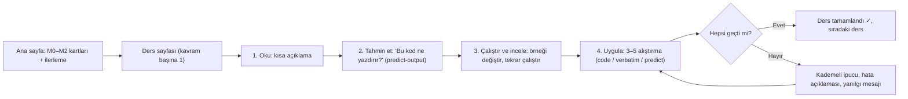
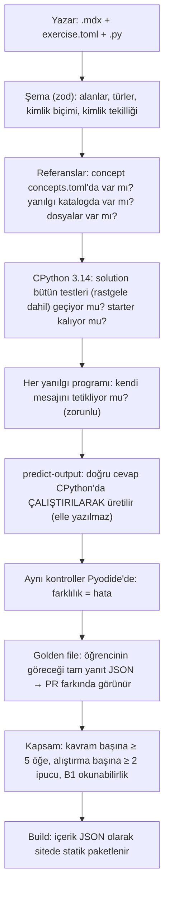
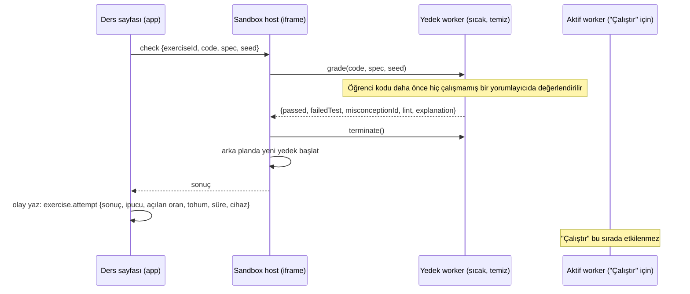
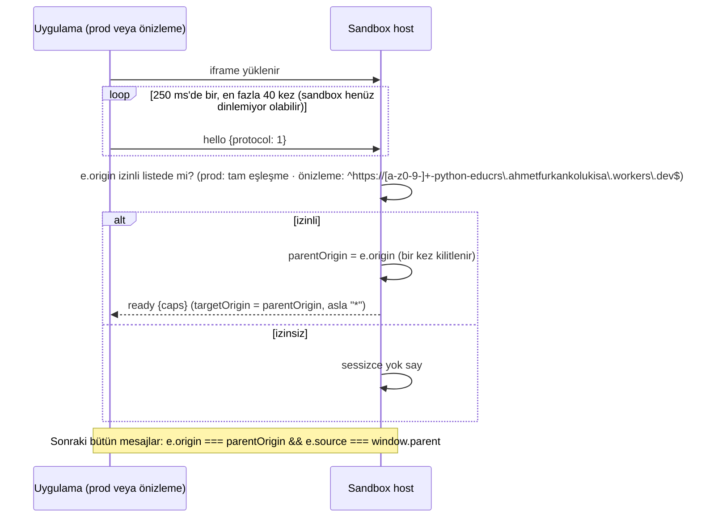
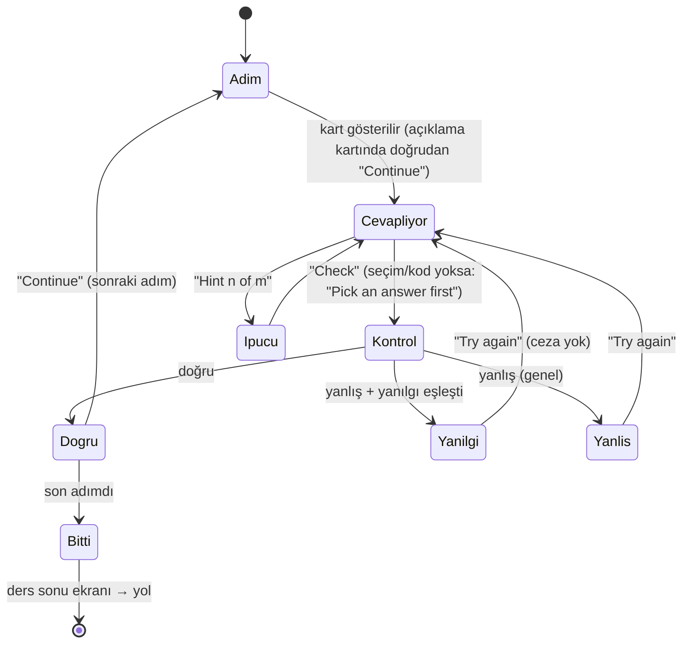

# F3 — MVP-0 Tasarımı (v0.8)

> **v0.8 (F3.8 görsel yön, §17):** Üç görsel yön tasarım tuvalinde karşılaştırıldı. **Proje sahibi A'yı seçti: sıcak ve oyunsu** (23.11.2026). Uygulama haritası §17.6.
> **v0.7 (F3.7, harita ve bulgular §16):** ✅ Tamamlandı. M0–M2 için 19 ders × 5 alıştırma + Kartvizit projesi planlandı. İçerik hattına okunabilirlik (Flesch ≥ 70, cümle ≤ 25 kelime), kavram başına ≥ 5 öğe, yanılgı kapsamı ve proje kontrolleri ekleniyor. Proje adresi `/learn/<modül>/proj-<ad>/`.
> **v0.6 (F3.6, harita ve bulgular §15):** ✅ Tamamlandı. XP ve seri kurallarında üç düzeltme var. (1) Tekrar çarpanı artık aynı gün içinde uygulanıyor ve en iyi çözümden başlayarak sıralanıyor. Zaman sırasına göre sayıldığında senkron toplam XP'yi düşürebiliyordu. (2) Seri ileri doğru yürüyor, çünkü dondurma hakkı zaman içinde ileri doğru kazanılıyor. (3) "En fazla 2 hak birikir" yerine "art arda en fazla 2 gün dondurulur". Tavan yüzünden boşa giden bir hak, geçmişe eklenen bir hedef gününün seriyi 51'den 0'a düşürmesine yol açıyordu. `exercise.attempt` yükü `difficulty` alanını taşıyor. Yeni olay: `settings.changed`.
> **v0.5 (F3.5 haritası, §14):** Yerel kayıt (`packages/store`) F3.6'dan F3.5'e alındı, çünkü yol durumları ve "kaldığın yerden devam" ona bağlı. Olay listesi sadeleşti: `lesson.started`, `exercise.attempt`, `lesson.completed`. `predict-output` şıklarının yanılgıları artık öğrenciye gösterilecek mesajı da taşıyor.
> **v0.4 (F3.4):** Editör kodda. Sıkı CSP ile CodeMirror'ın birlikte çalışması için alınan kararlar §5'te (gölge kök, `style-src-attr`, satır kaydırma). JS bütçesi üç kategoriye ayrıldı. Storybook kuruldu, her hikâye 3 temada axe ile taranıyor.
> **v0.3 (K18):** Ders artık uzun bir sayfa değil, **adım adım akan kartlar.** Oyunlaştırmanın temeli (XP, seri, günlük hedef, öğrenme yolu, ders sonu ekranı) MVP-0'a alındı. Ayrıntılar §13'te. §1'deki akış §13 ile güncellendi, ilkeler aynı.

> **Amaç:** Hesapsız ve tamamen yerel çalışan **ilk gerçek ders deneyimi.** M0–M2'yi (19 kavram) baştan sona öğretecek. Bitince **proje sahibi kendisi deneyip değerlendirecek** (v0.2 kararı, §12).
> **Kapsam dışı:** Hesap ve senkron, seviye/rozet/görev (F7), öğrenci modeli (BKT/FSRS), görselleştirici, YZ öğretmen.
> **İlke:** Algoritma haritaları burada onaylanır, kod ondan sonra yazılır. Her harita bir testle kanıtlanır.
> Kütüphane sürümleri 22.11.2026'da npm'den doğrulandı: CodeMirror 6 (`@codemirror/view` 6.43, `lang-python` 6.2), `@astrojs/mdx` 8.1, `zod` 4.6, `dexie` 4.4, Storybook 10.6, `bits-ui` 2.22.

---

## 1. Öğrencinin deneyimi (v0.3: ekran düzeni §13'te)



- Her ders **PRIMM** akışını izler (ana plan §9.2 H): Predict (tahmin et) → Run (çalıştır) → Investigate (incele) → Modify (değiştir) → Make (yap).
- **İlk 60 saniye hedefi:** Ana sayfaya giren öğrenci kayıt olmadan, tek tıkla ilk dersin çalıştırılabilir örneğine ulaşır.
- Bir dersten diğerine geçmek serbest. Kilit yok, sadece "önerilen sıra" gösterilir. Öğrenci modeli F6'da gelecek.

**Sayfalar** (hepsi statik, Astro):

| Yol | İçerik |
|---|---|
| `/` | Kısa tanıtım + "Başla" + M0–M2 modül kartları (yerel ilerlemeyle) |
| `/learn/<modül>/<kavram>/` | Ders sayfası: MDX içerik + gömülü alıştırmalar |
| `/learn/<modül>/proj-<ad>/` | Modül sonu projesi, ör. `/learn/m1/proj-business-card/` (v0.7, §16.3) |
| `/about/privacy` | Gizlilik: hiçbir veri cihazdan çıkmıyor (Cloudflare Web Analytics çerezsiz sayfa sayımı hariç) |

## 2. İçerik formatı ve hattı

### 2.1 Dosya yapısı

```
content/
  concepts.toml                       (var: kavram grafiği)
  en/lessons/M1/print.basic.mdx       ders metni (frontmatter: concept, title, order)
  en/exercises/print.basic/
    hello-world/
      exercise.toml                   tür, zorluk, kontroller, ipuçları, yanılgılar
      starter.py                      başlangıç kodu
      solution.py                     referans çözüm
      wrong/quoted-name.py            yanılgı tetikleyicisi (davranışsal eşleşme için)
  golden/                             CI'ın ürettiği "öğrencinin göreceği tam yanıt" kayıtları
```

### 2.2 Alıştırma tanımı (örnek)

```toml
id = "ex:vars.use/greet-by-name"      # kalıcı kimlik, asla yeniden kullanılmaz
concept = "vars.use"
type = "code"                         # code | verbatim | predict-output
difficulty = "easy"                   # easy | medium | hard  → BKT G/S (ana plan §3.4.1)
title = "Greet someone by name"
prompt = """
The program starts with a variable `name`. Make it print `Hello, ` followed by the name.
"""
source = "original"                   # veya "futurecoder@def491c" (MIT, uyarlanmış)

[check]
kind = "program-with-inputs"          # stdout | program-with-inputs
inputs = ["name"]                     # programın başındaki atamalar; grader bunları değiştirir
tests = [{ name = "Ada" }, { name = "Grace Hopper" }]
random = { count = 6, types = { name = "str" } }  # tohumlu rastgele testler

[[hints]]
text = "You already have the name in a variable. How do you print a variable?"
[[hints]]
text = "Use `print(\"Hello,\", name)` — two values separated by a comma."

[[misconceptions]]
id = "mc.quoted-name"                 # concepts.toml'daki katalogda tanımlı olmalı
program = "wrong/quoted-name.py"      # öğrenci bununla AYNI davranırsa bu yanılgı teşhis edilir
message = "You printed the word `name` itself. Remove the quotes to print what the variable holds."
```

### 2.3 Doğrulama hattı (CI)



**Önemli kararlar:**
- **Çıktı tahmini sorularının doğru cevabı elle yazılmaz.** CI programı çalıştırıp cevabı kendisi üretir. Yazar hatası imkânsız hale gelir. "Hata verir" seçeneği her zaman eklenir (futurecoder F6).
- **Çözümler istemciye gider.** Rastgele testler referans çözümle karşılaştırıldığı için çözüm koda gömülü olmak zorunda. İsteyen öğrenci bulabilir. İçerik zaten açık kaynak (CC BY-SA) ve liderlik tablosu yok. Bu bilinçli olarak kabul edildi.

## 3. Notlandırma (grader) v1

### 3.1 "Kontrol Et" akışı: her kontrol taze bir worker'da



- **Neden taze worker?** F1'de kullanıcı kodunun süreç içi hijyeni atlatabildiği görüldü (`gc` ile sabotaj). Notlandırma sonucunun güvenilir olması için kod kirlenmemiş bir yorumlayıcıda çalışmalı (CLAUDE.md, pazarlığa kapalı kural).
- **Maliyet:** Her kontrol bir yedek worker tüketir. Yeni yedek arka planda yüklenir: masaüstünde ~0,6–0,8 sn, düşük donanımlı telefonda ölçülecek. Art arda iki kontrol gelirse ikincisi yedek hazır olana kadar bekler ve arayüzde "kontrol ediliyor…" görünür.
- **Tohum:** Uygulama `crypto.getRandomValues` ile üretir, olaya yazar, grader `random.Random(tohum)` ile kullanır. Aynı tohum + aynı kod = aynı sonuç (ana plan §3.2).

### 3.2 Kontrol türleri (M0–M2 için yeterli olanlar)

| Tür | Algoritma |
|---|---|
| `stdout` | Çıktıyı normalleştir (satır sonları, sondaki boşluklar) ve karşılaştır |
| `program-with-inputs` | AST ile baştaki `ad = değer` atamalarını ayır → her test girdisi için atamaları değiştirip programı çalıştır → çıktıyı aynı girdilerle çalıştırılan referans çözümün çıktısıyla karşılaştır (futurecoder F1) |
| `verbatim` | Öğrencinin kodu ve hedef kod `ast.dump()` ile karşılaştırılır. Boşluk ve yorum farkı önemsiz, yapı birebir aynı olmalı |
| `predict-output` | Seçilen şık ile CI'ın ürettiği doğru cevap karşılaştırılır. Kod çalıştırılmaz. |

**Rastgele metin girdileri:** Rastgele harf dizileri değil, **seçilmiş bir isim ve kelime listesi** kullanılır: "Ada", "Grace Hopper", "Çağla", "Ömer", "Zoë", tek harfli ve boşluklu isimler, boş metin. İki faydası var: öğrenci hata mesajında anlamlı bir girdi görür, ve Unicode/Türkçe karakter sorunları erkenden yakalanır.

### 3.3 Geri bildirim sırası

1. `SyntaxError` → hata açıklayıcısı (§4).
2. Yanılgı eşleşmesi: öğrencinin çıktısı bilinen yanlış programın çıktısıyla bütün testlerde aynıysa hedefli mesaj gösterilir.
3. Başarısız test: hangi girdiyle, beklenen ve öğrencinin çıktısı yan yana.
4. Çalışma zamanı hatası: değişken değerleriyle açıklama (§4).
5. Sadece başarısızlıkta `pyflakes` uyarıları (ör. "`nmae` hiç tanımlanmadı"). `pyflakes` saf Python wheel olarak sandbox'a eklenecek.

## 4. Hata açıklayıcısı v1 (M0–M2'ye özel)

**İlke** (F2 bulgusu): Python sürümleri arasında hata mesajlarının metni değişebiliyor. Bu yüzden açıklayıcı mesaj metnine değil, **istisna türüne ve yapısal bilgiye** bakar: `e.name`, `e.text`, `e.offset`, token akışı, tanımlı isimler.

| # | Durum (yapısal tespit) | Öğrenciye (sade İngilizce) |
|---|---|---|
| 1 | `NameError` + isim bir kelimeye benziyor ve tırnak yok (`print(Hello)`) | Forgot the quotes? Text must be inside `"..."`. |
| 2 | `NameError` + yalnızca büyük/küçük harf farkı olan tanımlı isim var (`Print`, `Name`) | Python cares about capital letters: `Print` is not `print`. |
| 3 | `NameError` + tanımlı bir isme çok benziyor (difflib) | Did you mean `name`? (yazım hatası) |
| 4 | `NameError` + isim hiç atanmamış veya atamadan önce kullanılmış | Variables must be created (`name = ...`) before you use them. |
| 5 | `SyntaxError` + satırda `“ ” ‘ ’` karakterleri | These are "smart quotes" (from Word or a phone keyboard). Use plain `"` quotes. |
| 6 | `SyntaxError` + kapanmamış tırnak (tokenize hatası) | Your text starts with `"` but never ends. Add the closing quote. |
| 7 | `SyntaxError` + `print` sonrası parantez yok | In Python 3, `print` needs parentheses: `print("hi")`. |
| 8 | `SyntaxError` + açık parantez sayısı ≠ kapalı | A `(` is missing its `)` (or the other way round). |
| 9 | `SyntaxError` + atamanın sol tarafı literal (`"Ada" = name`) | The name goes on the left: `name = "Ada"`. |
| 10 | `SyntaxError` + iki değer arasında virgül yok (`print("Hi" name)`) | Separate values with a comma. |
| 11 | `SyntaxError` + değişken adında boşluk veya rakamla başlama | Variable names can't contain spaces or start with a digit. Try `my_name`. |
| 12 | `SyntaxError` + anahtar kelimeyi değişken adı yapma (`class = ...`) | `class` is a reserved word in Python. Pick another name. |
| 13 | `IndentationError` + beklenmeyen girinti | This line starts with spaces it doesn't need. Remove them. |
| 14 | `TypeError` + `'str' object is not callable` + öğrenci `print`'e değer atamış | You replaced `print` with a value (`print = ...`). Rename your variable. |
| 15 | Diğer her şey | Kısa, genel açıklama + hatanın olduğu satır + değişken değerleri (`stack_data`) |

Her satır için bir **örnek tetikleyici program** ve bir test yazılır: "bu program bu açıklamayı üretmeli". Aynı testler CPython 3.14'te ve Pyodide'de çalışır.

**Yanılgı kataloğu genişlemesi:** `concepts.toml` dosyasına M0–M2 için ekleniyor:

| Yanılgı | Kavram |
|---|---|
| `mc.missing-quotes` | `strings.literal` |
| `mc.smart-quotes` | `strings.literal` |
| `mc.case-insensitive` | `print.basic` |
| `mc.shadow-builtin` | `vars.naming` |
| `mc.assign-direction` | `vars.assign` |
| `mc.comma-vs-plus` | `print.multiple-args` |

## 5. Editör ve mobil sembol çubuğu (`packages/ui`)

- **`CodeEditor.svelte`:** CodeMirror 6 + `lang-python`. Renk teması tasarım token'larından üretilir, 3 temanın hepsinde çalışır. Ekran okuyucu etiketleri var. `Ctrl/⌘+Enter` = Çalıştır.
  - Uygulama CodeMirror'ı doğrudan import edemez, sadece bu sarmalayıcı üzerinden kullanır. dependency-cruiser kuralı ve negatif testi de eklenecek.
- **iOS yakınlaştırma kuralı (F3.2 bulgusu):** iOS Safari, yazı boyutu 16 px'ten küçük bir form alanına odaklanınca sayfayı otomatik yakınlaştırır. Bu yüzden editör ve girdi kutuları dar ekranlarda **en az 16 px** olacak (e2e regresyon testi var).
- **`SymbolBar.svelte`:** Dokunmatik cihazlarda editörün hemen üstünde durur. Tuşlar: `Tab` (4 boşluk) `:` `( )` `" "` `' '` `=` `,` `#` `[ ]` `←` `→`. Her tuş imleç konumuna ekleme yapar, parantez ve tırnakları çift olarak ekler. ≥ 44 px dokunma hedefi.
- **Yükleme:** CodeMirror ders sayfasında ilk boyamadan sonra tembel (lazy) yüklenir. Yüklenene kadar düz bir `<textarea>` gösterilir, öğrenci beklemeden yazmaya başlayabilir. O ana kadar yazılanlar editöre taşınır.
- **JS bütçesi (F3.4'te ölçüldü ve sabitlendi, `tools/js-budget.mjs`, gzip):**
  - **İlk boyama** ≤ 50 KB (ölçülen 2,0 KB): satır içi script'ler, `<script src>`, `modulepreload` ve bunların statik import'ları.
  - **Adacıklar** ≤ 60 KB (ölçülen 25,3 KB): Svelte bileşenlerinin hidrasyonda hemen yüklediği kod.
  - **Tembel** ≤ 160 KB (ölçülen 120,4 KB): dinamik `import()` ile sonradan gelenler (CodeMirror).
  - **Sahipsiz parça kuralı:** `_astro/` altındaki her `.js` dosyası bir sayfadan erişilebilir olmalı. Tarayıcı bir import sözdizimini kaçırırsa (ilk sürüm `` import(`...`) `` biçimini kaçırıp 123 KB'lık CodeMirror parçasını hiç saymıyordu) bütçe geçmek yerine kırmızıya döner. Bilerek eklenen sahipsiz bir dosyayla kanıtlandı.

### 5.1 CodeMirror + sıkı CSP (F3.4 bulguları)

| Sorun | Çözüm | Test |
|---|---|---|
| CodeMirror stillerini `<style>` elemanı ekleyerek kuruyor. CSP bunu engelliyor ve **editör stilsiz görünürken testler geçiyordu.** | Editör bir **gölge kökte** (`EditorView({root})`) çalışıyor. Orada CodeMirror `adoptedStyleSheets` kullanıyor, CSP buna izin veriyor. CSS değişkenleri gölge köke miras kaldığı için tema token'ları aynen çalışıyor. `'unsafe-inline'` stil **eklenmedi**. | e2e: editörün gerçekten stilli olduğu ölçülüyor (köşe yarıçapı, monospace yazı, konumlandırma) |
| CodeMirror çalışırken elemanlara `style="..."` özniteliği yazıyor (imleç, seçim, satır yüksekliği). | CSP'ye sadece `style-src-attr 'unsafe-inline'` eklendi. Bu, `<style>` elemanlarına ve harici stil dosyalarına izin vermiyor, sadece öznitelikleri kapsıyor. Script tarafı (`script-src`) değişmedi. | e2e'de CSP ihlali yok |
| axe `scrollable-region-focusable`: uzun satırda `.cm-scroller` klavyeyle kaydırılamayan bir alan oluyordu. | `EditorView.lineWrapping`: satırlar kaydırılıyor. Telefonda yana kaydırma da gerekmiyor. | axe (e2e + Storybook "Long line wraps") |
| Sembol çubuğundaki `Tab` tuşunun erişilebilir adı "Insert indent" idi. Görünen metin adın içinde olmadığı için sesli komutla ("click Tab") basılamıyordu (WCAG 2.5.3). | Ad "Tab: insert indent (4 spaces)" oldu. Storybook axe taraması yakaladı. | Storybook axe |

- **Klavye tuzağı yok:** `Tab` editörde girinti yapar. `Esc` ve ardından `Tab` editörden çıkar (CodeMirror'ın standart kaçış yolu).
- **Sembol çubuğu odağı çalmıyor:** Tuşlar `pointerdown` olayını iptal ediyor. Klavye açık kalıyor, imleç yerinde duruyor (e2e: odak eklemeden sonra hâlâ editörün içinde).
- **e2e'de kod yapıştırma:** Testler kodu bir insanın yapacağı gibi yapıştırıyor: tümünü seç, yapıştır (çok satırlı yazmak otomatik girintiyi tetikler). İki tuzak bulundu, ikisi de küçük deneylerle doğrulandı (`e2e/helpers.ts`):
  - Firefox, `ClipboardEvent` oluştururken verilen `clipboardData`'yı yok sayıp boş bir tane koyuyor (Chromium ve WebKit koruyor). Veri her motor için açıkça atanıyor.
  - iOS modunda CodeMirror, Backspace tuşunu iptal edip 50 ms sonra bir zamanlayıcıyla uyguluyor. Yük altında yardımcı fonksiyonun "boşaldı mı?" kontrolü zamanlayıcıdan önce koşunca döngü tekrar deniyordu. O tekrardaki Backspace yapıştırmadan **sonra** uygulanıp son karakteri siliyordu: tam koşuda `print("Hi", name` çalıştı. Masaüstü motorlarında olmuyor. Gerçek kullanıcıyı etkilemiyor, çünkü Backspace ile yapıştırma arasında 50 ms'den az süre olmaz. Yardımcı artık Backspace kullanmıyor: seçimin üstüne yapıştırmak her şeyi tek adımda değiştiriyor. iPhone emülasyonunda daha önce bir kez görülen kararsız `input()` testinin de büyük ihtimalle kök nedeni bu (aynı test; o koşunun ayrıntısı kaydedilmemişti, kanıtlanmadı).
- **Sınır kuralı:** `@codemirror/*`, `codemirror` ve `@lezer/*` sadece `packages/ui` içinden import edilebilir. Negatif testi var (`tools/tests/test_boundaries.mjs`, "app uses CodeMirror directly").

## 6. Önizleme origin listesi + el sıkışma (F2'den devreden)



- **`frame-ancestors`:** `https://python.educrs.com https://*.ahmetfurkankolukisa.workers.dev`
  - ⚠️ Joker karakter, hesaptaki bütün `workers.dev` adreslerini kapsıyor. Bu, kendi hesabındaki başka bir Worker'ın da sandbox'ı gömebileceği anlamına geliyor. Kabul edilebilir bir risk, ama belgelendi.
- **Önizlemede site ayrımı yok:** Önizleme uygulaması da sandbox da aynı `<hesap>.workers.dev` altında olduğu için birbirleriyle aynı site sayılırlar. Önizlemeler gerçek kullanıcı verisi taşımadığı için kabul edildi (deploy rehberi §5).
- **Testler (e2e):**
  - prod origin ✓
  - önizleme deseni ✓
  - benzer görünen sahte origin ✗ (`https://evil-python-educrs.example.workers.dev`)
  - kilitlendikten sonra farklı bir origin'den gelen mesaj ✗

## 7. Yerel ilerleme: `packages/store`

- `LocalStore` portunun iki uygulaması olacak (iki uygulama kuralı):
  - **`DexieStore`:** IndexedDB. Açılışta `navigator.storage.persist()` istenir.
  - **`MemoryStore`:** Testler için.
- **MVP-0 olayları:**
  - `profile.created {learnerId}`
  - `exercise.attempt {exerciseId, contentHash, result, hints, revealRatio, seed, durationMs, device}`
  - `hint.used`
  - `lesson.completed`
  - Hepsi `v: 1`, `rs: 1`, `tz` alanlarını taşır (ana plan §3.6).
- **Türetilmiş durum** (saf reducer, property testli): tamamlanan alıştırmalar, tamamlanan dersler, "kaldığın yerden devam et".
- **"Verimi indir" butonu:** Bütün olayları JSON olarak indirir. Kullanıcı testlerinde katılımcı bu dosyayı **isterse** paylaşır. Sunucuya hiçbir şey gitmez (§9).

## 8. Storybook

- ✅ `packages/ui` içinde Storybook 10.6 (`@storybook/svelte-vite`) + `@storybook/addon-a11y` kuruldu. Araç çubuğunda tema seçici var (açık, koyu, yüksek kontrast).
- ✅ F3.4 hikâyeleri: `CodeEditor` (varsayılan, boş, satırda hata, salt okunur, sembol çubuklu, uzun satır, yüklenmeden önceki `textarea`) ve `SymbolBar`.
- Sonraki bileşenler hikâyeleriyle birlikte gelir: `Button`, `OutputPanel`, `HintLadder`, `ExerciseCard` (F3.5). Her birinin bütün durumları yazılır: boş, yükleniyor, hata, başarılı, devre dışı.
- ✅ `pnpm a11y:stories` (`tools/storybook-a11y.mjs`) Storybook'u derler ve **her hikâyeyi 3 temada** axe ile tarar (WCAG 2.2 AA etiketleri). Ciddi veya kritik ihlal varsa kırmızıya döner. CI'daki e2e işinde ve `pnpm run check` içinde koşuyor.
- ✅ **Kendi kendini test ediyor:** Her koşuda tarama bittikten sonra bilinen iki ihlal ekleniyor: biri normal DOM'a, biri CodeMirror'ın yaşadığı gölge köke. axe ikisini de bulamazsa kontrol kırmızıya döner. Böylece "tarama aslında hiçbir şeye bakmıyor" durumu fark edilmeden kalamaz.
- Görsel regresyon F11'de eklenecek.

## 9. Değerlendirme (v0.2: dış kullanıcı testi yok)

**Karar (§12-1):** F3'ün çıkışında dış katılımcılarla test yapılmayacak. Proje sahibi (İngilizcesi C1) M0–M2'yi baştan sona kendisi deneyecek.

- **Bilinçli olarak kaybedilen şey:** "Hiç kod yazmamış biri nerede takılıyor?" sinyali. Proje sahibi yeni başlayan değil, bu yüzden bazı engelleri (ör. tırnakları unutmak) kendisi yaşamayacak.
- **Bu kaybı kısmen telafi eden önlemler:**
  1. Yanılgı tetikleyicileri ve hata açıklayıcısı testleri, yeni başlayan hatalarını **otomatik olarak** deniyor (§3.3, §4).
  2. Proje sahibi denerken bilerek yeni başlayan hataları yapar. Bunun için kısa bir kontrol listesi `docs/06-f3-review.md` içinde verilecek: tırnaksız metin, akıllı tırnak, `Print`, `print = ...`, girinti, eksik parantez.
  3. Anonim, isteğe bağlı alıştırma istatistikleri (ana plan §9.1 D) sonraki fazlarda eklendiğinde gerçek takılma noktaları veriyle görülecek.
- **Çıktı:** `docs/06-f3-review.md`: proje sahibinin notları + ölçümler (ilk koda kadar geçen süre, ders başına süre, bulunan hatalar). F4'te plan v0.14 bu notlara dayanacak.

## 10. Alt fazlar ve çıkış kriterleri

| Alt faz | İş | Çıkış kriteri (test) |
|---|---|---|
| **F3.1** ✅ | Sandbox protokolü v1: el sıkışma, origin listesi, taze worker'da notlandırma | ✅ e2e 9 yeni test × 4 tarayıcı. **Mutasyon testi:** izin listesi bilerek bozulunca "sahte origin" testi kırmızıya dönüyor. Her kontrol `worker_runs: 1` raporluyor (yepyeni yorumlayıcı). Sabotaj ve sonsuz döngü notlandırmayı etkilemiyor. |
| **F3.2** ✅ | Grader v1 (Python) + içerik şeması + doğrulayıcı + golden files | ✅ Tek grader (`packages/grader`) tarayıcıda ve CI'da; 18 birim testi (4 kasıtlı bozukluğun hepsi yakalandı); içerik hattının 16 negatif testi; Pyodide üretir, CPython 3.14 aynı sonucu vermek zorunda; **tarayıcı notu golden dosyalarla alan alan aynı** (e2e); 4 örnek alıştırma |
| **F3.3** ✅ | Hata açıklayıcısı v1 (§4) | ✅ 18 kural (`packages/grader/educrs_explain.py`); 23 tetikleyici program, her kural en az birini taşıyor (test zorunlu kılıyor); yanlış alarm testleri; CPython **ve Pyodide 3.14.2**'de geçiyor; her kuralın `explain.<id>` metni var ve metin sadece kuralın verdiği parametreleri kullanıyor; Runner'da "What went wrong" kutusu (e2e). Yazım hatası tespiti `difflib` yerine harf yer değiştirmeyi tek hata sayan bir uzaklık ölçüsü kullanıyor (`nmae`→`name`). |
| **F3.4** ✅ | `CodeEditor` + `SymbolBar` + Storybook | ✅ Storybook: 8 hikâye × 3 tema axe temiz, planlanmış ihlal öz-testi (normal DOM + gölge kök) her koşuda geçiyor; e2e: editör 16 px, gerçekten stilli, hata satırı vurgulanıyor ve düzenleyince kalkıyor, `Ctrl/⌘+Enter` çalıştırıyor, sembol çubuğu sadece dokunmatikte ve odağı çalmıyor; JS bütçesi 3 kategoride sabitlendi + sahipsiz parça kuralı (§5) |
| **F3.2b** ✅ | `fill-gap` alıştırma türü (§13.4) + ders manifestosu doğrulaması (§13.2) | ✅ İçerik hattı her kutucuğu çalıştırıyor ve belirsiz soruyu reddediyor; yanlış kutucukların geri bildirimi otomatik (yanılgı mesajı, açıklayıcı kodu ya da çıktı); 17 yeni negatif test (8 `fill-gap`, 9 ders); ilk ders manifestosu (`vars.use`, 3 alıştırma) |
| **F3.5** ✅ | **Adım adım ders akışı** (§13.3): kartlar, alttan açılan geri bildirim paneli, ipucu merdiveni, ders sonu ekranı + **öğrenme yolu** (§13.6) + **yerel kayıt** (`packages/store`, v0.5'te F3.6'dan alındı; harita §14) | ✅ e2e **183/183** (4 tarayıcı), dersle ilgili olanlar: `vars.use` baştan sona, beş adım türünün hepsinde önce yanlış sonra doğru cevap, ceza yok; klavyeyle tam akış (Enter, 1–4, odak her kartta başlıkta); iki yanlıştan sonra "Show me"; × ile çıkıp kaldığı adımdan devam; yol durumları; CSP ihlali yok; panel açıkken ve yolda axe temiz. Birim: akış reducer'ının değişmezleri property testli ve **mutasyon testiyle kanıtlı** (3 bozulmanın 3'ü yakalandı); aynı store test takımı Dexie ve bellek üzerinde; içerik hattının 5 yeni negatif testi; sınır testleri 13/13; Storybook 26 hikâye × 3 tema |
| **F3.6** ✅ | **`packages/gamification`** (XP, seri, günlük hedef reducer'ları, §13.5; harita §15) + "verimi indir" + sade mod + ayarlar sayfası | ✅ Property testleri (ana plan §3.5.5): olay eklemek XP'yi ve **hiçbir günün** XP'sini azaltmaz; bir olay sadece kendi gününü etkiler; olay sırası ve tekrarı sonucu değiştirmez; seri gün gün yürüyen referansla aynı, dondurma kuralları ve monotonluk korunuyor. **Yedi kasıtlı bozulmanın yedisini sadece property testleri yakalıyor** (her biri 3/3). `rs: 1` dondurulmuş tabloyla korunuyor. e2e **215/215** (4 tarayıcı; 5 atlanan mobil/masaüstü ayrımı): ilk derste +45 XP, hedef sorusu, iki günlük seri (sabit saatle), sayfa yenilenince ilerleme korunuyor, sade mod, verimi indir, ayarlarda axe ve CSP. Birim 216, sınır 15/15, Storybook 39 hikâye × 3 tema. Bulgular §15.10. |
| **F3.7** ✅ | **İçerik: M0–M2** (19 ders manifestosu, ≥ 95 öğe, Kartvizit projesi; harita §16) | ✅ 19 ders × 5 alıştırma + 3 adımlı proje = **98 alıştırma**, hepsi Pyodide'de çalıştırılıp golden dosyalara yazıldı ve CPython 3.14'te aynı sonucu veriyor. Okunabilirlik 85–104 (eşik 70), en uzun cümle 19 kelime (eşik 25). Dersi olan her kavramın katalogdaki yanılgıları öğretiliyor. İçerik hattının 8 yeni negatif testi (7 kuralın her biri bozulunca yakalanıyor). Tarayıcı notu golden dosyalarla birebir aynı (Chromium'da 43 alıştırma, diğer motorlarda temsilciler). e2e: 20 düğümlü yol, proje sayfası 4 tarayıcıda. İnceleme listesi `docs/06-f3-review.md`. Bulgular §16.7. |
| **F3.8** 🔶 | Cilalama: **görsel kimlik** (önce bir görsel yön dokümanı ve 2–3 seçenek, proje sahibi seçer; sonra tipografi, ders kartları, yol haritası, kutlamalar, mobil yerleşim), erişilebilirlik, mobil, iOS Safari | ✅ **Görsel kimlik (A) ve ayrıntı turu (§17.6–17.9):** üç temada 124 kontrast kontrolü; fontlar ve basma kenarı gerçekten uygulanıyor; yalnızca Latin fontlar ≤ 90 KB; hiçbir sayfa 375 px'de yana kaymıyor; güvenli alanlar, `theme-color`, font ön yüklemesi, zorunlu renkler, 404. Tam kontrol (23.11.2026): e2e 309 test geçti (119'u bilerek atlanıyor), birim 250, Storybook 53 hikâye × 3 tema. ⏳ **Kalan:** ikinci tur (maskot Byte ve zanaat işleri, §17.11), Lighthouse ölçümü (§17.10), gerçek iPhone denemesi (proje sahibinin cihazı). |
| **F3 çıkışı** | **Proje sahibinin değerlendirmesi** (§9) | M0–M2 baştan sona denendi, `docs/06-f3-review.md` yazıldı |

**Sıralama:** F3.1–F3.3 birbirine bağımlı (protokol → grader → açıklayıcı). F3.4 bunlardan bağımsız, paralel ilerleyebilir. F3.7 (içerik), F3.2'deki şema donduğu anda başlayabilir.

## 11. Riskler

| Risk | Önlem |
|---|---|
| **İçerik hacmi** (95 öğe, bu fazın asıl işi) | Yazar şablonları, doğrulayıcı, futurecoder havuzundan kaynak göstererek uyarlama |
| Her kontrol için taze worker: düşük donanımlı telefonda gecikme | Sıcak yedek worker; "kontrol ediliyor" geri bildirimi; F3.8'de gerçek cihazda ölçüm. Gerekirse kontrol için ikinci bir yedek worker. |
| CodeMirror'un mobil boyutu ve davranışı | Tembel yükleme + textarea yedeği; iOS'ta klavye ve seçim testleri |
| iOS Safari (henüz test edilmedi) | F3.8'de gerçek cihaz; sorun çıkarsa yedek yol (önceden doldurulan girdi) zaten var |
| Dış kullanıcı testi yok: yeni başlayan sinyali eksik (§9) | Otomatik yanılgı testleri + bilerek hata yapma kontrol listesi + ileride anonim istatistikler |

## 12. Kararlar (22.11.2026)

| # | Soru | Karar |
|---|---|---|
| 1 | Test katılımcıları ve dil | **Dış test yok.** Proje sahibi (İngilizcesi C1) kendisi deneyecek. İçerik İngilizce kalıyor (K2 değişmedi). §9 buna göre güncellendi. |
| 2 | İçerik incelemesi | Taslakları Claude yazar, **proje sahibi örnekleyerek** inceler. Doğruluk CI'da otomatik kontrol ediliyor. |
| 3 | `shell.expressions` | **M1'de küçük bir ön tanıtım** (`print(2 + 3)`). Sayılar M3'te ayrıntılı işlenir. Kavram grafiği değişmedi. |

---

## 13. Oyunlaştırılmış, adım adım akış (v0.3, K18)

### 13.1 Ne alıyoruz, ne almıyoruz

**Alıyoruz:** Duolingo'nun markası ya da görseli değil, kanıtlanmış **etkileşim kalıpları**:
- tek seferde tek adım
- üstte ilerleme çubuğu
- alttan açılan geri bildirim paneli
- öğrenme yolu
- seri, XP ve günlük hedef
- ders sonu ekranı

Görsel kimlik bizim token'larımız (`packages/ui`) ve kendi ikonlarımızla kurulacak.

**Almıyoruz** (ana plan §3.5.1):
- Can veya kalp sistemi
- Mağaza, elmas, reklam
- Kayıp korkusuna oynayan bildirimler (Spark'ta zaten mümkün değil)
- Lig ve liderlik tablosu (hileye açık, ertelendi)

**Python'a özel:** Yanlış şıklar yanılgı kataloğuna bağlı. Öğrenci genel bir "Yanlış" değil, tam olarak neyi karıştırdığını görüyor.

### 13.2 Ders manifestosu

Bir ders, sıralı adımlardan oluşan bir TOML dosyasıdır: `content/en/lessons/<concept>.toml`.

```toml
concept = "vars.reassign"
title = "Reassignment"

[[steps]]
kind = "explain"                     # markdown kart, isteğe bağlı çalıştırılabilir örnek
text = """A variable can get a new value later. The old value is gone."""
example = "colour = 'red'\ncolour = 'blue'\nprint(colour)"

[[steps]]
kind = "exercise"
id = "ex:vars.reassign/predict-copy"  # predict-output | fill-gap | code | verbatim

[[steps]]
kind = "exercise"
id = "ex:vars.reassign/fill-new-value"
```

**Doğrulama** (içerik hattına eklenecek, negatif testleriyle):
- Kavram `concepts.toml` içinde var.
- Bütün alıştırma kimlikleri var ve bu kavrama ait.
- Derste en az 1 `explain` ve en az 3 alıştırma adımı var.
- İlk adım `explain`, son adım bir alıştırma.
- Her `example` hatasız çalışıyor.
- Aynı alıştırma iki derste kullanılmıyor.

### 13.3 Ders akışı (durum makinesi)



- **Geri bildirim paneli:**
  - Doğru → yeşil.
  - Yanılgı → sarı, başlığı "Common mix-up".
  - Genel yanlış → kırmızı.
  - Her durumda panelde tek bir büyük buton var.
  - Kod adımlarında açıklama §4'teki açıklayıcıdan geliyor.
- **Kod adımı:** Editör ve sembol çubuğu olan bir "çalışma alanı" kartı açılıyor. "Run" serbest, "Check" taze worker'da notlandırıyor (§3.1).
- **Kısmi çözüm açma:** 2 başarısız denemeden sonra "Show me" düğmesi açılıyor ve çözüm kademeli olarak gösteriliyor (§3.2). Akış asla kilitlenmiyor.
- **Dersten çıkmak:** "×" ile çıkılabilir, ilerleme olay olarak kaydedildiği için ders kaldığı yerden devam eder.
- **Klavye:** Enter = Check/Continue, 1–4 = şık seçimi. Odak her geçişte yeni kartın başlığına taşınır, ekran okuyucu durumu duyurur (`aria-live`).
- **Hareket:** Kart geçişleri ve panel 200 ms. `prefers-reduced-motion` açıksa animasyonsuz.

### 13.4 Yeni alıştırma türü: `fill-gap` (boşluk doldurma)

Telefonda klavyesiz pratik için kullanılıyor (ana plan §9.1 B).

```toml
id = "ex:vars.use/fill-print-name"
concept = "vars.use"
type = "fill-gap"
difficulty = "easy"
title = "Print the name"
prompt = "Make it print Hello, followed by the name."
template = "name = \"Ada\"\nprint(\"Hello,\", ____)"   # tam olarak bir boşluk (v1)
tiles = ["name", "\"name\"", "Name"]
answer = "name"
explanation = "Without quotes, Python uses the value stored in name."
[tile_misconceptions]
'"name"' = { id = "mc.quoted-name", message = "With quotes, Python prints the word name itself." }
```

- **Doğrulama:**
  - İçerik hattı her kutucuğu boşluğa koyup programı **çalıştırır**.
  - Cevap kutucuğu hatasız çalışmalı.
  - Diğer kutucukların her biri cevaptan **farklı bir sonuç** vermeli. Aynı sonucu veren kutucuk varsa soru belirsizdir ve hata verilir (`ambiguous-tiles`).
  - Kutucuklara bağlanan yanılgılar katalogda olmalı.
- **Notlandırma istemcide yapılır.** Kutucuk kimliği karşılaştırılır, Python gerekmez, anında yanıt verir. Golden dosya her kutucuğun çalışma sonucunu kaydeder.
- **Yanlış kutucukların geri bildirimi içerik hattında hesaplanır** (`tile_feedback`):
  - Kutucuğun yanılgı etiketi varsa yanılgının mesajı gösterilir.
  - Kutucuk hata veriyorsa açıklayıcının yapısal açıklaması kullanılır. Örneğin `Name` kutucuğu `NameError` verir ve `name.case` açıklaması gelir.
  - Hata vermiyorsa "bu şunu yazdırır" bilgisi, beklenen çıktıyla (`expected_output`) yan yana gösterilir.
  - Yazarın her kutucuk için ayrı mesaj yazması gerekmez.

### 13.5 Oyunlaştırmanın temeli (MVP-0)

Her şey **olaylardan türetilir** (ana plan §3.6). Ödül kuralları sürüm 1'dir (`rs: 1`, §3.5.6), değeri saklanmaz.

| Öğe | Kural (rs: 1) |
|---|---|
| **XP** | Alıştırma başına: taban (kolay 10, orta 15, zor 20) × ipucu çarpanı (0 ipucu → 1, 1 → 0,75, 2 → 0,5, kısmi çözüm → 0,25) × tekrar çarpanı (**v0.6:** aynı gün aynı alıştırmanın değerleri büyükten küçüğe sıralanır, r. sıradaki → 1/2^(r−1), en az 1; ayrıntı ve gerekçe §15.2). **Yanlış denemeler XP'yi azaltmaz.** Ders tamamlama +5 (aynı kurala tabi). |
| **İlk denemede doğru** | Sadece ders sonu ekranında gösterilir, XP'yi etkilemez (yanlış cezası yok) |
| **Günlük hedef** | 10 / 20 / 30 / 50 XP (varsayılan 20). İlk ders bitince sorulur, ayarlardan değiştirilebilir. |
| **Seri** | Ana plan §3.5.4 madde 3: olayın yerel saat dilimine göre gün; günlük hedefi tutan ardışık günler; her 7 günlük seride 1 dondurma hakkı kazanılır, kaçırılan bir gün dondurmayla otomatik kapatılır. **v0.6:** yürüyüş ileri doğru; "en fazla 2 birikir" yerine "art arda en fazla 2 gün" (§15.4). |
| **Seviye, rozet, görev, taç** | **F7'de** (BKT ve kural motoru gerektiriyor) |
| **Sade mod** | Ayarlarda tek düğme: üst çubuktaki sayılar, kutlama ve ders sonu istatistikleri gizlenir. Öğrenme aynen devam eder (§3.5.1 madde 4). |

**Olaylar** (hepsi `v: 1`, `rs: 1`, `tz`):
- `lesson.started {lessonId}`
- `step.answered {lessonId, step, exerciseId, correct, attempt, hints, revealRatio}`
- `exercise.attempt` (kod adımları, §7)
- `lesson.completed {lessonId}`
- `settings.changed {dailyGoal | plainMode}`

**`packages/gamification`:** Saf TypeScript reducer'larından oluşur: `xp`, `dailyProgress`, `streak`. `packages/core` dışında hiçbir şeye bağımlı değil (sınır kuralı eklenecek). Ana plan §3.5.5'teki değişmezler property testleriyle korunacak.

### 13.6 Öğrenme yolu

- **Düğümler:** Her modül, `concepts.toml` sırasındaki kavramların dersleridir. Modül sonunda proje düğümü var (M1: Kartvizit).
- **Yerleşim derleme anında hesaplanır:** Zikzak deseniyle x kayması (−60, 0, +60, 0 …), düğümler arası 104 px. Tam grafik yerleşimi (Sugiyama, ana plan §3.5.4 madde 7) modül sayısı artınca gelecek.
- **Durumlar olaylardan türetilir:**
  - tamamlandı (yeşil ✓)
  - **sıradaki** (büyük, vurgulu, "Start" etiketi): önerilen sıradaki ilk tamamlanmamış ders
  - başlanmadı (kesik çizgi)
- **Kilit yok.** Her düğüm tıklanabilir.
- **Üst çubuk:** seri (alev), XP ve günlük hedef halkası. Sade modda gizlenir.

### 13.7 Erişilebilirlik ve kalite kapıları (eklenenler)

- Paneldeki renkler tek başına bilgi taşımaz. Her durumda ikon + başlık da var (yeşil/kırmızı ayrımı yapamayanlar için).
- Kutucuklar ve şıklar ≥ 44 px, klavyeyle seçilebilir, ekran okuyucuya "1 of 4: cat" diye okunur.
- Akışın e2e testleri 4 tarayıcıda çalışacak. Mobil projede kutucukla tam ders akışı test edilecek.


## 14. F3.5 uygulama haritası (v0.5)

> Kod yazılmadan önce yazıldı. Her madde bir testle kanıtlanacak (§14.7).

### 14.1 Sıralama kararı: yerel kayıt F3.5'e alındı

F3.5'in çıkış kriterinde "yol durumları doğru" ve "× ile çıkınca kaldığı yerden devam" var. İkisi de sayfalar arasında kalıcı olay kaydı gerektiriyor. Bu yüzden `packages/store` (`DexieStore` + `MemoryStore`) F3.6'dan F3.5'e alındı. F3.6'da XP, seri, günlük hedef, sade mod ve "verimi indir" kalıyor.

- **Dexie 4.4.7** (npm'den doğrulandı, ana plan §2.4 kararı): gzip ~29,6 KB. Dinamik import ile **tembel** yükleniyor. Ders sayfasının tembel bütçesi: CodeMirror 120 KB + Dexie ~30 KB ≈ 150 / 160 KB. Firebase SDK geldiğinde (F4) tembel bütçe kategorisi ayrılacak.
- Elle IndexedDB yazmak ~2 KB olurdu ama Safari'nin IndexedDB hatalarına karşı Dexie'nin yıllardır biriken çözümlerini kaybederiz. Plan kararı korunuyor.
- **Sınır kuralı:** `dexie` sadece `packages/store` içinden import edilebilir (negatif testiyle).

### 14.2 Paketler ve sorumluluklar

| Yer | İçerik | Bağımlılık |
|---|---|---|
| `packages/core` | Ders ve alıştırma tipleri; akış reducer'ı (§14.3); yerel notlandırma (§14.4); yol durumları ve "kaldığın yerden devam" (§14.5); olay tipleri, `uuidv7`, `newEvent` | Hiçbir şey (saf TS) |
| `packages/store` | `LocalStore` portu: `DexieStore`, `MemoryStore`; cihaz kimliği | `dexie`, `core` |
| `packages/ui` | Sunum bileşenleri, sadece props ve geri çağrılar: `LessonHeader` (ilerleme çubuğu + ×), `ChoiceList`, `GapFill`, `FeedbackPanel`, `HintLadder`, `LessonComplete`, `LearningPath`. Her birinin Storybook hikâyesi ve axe taraması var. | `svelte`, `i18n` |
| `apps/web` | Sayfalar; `sandbox-client.ts` (Runner'dan çıkarılıyor: el sıkışma, `run`, `check`); `CodeWorkspace.svelte` (editör + Run/Stop + girdi + çıktı + isteğe bağlı Check; ana sayfadaki Runner da bunu kullanıyor); `LessonFlow.svelte` (reducer + sandbox + store'u birleştiriyor); `PathIsland.svelte` | hepsi |

**Sayfalar:** `/learn/` öğrenme yolu, `/learn/<modül>/<kavram>/` ders. Kavramdaki noktalar tireye çevriliyor (ör. `/learn/m2/vars-use/`), çünkü statik sunucular `.use` gibi bir uzantıyı dosya türü sanabilir. İkisi de derleme anında içerik paketinden üretiliyor. Ana sayfaya "Start learning" bağlantısı ekleniyor.

### 14.3 Akış reducer'ı (§13.3 durum makinesinin kodu)

```
durum = { adım, evre: "answering" | "feedback" | "done", deneme, ipucu, gösterilen, geriBildirim, ilkDenemede[] }

continue  : açıklama adımı → sonraki adım | doğru geri bildirim → sonraki adım ya da "done"
checked(s): evre answering → feedback; deneme + 1; ilk denemeyse ilkDenemede[adım] = s.doğru
retry     : yanlış/yanılgı geri bildirimi → answering (ceza yok, deneme sayısı korunur)
hint      : ipucu < ipucu sayısı → ipucu + 1
reveal    : sadece deneme ≥ 2 iken; predict/fill-gap → doğru seçenek işaretlenir; code → çözümün bir satırı daha açılır (gösterilen / toplam = revealRatio)
```

- **Değişmezler** (property testi): adım hiç geri gitmez; her durumdan "done"a giden bir eylem dizisi vardır (akış asla kilitlenmez, `reveal` bunu garanti eder); deneme ve ipucu her adımda sıfırlanır; `ilkDenemede[i]` sadece i. adımın ilk kontrolü doğruysa true.
- **Sandbox cevap vermezse** (zaman aşımı, worker açılamadı): geri bildirim "Couldn't check, try again" olur ve **deneme sayılmaz**.

### 14.4 Geri bildirim (her tür için)

| Tür | Doğru | Yanılgı (sarı, "Common mix-up") | Genel yanlış (kırmızı) |
|---|---|---|---|
| `predict-output` | açıklama metni | şıkkın yanılgı mesajı | "Not quite. Go through the program one line at a time." + varsa ipucu |
| `fill-gap` | açıklama metni | kutucuğun yanılgı mesajı | hata veriyorsa açıklayıcı metni (`explain.<id>`); vermiyorsa "This prints X, but we need Y" |
| `code` | "Well done" + kaç testin geçtiği | grader'ın yanılgı mesajı | sözdizimi/çalışma hatası → açıklayıcı + hata satırı vurgusu; yanlış çıktı → hangi girdiyle, beklenen ve senin çıktın yan yana |
| `verbatim` | "Exactly right" | — | yapı farklı → "Not exactly the same yet. Compare it character by character." |

- **İçerik şeması değişikliği:** `predict-output` şıklarının yanılgıları artık `fill-gap` kutucuklarıyla aynı biçimde: `{ id, message }`. Şimdiye kadar sadece kimlik vardı ve öğrenciye gösterilecek metin yoktu (katalogdaki `belief` alanı öğrenciye yönelik değil). Eski biçim içerik hattında hata veriyor (negatif testiyle).
- `predict-output` ve `fill-gap` uygulamada, Python'suz notlandırılır (§13.4). `code` ve `verbatim` her zaman taze worker'da (§3.1).

### 14.5 Olaylar, kaldığın yerden devam, yol durumları

**Olaylar** (§7 ve §13.5'teki listeler tek listede birleştirildi; hepsi `v: 1`, `rs: 1`, `tz`):

| Olay | Yük | Neden |
|---|---|---|
| `lesson.started` | `lessonId, contentHash` | Devam noktası; içerik değiştiyse baştan başlatmak için |
| `exercise.attempt` | `exerciseId, contentHash, lessonId, step, correct, attempt, hints, revealRatio, problem?, misconceptionId?, seed?, durationMs` | Her kontrol. Tek kaynak: XP (F3.6) ve öğrenci modeli (F6) bunu okuyacak. Ders dışında da kullanılabilir. |
| `lesson.completed` | `lessonId, contentHash` | Yol durumu |

- `step.answered` ve `hint.used` **eklenmedi**: ikisinin bilgisi de `exercise.attempt` içinde var. Olay adları kalıcı olduğu için (olaylar asla yeniden yazılmaz) gereksiz tür eklemiyoruz.
- `id` UUIDv7 (zaman sıralı). `dev` cihaz kimliği store'da bir kez üretilir.

**Kaldığın yerden devam** (saf fonksiyon): bu ders için son `lesson.started` bulunur. Ondan sonra `lesson.completed` varsa ya da `contentHash` farklıysa ders baştan başlar. Yoksa devam adımı = doğru cevaplanmış en büyük adım + 1.

**Yol durumları** (saf fonksiyon, §13.6): `lesson.completed` olan ders "tamamlandı"; sıradaki ilk tamamlanmamış ders "sıradaki" (yarım kalmışsa etiketi "Continue", değilse "Start"); diğerleri "başlanmadı". Sıra `concepts.toml`'daki modül ve kavram sırası. Sadece dersi olan kavramlar gösterilir. Modül başlıkları katalogdan gelir.

### 14.6 İçerik hattı eklemeleri

- Ders kayıtlarına `module` alanı, pakete `path` (modül sırasına göre dersler) ekleniyor.
- `predict-output` yanılgı biçimi `{ id, message }` (§14.4).
- `vars.use` dersine bir `verbatim` adımı ekleniyor. Böylece tek ders beş adım türünün hepsini içeriyor: açıklama, tahmin, boşluk doldurma, aynen yazma, kod.
- İkinci ders: `vars.reassign` (mevcut `predict-copy` + 2 yeni alıştırma). Yol durumlarının geçişini ("sıradaki" bir sonraki derse geçiyor) e2e'de görmek için gerekli. İçerik proje sahibinin örnekleme incelemesinden geçecek (K16).

### 14.7 Test planı

- **Birim (vitest):**
  - reducer geçiş tablosu ve property testleri (§14.3 değişmezleri)
  - yerel notlandırma: her tür, her geri bildirim yolu
  - devam noktası ve yol durumları (karışık sıra, içerik değişimi, tekrar)
  - `uuidv7` sıralaması
  - **aynı test takımı hem `MemoryStore` hem `DexieStore` üzerinde** koşuyor (Node'da `fake-indexeddb` ile)
- **İçerik hattı:** yeni şema için negatif testler (eski biçim, bilinmeyen şık, boş mesaj).
- **Storybook:** her yeni bileşenin bütün durumları, 3 temada axe (§8).
- **e2e (4 tarayıcı):**
  - `vars.use` fareyle baştan sona: her türde önce yanlış cevap ("Try again", ceza yok), sonra doğru; ders sonu ekranı
  - klavyeyle tam akış: Enter, 1–4, odak her kartta başlığa taşınıyor
  - mobilde dokunarak şık ve kutucuk seçimi
  - × ile çıkış, sayfayı yenileme, kaldığı adımdan devam
  - yol durumları: önce `vars.use` sıradaki; bitince tamamlandı ve `vars.reassign` sıradaki
  - ders sayfasında CSP ihlali yok; geri bildirim paneli açıkken axe temiz
- **Bütçe:** ders sayfası ölçülüp sabitlenir; Dexie'nin tembel yüklendiği doğrulanır.

### 14.8 F3.5'te olmayanlar

- XP, seri, günlük hedef, sade mod, "verimi indir" (F3.6).
- Açıklama kartındaki örnek kodu çalıştırmak. Örnek, içerik hattının önceden hesapladığı çıktıyla gösteriliyor. Çalıştırma sonra eklenebilir.
- Kart geçiş animasyonları en sade haliyle (200 ms, `prefers-reduced-motion`'da yok). Görsel cilalama F3.8'de.

### 14.9 F3.5 bulguları

| Bulgu | Ne yapıldı |
|---|---|
| **Mutasyon testi zayıf bir property testi yakaladı.** "Akış asla kilitlenmez" testindeki sanal öğrenci, "Show me" olmasa da sonunda doğru cevap veriyordu. Yani test, kilitlenmeyi önleyen kuralı aslında hiç denemiyordu: "Show me" kapatıldığında bile geçiyordu. | Sanal öğrenci artık cevap gösterilene kadar **hiç** doğru cevap veremiyor. "Show me" kapatılınca test kırmızıya dönüyor. Diğer iki bozulma (ilk deneme bayrağının üzerine yazılması, cevapsız kontrolün deneme sayılması) da yakalanıyor. |
| **Açıklayıcı `colour = blue` için "önce değer ver" diyor**, "tırnak mı unuttun?" demiyor. Kural bilinçli olarak temkinli: tırnak önerisi sadece fonksiyon argümanında ya da büyük harfle başlayan isimde veriliyor (yanlış alarm olmasın). | Açıklayıcı değiştirilmedi. Bu soru tırnaklarla ilgili olduğu için içerikteki geçersiz kılma kullanıldı: `blue` kutucuğu `mc.missing-quotes` yanılgısıyla etiketlendi. |
| **`@educrs/ui`'nin tek giriş dosyası her bileşeni her sayfaya taşıyordu.** Paketler yan etkisiz olarak işaretlenmediği için paketleyici kullanılmayan dışa aktarımları atamıyordu. Yol sayfası CodeMirror'ı "tembel" olarak sayıyordu (151 KB), ana sayfa ders bileşenlerini indiriyordu. | Paketlere `sideEffects` eklendi (ui: sadece `.css`). Yol sayfasının tembel yükü **151 → 30,8 KB** (sadece Dexie), ana sayfanın adacıkları **32,6 → 28,4 KB**. |
| **axe animasyonun ortasında tarıyordu.** Geri bildirim paneli 200 ms'de belirirken yazılar yarı saydam. Kontrast hatası üç temada da çıktı, yüksek kontrast dahil. | Storybook taraması artık animasyonların bitmesini bekliyor. Renkler değişmedi, çünkü öğrencinin 200 ms'den uzun gördüğü bir durum değil. |
| **Programla odaklanan başlıkta odak çerçevesi görünüyordu.** Global `:focus-visible` kuralı katmansız olduğu için Tailwind'in katmanlı `focus:outline-none` sınıfını eziyordu. | `tabindex="-1"` olan, yani sadece programla odaklanan başlıklarda çerçeve kapatıldı. Ekran okuyucu yine başlığa iniyor. |
| **CI'da iPhone projesindeki bütün editör testleri kırıldı (PR #6).** iPhone kullanıcı aracısında CodeMirror sayfayı Mac sanıyor ve "tümünü seç"i Cmd+A'ya bağlıyor. Playwright'ın `ControlOrMeta` tuşu ise test makinesinin işletim sistemine bakıyor ve Linux'ta Ctrl+A gönderiyor. Mac'te Ctrl+A satır başına gidiyor, yani hiçbir şey seçilmiyordu ve her deneme kodu eskisinin üstüne yapıştırıyordu. Yerelde makine Mac olduğu için görünmüyordu. | Durum yeniden üretildi (iPhone + Ctrl+A satır başına ekliyor, Meta+A hepsini seçiyor). Yardımcı fonksiyon artık tuşu CodeMirror'ın kendi platform tespitiyle seçiyor (`f3/editor`, 577276c). |
| **Headless Firefox, yol sayfasında axe çalışırken çöktü** (içerik süreci SIGSEGV, öncesinde "RenderCompositorSWGL failed mapping default framebuffer"). Sadece test çalıştırıcısında oluyordu, yaklaşık her iki testte bir. Bağımsız betikle hiç üretilemedi. Sebep tema, hareket emülasyonu, `translate` ya da açık IndexedDB bağlantısı değil (hepsi denendi). | Belirleyici fark hazır olma beklemesiydi. `expect().toHaveAttribute()` ile sık sık çöküyordu, `waitForSelector` ile hiç çökmedi (19/19, sonra 16/16 tekrar). Test `waitForSelector` kullanıyor. Kök neden tarayıcıda; aynı sayfa Chromium, WebKit, iPhone ve Storybook'ta axe'tan temiz geçiyor. Gerçek Firefox'ta (GPU ile) ayrıca denenecek (F3.8). |
| **Masaüstü WebKit'te iki tıklama "`<html>` intercepts pointer events" ile zaman aşımına uğradı.** Bu, tam test koşusu sırasında yanında typecheck ve birim testleri çalışırken oldu. | Tek başına 9/9 geçti. Son tam kontrol yanında hiçbir şey çalışmadan koştu: e2e **183/183**, masaüstü WebKit dahil, tekrarlamadı. Tekrarlarsa ayrıca incelenecek. |

## 15. F3.6 uygulama haritası (v0.6)

> Kod yazılmadan önce yazıldı. Her madde bir testle kanıtlanacak (§15.8). Bu harita §13.5'teki iki kuralı düzeltiyor: XP tekrar çarpanı (§15.2) ve seri yürüyüşünün yönü (§15.4). İkisinde de plandaki tanım, planın kendi değişmezlerini (ana plan §3.5.5) bozuyordu.

### 15.1 Paket: `packages/gamification`

- Saf TypeScript. Sadece `@educrs/core`'u import edebilir (sınır kuralı + iki negatif test: çerçeve importu, başka paket importu). `sideEffects: false`.
- Dosyalar:
  - `days.ts`: olayın yerel günü
  - `rules.ts`: sürümlü ödül kuralları, sadece ekleme yapılır
  - `xp.ts`: toplam ve gün gün XP
  - `settings.ts`: ayarlar ve günün hedefi
  - `streak.ts`: seri ve dondurma
  - `index.ts`: `progressOf(events, now)` hepsini tek yerde birleştirir
- **Hiçbir değer saklanmaz.** Her şey olaylardan hesaplanır (ana plan §3.5.1 madde 5). MVP-0'da olay sayısı küçük olduğu için her açılışta baştan hesaplanıyor. 500 olayda bir alınan ara görüntü (checkpoint, ana plan §3.6) senkronla birlikte F4'te gelecek.
- Bütün fonksiyonlar olayları önce kimliğe göre tekilleştirir (G-Set). Böylece aynı olayın iki kez gelmesi sonucu değiştirmez.

### 15.2 XP (ödül kuralları sürüm 1, `rs: 1`)

**Bulgu: plandaki tekrar çarpanı senkronda XP'yi düşürüyor.** Planda kural şuydu: "aynı alıştırmanın k. çözümü 1/2^(k−1) kazandırır". Burada k, zaman sırasına göre sayılıyor. Karşı örnek:
- A cihazında zor bir alıştırma ipucusuz çözülüyor: 20 XP.
- Sonra B cihazının çevrimdışıyken daha **önce** yaptığı çözüm geliyor. Bu çözümde "Show me" kullanılmıştı.
- Sıralamada B'nin çözümü öne geçiyor: B 20 × 0,25 = 5 XP alıyor, A'nın çözümü ikinci sıraya düşüyor ve 10 XP alıyor.
- Toplam 20'den 15'e iniyor. Bu, §3.5.5'teki "toplam XP hiç azalmaz" değişmezini bozuyor.

Zaman sırasına göre sayılan her tekrar çarpanında bu sorun var. Tersini yapmak, yani en iyi çözüme tam puan vermek de yetmiyor: o zaman yarın daha iyi bir çözüm gelince dünkü XP'nin bir kısmı bugüne kayar. Dünün hedefi geriye dönük olarak tutulmamış hale gelir ve seri kırılır.

**Kural (`rs: 1`):**

```
değer(deneme) = taban(zorluk) × ipucuÇarpanı            (sadece correct = true denemeler)
  taban          : easy 10, medium 15, hard 20 (zorluk olayda yoksa ya da geçersizse 10)
  ipucuÇarpanı   : "Show me" kullanıldı (revealRatio > 0) → 1/4
                   değilse: 0 ipucu → 1, 1 ipucu → 3/4, 2 ve üstü → 1/2
değer(ders)     = 5                                     (her lesson.completed)

Gruplar: (rs, yerel gün, anahtar). Anahtar alıştırmada "ex:<id>", derste "lesson:<id>".
Bir grubun içinde değerler büyükten küçüğe sıralanır:
  r. sıradaki XP = max(1, ⌊değer / 2^(r−1)⌋)
Toplam XP = bütün grupların toplamı. Günün XP'si = o günün gruplarının toplamı.
```

- **Örnekler:**
  - easy: ipucusuz 10, 1 ipucu 7, 2 ipucu 5, "Show me" 2
  - medium: 15, 11, 7, 3
  - hard: 20, 15, 10, 5
  - aynı gün aynı alıştırma (ipucusuz, easy): 10, 5, 2, 1, 1…
  - ertesi gün aynı alıştırma yine 10
- **Kesirler aşağı yuvarlanır.** Hesap tam sayıyla yapılır: değer çeyrek XP birimiyle (değer₄ = taban × 4, 3, 2 ya da 1) tutulur, r. sıradaki XP = max(1, ⌊değer₄ / 2^(r+1)⌋). Kayan nokta hatası olamaz.
- **Neden aynı gün?** Bir günün XP'si sadece o günün olaylarına bağlı. Yarın yapılan bir şey dünün XP'sini, dolayısıyla dünkü hedefi ve seriyi değiştiremez.
- **Neden büyükten küçüğe sıralama?** Grubun toplamı olayların hangi sırayla geldiğine bağlı olmuyor. Senkronla yeni bir olay eklenince toplam hiç azalmıyor. Kanıt kısa:
  - Eklenen değer w (çeyrek birim) j. sıraya giriyor. c = ⌊w/2^(j+1)⌋.
  - Altındaki her eleman bir sıra kayar. Kaybı en fazla ⌈c_k/2⌉ olur, burada c_k = ⌊c/2^(k−j)⌋.
  - Kayıpların toplamı teleskopik olarak ≤ c olur. Eklenen eleman ise max(1, c) ≥ c kazandırır.
  - Bu kanıt bir property testiyle de denetleniyor.
- **XP kasmak:** Aynı gün aynı alıştırmayı tekrar çözmek 5, 2, 1, 1… kazandırır. Ertesi gün tam puan yeniden geliyor. Bu bilinçli bir seçim: ertesi gün yeniden çözmek aralıklı tekrardır ve teşvik edilmeli. Tekrarın kendi XP'si (ana plan §3.5.4, "tekrar") F6/F7'de öğrenci modeliyle gelecek. Ders tamamlama da aynı kurala tabi: aynı gün aynı ders 5, 2, 1…
- **Yanlış denemeler XP'yi hiçbir zaman değiştirmez** (sıfır değer, grup oluşturmaz).
- **Bilinmeyen `rs`** (daha yeni bir istemcinin yazdığı olay) 0 sayılır. Uygulama güncellenince sayılır. XP yine de azalmaz.
- **Kurallar sadece eklenir:** `RULES` tablosunda 1 numaralı kayıt dondurulmuş bir test tablosuna (golden) bağlı. Sürüm 1'deki bir değeri değiştirmek bu testi kırar. Değişiklik gerekiyorsa `rs: 2` eklenir, `REWARD_RULESET` artırılır (§3.5.6).
- **Olay değişikliği:** `exercise.attempt` yüküne `difficulty` eklendi. Değer olaydan hesaplanmalı, içerik paketinden değil: içerikte bir alıştırmanın zorluğu sonradan değişirse geçmiş XP değişmemeli. Eski olaylarda alan yok, onlar `easy` sayılıyor (en düşük taban). F3.5 olayları henüz yayında değildi.

### 15.3 Ayarlar ve günlük hedef

- **Olay:** `settings.changed { dailyGoal?: 10 | 20 | 30 | 50, plainMode?: boolean }`. Bu olay `core`'daki `EVENT` listesine ve kayıt defterine ekleniyor.
- **Güncel ayar:** Her alan için (t, id) sırasında son yazılan değer geçerli. Geçersiz değerler yok sayılıyor. Varsayılanlar: hedef 20, sade mod kapalı.
- **Bir günün hedefi** = o gün içinde geçerli olmuş hedeflerin **en küçüğü**. Yani günün başındaki hedef ile gün içinde seçilen hedeflerin en küçüğü. Bu yüzden:
  - Hedefi gün içinde düşürmek o günü hemen kurtarır.
  - Hedefi yükseltmek bugünü ve geçmişi asla bozmaz. Etkisi yarından itibaren başlar.
- **Hedef sorusu:** İlk ders bitince, henüz hiç hedef seçilmemişse ders sonu ekranında sorulur (10/20/30/50). Hiçbiri seçili gelmiyor, çünkü zaten seçili olan bir radyo düğmesine tıklamak değişiklik olayı üretmez ve önceden seçili 20 hiçbir zaman onaylanamazdı. Metin, seçilene kadar 20'nin geçerli olduğunu söylüyor. Seçmeden geçilirse soru sonraki ders sonunda tekrar gelir. Sade modda sorulmaz. Ayarlardan her zaman değiştirilebilir.

### 15.4 Seri ve dondurma

**Bulgu: plandaki yürüyüş yönü yanlış.** Ana plan §3.5.4 madde 3 bugünden geriye doğru yürüyor. Ama dondurma hakkı zaman içinde **ileri** doğru kazanılıyor: 7 gün sonra 1 hak, sonra kaçırılan bir günde harcanıyor. Geriye yürürken kaçırılan güne, o hakkı kazandıran 7 günden önce varılıyor. Bu yüzden elde hak olup olmadığı bilinemiyor. Yürüyüş ileri doğru yapılıyor:

```
gün(olay)     = ⌊(t + tz·60 000) / 86 400 000⌋  (olayın kendi saat dilimindeki takvim günü)
                 tz geçersizse (tam sayı değilse ya da ±840 dk dışındaysa) 0 sayılır
bugün         = max(şimdiki yerel gün, en son olayın günü)
tutulanGünler = { g : günXP(g) ≥ hedef(g) }

seri = 0, hak = 0, artArda = 0
ilk tutulan günden bugüne kadar her g için:
  g tutulduysa                       : seri += 1; artArda = 0; seri 7'nin katıysa hak += 1
  g bugünse                          : (gün bitmedi) hiçbir şey olmaz
  seri > 0, hak > 0 ve artArda < 2   : hak −= 1; artArda += 1; g "donduruldu" (seri korunur ama artmaz)
  değilse                            : seri = 0, hak = 0 (haklar seriyle birlikte biter)
```

**İkinci bulgu: "en fazla 2 hak birikir" kuralı da bir değişmezi bozuyor.** Bunu ilk yazdığım property testi buldu ("bir güne hedef eklemek seriyi asla kısaltmaz"), fast-check örneği küçülttü:
- Öğrenci 20 gün çalışıyor, sonra beş hafta boyunca haftada bir gün dinleniyor, en sonda da 2 günlük bir ara veriyor.
- Kazanılan her hak bir sonraki dinlenme gününde harcanıyor. Seri 51.
- Senkronla en başa tek bir gün eklenince hakların hangi gün kazanıldığı bir gün kayıyor. İlk blokta üçüncü hak tavana (2) takılıp boşa gidiyor.
- Sondaki 2 günlük arada bir hak eksik kalıyor ve seri **51'den 0'a** düşüyor.

Daha fazla çalışmak seriyi bitirmemeli. Ayrıca seri ödül katmanında ve ana plan §3.5.6'ya göre "asla geri alınmaz". MVP-0'da bu durum yaşanamaz, çünkü olaylar sadece bugüne ekleniyor. Senkronla (F4) yaşanabilir.

**Kural (seri kuralı sürüm 1):** Haklar biriktirilirken tavan yok. Onun yerine **art arda en fazla 2 gün dondurulabilir**, 3 günlük ara seriyi her zaman bitirir. Tavanın amacı korunuyor: uzun bir ara hiçbir zaman köprülenmiyor. Ama hiçbir hak boşa gitmiyor. Üç varyant 200 000 rastgele örnekle denendi:

| Varyant | Hedef günü eklemek seriyi kısaltabilir mi? |
|---|---|
| Plandaki: en fazla 2 hak birikir | Evet (51 → 0) |
| Tavansız: istenen uzunlukta ara köprülenir | Hayır, ama uzun seri haftalarca arayı kapatır |
| **Seçilen:** tavansız birikim, art arda en fazla 2 gün | Hayır |

- **Uygulama:** Gün gün yürümek yerine, tutulan günlerin arasındaki boşluklar tek adımda işleniyor: n gün boşluk, n ≤ hak ve n ≤ 2 ise donar, değilse seri biter. Maliyet tutulan gün sayısı kadar, uzun aralar pahalı değil. Gün gün yürüyen sürüm testlerde **referans** olarak duruyor. İkisi rastgele gün kümelerinde aynı sonucu vermek zorunda (§3.5.4'teki "referans algoritma" ilkesi).
- **Değişmezler:**
  - hak ≥ 0
  - hak + dondurulan gün sayısı = ⌊seri / 7⌋
  - seri 0 ise hak da 0
  - serinin içinde kalan, tutulmamış her geçmiş gün bir hak harcanarak donduruldu (§3.5.5)
  - art arda 2'den fazla dondurulmuş gün yok
  - bir güne hedef eklemek seriyi asla kısaltmaz
  - seri ≤ tutulan gün sayısı
- **Bugün henüz tutulmadıysa** seri dünkü haliyle gösterilir, alev sönük görünür ve "bugün de devam et" yazar. Bu bir uyarı değil, bilgi. Bildirim yok (§3.5.1).
- **Seyahat:** Her olay kendi `tz`'sini taşıdığı için gün anahtarı olayın yazıldığı yerdeki takvim günü. Batıya uçunca "bugün", en son olayın gününden geride kalabilir. Bu yüzden bugün, ikisinin büyüğü olarak alınıyor.

### 15.5 Sade mod

- Ayarlarda tek düğme (`role="switch"` olan yerel bir onay kutusu).
- **Açıkken gizlenenler:** yoldaki üst çubuk (seri, XP, hedef halkası), ders sonu ekranındaki istatistikler (+XP, ilk denemede doğru, bugünkü hedef, seri), kutlama animasyonu, hedef sorusu.
- **Değişmeyenler:** XP ve seri arka planda hesaplanmaya devam eder (olaylar aynı). Sade mod kapatılınca hepsi yerinde.
- Ayar da olayla saklanıyor. Bu yüzden ileride senkronla cihazlar arasında taşınacak.

### 15.6 "Verimi indir"

- Ayarlar sayfasında bir buton.
- İndirilen dosya `educrs-progress-YYYY-MM-DD.json`. İçeriği:
  ```
  { format: "educrs-progress", version: 1, exportedAt, device, events: [...] }
  ```
  Olaylar kanonik sırada (t, id), olduğu gibi yazılıyor.
- `Blob` + `URL.createObjectURL` + `<a download>` ile indiriliyor, ağ yok. CSP değişmiyor: indirme bir bağlantı ya da navigasyon değil.
- Dosyayı oluşturan fonksiyon saf bir fonksiyon (`apps/web/src/lib/export.ts`) ve birim testi var.
- **İçe aktarma kapsam dışı.** Senkron gelince (F4) hesaba bağlanmak bu işi görecek.
- Tarayıcı kalıcı depolama vermiyorsa (bazı gizli pencereler), ayarlar sayfası bunu söyler: "Bu tarayıcı ilerlemeni kaydetmiyor."

### 15.7 Arayüz

| Yer | Ne |
|---|---|
| `packages/ui` | `StatsBar` (alev + seri, XP, hedef halkası; görünür kısa etiketler + ekran okuyucu için tam cümle), `GoalRing` (SVG halka, `role="progressbar"`; ilerleme `stroke-dasharray` ile çiziliyor, bu bir SVG niteliği olduğu için CSP'ye takılmıyor), `GoalPicker` (yerel radyo grubu, kısayol tuşu yok), `Toggle` (`role="switch"`). `LessonComplete` şunları kazanıyor: +XP, bugünkü hedef, seri, "Daily goal reached!" kutlaması, `plain` ve hedef sorusu için bir `children` yuvası. Her durumun bir hikâyesi var ve 3 temada axe ile taranıyor. |
| `packages/i18n` | Yeni metinler. Çoğul için `plural(key, n)`: `Intl.PluralRules` ile `.one` / `.other` anahtarını seçer ("1-day streak", "2 streak freezes"). Tip düzeyinde sadece iki anahtarı da olan kökler kabul ediliyor. |
| `apps/web` | `lib/progress.ts`: store'u açar, olay bağlamını kurar (saat, `tz`, cihaz), olayları bellekte tutar, `record()` sağlar. Ders, yol ve ayarlar sayfası bunu ortak kullanıyor. `/settings/` sayfası: hedef, sade mod, verimi indir. Yol sayfasının üstünde `StatsBar` ve ayarlar bağlantısı. Altbilgide yol ve ayarlar bağlantıları. |

- **Ders sonu XP'si:** `toplamXP(bütün olaylar) − toplamXP(bu koşunun olayları hariç)`. Koşu, bu ders için son `lesson.started`'dan sonraki olaylar. Böylece yarıda bırakılıp devam edilen derste önceki oturumun denemeleri de sayılıyor. XP azalmadığı için fark hiçbir zaman negatif değil.
- **"Daily goal reached!"** sadece bu ders bugünün hedefini tutturduysa gösterilir (öncesi < hedef ≤ sonrası).
- **Yerleşim kayması yok:** İstatistikler olaylar okununca beliriyor. Üst satırın yüksekliğini statik ayarlar bağlantısı belirliyor.

### 15.8 Test planı

- **Birim (vitest, `fast-check`):**
  - **XP:**
    - kural tablosu örnekleri
    - **dondurulmuş `rs: 1` tablosu**
    - property: olay sırası karışınca sonuç aynı; aynı olay iki kez gelince aynı; olay eklemek toplamı ve **hiçbir günün** XP'sini azaltmaz; bir güne olay eklemek başka günlerin XP'sini değiştirmez; yanlış deneme, bilinmeyen tür ve bilinmeyen `rs` hiçbir şeyi değiştirmez
  - **Ayarlar:** son yazan kazanır; günün hedefi en küçük olan; hedefi yükseltmek geçmiş günleri bozmaz.
  - **Seri:**
    - referans yürüyüşle eşitlik
    - §15.4'teki değişmezler
    - saat dilimi örnekleri (aynı an, farklı `tz` → farklı gün; gece yarısını geçen seyahat)
    - 7 günde 1 hak
    - art arda kaçırılan iki gün iki hakla kapanır, üçüncü gün kaç hak olursa olsun seriyi bitirir
    - plandaki kuralın 51 → 0 karşı örneği
  - **Mutasyon testi:** Kanıt olarak şu bozulmalar elle denenecek ve her biri **sadece property testleriyle** en az bir testi kırmalı:
    - sıralamayı zamana göre yapmak (plandaki eski kural)
    - sıralamayı geliş sırasına göre yapmak
    - plandaki "en fazla 2 hak" tavanı
    - günü gruptan çıkarmak
    - dondurmayı harcamamak
    - dondurulan günü seriye saymak
    - hedefte en küçük yerine son değeri almak
  - **Dışa aktarma:** biçim, kanonik sıra, dosya adı.
  - **Ders koşusu:** devam eden derste koşu doğru bulunuyor, XP farkı ≥ 0.
- **Sınır:** iki yeni negatif test.
- **Storybook:** `StatsBar` (yeni öğrenci, seri sürüyor, bugün tutuldu, dondurma hakkı var), `GoalRing`, `GoalPicker`, `Toggle`, `LessonComplete` (istatistikli, hedef tutuldu, hedef sorusu, sade).
- **e2e (4 tarayıcı):**
  - İlk ders: +45 XP (4 easy alıştırma × 10 + 5), "Daily goal reached!", 1 günlük seri, hedef sorusu (hiçbiri seçili değil). 30 seçilince bugün yine 20'ye göre sayılıyor (yükseltme yarın başlar), yolda "45 / 20". Hedef seçildikten sonra soru bir daha gelmiyor.
  - **İki gün:** Playwright'ın sabit saatiyle (`page.clock.setFixedTime`), saat dilimi sabit. 1. gün `vars.use`. 2. gün yolda seri 1 ve alev sönük. `vars.reassign` bitince seri 2, XP 85. Sayfa yenilenince değerler korunuyor (F3.6 çıkış kriteri).
  - **Sade mod:** yol ve ders sonu ekranında sayı yok, ders aynen işliyor. Kapatınca, sade moddayken kazanılan XP görünüyor.
  - **Verimi indir:** dosya iniyor, JSON geçerli, olaylar zarfın bütün alanlarını taşıyor, ayar ve deneme olayları içinde.
  - Ayarlar sayfasında axe (açık/koyu) ve CSP ihlali yok.
- **Bütçe:** yol ve ders sayfası yeniden ölçülüp sabitlenir. Yeni `/settings/` sayfası ölçülür.

### 15.9 F3.6'da olmayanlar

- Seviye, rozet, görev, taç (F7).
- Ses efektleri. Kutlama sadece ders sonu ekranındaki kısa animasyon (`prefers-reduced-motion`'da yok).
- Verileri içe aktarma (F4'te senkron).
- Hedef ve seri bildirimleri (Spark'ta yok, §3.5.1).

### 15.10 F3.6 bulguları

| Bulgu | Ne yapıldı |
|---|---|
| **Plandaki XP tekrar çarpanı senkronda toplam XP'yi düşürüyordu** (k. çözüm zaman sırasına göre sayılınca: 20 → 15, §15.2). | Tekrar çarpanı aynı gün içinde, değere göre büyükten küçüğe uygulanıyor. Toplamın hiç azalmadığı kısa bir kanıtla ve property testiyle gösterildi. Plandaki kural mutasyon olarak geri konunca "olay eklemek XP'yi azaltmaz" testi her koşuda kırılıyor. |
| **Plandaki seri şeması geriye doğru yürüyordu.** Dondurma hakkı ileri doğru kazanıldığı için geriye yürürken elde hak olup olmadığı bilinemiyor. | İleri doğru yürüyen tanım (§15.4). Gün gün yürüyen referans ile boşlukları atlayan uygulama rastgele gün kümelerinde karşılaştırılıyor. |
| **"En fazla 2 hak birikir" kuralı, geçmişe eklenen bir hedef gününün seriyi bitirmesine yol açıyordu** (51 → 0, fast-check buldu ve küçülttü). Sebep, tavana takılıp boşa giden bir hak. | "Art arda en fazla 2 gün dondurulur" (§15.4). Üç varyant 200 000 örnekle denendi, seçilen varyant monoton. Karşı örnek kalıcı bir test oldu. |
| **Property testleri ilk halinde zayıftı.** Beş bozulmanın dördünü sadece örnek testleri yakaladı. fast-check'in varsayılan boyutu dizileri ~10 elemanda tutuyor, bu yüzden aynı gün tekrar ve 7 günlük seri neredeyse hiç üretilmiyordu. Yeni olay hep dizinin sonuna eklendiği için "geliş sırasına göre sıralama" bozulması da görünmüyordu. | Üreteçler yoğunlaştırıldı: `size: "max"`, az gün ve az alıştırma, seri blokları üreten gün kümeleri, senkronu taklit etmek için yeni olay rastgele bir yere ekleniyor. **Yedi bozulmanın yedisi de artık sadece property testleriyle yakalanıyor**, her biri 3 koşunun 3'ünde. |
| `size: "max"` tek başına verilince fast-check 2³¹ elemanlı dizi üretmeye çalıştı ve bellek bitti. | `size: "max"` her zaman bir `maxLength` ile birlikte veriliyor (CLAUDE.md'ye yazıldı). |
| **`astro check`, `apps/web` içindeki `.svelte` dosyalarını hiç denetlemiyormuş.** Aynı isimli iki tanım (`plain`) ancak derlemede ortaya çıktı. F3.5'ten kalan iki "prop'un sadece ilk değeri yakalanıyor" uyarısı da görünmüyordu. | `apps/web` tip kontrolü artık `astro check` + `svelte-check --fail-on-warnings`. İki uyarı düzeltildi (`$derived`). |
| **Deneme olayı, geri bildirim gösterildikten sonra yazılıyordu** (beklenmeden). "Correct!" görünür görünmez sayfadan çıkılırsa IndexedDB yazımı yarıda kalıyordu. e2e'de yolda 10 yerine 0 XP göründü. Bu F3.5'ten kalan bir hataydı, "kaldığın yerden devam" da bundan etkilenebilirdi. | Olay artık geri bildirimden **önce** yazılıyor (birkaç ms). Ekranda görülen sonuç her zaman kaydedilmiş oluyor. Hatayı yakalayan iki e2e testi kalıcı. |
| **Hedef sorusunda 20 önceden seçili gelemez:** zaten seçili radyo düğmesine tıklamak değişiklik olayı üretmiyor, yani "20" hiçbir zaman onaylanamazdı. | Hiçbiri seçili gelmiyor. Metin, seçilene kadar 20'nin geçerli olduğunu söylüyor (§15.3). |
| Hedef yükseltilince halka bugün hâlâ eski hedefi gösteriyor (45 / 20). Bu kuralın kendisi (§15.3): bugün asla elden alınmaz. | Ayarlar sayfasında "Daha yüksek hedef yarın başlar" notu var. Halka ve seri aynı hedefe bakıyor, bu yüzden tutarlılar. |
| **Masaüstü WebKit yerel bir uzun koşuda yine "`<html>` intercepts pointer events" verdi** (F3.5'te de görülmüştü). 20:55–21:07 arasında 7 tıklama testi zaman aşımına uğradı. Ondan sonra koşan WebKit testleri ve Firefox/iPhone testlerinin hepsi geçti (68/76). Bu sefer yanında hiçbir şey çalışmıyordu, ama kullanıcı o aralıkta bilgisayardan uzaktaydı. | Aynı testler WebKit'te tek başına 19/19 geçti. Kodla ilgili değil. Tahmin (doğrulanmadı): ekran uyuyunca macOS, headless WebKit'in pencere çizimini kısıyor ve vuruş testi `<html>`'e düşüyor. CI Linux'ta koşuyor, orada hiç görülmedi. Yerelde tekrarlarsa: önce makinenin uyanık olduğundan emin ol, sonra yeniden koş. |

## 16. F3.7 uygulama haritası: M0–M2 içeriği (v0.7)

> Kod ve içerik yazılmadan önce yazıldı. İçerik İngilizce, B1 sade dil (ana plan §9.2 I). Taslakları Claude yazar, proje sahibi örnekleyerek inceler (K16). Doğruluk CI'da otomatik denetleniyor: her çözüm çalıştırılıyor, her yanlış kutucuk ve yanılgı programı çalıştırılıyor, her cevap ve çıktı içerik hattından geliyor, elle yazılmıyor.

### 16.1 Kapsam

- **19 ders** (M0: 4, M1: 8, M2: 7). Her derste **5 alıştırma** var, toplamda 95 alıştırma. Her ders ≥ 1 açıklama kartıyla başlıyor.
- **Kartvizit projesi** (`proj.business-card`, M1 sonu): 1 açıklama + 3 adım.
- Toplam **98 alıştırma.** Mevcut 9 alıştırma yerinde kalıyor ve bu sayıya dahil: `intro.run-code` 1, `print.basic` 1, `vars.use` 4, `vars.reassign` 3.
- **Tür dağılımı (hedef):** her derste en az 1 `predict-output` ve en az 1 kod yazma (`code` ya da `verbatim`) adımı. Tahmin → düzeltme → yazma sırası (PRIMM, §1).
- **Kaynak:** `source = "original"`. futurecoder'dan metin alınmıyor.

### 16.2 Ders planı

Sütunlar: P = predict-output, F = fill-gap, V = verbatim, C = code (`stdout` ya da `inputs` = program-with-inputs). Sıra yoldaki sıradır (`concepts.toml`). Yanılgı ve açıklayıcı sütunu, o derste öğretilen yanılgıyı ve tetiklenen açıklayıcı kuralını gösteriyor.

| # | Ders | Alıştırmalar | Yanılgı / açıklayıcı |
|---|---|---|---|
| 1 | `intro.program` What is a program? | P çıktı mı kod mu · P iki komutun sırası · F `____("...")` (`print`/`show`/`Print`) · V ilk program · C stdout ilk mesaj | `mc.case-insensitive`, `name.*` |
| 2 | `intro.run-code` Running code | V *(mevcut)* · C mesajı değiştir · C iki satır · P iki kez yazdır · F kapanış parantezi | `syntax.unbalanced-brackets` |
| 3 | `intro.sequence` One line after another | P üç satır sırası · C satırları sıraya koy · P tekrar eden satır · F eksik adım · C geri sayım | — |
| 4 | `intro.errors-are-normal` Errors help you | P kapanmayan parantez → Error · C yazım hatasını düzelt (`pritn`) · C parantezi düzelt · F tırnakları tamamla · P `Print(...)` → Error | `mc.case-insensitive`, `mc.missing-quotes`, `syntax.*`, `name.case` |
| 5 | `print.basic` print() | C Hello world *(mevcut)* · P boş `print()` · F `print`/`Print`/`PRINT` · C üç satırlık şiir · V boş satırlı program | `mc.case-insensitive` |
| 6 | `strings.literal` Text needs quotes | P tek tırnak · F tırnak ekle · C tırnaksız metni düzelt · C akıllı tırnakları düzelt · P tırnaklar yazdırılmaz | `mc.missing-quotes`, `mc.smart-quotes`, `syntax.smart-quotes`, `name.missing-quotes` |
| 7 | `strings.quotes-mixed` Quotes inside text | P `"It's"` · P `'It's'` → Error · F dış tırnağı seç · C `Don't panic!` · C `Ada said "Hello"` | `mc.quote-ends-string` *(yeni)* |
| 8 | `strings.escape` Escape sequences | P `\n` · F `\n` / `/n` / `n` · C tek print'le üç satır · P `\"` · C `C:\docs\new` (`\\`) | — |
| 9 | `print.multiple-args` Several values in one print | P virgül boşluk koyar · P `+` yapıştırır · F `,` / `+` / `.` · C üç kelime · C `+`'ları virgüle çevir | `mc.comma-vs-plus` |
| 10 | `print.end-sep` sep= and end= | P `sep="-"` · P `end=" "` · F `sep=""` / `sep=" "` / `end=""` · C aynı satırda iki print · C tarih `22/11/2026` | — |
| 11 | `comments.basic` Comments | P yorum yok sayılır · P satır sonu yorumu · F `#` / `//` / `--` · C ortadaki satırı yoruma çevir · C not satırını yorum yap | `syntax.generic` |
| 12 | `shell.expressions` Expressions have values | P `print(2 + 3)` · P `print("2 + 3")` · F `5 + 5` / `"5 + 5"` · C 7 × 6 · P `"2 + 2 =", 2 + 2` | — |
| 13 | `proj.business-card` Business card *(proje)* | C ad ve unvan (tek print, `\n`) · C iletişim satırı (`sep`) · C kartın tamamı | — |
| 14 | `vars.assign` Assignment | P sakla ve yazdır · F değişken adı (`colour` / `"colour"` / `blue`) · C `"Ada" = name` düzelt · C değişken oluştur · V atama yaz | `mc.assign-direction`, `syntax.assign-to-literal` |
| 15 | `vars.use` Using variables | *(mevcut 4)* + P aynı değişken iki kez | `mc.quoted-name`, `mc.comma-vs-plus` |
| 16 | `vars.reassign` Giving a variable a new value | *(mevcut 3)* + P geçmiş tutulmaz · C inputs yeni değer ver | `mc.vars-auto-update`, `mc.var-remembers-history`, `mc.assign-direction` |
| 17 | `vars.naming` Naming rules | P büyük harf fark eder → Error · F geçerli ad (`full_name` / `full name` / `full-name`) · C `print = ...` düzelt · P rakamla başlayan ad → Error · C boşluklu adı düzelt | `mc.shadow-builtin`, `type.shadowed-builtin`, `syntax.bad-name` |
| 18 | `vars.name-error` NameError | P yazım hatası → Error · C yazım hatasını düzelt · C tanımlanmadan kullanılmış · F `planet` / `Planet` / `Mars` · C inputs büyük harf hatası | `name.typo`, `name.before-assign`, `name.case` |
| 19 | `vars.trace` Tracing a program | P iki değişken · P kopyala sonra değiştir · P araya print · F `a = b` / `b = a` / `a = "b"` · C inputs yedekle ve değiştir | `mc.vars-auto-update`, `mc.assign-direction` |
| 20 | `vars.swap` Order of updates | P geçicisiz takas · P geçici değişkenle takas · F takası bitir · C inputs iki değeri takas et · C inputs üçünü döndür | `mc.swap-overwrites` *(yeni)* |

- **Yeni yanılgılar** (`concepts.toml`, belge yeniden üretilecek):
  - `mc.quote-ends-string`: "Metindeki dış tırnakla aynı tırnak sadece bir karakterdir." Tespit: exception.
  - `mc.swap-overwrites`: "`a = b` sonra `b = a` iki değeri takas eder." Tespit: behavioral.
- **e2e'nin dayandığı iki ders büyüyor:** `vars.use` 5 alıştırmaya (55 XP), `vars.reassign` 5 alıştırmaya (60 XP) çıkıyor. Yeni adımlar dersin sonuna ekleniyor. Yol artık `intro.program` ile başlıyor. e2e beklentileri buna göre güncellenecek.

### 16.3 Projeler

- **Proje manifestosu** de bir ders dosyası: `content/en/lessons/proj.business-card.toml`, `concept = "proj.business-card"`. Alıştırma kimlikleri `ex:proj.business-card/<slug>`.
- İçerik hattı proje kimliklerini (`[[project]]`) kavram gibi kabul ediyor.
- **Yoldaki yeri:** projenin modülündeki son kavramdan hemen sonra. Başlık "Project: Business card".
- **Adres:** `/learn/m1/proj-business-card/`. Bu, §1'deki `/learn/<modül>/project/` adresinin yerini alıyor, çünkü bir modülde birden fazla proje olabilir (M20).
- Projelerde de en az 3 adım şartı var. "Kavram başına ≥ 5 öğe" kuralı projelere uygulanmıyor.
- Paket şeması değişmiyor (2).

### 16.4 İçerik hattına eklenecek kontroller (negatif testleriyle)

| Kontrol | Kural | Hata kodu |
|---|---|---|
| **Okunabilirlik** (B1 vekili) | Dersin öğrenciye görünen bütün metni birlikte ölçülür: açıklamalar, yönergeler, ipuçları, açıklama metinleri ve yanılgı mesajları. Kod blokları ve satır içi kod ölçülmez. **Flesch okuma kolaylığı ≥ 70** ve **hiçbir cümle 25 kelimeden uzun değil.** | `hard-to-read`, `long-sentence` |
| **Kapsam** | Dersi olan her kavramda ≥ 5 alıştırma | `too-few-items` |
| **Yanılgı kapsamı** | Dersi olan bir kavrama katalogda bağlı her yanılgı, o kavramın en az bir alıştırmasında kullanılıyor (şık, kutucuk ya da kod yanılgısı) | `misconception-not-taught` |
| **Projeler** | Proje kimliği katalogda var. Modülü yoldaki yerini belirliyor. `requires` kavramlarının hepsi yolda projeden önce. | `unknown-concept`, `project-before-requirement` |

- **Okunabilirlik ölçüsü** `tools/content/readability.py` içinde, bağımlılıksız saf Python. CPython ile Pyodide'de aynı sonucu veriyor (içerik hattı ikisinde de koşuyor).
- Hece sayımı, sesli harf gruplarına dayalı yaygın bir sezgisel yöntem. Kesin değil, ama deterministik ve birim testli.
- **Eşiğin gerekçesi:** mevcut iki ders 86 ve 91 puan alıyor. Ortalama cümle 9 kelime, en uzun 19 kelime. 70 ("oldukça kolay", ana dili İngilizce olanlar için 7. sınıf düzeyi), yoğun metni yakalarken sade metne pay bırakıyor.
- B1 kesin olarak ölçülemez. Bu ölçü bir vekil. Asıl karar proje sahibinin incelemesi (§9).

### 16.5 Test planı

- **İçerik hattının yeni negatif testleri:**
  - zor metin
  - uzun cümle
  - kod bloğunun ölçüme girmediği
  - 4 alıştırmalı ders
  - öğretilmeyen yanılgı
  - bilinmeyen proje
  - gereksinimden önce gelen proje
  - projede 5 alıştırma şartının aranmaması
- **Okunabilirlik birim testleri:** hece sayımı örnekleri, cümle bölme, kod çıkarma, bilinen bir metnin puan aralığı.
- **İçerik:** `pnpm content` 98 alıştırmayı Pyodide'de çalıştırır ve golden dosyaları üretir. `pnpm test:content` CPython 3.14'te aynısını doğrular.
- **e2e:**
  - yolda 20 düğüm, ilki `intro.program` (sıradaki)
  - proje düğümü M1'in sonunda
  - büyüyen derslerle güncellenmiş akışlar ve XP değerleri
  - kartvizit projesinin ilk adımı tarayıcıda notlandırılıyor
- **Bütçe:** 20 ders sayfası ölçülür. İçerik büyüdükçe adacık boyutu değişmemeli, çünkü her sayfa sadece kendi dersini alıyor.
- **İnceleme listesi:** `docs/06-f3-review.md` iskeleti. Proje sahibinin örnekleme yapacağı dersler ve bilerek yapılacak yeni başlayan hataları (§9) burada.

### 16.6 F3.7'de olmayanlar

- Teknik terimler için fareyle üzerine gelince açılan sözlük (ana plan §9.2 I). Sözlük verisi ve arayüz sonraki bir fazda.
- Görsel cilalama (F3.8).
- Tekrar ve alıştırma modu: alıştırmalar sadece derslerinde görünüyor.

### 16.7 F3.7 bulguları

| Bulgu | Ne yapıldı |
|---|---|
| **Tarayıcıdaki notlandırma ile CI'daki golden dosyalar, çalışma zamanı hatalarında ayrışıyordu.** Tarayıcıdaki sandbox kodu `/main.py` dosyasına yazıyor. Python da hata dökümüne kaynak satırını (`print(print)` ve `~~~~^^^^`) oradan ekliyor. İçerik hattında böyle bir dosya yok, satır boş kalıyordu. Önceki 9 alıştırmada hiçbir başlangıç kodu çalışma zamanı hatası vermediği için görünmemişti. Golden eşitlik e2e testi 7 alıştırmada yakaladı. | Notlandırıcı, notlandırma süresince öğrencinin kodunu `linecache` ile bellekten sunuyor. Böylece sonuç, dosyanın diskte olup olmamasından bağımsız. Yeni birim testi iki durumu da deniyor (dosya yok, dosya var ama başka içerikli) ve düzeltme geri alınınca kırmızıya dönüyor. Golden dosyalar yeniden üretildi, tarayıcıda 43/43 aynı. |
| **Golden eşitlik testi 98 alıştırmayla 4 tarayıcıda ~6,5 dakika ekliyordu.** | Bütün alıştırmalar Chromium'da karşılaştırılıyor. Python her tarayıcıda aynı Pyodide wasm'ında çalıştığı için tam tarama içeriği sınıyor, tarayıcıyı değil. Diğer motorlarda her kontrol türünden ve her hata biçiminden bir temsilci var (5 alıştırma). |
| **Otomatik geri bildirimin dördü yanıltıcıydı.** Bunlar içerik hattının ürettiği açıklamalar tek tek okunarak bulundu: <br>• "`user's`" kelimesindeki kesme işareti, yanlış kutucuklarda "metin hiç bitmiyor" hatası doğuruyordu. <br>• `show` kutucuğuna "önce bir değer ver" deniyordu. <br>• `blue` kutucuğu, sonucu yine yanlış olan bir tırnak öneriyordu. <br>• `Mars` kutucuğuna "Did you mean vars?" deniyordu. | İçerik değiştirildi: <br>• kesme işaretsiz bir cümle <br>• `pritn` kutucuğu ("Did you mean print?") <br>• `Colour` kutucuğu (büyük harf açıklaması) <br>• `Mars` için yanılgı mesajı <br>**Açıklayıcı için açık iş:** `name.typo` kuralı yerleşik isimleri (`vars` gibi) de öneriyor. Büyük harfle başlayan, bilinmeyen bir isim için bu yanlış. Kural ileride tanımlı isimlerle ve sık kullanılan birkaç yerleşik isimle sınırlanmalı (tetikleyici programıyla birlikte). |
| **Yeni kontroller mevcut içerikteki boşlukları buldu:** `vars.use` 4, `vars.reassign` 3 alıştırmadaydı. Katalogdaki `mc.var-remembers-history` hiçbir alıştırmada öğretilmiyordu. | İki derse alıştırma eklendi. Kapsam kuralı, yanılgı kapsamı ve okunabilirlik artık hata veriyor (uyarı değil). Yeni kuralların her biri, kural bozulunca kendi negatif testiyle yakalanıyor (7/7). |
| Okunabilirlik: 20 dersin hepsi Flesch 85–104 arasında, en uzun cümle 19 kelime. Eşik 70 / 25 kelime. | — |
| `strings.escape/folder-name` alıştırmasının başlangıç kodu bir SyntaxWarning veriyor (`"\d" is an invalid escape sequence`). | Bilerek böyle bırakıldı. Uyarının önerisi (`"\\d"`) tam olarak çözümün kendisi. |
| **Yol (UX):** Öğrenci ileriye atlayıp bir dersi yarıda bırakırsa, "sıradaki" ilk bitmemiş derstir. "Continue" etiketi sadece o düğümde göründüğü için yarım kalan ders işaretsiz kalıyor. | F3.8'e not: yarım kalan her düğümde "In progress" göster (bilgi `PathNode.inProgress`'te zaten var). |

## 17. F3.8 görsel yön (v0.8): seçenekler

> F3.8'in ilk adımı proje sahibinin kararı (§10). Bu bölüm neye karar verildiğini, neyin değişmediğini ve üç seçeneği anlatıyor. Seçenekler bir tasarım tuvalinde yan yana gösteriliyor: aynı ekranlar, üç farklı yön. Seçimden sonra uygulama haritası (§17.5) ayrıntılandırılıp koda geçilecek.

### 17.1 Ne karar veriliyor

- **Renk:** açık, koyu ve yüksek kontrast temalarının değerleri (token isimleri aynı kalıyor).
- **Yazı tipi:** metin ve başlık fontu. Kod fontu JetBrains Mono olarak kalıyor (ana plan §2.4.2).
- **Şekil dili:** köşe yuvarlaklığı, gölge ve derinlik, çizgi kalınlığı, butonların hissi.
- **İkon ve süsleme:** sadece Lucide çizgi ikonları mı, yoksa ders düğümlerinde küçük resimler ya da bir maskot mu.
- **Hareket:** geçişlerin ve kutlamanın yoğunluğu.

### 17.2 Hangi seçenek seçilirse seçilsin değişmeyenler

- WCAG 2.2 AA: bütün metin/arka plan çiftleri en az 4,5:1, arayüz öğeleri en az 3:1. `contrast.test.ts` her temayı denetliyor.
- Üç tema: açık, koyu, yüksek kontrast. Dokunma hedefleri ≥ 44 px. `prefers-reduced-motion` açıksa animasyon yok.
- **Font kendi sunucumuzdan:** `@fontsource` paketiyle, CSP değişmeden (`default-src 'self'`). Google'a istek gitmiyor. Sadece Latin alt kümesi.
- Hiçbir karanlık örüntü yok (§3.5.1). Duolingo'nun görsel kimliği alınmıyor (§13.1).
- JS bütçesi aynı. Font, CSS ile yükleniyor ve JS bütçesine girmiyor. Ağırlığı ayrıca ölçülecek: hedef ≤ 60 KB woff2.

### 17.3 Üç yön

| | **A. Sıcak ve oyunsu** | **B. Sakin ve odaklı** | **C. Canlı ve kodcu** |
|---|---|---|---|
| **His** | Cesaretlendiren, neşeli, oyun gibi | Sakin, okunaklı, kitap gibi | Enerjik, "gerçek programcı" hissi |
| **Kime iyi gelir** | Gençler ve ilk kez kod yazan herkes | Yetişkinler, dikkat dağınıklığından kaçınanlar | Teknolojiye meraklı gençler |
| **Yazı tipi** | Lexend (okumayı kolaylaştırmak için tasarlandı) | Atkinson Hyperlegible (az gören okuyucular için tasarlandı) | Space Grotesk (başlık) + Inter |
| **Renk** | Çivit mavisi ana renk, mercan vurgu, pastel kartlar | Derin deniz yeşili ana renk, kâğıt beyazı zemin | Koyu zemin önce; limon yeşili ve camgöbeği vurgu |
| **Şekil** | Büyük yuvarlak köşeler (16 px), basılabilen "kalın" butonlar (alt gölge) | Hafif köşeler (8 px), ince çizgiler, gölge yok | Keskin köşeler (4 px), parlayan odak, terminal kartları |
| **Yol** | Yuvarlak düğümler, ikonlu, kıvrımlı yol | Dikey zaman çizelgesi, sade numaralar | Git dalı gibi bir çizgi, kod etiketleri |
| **Kutlama** | Konfeti + rozet zıplaması | Yumuşak bir onay işareti | Yazı makinesi efektiyle "✓ passed" |
| **Risk** | Fazla "çocuksu" görünebilir | Fazla sade, motivasyonu düşük kalabilir | Yeni başlayanı korkutabilir; açık tema zayıf kalabilir |

### 17.4 Değerlendirme ölçütleri

1. Ana dili İngilizce olmayan bir yeni başlayan için **okunabilirlik**: metin, kod ve geri bildirim.
2. **Güven:** hata yapınca ezilmiş değil, cesaretlenmiş hissetmek.
3. **Kodla uyum:** editör ve çıktı, ekranın geri kalanıyla aynı dünyadan mı.
4. **Telefonda** (375 px) rahat mı.
5. **Kimlik:** başka bir ürüne benziyor mu.
6. **Uygulama maliyeti:** A > C > B (illüstrasyon ve animasyon işi).

### 17.5 Karar (23.11.2026)

**A. Sıcak ve oyunsu** seçildi. Lexend fontu, çivit mavisi ana renk, mercan vurgu, büyük yuvarlak köşeler, basılabilen butonlar. Kod fontu JetBrains Mono. Tasarım tuvali: Learn Python visual directions (proje sahibinin claude.ai hesabında).

### 17.5a Seçimden önceki uygulama taslağı

- Token değerleri ve font (`@fontsource-variable/*`), kontrast testinde yeni çiftler.
- Bileşenler: butonlar, kartlar, şıklar, geri bildirim paneli (telefonda alttan açılan panel), ders başlığı, yol (düğümler arası bağlantı çizgisi, yarım kalan derste "In progress", §16.7), üst çubuk, ders sonu ekranı.
- Kutlama: tembel yüklenen hafif bir efekt (`canvas-confetti` ya da CSS). Sade modda ve azaltılmış harekette yok.
- Kalite kapıları: her bileşenin hikâyesi 3 temada axe ile taranıyor; e2e hesaplanmış stilleri doğruluyor; Lighthouse ≥ 90; gerçek iPhone'da deneme (proje sahibinin cihazı).

### 17.6 F3.8 uygulama haritası (A yönü)

> Kod yazılmadan önce yazıldı. Görsel değişiklikler, bileşenlerin davranışını ve test kimliklerini değiştirmiyor. e2e testleri aynı kalıyor, görünüm için yeni testler ekleniyor.

**Font:**
- `@fontsource-variable/lexend` 5.3.0 ve `@fontsource-variable/jetbrains-mono` 5.3.0 (OFL-1.1, npm'den doğrulandı), `packages/ui/src/fonts.css` üzerinden. Vite dosyaları `/_astro/` altına koyuyor, yani kendi sunucumuzdan geliyorlar. CSP değişmiyor.
- **Ölçüm:** Latin alt kümesi Lexend 39,7 KB, JetBrains Mono 40,4 KB. Tarayıcı bir aileyi sadece kullanan sayfada ve sadece gereken alt kümeyi (`unicode-range`) indiriyor: yol ve ayarlar sayfası ≈ 40 KB, ders sayfası ≈ 80 KB.
- §17.2'deki 60 KB hedefi tek sayfa için tutmuyor. **Yeni sınır: sayfa başına ≤ 90 KB font ve sadece Latin dosyaları.** e2e ağ isteklerini sayarak denetliyor.

**Token'lar** (isimler aynı, değerler A; yeniler eklendi). Her yeni metin/arka plan çifti `contrast.ts`'e giriyor.

| Token | Açık | Koyu | Yüksek kontrast |
|---|---|---|---|
| `bg` / `surface` | #FFF8F1 / #FFFFFF | #16132B / #221E3D | #000000 / #000000 |
| `text` / `text-muted` | #1F1B3A / #5B5675 | #F4F2FF / #B8B2D6 | #FFFFFF / #E7E5E4 |
| `border` (≥ 3:1) / `border-soft` (süs) | #8A82A6 / #E5E0F5 | #7A7399 / #3A3560 | #FFFFFF / #FFFFFF |
| `accent` / `on-accent` / `accent-shadow` / `accent-soft` | #4338CA / #FFFFFF / #312E81 / #EEF0FF | #A5B4FC / #1E1B4B / #6366F1 / #2E2A5C | #FFFF00 / #000000 / #FFFFFF / #000000 |
| `streak` (metin) / `streak-fill` (ikon) / `streak-soft` | #C2410C / #E8590C / #FFEDD5 | #FDBA74 / #FB923C / #3D2410 | #FDBA74 / #FDBA74 / #000000 |
| `xp` / `xp-soft` | #6D28D9 / #F3E8FF | #C4B5FD / #2E1F55 | #F0ABFC / #000000 |
| `warning` / `warning-strong` (buton) / `on-warning-strong` | #92400E / #B45309 / #FFFFFF | #FCD34D / #FCD34D / #1F1B3A | #FDE047 / #FDE047 / #000000 |
| `code-bg` | #F1EEFB | #0F0D20 | #000000 |

- **Şekil:** `--radius-sm` 8, `--radius-md` 16, `--radius-lg` 24 px.
- **Basma derinliği:** `--press` 4 px. Butonun alt gölgesi `0 var(--press) 0 var(--accent-shadow)`. Basılınca buton 4 px aşağı iniyor, gölge kayboluyor. Azaltılmış harekette geçiş yok, durum aynı.

**Bileşenler:**
- **Yeni `Button`** (`packages/ui`):
  - türler: `primary`, `secondary`, `tone` (geri bildirimin rengi)
  - `href` verilirse `<a>` oluyor
  - test kimlikleri ve diğer nitelikler aynen geçiyor
  - Uygulamadaki elle yazılmış buton sınıflarının yerini alıyor: Continue, Check, Show me, Run/Stop, Start learning, Download, Next lesson, Back to the path.
- **`ChoiceList`, `GapFill`, `GoalPicker`:** 16 px köşeli kutucuklar, `border-soft` + 4 px koyu alt kenar. Sınır, 1.4.11'deki 3:1 şartını bu alt kenarla karşılıyor. Seçilince `accent-soft` + `accent` kenar.
- **`FeedbackPanel`:** alttan açılan panel görünümü (üst köşeler 24 px, ton rengi zemin, yuvarlak ikon), `tone` butonu.
- **`LessonHeader`:** 14 px yuvarlak ilerleme çubuğu, yuvarlak × butonu.
- **`LearningPath`:**
  - 64 px yuvarlak düğümler; tamamlananlar dolu ve basılabilir görünümde
  - "sıradaki" düğüm 84 px, mercan halkalı, Start butonuyla
  - başlanmamışlar kesik çizgili
  - **yarım kalan her düğümde "In progress"** (§16.7)
- **`StatsBar`:** hap biçiminde rozetler.
- **`LessonComplete`:** yıldız rozeti, renkli çipler (XP, hedef, seri).
- **`CodeBlock` ve editör:** 16 px köşe, `code-bg`.
- **Kutlama:** ders sonu rozetinin etrafında 8 kıvılcımlık bir CSS patlaması. JS yok. Sade modda ve `prefers-reduced-motion`'da çizilmiyor.

**Testler:**
- **Storybook:**
  - `Button` hikâyeleri (her tür, href, devre dışı)
  - mevcut hikâyelerin hepsi 3 temada axe ile taranıyor
  - planlanmış ihlal öz-testi aynen sürüyor
- **e2e (yeni):**
  - Ders sayfasında başlık Lexend ile, kod JetBrains Mono ile çiziliyor (`document.fonts.check` + hesaplanmış stil).
  - Ana buton basılabilir gölgeyi taşıyor.
  - İndirilen fontlar sadece Latin dosyaları ve toplamı ≤ 90 KB.
  - Koyu temada da aynı kontroller.
  - Yarım kalan düğümde "In progress" yazıyor.
- **Bütçe:** JS değişmemeli (CSS ve font JS'e girmiyor).
- **F3.8'in görsel olmayan kısmı:** Lighthouse ölçümü ve gerçek iPhone denemesi. iPhone proje sahibinin cihazıyla yapılacak. Lighthouse için hangi aracın kurulacağı ayrıca doğrulanacak.

### 17.7 Ayrıntı denetimi (proje sahibinin isteği: "tüm detaylar düşünülmüş olsun")

> İlk geçişte token'lar, font ve bileşenlerin ana görünümü A yönüne taşındı. Bu liste, her ekranı ve her durumu tek tek dolaşarak çıkan ayrıntıları topluyor. Her madde bir testle ya da gözle kontrolle kapanacak (§17.8). Kapsam: telefon (375 px) ve masaüstü, açık / koyu / yüksek kontrast tema, klavye, azaltılmış hareket, Windows "zorunlu renkler" modu.

**Genel**
1. **Site başlığı ve marka:** yol, ayarlar ve ana sayfada ince bir üst çubuk. Solda logo (çivit kare + beyaz `>` + mercan kıvılcım; Python logosu değil) ve "Learn Python", sağda ayarlar. Ders sayfasında üst çubuk yok, odak modu: sadece × ve ilerleme çubuğu.
2. **Favicon** aynı logoyla. Telefon tarayıcısının çubuk rengi için `theme-color` meta etiketi, açık ve koyu tema ayrı.
3. **Güvenli alanlar:** `viewport-fit=cover` + `env(safe-area-inset-*)`. Alttan açılan panel ve alt eylem çubuğu iPhone'un ana ekran çizgisinin altında kalmıyor.
4. **Okuma genişliği:** ders içeriği en fazla 40 rem. Başlıklarda `text-wrap: balance`, paragraflarda `text-wrap: pretty`. Seçili metin `accent-soft`.
5. **Erken erişim şeridi** daha sakin: küçük, ikonlu, ortalanmış.
6. **Font ön yüklemesi:** Lexend'in Latin dosyası `<link rel="preload">` ile geliyor, başlıklar ilk boyamada yanlış fontla görünmüyor. Kod fontu ön yüklenmiyor (sadece ders sayfasında lazım).
7. **Zorunlu renkler** (Windows yüksek kontrast): butonların basma kenarı gölgeyle çiziliyor ve bu modda kayboluyor. Butonlara ve kutucuklara kenarlık yedeği.
8. **Dokunma:** özel kontrollerde mobil dokunma vurgusu kapalı, yerine kendi `:active` hali var.

**Ders**
9. **Üst etiket (eyebrow):** her kartın başlığının üstünde ne yapılacağı yazıyor: "New idea", "Predict the output", "Fill the gap", "Type it exactly", "Write the code", "Project step".
10. **Alt eylem çubuğu:** Check (ve Show me) cevaplarken ekranın altında, telefonda tam genişlikte. Kontrol edilince geri bildirim paneli aynı yerde açılıyor. Tek bir "alt bölge" var, başparmak hep aynı yere gidiyor.
11. **Cevabın sonucu kutucukta da görünüyor:** kontrolden sonra seçilen şık ya da kutucuk tonun rengini alıyor: doğru yeşil + ✓, yanılgı kehribar + !, yanlış kırmızı + ×. Renk tek başına bilgi taşımıyor, işaret de var. "Show me" ile gösterilen doğru cevap yeşil kesik çizgili.
12. **Kart geçişi:** yeni adım yumuşak bir kayma ve belirmeyle geliyor (200 ms, azaltılmış harekette yok). Sayfa yeni kartın başına kayıyor.
13. **Açıklama kartındaki örnek:** kod ve çıktısı tek bir kartta. Çıktı bölümü "Output" etiketli ve hafif koyu zeminli.
14. **Kod çalışma alanı:**
    - Run, Stop ve Check aynı butonlarla.
    - Çıktı kutusu yuvarlak köşeli, kod zemininde, boşken "Press Run to see the output" diyor.
    - Durum metninin yanında renkli bir nokta: yükleniyor (kehribar, nabız), hazır (yeşil), hata (kırmızı).
    - Python başlatılamazsa dostça bir hata kartı çıkıyor.
15. **İpucu butonu** ampul ikonlu. Açılan ipucunun yanında aynı ikon.
16. **Yükleniyor hali:** ders verisi okunurken düz metin yerine kartın iskeleti (başlık + üç satır). Azaltılmış harekette parıltı yok.
17. **Hedef sorusu** (ders sonu) kenarlıklı bir kart içinde.

**Yol**
18. Üst çubukta istatistikler ortalanmış; ayarlar site başlığına taşındı.
19. **Modül başlığının altında ilerleme:** "2 of 4 done" ve ince bir çubuk.
20. **Proje düğümü farklı:** numara yerine kupa ikonu, altında "Project" etiketi.
21. Düğümlere basınca biraz aşağı iniyor (diğer butonlar gibi).

**Ana sayfa**
22. **Karşılama alanı:** başlık, alt başlık, "Start learning" ana butonu ve üç kısa özellik (Free, No account, Works offline), ikonlarıyla. "Try it now" kutusu bir kart içinde.

**Ayarlar**
23. Her bölüm bir kart, başlığında ikon. Geri bağlantısı bir çip. "Saved." mesajı değişen kontrolün hemen yanında beliriyor ve sonra kayboluyor (ekran okuyucu yine duyuruyor).

**Hata ve boş haller**
24. 404 sayfası: kısa bir mesaj ve "Back to the path" butonu.

### 17.8 Ayrıntıların testi

- **Storybook:**
  - yeni hikâyeler: `SiteHeader`, `ChoiceList` sonuç halleri (doğru / yanılgı / yanlış / gösterilen), iskelet, kod çalışma alanının çıktı halleri
  - hepsi 3 temada axe ile taranıyor
- **e2e:**
  - `theme-color` meta etiketleri ve Lexend ön yüklemesi var
  - ön yüklenen dosya gerçekten kullanılıyor (iki kez indirilmiyor)
  - alt eylem çubuğu ve panel güvenli alan boşluğunu taşıyor
  - kontrol sonrası seçilen şık doğru tonu ve işareti taşıyor
  - 404 sayfası
  - zorunlu renkler emülasyonunda butonların kenarlığı var
- **Gözle:** her ekran, telefon ve masaüstünde, üç temada ekran görüntüsüyle gözden geçirildi (§17.9'a not edilecek).

### 17.9 F3.8 bulguları (görsel geçiş)

| Bulgu | Ne yapıldı |
|---|---|
| **Kod adımı iPhone'da ekrandan taşıyordu:** 393 px'lik ekranda sayfa 589 px genişliğe çıkıyordu. Ders kartı bir ızgara (grid) ve sütunu varsayılan olarak en geniş içeriğe göre büyüyor. Sembol çubuğunun tek satırlık uzun dizisi kartı ekranın dışına itiyordu. Muhtemelen F3.4'ten beri vardı: sembol çubuğu sadece dokunmatikte göründüğü için masaüstü testleri hiç görmedi, testler de görünüme bakmıyordu. | Sütun `minmax(0, 1fr)`: çubuk kendi kutusunda kayıyor. Yeni e2e: beş sayfada (ana sayfa, yol, ayarlar, kod adımı, 404) **hiçbir şey yana kaymıyor**. Düzeltme geri alınınca iPhone projesinde kırılıyor (589 > 393), düzeltmeyle geçiyor. |
| **Font, CSP'ye takılıyordu.** Vite küçük font alt kümelerini `data:` adresi olarak CSS'e gömüyor. Chrome gömülü font yüzlerini kullanılmasalar bile hemen çözüyor ve CSP (`font-src` = `'self'`) bunu her sayfada engelliyordu. Sessizce bozuk kalacaktı, CSP e2e testleri yakaladı. | Fontlar hiçbir zaman gömülmüyor (`assetsInlineLimit`). CSP'ye `data:` eklenmedi. |
| Editör stil testi köşe yarıçapını sabit "8px" olarak bekliyordu. | Test artık `--radius-md` token'ını okuyup onunla karşılaştırıyor. |
| axe, ders sonu çipini "pop" animasyonunun ortasında tarayıp kontrast hatası veriyordu (Storybook'taki §14.9 bulgusunun e2e karşılığı). | e2e'deki axe yardımcısı da animasyonların bitmesini bekliyor. Kopya yardımcı kaldırıldı, tek bir yardımcı var. |
| **Alt eylem çubuğu kısa kartlarda ekranın ortasında kalıyordu.** `margin-top: auto`, daha sonra gelen `margin` kısaltmasıyla eziliyordu. Altında da altbilgi görünüyordu. | Ders sayfaları tam odak modu: altbilgi yok, ders bütün yüksekliği kaplıyor, çubuk her zaman altta. e2e, çubuğun alt kenarının ekranın altında olduğunu ölçüyor. |
| `Button`'ın `wide` hali Storybook'ta taşıyordu: uygulamadaki Tailwind sıfırlaması (`box-sizing`) Storybook'ta yok. | `Button` kendi `box-sizing`'ini taşıyor, Storybook'a da aynı sıfırlama eklendi. Bileşenler kendi başlarına doğru duruyor. |
| Geri bildirimde "Not quite" iki kez yazıyordu: başlıkta ve metnin başında. | Metinler düzeltildi. |
| Ana sayfa ve site açıklaması "works offline" diyordu. Çevrimdışı çalışma (PWA) henüz yok. | O iddia kaldırıldı ("Learn by doing", "no account needed"). PWA gelince geri yazılabilir. |
| WebKit'te (iPhone emülasyonu) yerel koşularda yine ara sıra "`<html>` intercepts pointer events" zaman aşımları görüldü. | Aynı testler tek başına ve tekrar koşunca geçti (45/45). Ortamla ilgili (§15.10). CI Linux'ta görülmedi. |

**Gözle kontrol:** her ekran 390 px telefonda açık temada gözden geçirildi, ana ekranlar koyu temada da. Ders sonu ve geri bildirim yüksek kontrastta Storybook'ta kontrol edildi.

### 17.10 Lighthouse ölçümü (harita)

> F3.8'in çıkış kriteri "Lighthouse ≥ 90" (§10). Kod yazılmadan önce yazıldı.

- **Araç:** `lighthouse` 13.6.0 (Apache-2.0, Node ≥ 22.19; npm'den 23.11.2026'da doğrulandı), kök `devDependencies`'e sabitlenmiş sürümle. Ayrı bir Chrome kurulmuyor: e2e'nin kullandığı Playwright Chromium'u uzaktan hata ayıklama portuyla açılıyor, Lighthouse ona bağlanıyor. Böylece ölçüm ve e2e aynı tarayıcı sürümünü kullanıyor.
- **Neyi ölçüyor:** e2e ile aynı derlenmiş siteler, gerçek `_headers` ile (`tools/serve-dist.mjs`). Sayfalar: ana sayfa, yol, ayarlar, bir ders sayfası.
- **Ayar:** Lighthouse'un varsayılanı: telefon, yavaş 4G ve 4× yavaş işlemci benzetimi. Bu, düşük donanımlı bir telefona yakın bir ölçü.
- **Kategoriler ve eşik:** Performance, Accessibility, Best Practices, her biri **≥ 90**.
- **SEO kategorisi bilerek ölçülmüyor:** site erken erişimde ve bilerek `noindex` (ana plan F2). SEO puanı bu yüzden düşük çıkar. Arama motorlarına açılınca eklenecek.
- **Komut:** `pnpm lighthouse` (önce `pnpm build:e2e`). Puanları ve LCP / TBT / CLS değerlerini yazdırır, eşiğin altında kalırsa 1 ile çıkar. Ayrıntılı raporlar `test-results/lighthouse/` altına.
- **CI'a girip girmeyeceği ölçümden sonra kararlaştırılacak.** Performans puanı paylaşımlı CI makinelerinde oynak olabilir. Erişilebilirlik ve Best Practices puanları deterministik. Önce yerelde birkaç koşunun oynaklığına bakılacak (§17.11'e not edilecek).
- **Kendini kanıtlama:** eşik kontrolünün gerçekten kırıldığı, eşik geçici olarak 101 yapılarak gösterilecek.

### 17.11 İkinci tur: zanaat turu (harita)

> Proje sahibinin değerlendirme sorusuna verilen dürüst cevap: ilk tur temiz, tutarlı ve erişilebilir, ama "her detayı düşünülmüş" çıtasının altında. **Karar (23.11.2026): ikinci tur yapılacak ve maskot dahil.** Kod yazılmadan önce yazıldı.

**1. Maskot**
- Üç seçenek tasarım tuvalinde, aynı beş ifadeyle çizildi: merhaba, doğru, düşünüyor, olmadı (kırıcı değil), kutlama. **Karar (23.11.2026): proje sahibi Byte'ı seçti.** Spark ve Dot kullanılmayacak.
  - **Byte:** logodaki çivit karenin canlanmış hali; küçük bir bilgisayar, ekranı yüzü.
  - **Spark:** logodaki mercan kıvılcım; yüzü olan dört köşeli bir yıldız.
  - **Dot:** dost bir böcek ("bug" kelime oyunu: hatalar düşman değil).
- **Sınır:** kodla çizilen basit, geometrik SVG. Profesyonel karakter illüstrasyonu değil. İleride bir illüstratörle değiştirilebilsin diye tek bir bileşenin arkasında duracak.
- **Bileşen:** `Mascot` (`packages/ui`), `mood` özelliğiyle. Satır içi SVG, JS yok. Dekor olduğu için `aria-hidden`: anlamı her zaman metin taşıyor.
- **Kullanılacağı yerler:** ana sayfa karşılaması, yol başlığı, geri bildirim paneli (tona göre ifade), ipucu, ders sonu (kutlama), 404, yükleme ve boş haller.
- **Sade mod:** geri bildirimde ve ders sonunda maskot gösterilmez (§3.5.1 madde 4).
- **Hareket:** göz kırpma ve hafif zıplama, sadece CSS. `prefers-reduced-motion`'da yok.
- **Renk:** maskot token'ları kullanıyor, üç temada da çalışıyor. Yüksek kontrastta kenar çizgisi var.
- **Byte'ın ifadeleri ve tonlar:** doğru → mutlu; yanılgı → düşünüyor; yanlış → "olmadı" (kaşlar endişeli, ağız dalgalı; üzgün ya da kızgın değil); kontrol edilemedi → düşünüyor; ders sonu → kutlama; ana sayfa ve yol → merhaba (el sallıyor); 404 → olmadı.

**2. Yol gerçekten yol olsun**
- Düğümler arasında bağlantı çizgisi: tamamlanan kısım dolu, kalan kısım kesikli. CSS ile, statik HTML'de de çizili.
- Düğümlerde tür ikonu (ders, proje). Boşluklar sıkılaştırılacak.

**3. Ana sayfa**
- Karşılama alanında görsel: maskot ve gerçek bir ders kartının küçük önizlemesi.

**4. Ödül anları** (hepsi azaltılmış harekette ve sade modda kapalı)
- Doğru cevapta seçilen kutucuk kısa bir "zıplama" yapıyor.
- İlerleme çubuğu dolarken ucunda kısa bir parlama.
- Ders sonunda XP sayısı 0'dan sayarak artıyor. Ekran okuyucu son değeri bir kez duyuyor.

**5. Masaüstü (≥ 1024 px)**
- İlk turda sadece telefon genişliğine bakıldı. Geniş ekranda her sayfa gözden geçirilecek.
- Yol sayfası: istatistikler ve bugünkü hedef yan sütunda. Ders sayfası: kart ortada, kod alanı daha geniş.

**6. Henüz ekranda görülmemiş durumlar** (tek tek ekran görüntüsüyle)
- proje düğümündeki kupa ikonu
- ders sonundaki hedef sorusu kartı
- kod geri bildirimindeki "beklenen / senin çıktın" karşılaştırması
- yükleme iskeleti ve Python başlatılamadı kartı
- açılmış ipuçları, "Show me" ile açılan çözüm
- koyu ve yüksek kontrast temada ana sayfa, ayarlar, 404

**7. Test**
- Her yeni görsel durumun Storybook hikâyesi, 3 temada axe.
- e2e: bağlantı çizgisi ve maskot gerçekten çiziliyor (hesaplanmış stil ve boyut); sade modda maskot yok; azaltılmış harekette animasyon yok; 1280 px'de yana kayma yok.
- Gözle tur: telefon ve masaüstü × üç tema. Sonuç §17.14'te tablo olarak yazıldı.

### 17.12 Güvenlik sertleştirmesi ve aynı klasörde iki oturum (bulgular, 23.11.2026)

> Başka bir Claude oturumu, bu oturumun tam kontrolü koşarken **aynı klasörde** güvenlik sertleştirmeleri yaptı. Proje sahibi notunu iletti. Değişiklikler okunmadan commit edilmedi.

**Diğer oturumun değişiklikleri (kabul edildi):**
- `runId` artık `crypto.randomUUID()` ile üretiliyor (sıralı `r1` / `c1` yerine).
- `stdinTimeoutMs` 1–60 sn aralığına sıkıştırılıyor (`host.js`, `sw.js`). Service worker'da eşleşmeyen değerler en fazla 100 kayıt.
- Derleme, sandbox adresi `educrs.com` ya da alt alan adıysa ya da localhost dışında `http` ise duruyor.
- Yerel test sunucusu bozuk URL'de 400 dönüyor, dizin sınırı kontrolü düzeltildi.
- Çalıştırma çıktısı arayüzde 100 000 karakterle sınırlı.

| Bulgu | Ne yapıldı |
|---|---|
| **Aynı klasörde iki oturum.** Dosyalar tam kontrolün ortasında değişti. O koşunun sonucu ne yeşil ne kırmızı olarak güvenilirdi. | Koşu durduruldu, ağaç sabitlendikten sonra baştan koşuldu. Koşu boyunca kaynak ağacının parmak izi alınıyor. **Kural:** bir klasörde tek yazar. Paralel oturumlar kendi `git worktree`'sinde çalışmalı. |
| **Çıktı sınırı "Stopped." yazısını yutuyordu.** Sınırdan sonra gelen her şey atılıyordu. Sonsuz `print` döngüsünü durduran öğrenci, durduğunu göremiyordu. | Program çıktısı sınırlı; hata mesajı ve "Stopped." ayrı bir yoldan her zaman yazılıyor. Kesilme notu i18n kataloğundan geliyor ve sade bir dille yazıldı. |
| **Sonsuz `print` döngüsü Chromium'da sekmeyi çökertiyordu.** Arayüzdeki sınır yetmiyor: worker her satır için ayrı mesaj gönderiyor ve mesaj seli sayfayı boğuyor. Bu, sertleştirmeden önce de vardı. Mevcut test sadece `while True: pass` deniyordu. | Sınır kaynağa, worker'a taşındı: bir koşunun ilk 500 mesajı hemen gider (normal programlar etkileşimli kalır), sonrası 50 ms / 16 KB'lik gruplarla gider, 450 KB'tan sonrası atılır. `input()` beklemeden ve sonuç gönderilmeden önce bekleyen çıktı boşaltılır. Yeni e2e (4 tarayıcı): sonsuz `print` döngüsü kesiliyor, "Stopped." görünüyor, sonraki koşu temiz; 3000 satırlık hızlı çıktı eksiksiz ve sıralı geliyor. |
| **Negatif test, derlenmiş siteyi bozdu.** Origin kuralının testi derleme betiğini "reddedilecek" adreslerle çalıştırıyordu. Kural bilerek bozulunca bir adres kabul edildi ve `dist/_headers` dosyasına yazıldı: site sandbox'ı çerçeveleyemedi, bütün sandbox testleri düştü. | Kural saf bir fonksiyona ayrıldı (`apps/web/scripts/run-origin.mjs`), test onu doğrudan çağırıyor ve hiçbir dosyaya yazmıyor. Üç kuralın her biri bozulunca kendi testi kırılıyor, `dist/_headers` değişmiyor (özet değeriyle doğrulandı). |
| **iPhone projesinde sandbox testleri sonsuza kadar bekliyordu.** Yeni ana sayfada "Try it now" telefonda ekranın altında kalıyor ve ancak görünür olunca yükleniyor (`client:visible`). Testler oraya kaydırmadan bekliyordu. | Test yardımcıları önce oraya kaydırıyor. Ürün davranışı bilinçli: telefonda Python ancak kutuya inilince yükleniyor. |

**Açık iş (bu PR'da yok):** "Check" yolunda sonsuz `print` döngüsü sekmeyi çökertmiyor ama 1 saniye içinde yanıltıcı bir mesaj veriyor ("Python didn't answer in time"). Sebep: notlandırıcı çıktıyı bellekte sınırsız topluyor, worker belleği tükeniyor. Çözüm: notlandırıcıda çıktı sınırı ve buna özel bir açıklayıcı kuralı ("çok fazla çıktı: bitmeyen bir döngü mü var?"). Sonsuz döngülerde genel geri bildirim de aynı işin parçası. Döngüler M6'da öğretiliyor; o içerikten önce yapılmalı.

### 17.13 CI süre sınırı: e2e tarayıcı başına ayrı işlere bölündü (bulgu, 23.11.2026)

> PR #10'da "E2E" işi kırmızıydı ama **hiçbir test düşmemişti.**

**Ne oldu.** Dört tarayıcı projesi tek işte sırayla koşuyordu (`workers: 1`). F3.7 içeriği ve F3.8 testleriyle 428 teste çıktı ve 28 dakika sürdü (309 geçti, 119 atlandı). Arkasındaki Storybook taraması işin 30 dakikalık sınırına takılıp iptal edildi. GitHub bunu "başarısız" gösteriyor; test düşmesinden ayırmak için adım sürelerine bakmak gerekti.

**Seçenekler.**

| Seçenek | Değerlendirme |
|---|---|
| Sınırı yükseltmek (ör. 60 dk) | Tek satır. Ama geri bildirim 30+ dakika kalır ve her yeni derste uzar. Sorunu erteler. |
| Playwright `workers` sayısını artırmak | Reddedildi. Testler aynı yerel sunucuları ve ağır Pyodide yüklemesini paylaşıyor; `workers: 1` zamanlama dalgalanmasına karşı bilinçli bir karar. |
| **Tarayıcı projesi başına ayrı iş (seçildi)** | Dört iş paralel koşar; en yavaşı kadar sürer. Bir motordaki hata diğerlerinin sonucunu gizlemez (`fail-fast: false`). Her iş sadece kendi tarayıcısını kurar. Depo herkese açık olduğu için Actions dakikası ücretsiz. |

**Yeni yapı** (`.github/workflows/ci.yml`):
- `checks`: değişmedi (+ aşağıdaki `pnpm lint:ci`).
- `e2e`: `matrix.project` = `chromium`, `firefox`, `webkit`, `mobile-webkit`. Her iş: kurulum → `pnpm build:e2e` → `pnpm e2e --project=<ad>`. Sınır 20 dk.
- `stories`: Storybook × 3 tema taraması kendi işinde. Sınır 15 dk.
- Yerelde `pnpm run check` aynı: her şeyi sırayla koşar.

**Yeni risk ve kapısı.** Liste artık iki yerde: `playwright.config.ts` ve iş matrisi. Config'e eklenip matrise eklenmeyen bir proje CI'da **hiç koşmaz ve hiçbir şey kırmızı olmaz.** `tools/check-ci-matrix.mjs` (`pnpm lint:ci`, `checks` işinde ve `pnpm run check` içinde) iki listeyi karşılaştırır; config'i gerçekten içe aktarır, YAML'dan sadece `e2e` işinin listesini okur.

| Kanıt (bozup denendi) | Sonuç |
|---|---|
| Matristen `mobile-webkit` silindi | Hata: "would never run in CI" |
| Matrise olmayan bir ad (`edge`) eklendi | Hata |
| `e2e` işinin adı değiştirildi | Hata: "no `e2e` job" |
| Kontrolün kendisi bozuldu (eksik projeyi raporlamıyor) | Öz-test yakaladı: "the check itself is broken" |
| Kontrol başka bir işin listesini de sayacak şekilde bozuldu | Öz-test yakaladı |

Öz-test her koşuda çalışır (7 durum), Storybook taramasındaki "ekilmiş ihlal" ile aynı fikir.

### 17.14 İkinci tur: gözle tur ve bulgular (23.11.2026)

> §17.11'deki haritanın sonucu. Her durum için ekran görüntüsü alındı (135 görüntü: telefon 390 px ve masaüstü 1280 px; açık, koyu, yüksek kontrast) ve tek tek bakıldı. **Sonuç: daha önce hiçbir testin açmadığı durumlarda beş gerçek kusur çıktı.**

**Bakılan durumlar**

| Durum | Telefon açık | Telefon koyu | Masaüstü açık | Masaüstü koyu | Yüksek kontrast |
|---|---|---|---|---|---|
| Açıklama, tahmin, boşluk doldurma kartları | ✓ | ✓ | ✓ | | ✓ |
| Geri bildirim: doğru / yanılgı / yanlış (Byte ile) | ✓ | ✓ | ✓ | | ✓ |
| Kod adımı: boş, ipucu 1–2, "beklenen / senin çıktın", hata satırı, "Show me" | ✓ | ✓ | ✓ | ✓ | |
| Ders sonu + hedef sorusu | ✓ | ✓ | ✓ | | ✓ |
| Yol: yeni öğrenci, ilerleme sonrası (dolu çizgi), proje düğümü | ✓ | ✓ | ✓ | ✓ | ✓ |
| Ana sayfa, ayarlar, 404 | ✓ | ✓ | ✓ | ✓ | ✓ |
| Python başlatılamadı kartı, yükleme iskeleti | ✓ | ✓ | | ✓ | |

**Bulgular**

| Bulgu | Ne yapıldı |
|---|---|
| **Ders, bittiği ekrandan hemen ayrılınca kaybolabiliyordu.** `lesson.completed` olayı, ders sonu ekranı gösterildikten *sonra* yazılıyordu; ekrandaki butonlar başka sayfaya götürüyor. Bir test ekran geldikten ~30 ms sonra ayrıldı ve tamamlama kayboldu (XP 60 yerine 55). Kusur F3.5'ten beri vardı; eski test farkında olmadan yazmanın bitmesini bekliyordu. | Sıra değişti: önce kayıt ve ödül hesabı, sonra ekran (denemelerdeki kuralın aynısı, §15.10). İkinci basış dersi iki kez tamamlamasın diye koruma var. e2e artık ekran gelir gelmez yola gidiyor ve dersin "tamamlandı" olduğunu doğruluyor. |
| **"Python başlatılamadı" durumunda durum noktası kırmızı bir lekeydi.** Nokta durumu sınıf olarak taşıyor (`dot failed`); yardım kartının sınıfı da `failed` idi ve noktaya kartın iç boşluğu geçti. Bu durumu açan hiçbir test yoktu. | Kartın sınıfı `failed-help`. Yeni e2e: sandbox'a ulaşılamayınca nokta 10×10 px, mesaj ve öneri görünüyor, Run ve Check basılamıyor. |
| **Üç başlık uygulamada ince yazılıyordu** ("Lesson complete!", modül adları, geri bildirim başlığı; ayarlar kartlarının başlıkları da). Tailwind'in sıfırlaması başlıkların kalınlığını kaldırıyor; Storybook'ta sıfırlama olmadığı için hikâyelerde kalın görünüyorlardı. | Bileşenler kalınlığı kendileri yazıyor. Storybook önizlemesi artık aynı sıfırlamayı yapıyor, iki ortam bir daha ayrışamaz. e2e hesaplanmış kalınlığı okuyor. |
| **Kod adımında "Show me" bir şey yapmıyor gibiydi.** Çözüm satırı çıktı kutusunun altında, ekranın dışında ve alttaki butonun arkasında beliriyordu; sayfa da başa kayıyordu. Görünen bir etiketi yoktu. Kod adımındaki "Show me" için e2e de yoktu. | Çözüm editörün hemen üstünde, "Solution so far" etiketiyle. Basınca odak ona gidiyor ve ekranın ortasına kayıyor. Yeni e2e: satır satır açılıyor, ekranda, butonun altında kalmıyor. |
| **Ana sayfada geniş ekranda Byte yazıya değiyordu.** Kutu çakışması testi yakaladı. | Sütun aralığı Byte'ın taşmasından büyük. |
| **Sonsuz animasyonlar beklemeyi kilitledi.** Byte'ın göz kırpması eklenince "bütün animasyonlar bitsin" bekleyişi hiç dönmedi (axe taraması ve e2e yardımcısı). | Sadece biten animasyonlar bekleniyor (`e2e/flows.ts` `settled`, `tools/storybook-a11y.mjs`). |
| **Bir test, bozmayı kaçırdı.** "Geniş ekranda butonlar kartı izler" testi, kural silinince de geçti: iki ayrı kural aynı sonucu veriyordu. | Test geri bildirim panelinin yerini de ölçüyor; o tek kurala bağlı ve bozunca düşüyor. |

**Kanıt.** 16 bilinçli bozma, üç derlemede denendi; her biri kendi testini düşürdü (yukarıdaki kaçırılan hariç, o da düzeltildi): tamamlama sırası, sınıf çakışması, dört başlık kalınlığı, çizginin yönü ve dolu hali, Byte'ın sade modda görünmesi (panel ve ders sonu), azaltılmış harekette Byte / parlama / XP sayımı, sayımın hiç olmaması, "Show me" etiketi, Byte'ın başlığın üstüne binmesi, geniş ekran yerleşimi.

**Haritadan (§17.11) bilerek yapılmayanlar**
- **Byte ipuçlarında, yükleme iskeletinde ve hata kartında yok.** İpucu kodun yanında, dikkat isteyen bir anda okunuyor. İskelet bir saniyeden kısa. Teknik bir arızanın yanında sevimli bir yüz yanlış yerde. Byte beş yerde: ana sayfa, yol, geri bildirim, ders sonu, 404.
- **Yüksek kontrastta Byte'a kenar çizgisi eklenmedi.** Gövde sarı, zemin siyah: gerek yok (görüntüyle doğrulandı).
- **Yol sayfasında yan sütun yok.** Her sayfa tek, ortalanmış sütun. Tek bir sayfayı iki sütunlu yapmak tutarlılığı bozuyor. Açık fikir olarak duruyor.
- **Ders sayfasında kod alanı genişletilmedi.** Okuma sütunu 42rem kalıyor; uzun kod için tam ekran modu geldi (§17.15).

**Açık karar (proje sahibine):** yüksek kontrast teması token'larda ve Storybook'ta var, ama **hiçbir öğrenci ona ulaşamıyor**: ne ayarlarda bir seçim var ne de sistem tercihi (`prefers-contrast`) okunuyor. Öneri: ayarlara "Tema: sistem / açık / koyu / yüksek kontrast" seçimi (yeni bir ayar olayı ve sayfa boyanmadan önce çalışan küçük bir betik ister; F4'e uygun).

### 17.15 Kod yazma alanı (harita ve sonuç, 23.11.2026)

> Proje sahibinin canlı siteden bildirimi: **"imleç gözükmüyor, kod yazma alanını daha iyi ve kullanışlı hale getirmeliyiz"**, ardından: **"daha uzun kodlar için tam ekran modu da ekleyelim, plandan da çok sapmayalım."**

**1. İmleç (hata)**
- Sebep: CodeMirror hazır renklerini açık / koyu diye iki takım tutuyor ve hangisini kullanacağına sayfanın rengine değil, temadaki bir bayrağa bakarak karar veriyor. Bizim temalar token'larla değiştiği için hep "açık" kaldı: koyu temada **siyah zemine siyah imleç.**
- Düzeltme: imleç token'la çiziliyor (2 px, metin rengi). Aynı sebeple eşleşen parantez, etkin satır ve yer tutucu da token'lara bağlandı.
- Test: iki temada hesaplanmış renk, kalınlık, zeminle kontrast ≥ 7, imlecin kutusu.

**2. Kullanışlılık**
- Boş editörde yer tutucu: "Type your code here". Yüklenmeden önceki `textarea`'da da aynısı.
- İmlecin olduğu satır hafif renkli, satır numarası koyu.
- `textarea` ile editör aynı yükseklikte: editör gelince sayfa oynamıyor (önceden 24 px zıplıyordu).
- **Kod yazı tipi işaretleri birleştiriyordu:** JetBrains Mono `!=` yerine ≠, `>=` yerine ⩾, `->` yerine ok çiziyor. Yeni başlayan biri klavyede olmayan bir işaret görür. Kapatıldı. Kural her elemana ve `!important` ile yazıldı, çünkü `font:` kısayolu bu özelliği sıfırlıyor: ilk deneme (`:root`) kod bloklarında etkisizdi ve bunu test yakaladı.

**3. Tam ekran modu (harita)**
- **Ne:** kod alanındaki bir düğme, editör + Run / Stop / Check + çıktıyı pencerenin tamamına yayar. Uzun programlar ve projeler için.
- **Tarayıcının tam ekran API'si kullanılmıyor.** iPhone'da Safari bir elemanı tam ekran yapamıyor. Sayfa içinde `position: fixed` ile yapılıyor; her tarayıcıda aynı.
- **Editör yeniden kurulmuyor:** aynı eleman büyüyor. Yazılan kod, imleç ve geri alma geçmişi yerinde kalıyor.
- **Yerleşim:** dar ekranda tek sütun (editör üstte, kalan yüksekliği doldurur ve kendi içinde kayar; altında düğmeler ve çıktı). ≥ 900 px'de iki sütun: solda editör, sağda düğmeler ve çıktı. Böylece uzun kodda da çıktı hep görünür.
- **Erişilebilirlik:** açıkken alan bir iletişim kutusu (`role="dialog"`, `aria-modal`). Sayfanın geri kalanı `inert`: odak arkaya kaçamaz, ekran okuyucu arkayı okumaz. Arka plan kaymaz. Açılınca odak editörde, kapanınca düğmede. `Esc` kapatır (editördeki "Esc sonra Tab" çıkışı çalışmaya devam eder).
- **Check:** sonuç dersin içinde gösterildiği için Check'e basınca mod kapanır ve geri bildirim görünür. Run tam ekranda kalır.
- **Kapsam dışı:** yan yana dosyalar, yazı boyutu ayarı, editör teması seçimi. Plandan sapmamak için bilerek yok.
- **Test:** pencereyi kaplıyor; arkası `inert`; uzun kodda sayfa değil editör kayıyor; Run çıktısı ekranda; `Esc` ve düğme kapatıyor; kod ve geri alma geçmişi korunuyor; Check dersi geri getiriyor; axe (iki tema); 375 px'de yana kayma yok.

**4. Sonuç (uygulandı)**
- İmleç iki temada görünüyor; yer tutucu, etkin satır, token'lı parantez eşleşmesi, ligatürsüz kod, sıçramayan `textarea` → editör geçişi yerinde.
- Tam ekran modu: `apps/web/src/components/CodeWorkspace.svelte` (mod, `inert`, odak, `Esc`), `packages/ui/src/CodeEditor.svelte` (`fill` özelliği ve `focus()`). Düğme satırın sonunda: telefonda sadece ikon, ≥ 640 px'de yazısıyla.
- Yeni metinler: `editor.placeholder`, `runner.fullScreen`, `runner.exitFullScreen`, `runner.fullScreenTitle`.

| Kanıt (bozup denendi) | Sonuç |
|---|---|
| İmleç kuralı silindi (CodeMirror'ın kendi imleci) | İki temada da düştü |
| Yer tutucu kaldırıldı; etkin satır kaldırıldı | Düştü |
| Ligatür kuralı sadece `:root`'ta | Kod bloklarında etkisiz: test düştü (ilk denemede kendiliğinden oldu) |
| `textarea` eski kutusunda | 24 px sıçrama: test düştü (ilk denemede kendiliğinden oldu) |
| Tam ekranda arka plan `inert` yapılmıyor | Düştü |
| Check tam ekranda kalıyor | Düştü |
| Editör yüksekliği doldurmuyor (`fill` yok) | Düştü: kod editörün içinde kaymıyor |
| `Esc` bir şey yapmıyor | Düştü |

**Dürüst not.** "Boş editörün her yerine tıklanabiliyor" testi, yükseklik kuralı eski haline alınınca da geçti: eski yerleşimde de tıklama çalışıyordu. Yani bu bir hata düzeltmesi değil; test sadece davranışı sabitliyor.

**Sonraya bırakılanlar:** başlangıç koduna dönme ("Start over") düğmesi, Run için kısayol ipucu (Ctrl/⌘+Enter zaten çalışıyor), yazı boyutu ayarı.

### 17.16 Lighthouse ölçümü: sonuç (23.11.2026)

> §17.10'daki haritanın sonucu. `lighthouse` 13.6.0 (npm'den yeniden doğrulandı: Apache-2.0, Node ≥ 22.19), kök `devDependencies`'te sabit sürümle. Komut: `pnpm build:e2e && pnpm lighthouse` (`--runs 3` ile ortanca).

**Sonuç** (telefon profili: yavaş 4G, 4× yavaş işlemci; üç koşunun ortancası; e2e ile aynı derleme ve aynı `_headers`):

| Sayfa | Performans | Erişilebilirlik | Best Practices | LCP | TBT | CLS |
|---|---|---|---|---|---|---|
| Ana sayfa | 100 | 100 | 100 | 1,5 sn | 0 ms | 0 |
| Yol | 100 | 100 | 100 | 1,5 sn | 0 ms | 0 |
| Ayarlar | 94 | 100 | 100 | 2,9 sn | 0 ms | 0,082 |
| Ders | **90** | 100 | 100 | **3,6 sn** | 0 ms | 0 |

**F3.8'in çıkış kriteri ("Lighthouse ≥ 90") karşılandı; ama ders sayfası tam sınırda, payı yok.**

- **Oynaklık:** üç koşu da aynı sonucu verdi (90 / 90 / 90). Benzetimli yavaşlatma aynı derlemede kararlı.
- **Ders sayfası neden 3,6 sn:** ilk boyama 1,5 sn'de iskeletle geliyor; asıl içerik (kart) ancak betik yüklenip öğrencinin kaydı okunduktan sonra çiziliyor. Sebep bilinçli bir tasarım: hangi adımda kalındığı kayda bağlı.
- **Ayarlar neden 0,082 kayıyor:** ayar kartları kayıt okununca geliyor ve alt bilgi aşağı itiliyor. "İyi" sınırının (0,1) altında ama gözle görülen küçük bir oynama.
- **Eşik gerçekten kırılıyor:** `--min 101` ile komut 1 ile çıkıyor.

**Kararlar**
- **CI'a alınmadı.** Erişilebilirlik zaten iki ayrı kapıda ölçülüyor (e2e'de axe, Storybook'ta 61 hikâye × 3 tema). Performans puanı ders sayfasında sınırda ve CI makinesine göre değişebilir: zorunlu bir kapı yanlış alarm üretir. `pnpm lighthouse`, arayüzü etkileyen işlerden sonra elle koşulacak.
- **Açık iş (öneri, bu PR'da yok):** ders sayfasının ilk kartı statik HTML'de gelsin (yeni öğrenci için ilk adım belli; geri dönen öğrencide kaldığı adıma geçilir). LCP'yi ilk boyamaya indirir ve puana pay açar. Geri dönen öğrencide kısa bir "önce ilk kart, sonra kaldığı kart" geçişi riski var; karar proje sahibinde.
- **Açık iş (küçük):** ayarlar sayfasında kartların yeri önceden ayrılırsa kayma sıfırlanır.

### 17.17 Storybook taramasında yarış: "Axe is already running" (bulgu, 23.11.2026)

> PR #12'de "Design-system stories" işi düştü. **Bir erişilebilirlik ihlali değildi;** aynı kod PR #11'de geçmişti.

- **Sebep:** Storybook'un kendi a11y eklentisi, hikâye çizildikten yaklaşık 300 ms sonra sayfaya axe yükleyip çalıştırıyor (ölçüldü). Bizim taramamız da hikâye yerleşince, yani aynı anlarda başlıyor. İkisi aynı `window.axe`'i kullanınca axe "zaten çalışıyorum" diye hata veriyor. Hızlı makinede denk gelmiyor, yavaş CI makinesinde geldi.
- **Düzeltme** (`tools/storybook-a11y.mjs`): bu hata bir bulgu değil, "meşgul" işareti. Tarama 300 ms bekleyip yeniden soruyor (en fazla 10 kez). Başka her hata ve meşgul kalmaya devam eden sayfa yine hata.
- **Öz-test (her koşuda):** sayfa, kendisine verilen axe'i kısa süre "çalışıyor" gösteriyor; taramanın en az bir kez bekleyip temiz dönmesi gerekiyor.
- **Kanıt:** yeniden deneme kapatılınca öz-test CI'daki hatanın aynısıyla düşüyor; açıkken geçiyor.
